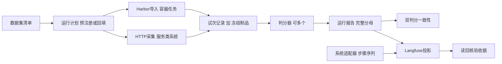

# ADR 0120 系统无关的评测平台核心

## 1. 背景

[ADR 0110](0110-evaluation-integrations.md)接通了Langfuse只读导出与Harbor协议适配，但实现位于产品包内，
报告合同把Harnessix专属字段（原生Turn、失败类别、协议完整性）与通用试次事实混在一起，
并依赖Harnessix的Suite合同、错误类型和价格表。评测平台需要被其他智能体系统复用，其中包括
常驻HTTP服务形态的系统：它们已有“冻结Gold、采集回答、冻结快照、评分”的流程，不适合按题启动容器。

## 2. 决策

1. 新增独立包`packages/evalkit`（发行名`harnessix-evalkit`，导入名`evalkit`），只依赖pydantic与httpx，
   禁止导入`harnessix`，由治理测试强制。它不进入产品wheel、锁文件和SBOM：仓库测试经pytest的
   `pythonpath`从源码导入，评测环境和其他系统单独安装或以`PYTHONPATH`引用。
2. Langfuse导出与Harbor导入整体迁出产品包。通用部分进入evalkit；Harnessix一侧的协议摘要解析器
   与Suite回填位于`integrations/harnessix_eval`，同样不进入产品wheel。产品CLI不再提供评测导出和
   Harbor导入命令，统一使用`python -m evalkit`。
3. 统一四个证据合同：数据集清单、运行计划、试次记录、运行报告。任何执行方式和判分器都只
   产出或消费这四个合同，平台的其余部分（判分汇总、可观测投影、读回核验）对被测系统无感知。
4. 运行计划区分预注册与事后回填。预注册计划的冻结时间必须早于全部试次的开始时间；
   由已有运行证据推出的计划标记为`backfilled`，记录源证据身份，Langfuse中同样标明，
   不能作为预注册证据引用。
5. 执行方式分两种，只负责产出试次和冻结制品，不判分：
   - Harbor：容器类任务，按计划槽位导入零自动重试的Job目录，智能体专属字段由按名称选择的解析器给出；
   - HTTP采集：服务类系统，逐条调用接口并冻结原始响应及清单（待实现）。
6. 判分器独立于执行。同一试次可有多个判分器，每个分数携带判分器身份；运行计划声明唯一主指标。
   双判分时生成一致性报告，逐个列出不一致的试次，不合并成一个数字。
7. 逐步记录由系统适配器提供中立的步骤序列（模型调用、工具调用、其他步骤，附用量），evalkit只负责
   编码与关联到试次；Langfuse仍是可重建的只读投影，本地证据保持权威。
8. 内容级别默认只导出元数据。导出提示词、工具输出和模型回复必须由运行计划显式声明，且只用于公开基准。
9. 其他系统的适配器和验收证据保存在该系统自己的仓库，本仓库只提交合成夹具。

## 3. 合同要点

| 合同 | 身份 | 关键约束 |
|---|---|---|
| 数据集清单 | 条目ID与条目摘要的有序列表的摘要 | 条目唯一；只存摘要和标签，正文另存 |
| 运行计划 | 计划全部字段的摘要 | 冻结数据集摘要、组别（系统、版本、配置摘要、执行方式）、重复次数、判分器、主指标、内容级别、来源 |
| 试次记录 | 计划摘要、条目、组别、重复序号 | 缺失或失败也占位；结果只有通过、失败、无效三类；用量和费用各自带完整性 |
| 运行报告 | 计划摘要加全部试次 | 汇总可由试次重算；分数只能来自计划内判分器；预注册计划早于全部试次 |

系统专属信息只放在试次记录的`executor_refs`和`system_refs`中，键为小写蛇形标识，值为受限字符串，
例如Harbor试次ID、Harnessix的Thread和Turn ID。冻结制品以证据库相对路径和摘要登记，判分时核对。

## 4. 与现有代码的关系

- ADR 0110中的OTLP编码、传输和读回迁入evalkit，原产品模块删除，不保留两套实现。
  读回按组别逐个核对实验，每个组别是一个Langfuse实验，同一条目的同一重复在组别间共享条目ID。
- `HarborEvalReport`的通用字段进入试次记录，原生Turn字段进入`system_refs`；
  原生归因规则（未完成却无智能体异常判为协议证据不完整）由Harnessix解析器保持。
- 现有Suite报告经回填生成运行报告，逐试次核对与原结论一致；Langfuse导出只保留evalkit一条路径。

## 5. 不做的事

- evalkit不实现模型循环、沙箱、审批或任务调度，Harbor和被测系统各自负责执行。
- 不补造缺失试次、未知用量或未知费用；不把不同判分器的结果合并成单一分数。
- HTTP采集不替被测系统做认证授权，凭据由运维提供且不进入报告。

## 6. 验证

- 治理测试：evalkit源码不导入`harnessix`，导入evalkit不会加载`harnessix`。
- 合同测试：分母完整、身份唯一、主指标存在、汇总可重算、预注册时间顺序。
- 执行与判分：Harbor导入的状态归因、身份绑定、零重试、制品摘要；双判分一致性逐项列出。
- 投影与读回：全部槽位、稳定身份、白名单字段、原币种、多实验读回与失败不重试。
- 通用性：一个服务类系统已冻结的Gold与回答快照导入为运行报告，经判分、Langfuse写入和读回核验；
  不调用该系统服务或云模型，验收在该系统仓库内完成。
- 回归：ADR 0110的五场景矩阵和Langfuse读回在新路径上重跑并另立证据。

## 7. 实施记录与验收（第3版，2026-11-07）

### 7.1 实施中补充的决策

- **逐步记录来源。** mini-swe-agent取轨迹；Harnessix取协议驱动导出的本Turn公开事件（作为试次制品登记摘要），
  不读会话库：会话库与发布密钥绑定，密钥目录要求属主一致，离开任务容器后无法验真。
  工具调用取tool_call与tool_result的完成时刻；模型调用结束于该步用量记录，开始取上一步工具结果完成时刻，
  与mini-swe-agent相邻消息窗口同一口径，验证测试确认这一窗口完整覆盖真实调用。
- **读回。** Langfuse v4只保留实验与v2 Observation接口；重发后在合并前会返回逐字相同的重复行，
  读回接受完全相同的重复，内容不同仍判失败。
- **Harbor SWE-bench离线条件。** 派生镜像只加入固定版本uv、包与Python下载镜像、托管Python和离线
  GitHub原始文件镜像的CA；原始文件镜像以每个试次网络内的服务别名提供。奖励判分要求判分报告与奖励一致。
- **任务版本。** E0c起任务锁定harbor-datasets 37db1088：其判分只删除测试补丁涉及的未跟踪文件，
  保留智能体新增的源文件（86723674执行`git clean -fd`）。新旧版本之间以Oracle复核衔接。
- **Harnessix组别。** 任务容器即隔离边界，产品使用外部边界原生命令Profile（[ADR 0121](0121-external-boundary-native-process-profile.md)），
  安装包与配置模板按内容摘要计入组别配置摘要。
- **工作区权限规整（用户决定，2026-11-07）。** 适配器显式开启`normalize_workspace_modes`时，在Harnessix启动前把
  任务工作区内普通文件的权限按Git规则规整：属主可执行的设为0755，其余设为0644；不进入`.git`、不跟随符号链接、不改内容。
  Git只按属主可执行位区分100644与100755，规整后Git、导出补丁和两种判分都看不到变化；一期旧运行器准备工作区时做同样处理。
  这是评测侧的临时措施：产品补丁目前只能修改0644/0755文件，正式放开另行实施（需新增事务合同版本，Git交付旧合同保持不变）。

### 7.2 验收结果

| 项 | 证据（247 `/data/harnessix/harbor/runs/`） | 结果 |
|---|---|---|
| Langfuse重启存续 | `/data/harnessix/langfuse/acceptance/` | 停启与销毁重建后读回一致 |
| 五场景矩阵（集成代码e42e3750） | `matrix-e42e3750` | 5个场景断言通过；任务通过1/5；10个容器均为none网络；付费调用0；重发后读回摘要一致 |
| E0a环境对照 | `e0a-b0c7606b` | Oracle 5/5、Nop 0/5；官方与奖励判分10/10一致；读回2个实验、10个试次、70个分数 |
| E0b mini-swe-agent | `e0b-4b4e23d4` | 3/5；双判分5/5一致；逐步记录573步读回 |
| 服务类系统通用性 | 在该系统仓库内验收 | 合成集9题4题通过（与其原指标一致）；云端集通过1、失败1、无效1；读回通过 |
| 全量回归 | 分支e42e3750对基线f36d87f8 | 新增失败仅为两个需在普通终端运行的本机回环测试，其余失败集合与基线相同 |
| E0c Harnessix（外部边界Profile，代码3340926f） | `e0c-3340926f`（`e0c-bbafb003`已作废，见DEVIATIONS） | Oracle 5/5；Harnessix官方判分解决2/5（django-10880、sympy-11618），主指标1/5（10880以预算耗尽结束，按规则记失败）；官方与奖励判分10/10一致；逐步记录5条；读回2个实验、10个试次、70个分数、742步 |
| E0c后修复回归 | 0d0762e4对3340926f，delivery、trusted_actions、product_config、evalkit、integrations | 失败集合相同，新增4个通过（即新增用例） |
| 本机回环测试 | 普通终端，代码c1498c0d | Langfuse联网导出与模型端口转发两个回环测试2/2通过 |

### 7.3 发现与待决事项

- **服务方故障归类（已决定）。** 一次请求的用量不完整时，产品拒绝再发付费请求，原先以`budget_exceeded`结束，
  服务方503因此呈现为预算类故障。用户决定停止规则不变、原因如实标注，评测记为基础设施失败，
  见[ADR 0123](0123-provider-service-failure-attribution.md)；矩阵预期随之更新。
- **本机回环测试。** 会话沙箱内回环HTTP返回EPERM，两个回环测试改在普通终端运行，2026-11-07通过。
- **任务镜像文件权限（E0c发现，已修复）。** django-11133、sympy-13031镜像内全部`.py`为0777，
  Workspace Patch只支持0644/0755。审批预览阶段把这一确定性拒绝误记为未知效果，中断整轮，两题因此为空补丁。
  ca51bd75起改为可修正的失败结果；在原任务容器内重放当时的调用，Turn正常结束且工作区不变。
  用户决定：评测侧先按7.1节规整权限，产品层面修改已有文件时保留原权限另行实施。
- **数值评分读回（E0c发现，已修复）。** Langfuse按双精度存取，36.345758读回为36.345758000000004，
  严格相等核对误判不符。0d0762e4起数值评分按相对误差1e-9比较；E0c以修正后的代码对已发送数据只读核验，未重发。
- **主指标与官方解决数。** 系统未正常结束的试次即使补丁通过官方判分也记失败（django-10880），
  因此E0c主指标1/5低于官方解决数2/5；两个数在报告中都保留。

