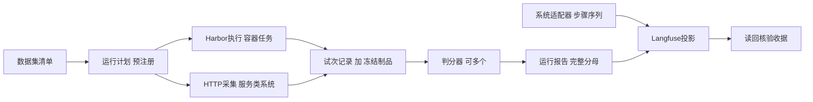

# ADR 0120 系统无关的评测平台核心

## 1. 背景

[ADR 0110](0110-evaluation-integrations.md)接通了Langfuse只读导出与Harbor协议适配，但报告合同把
Harnessix专属字段（原生Turn、失败类别、协议完整性）与通用试次事实混在一起，并依赖Harnessix的
Suite合同、错误类型和价格表。评测平台需要被其他智能体系统复用，首个候选是TTPs Agentic GraphRAG：
它是常驻HTTP服务（PostgreSQL、Neo4j、LangGraph），已有“冻结Gold、采集回答、冻结快照、评分”的流程，
不适合按题启动容器。

## 2. 决策

1. 新增独立包`packages/evalkit`（发行名`harnessix-evalkit`，导入名`evalkit`），只依赖pydantic与httpx，
   禁止导入`harnessix`，由治理测试强制。它不进入产品wheel、锁文件和SBOM：仓库测试经pytest的
   `pythonpath`从源码导入，评测环境和其他系统单独安装`packages/evalkit`。
2. 统一四个证据合同：数据集清单、运行计划（预注册）、试次记录、运行报告。任何执行方式和判分器都只
   产出或消费这四个合同，平台的其余部分（判分汇总、可观测投影、读回核验）对被测系统无感知。
3. 执行方式分两种，只负责产出试次和冻结制品，不判分：
   - Harbor：容器类任务，导入Harbor Job目录；
   - HTTP采集：服务类系统，逐条调用接口并冻结原始响应及清单。
4. 判分器独立于执行。同一试次可有多个判分器，每个分数携带判分器身份；运行计划声明唯一主指标。
   双判分时生成一致性报告，逐个列出不一致的试次，不合并成一个数字。
5. 逐步记录由系统适配器提供中立的步骤序列（模型调用、工具调用、其他步骤，附用量），evalkit只负责
   编码与关联到试次；Langfuse仍是可重建的只读投影，本地证据保持权威。
6. 内容级别默认只导出元数据。导出提示词、工具输出和模型回复必须由运行计划显式声明，且只用于公开基准。
7. 系统适配器留在系统一侧：Harnessix的Harbor智能体、状态库到步骤序列的导出、官方SWE-bench判分和
   一阶段运行目录导入留在本仓库；TTPs适配器先放在`integrations/ttps_graphrag`做通用性验证，
   之后可迁回TTPs仓库。

## 3. 合同要点

| 合同 | 身份 | 关键约束 |
|---|---|---|
| 数据集清单 | 条目ID与条目摘要的有序列表的摘要 | 条目唯一；只存摘要和标签，正文另存 |
| 运行计划 | 计划全部字段的摘要 | 冻结数据集摘要、组别（系统、版本、配置摘要）、重复次数、判分器、主指标、内容级别 |
| 试次记录 | 计划摘要、条目、组别、重复序号 | 缺失或失败也占位；结果只有通过、失败、无效三类；用量和费用各自带完整性 |
| 运行报告 | 计划摘要加全部试次 | 汇总可由试次重算；按组别给出完整分母；主指标必须有分数 |

系统专属信息只放在试次记录的`system_refs`中，键和值都是受限字符串，例如Harnessix的Thread和Turn ID。

## 4. 与现有代码的关系

- ADR 0110中与系统无关的OTLP编码、传输和读回迁入evalkit，原模块改为复用，不保留两套实现。
- `HarborEvalReport`的通用字段进入试次记录，原生Turn字段进入`system_refs`；Harbor导入按智能体名称
  选择结果解析器，Harnessix解析器留在本仓库。
- 现有Suite报告经转换器生成运行报告，Langfuse导出只保留evalkit一条路径。

## 5. 不做的事

- evalkit不实现模型循环、沙箱、审批或任务调度，Harbor和被测系统各自负责执行。
- 不补造缺失试次、未知用量或未知费用；不把不同判分器的结果合并成单一分数。
- HTTP采集不替被测系统做认证授权，凭据由运维提供且不进入报告。

## 6. 验证

- 治理测试：evalkit源码不导入`harnessix`。
- 合同测试：分母完整、身份唯一、主指标存在、汇总可重算。
- 通用性：TTPs已冻结的Gold与回答快照导入为运行报告，经判分、Langfuse写入和读回核验；
  本验证不调用TTPs服务或云模型，实时HTTP采集另行验收。
- 回归：ADR 0110的五场景矩阵和Langfuse读回在新路径上重跑。
