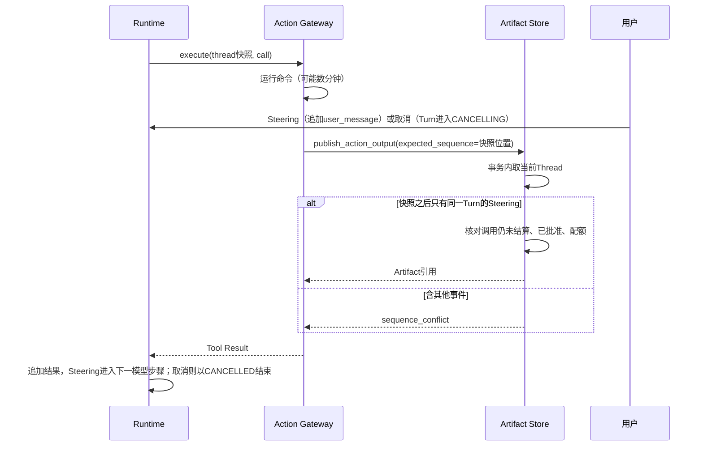

# 0.10.0b12 Beta反馈的产品修复

## 1. 文档摘要

2026-11-11两轮Beta使用（macOS、PyPI `0.10.0b12`、百炼`qwen3.8-flash`、真实终端界面，共8个任务）报告了20条问题。
本文记录其中由本分支修复的条目，每条都先用事件库和源码核实根因，再以回归测试复现后修复：

| 编号 | 用户看到的现象 | 根因所在 |
|---|---|---|
| HX-01 | 命令运行或补丁准备期间按Ctrl+S补充要求，本轮以`sequence_conflict`失败或以`uncertain_effect`中断 | Action Artifact发布要求Thread Sequence逐一相等 |
| HX-10 | 按Ctrl+X取消运行中的命令，显示“已中断”“操作结果无法确认”和`trusted_action_output_failed` | 命令输出发布沿用执行准入，取消收尾时被拒绝 |
| HX-03 | 百炼qwen3.8配置`--thinking off`后模型仍然思考 | 该模型族没有思考协议，设置被写入却从未发送 |

补丁工具与读取工具相关的条目（换行不一致的文件无法多行编辑、新建文件时父目录不存在、批次失败反馈、参数宽容度、
读取分页）按用户决定由另一条开发线承接，不在本文范围内。

## 2. 需求背景

- 用户对商业化的最低要求是易用、稳定、基本功能可用；新用户遇到的阻力按缺陷处理。
- HX-01：补充要求是界面的主要交互之一。事件库显示命令在15:57:51.6开始执行，用户消息在.761写入，命令成功结束后
  输出发布在.941失败，整轮随之失败。命令本身退出码为0。
- HX-10：用户在测试命令无输出2分55秒后取消。取消0.2秒内生效，进程已终止，但本轮状态是`interrupted`而不是
  `cancelled`，下一轮模型看到的是一条没有正文的内部错误。
- HX-03：测试者执行`configure --vendor bailian --model qwen3.8-flash --thinking off`，生成的配置含`thinking: off`，
  首次请求返回的4096个输出Token全部是思考内容，68秒后以输出长度上限结束，没有生成任何文件。

## 3. 设计目标与非目标

目标：

- 用户在工具规划与执行期间的补充和取消，不把已知结果变成失败或未知。
- 用户显式给出的思考设置要么生效，要么在配置阶段被明确拒绝，不生成一份设置不生效的配置。
- 不放宽任何执行准入、审批或授权条件；默认配置的行为、序列化与摘要不变。

非目标：不改变Steering的时序语义（仍在当前Tool Result之后进入下一模型步骤）；不改变百炼qwen3.8在未指定
`--thinking`时的默认行为；不处理第1节所列由另一条开发线承接的条目。

## 4. 总体架构

三处修复互相独立，都落在既有模块边界内，没有新增包依赖边：

| 修复 | 模块 | 变化 |
|---|---|---|
| HX-01 | `artifacts` | 新增[`action_publication_snapshot`](../../src/harnessix/artifacts/action_publication_snapshot.py)，由Action Review与Action Output两处发布共用 |
| HX-10 | `artifacts` | [`publish_action_output`](../../src/harnessix/artifacts/action_output_store.py)的调用归属核对改用已有的宿主核对作用域[`inspection_scope`](../../src/harnessix/agent/patching.py) |
| HX-03 | `product_config`、`product_ui` | 新增[`explicit_thinking_switch`](../../src/harnessix/product_config/wizard.py)；[`configure_cli`](../../src/harnessix/product_ui/configure_cli.py)在显式`--thinking`时使用它，无开关可用时拒绝 |

## 5. 接口设计与数据结构

- `action_publication_snapshot(session, database, thread_id, turn_id, expected_sequence, *, subject) -> Thread`：
  在调用方已开启的发布事务内返回当前Thread。`expected_sequence`之后的事件必须全部是同一Turn的`user_message`
  Item事件，否则抛出`sequence_conflict`。
- `publish_action_review`与`publish_action_output`的签名不变；`expected_sequence`的含义由“必须相等”变为
  “调用方观察到的位置，其后只允许Steering”。
- `explicit_thinking_switch(base_url, model) -> ThinkingProtocol | None`：返回用户显式指定思考档位时应启用的协议。
- 命令行：`harnessix code configure`的参数集合不变。`--thinking`在没有协议可用时由接受变为拒绝（退出码2，
  错误码沿用`product_configure_invalid`）。
- 领域契约与数据结构：Agent Event、Thread投影、产品配置Schema、`spec/`均无变化。

## 6. 流程与数据流

HX-01与HX-10的发布流程：

HX-03的配置流程：`--thinking-protocol auto`时先取默认预设；没有预设且用户写了`--thinking`时查显式开关；
仍然没有则拒绝。运行时由既有的`default_provider_factory`把协议和档位换算为请求里的`enable_thinking`。

## 7. 失败、恢复、取消与超时

- Steering以外的Session变化、Sequence回退：仍为`sequence_conflict`，发布事务回滚，行为与此前一致。
- 提交确认丢失：两处发布的“按原身份查询已有记录”分支不变。
- 取消：进程终止并对账后，Tool Result为`failed`/`process_cancelled`并保留取消前的输出，Turn为`cancelled`。
  对账本身失败时仍按原逻辑记为`unknown`并以`uncertain_effect`中断，这一保护没有削弱。
- 超时：Turn超时等其他收尾路径此前就在`EXECUTING_TOOLS`下发布，不受影响。

## 8. 持久化与数据流程

不新增表、列或迁移，不改变事件与Artifact的存储格式。事务边界不变：快照读取、事件核对、配额检查与Artifact插入
仍在同一个`BEGIN IMMEDIATE`事务内，核对用的事件由同一连接读取，持有写锁期间不会有新的提交插入。

## 9. 安全与信任边界

- HX-01没有放宽授权：调用归属（`for_pending_call`）、审批匹配与配额仍在事务内的当前Thread上核对；
  被容忍的只有同一Turn的用户输入事件，其余任何事件照旧拒绝。
- HX-10把命令输出发布的归属核对从执行准入换成宿主核对作用域。发布输出是结算已经执行过的Process，不授予执行
  许可；调用是否已批准、Plan是否匹配仍由`_require_approved_process_output`核对，未批准的调用不能发布。
  执行准入`for_pending_call`本身未改动，其余调用方不受影响。
- HX-03只影响发给模型服务的思考参数，不涉及密钥、工作区或权限。

## 10. 可观测与错误分类

不新增错误码。变化的是出现的场合：

| 场景 | 此前 | 现在 |
|---|---|---|
| 工具执行期间Steering | Turn `failed`/`sequence_conflict`，或`interrupted`/`uncertain_effect` | Turn继续 |
| 取消运行中的命令 | Tool Result `unknown`/`trusted_action_output_failed`，Turn `interrupted` | Tool Result `failed`/`process_cancelled`，Turn `cancelled` |
| 无开关可用时写`--thinking` | `off`被静默接受，其余档位报“配置向导参数不符合契约” | `product_configure_invalid`，消息给出三条出路 |

## 11. 部署、兼容与回退

- 已有配置文件、会话数据与事件日志无需迁移；未写`--thinking`的百炼qwen3.8配置行为不变。
- 兼容性变化只有一处：脚本里对没有已核对开关的服务传`--thinking`会从成功变为退出码2。按提示加
  `--thinking-protocol none`或去掉该参数即可。
- 回退：三处修复各自一个提交，可分别`git revert`，无数据迁移。
- 可读性预算（ADR 0076）：策略文件未改动，只重新生成了最终报告。`publish_action_review`保持在100行以内。

## 12. 限制、风险与取舍

- 取舍：HX-01选择“只容忍Steering”而不是“只要调用仍未结算就接受任何Session推进”。后者实现更短，但会让将来
  新增的并发写入者被默认放行；前者让不认识的事件继续按冲突拒绝。
- 取舍：HX-03对无开关的服务选择拒绝而不是保存后提示。配置命令失败的成本很低，而一份写着关闭却不生效的配置
  要到运行时才暴露，首轮Beta正是这样浪费了一轮。
- 限制：显式开关只列入已核对的型号前缀。百炼新增可关闭思考的型号时需要补充；`qwen3.8-max`依据官方文档，
  `qwen3.8-flash`另有Beta第二轮的实际运行佐证（关闭后思考Token为0）。
- 风险：真实终端界面下的端到端复验（命令执行期间补充、取消长时间运行的命令）尚未在三个平台执行，随下一次
  发布前的正式测试完成。

## 13. 验证

- [`test_action_user_interruptions.py`](../../tests/product_config/test_action_user_interruptions.py)，使用真实的产品
  动作装配、Session与Artifact存储，只把进程替换为可暂停的替身：
  - 命令运行期间Steering：Turn完成，输出可读，补充输入进入第二次模型请求；
  - 补丁规划期间Steering：审批材料照常发布，批准后补丁生效；同一测试内的负控确认非Steering事件仍得到
    `sequence_conflict`；
  - 取消运行中的命令：Turn为`cancelled`，Tool Result为`process_cancelled`并保留取消前的输出。
  三项测试在修复前分别以`sequence_conflict`、`uncertain_effect`和`interrupted`失败。
- [`test_thinking_config.py`](../../tests/product_config/test_thinking_config.py)：显式开关只覆盖已核对型号；
  百炼qwen3.8-flash的`off`与`every_step`都换算为请求里的显式`enable_thinking`；未写`--thinking`时仍不发送；
  无开关可用时拒绝且不写文件；`--thinking-protocol none`加`off`照常接受。
- 用测试者的原命令在真实命令行入口复验：生成的配置含`dashscope_enable_thinking`与`thinking: off`。
- 回归：`tests/artifacts`、`tests/trusted_actions`、`tests/agent`、`tests/delivery`与整个`tests/product_config`
  在基线`dad55d32`与修复后的失败集合逐项相同，没有新增失败。剩余失败均为本机环境问题（Apple Git 2.24不支持
  `--object-format`、沙箱禁止本地Socket）。Ruff、Mypy、文档门禁与可读性策略检查通过。

## 14. 源码与测试映射

| 内容 | 位置 |
|---|---|
| Action发布时的Session快照核对 | [`action_publication_snapshot.py`](../../src/harnessix/artifacts/action_publication_snapshot.py) |
| 命令输出发布 | [`action_output_store.py`](../../src/harnessix/artifacts/action_output_store.py) |
| 审批材料发布 | [`action_review_store.py`](../../src/harnessix/artifacts/action_review_store.py) |
| 宿主核对作用域 | [`patching.py`](../../src/harnessix/agent/patching.py) |
| 显式思考开关 | [`wizard.py`](../../src/harnessix/product_config/wizard.py) |
| 配置命令 | [`configure_cli.py`](../../src/harnessix/product_ui/configure_cli.py) |
| 用户介入回归 | [`test_action_user_interruptions.py`](../../tests/product_config/test_action_user_interruptions.py) |
| 思考配置回归 | [`test_thinking_config.py`](../../tests/product_config/test_thinking_config.py) |
| 模块设计 | [Artifact](../modules/artifacts.md)、[产品配置](../modules/product-config.md)、[产品界面](../modules/product-ui.md) |
