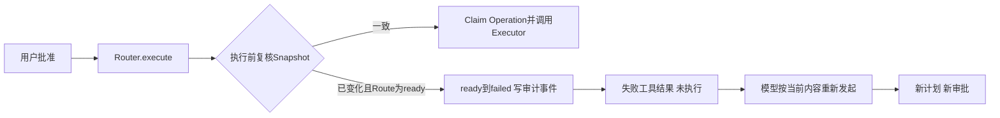

# Beta反馈（0.10.0b20真实仓复测）改进设计

## 1. 文档摘要

本文记录0.10.0b20真实仓库复测（2026-11-12）确认的问题中由Beta改进会话负责的部分。本版包含第一项：
批准后、执行前工作区发生变化时，操作不再被报告为“结果未知”并中断整轮，而是以确定的失败结束，本轮继续
（Beta编号B20-02，[ADR 0142](../adr/0142-stale-approved-plan-fails-without-effect.md)）。

后续批次（收窄目录绑定、交互模式下服务方故障后的自动重试、大仓全仓搜索）落地时在本文追加。

## 2. 需求背景

复测报告的最高优先级问题：vLLM仓库（6,682个文件）中，用户批准新建测试文件的修改后，界面显示“审批：已批准”，
随即整轮以`uncertain_effect`中断；核心改动还在，获批的文件没有写入，用户要手工核对工作区再续做。

确认过程：

- 会话事件：审批请求12:20:49发出，12:22:40批准，34毫秒后出现`uncertain_effect`
  “触发原因：execution_plan_stale”，没有任何写入。
- 审批期间（约111秒）同一工作区根目录多了一个与本次修改无关的日志文件。
- 在0.10.0b20的真实终端界面复现：让模型新建`notes/hello.txt`，审批窗口打开时在根目录放一个无关文件，批准后
  显示“已中断”，文件没有写入。把修改换成一条命令（`sleep 2 && echo …`）结果相同。
- 确定性探针：对“新建`tests/tools/test_x.py`”绑定的资源捕获Snapshot后，在根目录或`tests/`下新建任意文件，
  复核即报`execution_plan_stale`。

因此这不是并发测试才有的偶发现象：审批期间工作目录或目标上级目录里出现任何文件都会触发。

## 3. 设计目标与非目标

目标：

- 批准后确定没有执行的操作如实报告为“未执行、无改动”，本轮继续；
- 不放宽“旧批准只对批准时的事实有效”这条约束；
- 补丁、命令及其他经Router执行的操作行为一致。

非目标：

- 不在本版收窄Snapshot的绑定范围（无关文件仍会使计划过期，另见ADR 0143的后续批次）；
- 不改变进入Executor之后的未知效果处理；
- 不提供“自动按当前内容重做并沿用旧批准”。

## 4. 总体架构

改动只在Trusted Action Router的执行入口及其结果投影：

Agent Runtime、Session事件类型、Workspace Snapshot和各Executor都没有改动。

## 5. 接口设计与数据结构

- `trusted_actions/contracts.py`：`ALLOWED_ROUTE_TRANSITIONS["ready"]`由`{running}`变为`{running, failed}`；
  新常量`STALE_PLAN_CODE = "execution_plan_stale"`。
- `trusted_actions/operation_router.py`：`execute_action`捕获执行前复核抛出的`KernelError`，交给
  `_reject_stale_plan(router, plan_id, error)`；后者只在错误码是`STALE_PLAN_CODE`且Route为`ready`时迁移并返回
  `ActionExecutionOutcome(kind="failed", error_code=STALE_PLAN_CODE)`，否则返回`None`，原异常继续抛出。
- `trusted_actions/public_outcomes.py`：`STALE_PLAN_CODE`登记为公共失败码，避免被归一为`action_failed`。
- `trusted_actions/agent_gateway_output.py`：`build_result`按错误码选择固定说明（`_FAILURE_MESSAGES`）；未登记的
  失败码沿用原通用说明。

审计事件、工具结果和公开协议的字段都没有变化；只是出现了新的状态迁移和一个此前不会出现在工具结果里的错误码。

## 6. 流程与数据流

1. 模型发起写操作，Router规划并冻结Snapshot，进入`pending_approval`。
2. 用户批准，Route进入`ready`。
3. `execute`复核Snapshot。事实未变：Claim Operation，`ready → running`，调用Executor（原流程）。
4. 事实已变且Route为`ready`：一次CAS把Route迁到`failed`，审计事件记录`error_code=execution_plan_stale`；
   不创建Operation，不调用Executor。
5. Gateway生成失败的工具结果（`outcome=failed`、`trusted_action.state=failed`、固定说明），写入Session。
6. 模型在下一步看到失败原因，重新读取并重新发起；新的调用得到新的计划和新的审批请求。

## 7. 失败、恢复、取消与超时

- 复核失败但Route不是`ready`（尚未批准、执行中、已是终态）：原异常照旧抛出，行为不变。
- CAS迁移时Route被并发改变：`action_route_conflict`照旧抛出，不吞掉。
- 迁移完成后进程退出：恢复时Route已是`failed`终态，Gateway的恢复路径按原逻辑重新投影同一条失败结果，不会执行。
- 迁移之前进程退出：Route仍是`ready`，恢复路径不启动效果（原逻辑），Turn按原规则终结。
- 取消与超时路径没有改动。

## 8. 持久化与数据流程

- Action审计库多出一种事件序列：`… → ready → failed`（没有对应的Operation行）。
- Workspace事务库中该计划的事务保持`prepared`，不会被发布；沿用原有的保留与清理规则。
- 没有Schema变更，没有迁移脚本。

## 9. 安全与信任边界

- 旧批准只能用于批准时冻结的事实：过期计划成为终态，不能再执行，也不会在工作区恢复旧状态后悄悄生效。
- 不在执行阶段刷新Snapshot，新的事实必须经过新的规划和审批。
- 说明文本是固定常量，由错误码选择，不含路径、参数或异常正文。
- “没有效果”的结论有依据：Route为`ready`意味着从未Claim过执行，Executor没有被调用。

## 10. 可观测与错误分类

- 审计事件`error_code=execution_plan_stale`、`from_state=ready`可直接统计这类失败的次数。
- 工具结果错误码`execution_plan_stale`，类别为普通失败；Turn不再因此出现`uncertain_effect`。
- 界面显示为该操作的失败行，带固定说明。

## 11. 部署、兼容与回退

- 升级后已有会话不受影响；升级前已批准但未执行的计划，在工作区变化后同样按新规则以失败结束。
- 回退到旧版本：旧版本不会产生`ready → failed`；读取含这条迁移的审计链不受影响（迁移合法性只在写入时检查）。
- 三个平台行为一致，没有平台相关代码。

## 12. 限制、风险与取舍

- 无关文件仍会使计划过期（绑定范围未变），用户会多批准一次；有程序持续向工作目录写文件时可能反复出现。
  这是本批次有意留下的，由收窄绑定的后续批次解决。
- 模型可能不重新发起而是先做别的检查，这由模型决定；真实运行中两个场景都在同一轮内重新发起并完成。
- 进入Executor之后才发现的变化（复核与发布之间的极短窗口）仍按写类操作的保守规则记为未知，再由对账确认未执行。

## 13. 验证

- 单元与集成测试：Router（过期计划返回确定失败、不调用Executor、不创建Operation、旧计划不可再执行、重新规划后
  正常执行）；补丁Executor；产品组合下的两条端到端用例（目标被外部改写；根目录出现无关文件后模型重新提交并在
  第二次审批后发布）；SDK路径两条既有用例改为断言新行为。
- 全量测试与0.10.0b20基线逐项对比：除上述改动的用例和可读性基线外没有差异。
- 真实终端界面（百炼qwen3.8-flash）：补丁审批、命令审批两个场景，0.10.0b20均为“已中断”；修复后均为“已完成”，
  失败行显示固定说明，第二次审批后操作执行。

## 14. 源码与测试映射

| 内容 | 源码 | 测试 |
|---|---|---|
| 状态迁移与错误码常量 | `src/harnessix/trusted_actions/contracts.py` | `tests/trusted_actions/test_router.py` |
| 执行前过期的确定失败 | `src/harnessix/trusted_actions/operation_router.py` | `tests/trusted_actions/test_router.py`、`tests/delivery/test_trusted_action_patch.py` |
| 失败码登记与说明 | `src/harnessix/trusted_actions/public_outcomes.py`、`agent_gateway_output.py` | `tests/product_config/test_stale_approved_plan.py` |
| 产品端到端 | — | `tests/product_config/test_stale_approved_plan.py`、`test_parent_closure_product_sdk.py`、`test_server_and_cli.py` |
