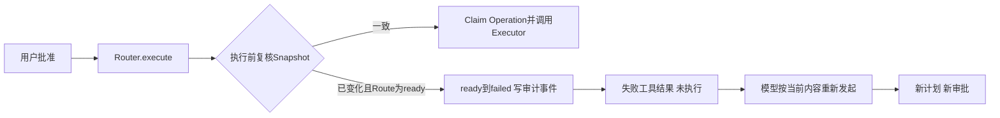
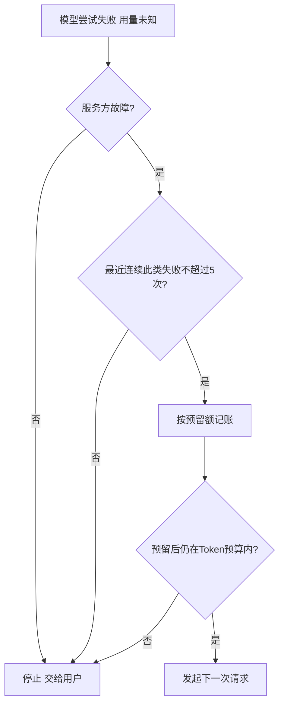
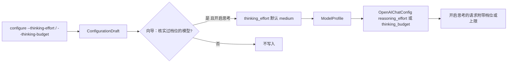

# Beta反馈（0.10.0b20真实仓复测）改进设计

## 1. 文档摘要

本文记录0.10.0b20真实仓库复测（2026-11-12）确认的问题中由Beta改进会话负责的部分：

| 项 | 用户看到的现象 | 处理 | 决策记录 |
|---|---|---|---|
| 一 | 批准后整轮中断，显示“存在未知效果”，获批操作没有执行（B20-02） | 过期计划以确定的失败结束，本轮继续 | [ADR 0142](../adr/0142-stale-approved-plan-fails-without-effect.md) |
| 二 | 一次流式中断结束了进行到第57次请求的任务，要手动“继续” | 付费交互模式下服务方故障连续至多自动重试5次 | [ADR 0144](../adr/0144-automatic-retry-after-service-failures-in-interactive-mode.md) |
| 三 | 大仓库在根目录搜索5秒后超时，没有任何结果（B20-05） | 搜索提速约3.5倍，整仓上限放宽到四倍 | [ADR 0145](../adr/0145-whole-repository-search-on-large-repositories.md) |
| 四 | 产品负责人试用：第一步思考十分钟，任务两小时没有做完 | 思考强度档位，核实过的模型默认中档 | [ADR 0146](../adr/0146-thinking-intensity-tiers.md) |
| 五 | 模型只说了接下来要做什么就显示“已完成” | 交互模式提示它继续；宿主说明显示为“提示” | [ADR 0147](../adr/0147-interactive-prompt-for-announced-steps.md) |
| 六 | 任务在第60分钟被判为“未完成”，等待审批的时间也算在内；任务做完了模型还在追加工作，只能取消 | 实际运行每满60分钟询问一次，等待审批不计；`Ctrl+F`一键收尾 | [ADR 0148](../adr/0148-interactive-run-time-checkpoint-and-wrap-up.md) |
| 七 | 任务早已做完，模型又自己验证、修改了一个多小时 | 本机模式的模型指令加入完成规则：做完就结束，已有检查只验证一次，无法验证的写进最终回答 | [ADR 0149](../adr/0149-completion-rule-in-native-instructions.md) |
| 八 | 审批期间工作区里多出无关文件，批准后操作没有执行，要重新发起、再批准一次 | 计划对目录只绑定对象与权限，不绑定有哪些成员 | [ADR 0143](../adr/0143-plans-bind-directories-without-their-members.md) |
| 九 | 一次模型请求持续几分钟，界面只有静止的“思考中”，Token与费用不变，看起来像卡死 | 请求进行中显示生成阶段与估算的Token、费用 | [ADR 0156](../adr/0156-generation-progress-and-live-usage-estimate.md) |
| 十 | `harnessix exec`的过程文本里，思考内容没有标注，还和下一行接在一起 | 思考的每一行以“思考：”开头，其后的输出另起一行 | 本文第24节 |
| 十一 | 先用`harnessix exec`、后运行`harnessix code configure`，被以“配置目录的权限是 755”拒绝 | 产品自己创建的状态目录每一级都按0700创建 | 本文第25节 |
| 十二 | 百炼返回没有名称的工具调用，整轮任务中断，要手动“继续”（0.10.0b24，Issue #1） | 只拒绝这一次调用，模型改正后任务继续 | [ADR 0157](../adr/0157-nameless-tool-calls-are-rejected-individually.md) |
| 十三 | 上下文耗尽后任务中断，界面只有一行内部报错，没有恢复办法（0.10.0b24，Issue #3） | 对话与F1说明怎样接着做；耗尽本身的根因归上下文预算的工作 | 本文第27节 |
| 十四 | `--service-failure-retries 2`之后，连续HTTP 503仍发出6次请求（0.10.0b24，Issue #2） | 配置了它时，一次请求最多尝试N+1次 | [ADR 0144](../adr/0144-automatic-retry-after-service-failures-in-interactive-mode.md)第2版 |
| 十五 | 模型迟迟不返回首帧、或读超时后重试的几分钟里，界面一直是“思考中”（0.10.0b25，Issue #7、#11） | 显示“等待模型服务响应 · 已等待 N 秒” | 本文第29节 |
| 十六 | 新会话续做约10分钟后以`context_artifact_timeout`中断，没有恢复办法（0.10.0b24，Issue #8） | 补恢复说明；正文只完整核对一次 | 本文第30节、[ADR 0158](../adr/0158-history-artifact-bodies-verified-once-per-store.md) |
| 十七 | 退出终端界面时偶尔打印一段`IndexError`报错堆栈（0.10.0b23起） | 界面全部关闭后，运行时间检查点的定时器直接跳过 | 本文第31节 |
| 十八 | 重试期间看不出第几次尝试、为什么还在等（0.10.0b25，Issue #11） | 运行提示说明尝试序号与上次失败原因 | 本文第32节 |
| 十九 | 百炼北京的业务空间专属域名显示“费用未知”（0.10.0b25，Issue #6） | 与共享域名按同一套表核对 | 本文第33节 |
| 二十 | “已完成”，但总结声称的测试并没有在修复之后运行（0.10.0b25，Issue #9） | 对话末尾如实提示修改之后没有检查 | 本文第34节 |
| 二十一 | Windows上命令的真实退出码2被记成1（0.10.0b25，Issue #12） | PowerShell命令后补一段带出原生退出码 | 本文第35节 |
| 二十二 | 命令失败行不显示已记录的退出码（0.10.0b25，Issue #13） | 写成“失败（退出码 N）” | 本文第36节 |
| 二十三 | 对话区不能用鼠标选中复制（负责人2026-11-13反馈） | 对话历史区支持拖选与Ctrl+C复制 | 本文第37节 |

第1～14节描述第一项；第二至五项的设计分别集中在第15～18节，第19节是第四、五项的真实模型验证，
第六、七项在第20、21节，第八项在第22节，第九项在第23节，第十、十一项在第24、25节，第十二至二十三项在第26～37节。

## 2. 需求背景

复测报告的最高优先级问题：vLLM仓库（6,682个文件）中，用户批准新建测试文件的修改后，界面显示“审批：已批准”，
随即整轮以`uncertain_effect`中断；核心改动还在，获批的文件没有写入，用户要手工核对工作区再续做。

确认过程：

- 会话事件：审批请求12:20:49发出，12:22:40批准，34毫秒后出现`uncertain_effect`
  “触发原因：execution_plan_stale”，没有任何写入。
- 审批期间（约111秒）同一工作区根目录多了一个与本次修改无关的日志文件。
- 在0.10.0b20的真实终端界面复现：让模型新建`notes/hello.txt`，审批窗口打开时在根目录放一个无关文件，批准后
  显示“已中断”，文件没有写入。把修改换成一条命令（`sleep 2 && echo …`）结果相同。
- 确定性探针：对“新建`tests/tools/test_x.py`”绑定的资源捕获Snapshot后，在根目录或`tests/`下新建任意文件，
  复核即报`execution_plan_stale`。

因此这不是并发测试才有的偶发现象：审批期间工作目录或目标上级目录里出现任何文件都会触发。

## 3. 设计目标与非目标

目标：

- 批准后确定没有执行的操作如实报告为“未执行、无改动”，本轮继续；
- 不放宽“旧批准只对批准时的事实有效”这条约束；
- 补丁、命令及其他经Router执行的操作行为一致。

非目标：

- 不在本版收窄Snapshot的绑定范围（无关文件仍会使计划过期；已由第22节的后续批次解决，ADR 0143）；
- 不改变进入Executor之后的未知效果处理；
- 不提供“自动按当前内容重做并沿用旧批准”。

## 4. 总体架构

改动只在Trusted Action Router的执行入口及其结果投影：



Agent Runtime、Session事件类型、Workspace Snapshot和各Executor都没有改动。

## 5. 接口设计与数据结构

- `trusted_actions/contracts.py`：`ALLOWED_ROUTE_TRANSITIONS["ready"]`由`{running}`变为`{running, failed}`；
  新常量`STALE_PLAN_CODE = "execution_plan_stale"`。
- `trusted_actions/operation_router.py`：`execute_action`捕获执行前复核抛出的`KernelError`，交给
  `_reject_stale_plan(router, plan_id, error)`；后者只在错误码是`STALE_PLAN_CODE`且Route为`ready`时迁移并返回
  `ActionExecutionOutcome(kind="failed", error_code=STALE_PLAN_CODE)`，否则返回`None`，原异常继续抛出。
- `trusted_actions/public_outcomes.py`：`STALE_PLAN_CODE`登记为公共失败码，避免被归一为`action_failed`。
- `trusted_actions/agent_gateway_output.py`：`build_result`按错误码选择固定说明（`_FAILURE_MESSAGES`）；未登记的
  失败码沿用原通用说明。

审计事件、工具结果和公开协议的字段都没有变化；只是出现了新的状态迁移和一个此前不会出现在工具结果里的错误码。

## 6. 流程与数据流

1. 模型发起写操作，Router规划并冻结Snapshot，进入`pending_approval`。
2. 用户批准，Route进入`ready`。
3. `execute`复核Snapshot。事实未变：Claim Operation，`ready → running`，调用Executor（原流程）。
4. 事实已变且Route为`ready`：一次CAS把Route迁到`failed`，审计事件记录`error_code=execution_plan_stale`；
   不创建Operation，不调用Executor。
5. Gateway生成失败的工具结果（`outcome=failed`、`trusted_action.state=failed`、固定说明），写入Session。
6. 模型在下一步看到失败原因，重新读取并重新发起；新的调用得到新的计划和新的审批请求。

## 7. 失败、恢复、取消与超时

- 复核失败但Route不是`ready`（尚未批准、执行中、已是终态）：原异常照旧抛出，行为不变。
- CAS迁移时Route被并发改变：`action_route_conflict`照旧抛出，不吞掉。
- 迁移完成后进程退出：恢复时Route已是`failed`终态，Gateway的恢复路径按原逻辑重新投影同一条失败结果，不会执行。
- 迁移之前进程退出：Route仍是`ready`，恢复路径不启动效果（原逻辑），Turn按原规则终结。
- 取消与超时路径没有改动。

## 8. 持久化与数据流程

- Action审计库多出一种事件序列：`… → ready → failed`（没有对应的Operation行）。
- Workspace事务库中该计划的事务保持`prepared`，不会被发布；沿用原有的保留与清理规则。
- 没有Schema变更，没有迁移脚本。

## 9. 安全与信任边界

- 旧批准只能用于批准时冻结的事实：过期计划成为终态，不能再执行，也不会在工作区恢复旧状态后悄悄生效。
- 不在执行阶段刷新Snapshot，新的事实必须经过新的规划和审批。
- 说明文本是固定常量，由错误码选择，不含路径、参数或异常正文。
- “没有效果”的结论有依据：Route为`ready`意味着从未Claim过执行，Executor没有被调用。

## 10. 可观测与错误分类

- 审计事件`error_code=execution_plan_stale`、`from_state=ready`可直接统计这类失败的次数。
- 工具结果错误码`execution_plan_stale`，类别为普通失败；Turn不再因此出现`uncertain_effect`。
- 界面显示为该操作的失败行，带固定说明。

## 11. 部署、兼容与回退

- 升级后已有会话不受影响；升级前已批准但未执行的计划，在工作区变化后同样按新规则以失败结束。
- 回退到旧版本：旧版本不会产生`ready → failed`；读取含这条迁移的审计链不受影响（迁移合法性只在写入时检查）。
- 三个平台行为一致，没有平台相关代码。

## 12. 限制、风险与取舍

- 无关文件仍会使计划过期（绑定范围未变），用户会多批准一次；有程序持续向工作目录写文件时可能反复出现。
  这是本批次有意留下的，由收窄绑定的后续批次解决（第22节）。
- 模型可能不重新发起而是先做别的检查，这由模型决定；真实运行中两个场景都在同一轮内重新发起并完成。
- 进入Executor之后才发现的变化（复核与发布之间的极短窗口）仍按写类操作的保守规则记为未知，再由对账确认未执行。

## 13. 验证

- 单元与集成测试：Router（过期计划返回确定失败、不调用Executor、不创建Operation、旧计划不可再执行、重新规划后
  正常执行）；补丁Executor；产品组合下的两条端到端用例（目标被外部改写；根目录出现无关文件后模型重新提交并在
  第二次审批后发布）；SDK路径两条既有用例改为断言新行为。
- 全量测试与0.10.0b20基线逐项对比：除上述改动的用例和可读性基线外没有差异。
- 真实终端界面（百炼qwen3.8-flash）：补丁审批、命令审批两个场景，0.10.0b20均为“已中断”；修复后均为“已完成”，
  失败行显示固定说明，第二次审批后操作执行。

## 14. 源码与测试映射

| 内容 | 源码 | 测试 |
|---|---|---|
| 状态迁移与错误码常量 | `src/harnessix/trusted_actions/contracts.py` | `tests/trusted_actions/test_router.py` |
| 执行前过期的确定失败 | `src/harnessix/trusted_actions/operation_router.py` | `tests/trusted_actions/test_router.py`、`tests/delivery/test_trusted_action_patch.py` |
| 失败码登记与说明 | `src/harnessix/trusted_actions/public_outcomes.py`、`agent_gateway_output.py` | `tests/product_config/test_stale_approved_plan.py` |
| 产品端到端 | — | `tests/product_config/test_stale_approved_plan.py`、`test_parent_closure_product_sdk.py`、`test_server_and_cli.py` |

## 15. 第二项：交互模式下服务方故障后的自动重试

### 15.1 背景与决定

复测的OCR任务第57次模型请求时流式响应中途断开，该次用量没有报回。按[ADR 0123](../adr/0123-provider-service-failure-attribution.md)
第6节，付费端点的交互模式在“计费未知”时停止，整轮以`provider_transport`结束，用户输入“继续”后才接着做。
同一轮里另外两次连接失败因为确定未计费而自动重试成功。产品负责人2026-11-12决定：网络中断允许自动重试，
重试次数为5次（[ADR 0144](../adr/0144-automatic-retry-after-service-failures-in-interactive-mode.md)）。

### 15.2 设计



- `agent/provider_stop.py::service_failures_within(turn, limit)`：本Turn用量未知的尝试（含摘要请求）必须全部是
  服务方故障（`provider_transport`、`provider_rate_limit`、`provider_provider_internal`），且主模型尝试末尾连续的
  此类失败不超过`limit`。
- `agent/turn_budget_compaction.py::UnknownUsagePolicy(always, service_failure_retries)`：`continues(turn)`为真时
  按预留额继续（`require_reserved_unknown_usage`），否则沿用原停止规则。
- `AgentRuntime`的参数`continue_after_unknown_usage: bool`改为`unknown_usage: UnknownUsagePolicy`，四个读取点
  （请求额度、摘要额度、每步发起前、预算压力压缩规划）改为调用`continues(turn)`。默认策略仍是停止。
- `product_config/server.py`：默认值`SERVICE_FAILURE_RETRIES = 5`；无人值守和不计费端点`always=True`（行为不变），付费
  交互模式`always=False`，次数取配置项。
- 配置项：`ProductConfigV2.service_failure_retries`（0～20，未设置即默认5，不写入配置文件；0表示不自动重试），
  `harnessix code configure --service-failure-retries N`经`ConfigurationDraft`写入。
- 向导生成配置的`max_attempts`由4改为6；`ModelProfile.max_attempts`与`ModelHTTPConfig.max_attempts`的上界由5
  放宽到6，7个公开Schema的`maximum`随之更新。

### 15.3 边界

- 响应已经开始输出之后才断开的请求，适配器不重试（ADR 0123未改变的部分），该轮仍以原故障结束。
- 非服务方故障造成的用量未知（输出无效等）照旧停止。
- 连续6次失败后停止，错误码与说明和原来相同；中间有一次成功则重新计数。
- 重试的请求可能已被计费，最坏多付5次请求的费用；预留额仍计入Token预算。

### 15.4 验证

- `tests/agent/test_model_attempts.py`：三类服务方故障各自重试后本轮完成；连续5次失败后第6次成功照常完成，
  连续6次失败后停止且第7次请求没有发出；其他原因的用量未知仍停止；策略参数校验；原有“默认停止”
  “无人值守继续”用例保持通过。
- `tests/context/test_pressure_window_candidates.py`：预算压力压缩规划读取同一策略。
- `tests/product_config/test_service_failure_retries.py`：真实产品服务端装配下，默认配置与配置为3时中断后重试并完成，
  配置为0时立即以`provider_transport`结束。`tests/product_ui/test_configure_vendors.py`：configure参数的写入与越界拒绝。

## 16. 第三项：大仓库的整仓搜索

### 16.1 背景与确认

复测在vLLM仓库（6,682个文件、101.6 MB）根目录搜索`report_build_time_ninja`，5秒后`tool_timeout`，没有结果，
报告记为单次观察。用同一份仓库副本直接调用产品的搜索函数复核：默认时限下必然超时；解除时限后读到64 MiB
上限即`limit_exceeded`；同一查询`git grep`用0.36秒。分析显示约六成时间在逐字符的二进制判断，约四分之一在
对不含查询的文件逐行调用匹配器。

### 16.2 设计

- `tools/files.py::_decode`：控制字符判断由逐字符循环改为一次预编译正则扫描，结论不变。
- `tools/grep_matcher.py::whole_text_decides(args)`：快照与正则搜索中，字面量查询和不含`^`、`$`、`\A`、`\z`的
  正则可以先对整份文本判断一次。
- `tools/search.py::grep_line_matches`：上述条件成立且整份文本不命中时直接返回，不逐行扫描、不计算摘要；
  超长行的字节数判断先比较字符数（UTF-8每字符至多4字节），多数行不必编码。
- `tools/search_contracts.py`：快照与正则搜索的条目、名称字节、总读取上限放宽到四倍；`SnapshotSearchStats`
  的字段上界随之放宽，两个公开Schema更新。
- 执行合同版本：快照v5→v7，正则v6→v8；原字面量合同v3及其描述符摘要不变。

### 16.3 行为差异

- 整份文本都不含查询的文件，其超长行不再计入`long_lines`（它们藏不住命中），这类搜索可以报告
  `scan_complete`。可能命中的文件照旧计数。原字面量合同的统计口径不变。
- 不含查询的文件不再计算正文摘要；命中结果里的摘要、修订号和上下文与原来相同。
- 读取时限（5秒）、单文件上限（2 MiB）、忽略目录、路径安全检查都没有变化。

### 16.4 验证

- `tests/tools/test_whole_repository_search.py`：二进制判断对0～0x17F的每个码点及若干非ASCII字符与原规则
  逐一比对；捷径只在不会漏行的查询上启用；含锚点与不含锚点的查询在CRLF与LF文件上命中相同的行；
  不含查询的20个文件各只判断一次；超长行计数的新口径与原字面量合同的旧口径；上限数值。
- 既有搜索测试（POSIX与Windows内存端口两套）全部通过；描述符摘要测试更新快照合同的摘要，原字面量合同的
  摘要保持不变。
- 真实仓库：vLLM副本、产品默认时限与上限。`report_build_time_ninja`由5.00秒超时变为2.46秒返回7处命中；
  其余三类查询见ADR 0145的表格。

### 16.5 未解决

更大的仓库仍会超时且没有部分结果（需要改搜索输出合同）；每个文件重新逐级打开并核对根身份的开销未动；
Glob仍用原上限。

## 17. 第四项：思考强度档位

### 17.1 背景与确认

产品负责人用本机安装的0.10.0b20（百炼qwen3.8-flash，11月10日生成的配置）让Agent创建一个演示黑洞的3D网页：
第一次模型请求运行10分钟，32,768的输出额度里28,502个Token是思考，写文件的调用被截断；两个多小时、四轮、
115次请求之后任务仍未结束，输出的约29.7万Token里约72%是思考。

查证结果见[ADR 0146](../adr/0146-thinking-intensity-tiers.md)：这两个型号不设强度时按服务端最强档思考；
设为low或medium后同一个简单任务的思考量从17,378 Token降到一两百；在真实终端界面里用负责人的原任务对比了
八种设置，只有档位medium完成（8.7分钟）。

### 17.2 设计



- `models/config.py`：`OpenAIChatConfig.reasoning_effort`（小写标识，可不设）；与`thinking_budget`二选一；
  `thinking_budget`不再要求`max_completion_tokens`。`models/_chat_mapping.py::_thinking_switch`把开关、上限、
  档位组装进顶层思考格式的扩展参数，只在该请求开启思考时附带档位或上限。
- `product_config/profile_options.py`（新模块）：档位类型、Profile可选字段类型、档位到线上取值的映射
  （`dashscope_enable_thinking`：low→low、medium→medium、high→不发送）、`validate_profile_thinking`。
- `product_config/contracts.py`：`ModelProfile.thinking_effort`、`thinking_budget_tokens`；校验移入上述模块。
- `product_config/wizard.py`：`effort_tiers_verified`（百炼qwen3.8-max、qwen3.8-flash）；`_thinking_bounds`
  在开启思考且没有给上限时写入档位，核实过的模型默认`medium`。
- `product_ui/configure_cli.py`：`--thinking-effort`、`--thinking-budget`；未核实的服务与模型、关闭思考、
  两者同时给出时拒绝并说明原因。
- `product_ui/config_hints.py`（新模块）：活动模型核实过档位、配置里却没有强度也没有上限时返回一条建议，
  显示在空会话的输入提示下方和`harnessix code doctor`的输出里。

### 17.3 兼容

- 已有配置没有新字段：序列化、摘要、线上请求都不变。
- 新字段都是可选的，未设置时不进入序列化；公开Schema只新增可选字段。
- `--thinking off`、小窗口自动关闭思考时不写入档位。

### 17.4 验证

- 配置与映射：`tests/product_config/test_thinking_config.py`（默认中档、三档映射、上限替代档位、到不了模型的
  设置被拒绝、未核实端点不写入、旧配置不变、合同层的不一致组合被拒绝）、`tests/models/test_chat_mapping.py`
  （档位只随开启思考的请求发送、与上限互斥、`max_tokens`下的上限）。
- 提示：`tests/product_ui/test_config_hints.py`（新配置不提示、两代旧配置都提示、空会话里显示）。
- 真实模型：见第19节。

## 18. 第五项：交互模式下只宣布下一步的回复

### 18.1 背景

真实终端界面里两次出现模型只说了下一步就停下、界面显示“已完成”（原文见
[ADR 0147](../adr/0147-interactive-prompt-for-announced-steps.md)）。交互模式一直没有开启完成守卫，
因为它的另外两条规则会误伤问答。

### 18.2 设计

- `agent/completion_guard.py`：模式`off`、`interactive`、`full`；`completion_guard_mode`把运行时开关
  （布尔值或模式名）归一；`completion_notice(turn, step, reply, mode)`在交互模式下只判断
  `leaves_a_step_undone`——沿用宣布说法的词表，另认首句破折号之后的分句，以问号结尾的回复不算。
- `agent/runtime.py`：构造时归一模式；步骤收尾处模式不是`off`即调用守卫并传入模式。
- `product_config/server.py`：无人值守用`full`，终端界面用`interactive`。
- `product_ui/rendering.py`：完成守卫与回复恢复补发的说明按派生的Item身份识别，显示为一行“提示”。

### 18.3 边界

- 上一步已经补发过不再连续补发；每个Turn最多两次；步骤或Token预算用尽时不补发。
- 完整守卫（无人值守、评测）的判定逐条不变。
- 误判时多一次很短的模型请求；漏判时用户需要手动“继续”，与此前相同。

### 18.4 验证

- `tests/agent/test_completion_guard.py`：两段真实回复原文被识别；提问、普通答复、带破折号的陈述不被识别；
  交互模式不发“还没有补丁”“不是答复”两类提示；运行时提示一次后模型继续、不连续提示；模式开关的取值。
- `tests/product_ui/test_rendering_host_notices.py`：两类说明显示为“提示”，用户自己输入同样的文字仍是用户发言。

## 19. 第四、五项的真实模型验证

真实终端界面（tmux驱动、逐条批准），百炼qwen3.8-flash，本分支代码，每种设置三次，单次上限15分钟。
“中档”是向导的新默认值，“低档”是`--thinking-effort low`。

| 任务 | 档位 | 完成次数 | 完成用时（分钟） | 交付核对 |
|---|---|---|---|---|
| 从零创建演示黑洞的3D网页（负责人的原任务） | 中 | 3/3 | 5.0、5.7、7.5 | 三次都写出自包含网页并给出总结 |
| 同上 | 低 | 0/3 | 均超时 | 三次都写出了文件，但15分钟内没有收尾 |
| 真实仓库（python-slugify）：新增`--stdin-lines`、修参数透传、补测试与README | 中 | 3/3 | 5.0、6.9、12.9 | 项目测试96～102项全部通过，新选项行为正确 |
| 同上 | 低 | 2/3 | 7.1、8.2，一次超时 | 完成的两次项目测试98、100项全部通过 |

- 对照：同一个网页任务在0.10.0b20上，默认（最强档）60分钟被时限终止，关闭思考20分钟未完成。
- 低档并不更快：它的思考在每步4,096 Token处被截断，步数和输出反而更多。默认值维持中档。
- 交互模式的提示在12次运行里触发1次（模型宣布了下一步却没有动作），提示后该次任务正常完成并通过项目测试；
  其余11次没有触发，最终答复没有被误判。


## 20. 第六项：一键收尾与运行时间检查点

### 20.1 背景与决定

同一次试用里，第一轮在整60分钟时被内核时限判为“未完成”，其中包含14次等待审批的时间。负责人的决定：
终端界面实际运行满60分钟时询问是否继续，等待审批的时间不计；无人值守不变；提供一键收尾，询问里也给出收尾的选择
（[ADR 0148](../adr/0148-interactive-run-time-checkpoint-and-wrap-up.md)）。

### 20.2 设计

- `product_ui/turn_budget.py`：`interactive_turn_budget`的墙钟预算取协议上限86,400秒（兜底）；`exec`的预算不变。
- `product_ui/turn_checkpoint.py`：`ActiveTimeMeter`按Turn累计实际运行时间，只有Agent自己在工作的状态计时；
  常量（60分钟、5分钟、继续与收尾的固定说明）集中在这里。
- `product_ui/interaction_screens.py`：`CheckpointScreen`——继续、收尾、停止；无人回应时调用暂停回调并改为
  “已暂停”的说明；按钮、`Esc`、定时器先后触发时只生效一次。
- `product_ui/turn_pacing.py`：Mixin `TurnPacing`并入`ProductApp`。每秒观察一次当前Turn；到点且没有其他窗口时
  启动`run_checkpoint`；询问期间任务自己结束则关闭窗口。`run_checkpoint`按当时的情况执行选择：
  本轮还在运行——收尾发送Steer说明，停止取消Turn；本轮已因无人回应暂停——等Turn结束后提交新的一轮。
  `Ctrl+F`的`wrap_up`也在这里。

### 20.3 边界

- 计时只在界面进程内：重新打开界面后从零开始；只对界面当前显示的会话计时；24小时的内核预算兜底。
- 暂停通过取消Turn实现，界面显示“已取消”；继续是新的一轮，模型从会话记录里接着做。
- 收尾是对模型的请求：正在生成的一步会先做完；需要立即停下仍用`Ctrl+X`。
- 没有放进内核：那需要改Turn与预算的持久化模型和协议合同，两处模块规模已在可读性预算上限，
  且与进行中的第二轮开发改同一批文件。

### 20.4 验证

- `tests/product_ui/test_time_checkpoint.py`：等待状态不计时、新的一轮从零开始；交互预算与`exec`预算；
  真实Runtime、协议服务与界面下的六个场景——及时选继续（同一轮完成，没有多余消息）、任务先结束（窗口自动关闭）、
  选收尾（收尾说明进入同一轮）、无人回应后暂停再选继续或收尾（新的一轮带固定说明）、暂停后停止。
- `tests/product_ui/test_wrap_up.py`：`Ctrl+F`发送收尾说明；没有运行中的任务时不可用。
- 真实模型：真实终端界面（tmux驱动、逐条批准），百炼qwen3.8-flash，负责人的原任务（从零创建演示黑洞的3D网页），中档思考。
  只把60分钟与5分钟缩短，其余为产品原样（验证时的代码同时包含第七项的完成规则），五个场景各一次，全部通过：

| 场景 | 设置 | 结果 |
|---|---|---|
| 每次询问都及时选继续 | 每45秒询问 | 询问19次，任务在同一轮正常完成（15.2分钟） |
| 第一次询问无人回应 | 每45秒询问，20秒后暂停 | 本轮暂停并显示“已暂停”；选继续后新的一轮带着固定说明开始，之后正常完成 |
| 询问里选收尾 | 200秒时询问 | 模型给出总结，本轮正常结束 |
| `Ctrl+F` | 第一次审批之后按下 | 34秒后本轮以总结正常结束 |
| 审批窗口停留70秒 | 每45秒询问 | 四次询问出现在实际运行45～48秒处，等待的70秒没有计入 |

## 21. 第七项：本机模式指令的完成规则

### 21.1 背景

负责人的真实试用里，网页在第一轮就写出来了，任务又运行了一个多小时：模型没有浏览器可用，就写脚本检查HTML结构、
搭建本地服务，再根据这些检查继续改页面，先后运行43条命令。指令只推着它验证，没有一句说明什么算做完
（[ADR 0149](../adr/0149-completion-rule-in-native-instructions.md)）。

### 21.2 设计

- `product_config/agent_context.py`：本机命令的系统指令升为`harnessix.native-execution-instructions/v5`，
  在“交付前复核”之前加入完成规则——只做被要求的事；用项目已有的检查验证一次，通过后不再重复；
  用现有工具无法验证的要求不另造检查手段，写进最终回答请用户确认；做完立即给出最终回答。
- 容器命令与外部边界（评测使用）的两套指令不变。

### 21.3 边界

- 规则约束的是范围和次数，不是放弃验证：“不得为通过而削弱测试”“报告已做的检查与缺口”两条原样保留。
- 靠指令约束，模型不一定每次都遵守；停不下来时由第六项的两种操作结束。

### 21.4 验证

- `tests/product_config/test_zero_config.py::test_local_mode_instructions_say_when_the_work_is_done`：
  规则四句都在本机指令里，原有的验证要求仍在，另外两套指令里没有。
- 真实模型：真实终端界面（tmux驱动、逐条批准），百炼qwen3.8-flash，负责人的原任务（从零创建演示黑洞的3D网页）。
  完成规则的前后对照（单次上限20分钟；“前”取自第19节及此前的记录）：

| 设置 | 加规则前 | 加规则后 |
|---|---|---|
| 关闭思考 | 0/1完成（20分钟，43次请求） | 2/2完成，4.7与6.3分钟，各16次请求 |
| 中档（默认） | 3/3完成，5.0、5.7、7.5分钟；三次共运行4条命令 | 1/1完成，3.8分钟，没有运行命令 |
| 最强档 | 60分钟被时限终止（0.10.0b20） | 0/2完成（20分钟）：第一步思考近10分钟、2.9万Token，没有运行任何命令 |

- 最强档没有完成的原因是思考量，不是反复验证；这是默认值取中档的原因（第17节）。
- 真实仓库任务（python-slugify，中档）加规则后1/1完成，项目测试仍然运行。
- 样本量小，“关闭思考、加规则前”只有一次。
- 第六项验证的五次中档运行（都带完成规则）里有两次用时较长（12.8与15.2分钟）：时间花在补丁参数被拒绝后的
  重试和对自己页面的反复修改上（各只运行1条命令），不是另造验证手段。补丁参数的问题由第二轮开发的修复覆盖。

## 22. 第八项：计划不再绑定目录里有哪些成员

### 22.1 背景与决定

第一项让“批准后计划过期”不再中断整轮任务，但无关文件仍会使计划过期，用户要多批准一次。负责人的决定是两步都做。
快照里的目录此前绑定对象与权限、链接数和全部成员；在macOS（APFS）上链接数随成员数变化，连“待新建文件”的身份
也跟着变（[ADR 0143](../adr/0143-plans-bind-directories-without-their-members.md)）。

### 22.2 设计

- `workspace/snapshot.py`：观察对象`_Observed`新增`binding`（计划绑定身份），默认等于观察身份。
  目录的`binding`是`_directory_binding`（设备号、inode、模式、属主、属组）；缺失资源是父目录的`binding`加名称；
  父目录也缺失时是最近的已有目录的`binding`加其下路径。`bound_size`把目录的大小记为0。
- `workspace/windows.py`：Windows观察对象同样新增`binding`；目录取原有的稳定身份（不含成员摘要）。
- 第1代快照（`capture_workspace_snapshot`）与第2代（`snapshot_capture._Observations.observe`）的资源观察
  改用`binding`和`bound_size`。原生观察、读取工具、安全目录读取使用的`identity`不变。

### 22.3 兼容与边界

- 合同、Schema与事件格式不变；变的是`identity`摘要与目录`size`的取值。
- 升级前捕获、升级后才执行的计划会被判为过期，按第一项以“未执行”结束，Agent重新发起即可。
  已完成修改的回滚不受影响：回滚按文件镜像重新捕获快照。
- 观察目录时仍然读取成员列表（读取工具依赖同一观察），单个目录超过10,000个成员时快照失败的限制仍在。
- Windows的改动只是取用原有的稳定身份，本机无法运行Windows观察，依赖发布前的三平台测试核对。

### 22.4 验证

- `tests/workspace/test_plan_binding_ignores_directory_members.py`（两代快照逐项）：根、中间目录、目标所在目录、
  工作目录里出现或消失无关的文件与子目录，快照不过期；目标文件被改、待新建的路径上出现文件（含大小写不敏感
  文件系统上的同名不同大小写）、父目录被替换、父目录权限变化，仍然过期；缺失目录之下的目标遵循同一规则。
  这些“仍然过期”的用例在修改前后都通过，“不过期”的用例在修改前失败。
- 原有13个断言“成员变化即过期”的用例按本决定更新：成员变化改为断言不过期，或把触发条件换成父目录对象、
  权限的真实变化（`test_snapshot.py`、`test_snapshot_parent_closure.py`、`test_snapshot_v2_native_progress.py`、
  `test_root_binding.py`、`test_snapshot_request_refactor.py`、`test_agent_preplanning.py`、
  `test_parent_closure_runtime.py`、`test_parent_closure_product_sdk.py`、`test_stale_approved_plan.py`）。
  `test_snapshot_request_refactor.py`与重构前源码的逐字段比对保留，只排除目录与缺失资源的身份、目录大小和自摘要。
- 真实终端界面（百炼qwen3.8-flash，第一项的两个复现场景，审批打开时往工作区根写入无关文件）：

| 场景 | 0.10.0b22 | 本项之后 |
|---|---|---|
| 新建文件 | 批准2次（第一次过期后重新发起），约34秒 | 批准1次，约13秒，文件写入 |
| 运行需要审批的命令 | 批准3次，约34秒 | 批准1次，约17秒 |

## 23. 第九项：请求进行中的生成进度与用量估算

### 23.1 背景与决定

负责人试用时两次发问：运行几分钟了为什么Token数和费用没变，是不是卡死了。那次请求持续10分钟：思考2.8万Token，
再整段生成写文件的参数；思考预览到64 KiB为止，工具参数没有任何增量，用量要等请求结束才报回。
决定按对齐过的方案实现：状态行按阶段变化并显示估算，底栏在请求进行中显示估算的用量与费用
（[ADR 0156](../adr/0156-generation-progress-and-live-usage-estimate.md)）。

### 23.2 设计

- `models/contracts.py`：Provider事件`ToolArgumentsProgress`（累计UTF-8字节数、工具名）。`models/_progress.py`的
  `ArgumentProgress`节流（第一批立即，之后每满256字节）；两个流式适配器在累计参数片段处上报。
- `agent/generation_progress.py`：`GenerationProgress`按思考、正文、工具参数三类累计本步骤的字节数，有变化时每秒
  至多发出一行累计值的临时`ItemDelta`，落在节流期内的变化到期补发；条目身份由轮次与步骤号派生，序号独立。
  `agent/model_text.py`在`preview`与`accept`里接线，响应结束时取消待补发的一行；`agent/runtime.py`不变。
- `protocol/contracts.py`：握手的两个能力对象各增加`generation_progress`；`protocol_json_size`（没有调用方）移到
  `protocol/codec.py`，为合同文件留出空间。
- `app_server/preview_streams.py`：`PreviewStreams(reasoning, progress)`取代原来的思考开关，握手时确定，
  `events/next`用`visible`滤掉连接没有声明的预览增量。
- `sdk/agent_client.py`：`AgentClient(generation_progress=False)`；终端界面的会话以`True`创建。
- `product_ui`：`projection.py`识别进度流并只留最近一行，记录最近一次已结算请求的Token数；
  `generation_estimate.py`给出阶段与估算；`activity_indicator.py`与`main_view.py`显示，进度连续5秒没有变化时
  运行提示改为“模型服务 N 秒未返回新内容”；`cost_estimate.py`的费用文案支持“≈”。

### 23.3 与对齐方案的两处差异

- 进度覆盖思考与正文，不只是工具参数：思考预览有64 KiB上限，上限之后数字又会停住。
- 没有新增协议通知，而是复用Delta通道并加能力位：协议没有服务端主动推送的通道；对未声明的客户端
  （`harnessix exec`、默认SDK客户端）同样不可见。

### 23.4 实测发现：百炼不逐段返回补丁内容

第一次真实界面验证里，生成修改内容的阶段从未出现：一次27秒的补丁请求全程显示“思考中 · 约 10 tokens”。
在产品的服务进程里记录适配器收到的每个片段后确认：百炼先返回参数开头的10个字节，随后16秒没有任何片段，
最后一次返回其余3.4 KB。直接请求百炼做对照：内容是顶层字符串字段时逐段返回（约700个片段），内容在数组里的对象中
（补丁工具的结构）时整段返回。两处据此修改：节流期内的变化到期补发（否则开头10个字节被节流吞掉，阶段不切换）；
进度没有变化时显示“模型服务 N 秒未返回新内容”。生成补丁期间的Token数在百炼上无法估算，这是服务商的行为。

### 23.5 边界

- 估算按3个UTF-8字节折合1个Token；输入按最近一次已结算请求的Token数估算，本会话第一次请求不估输入，
  上下文压缩之后会偏大。请求结束时数字换成实际值。
- 自定义Provider适配器不发进度事件时，生成工具参数期间估算不更新，其余不受影响。
- 未声明能力的客户端在模型生成期间每秒至多被唤醒一次（空页），随即重新轮询。

### 23.6 验证

- `tests/agent/test_generation_progress.py`：适配器的上报与节流（两种协议，按字节计）；运行时每秒至多一次、
  无变化不发、不建Item；最近一行的解析；四种能力组合的过滤，以及经协议的端到端用例（声明的客户端收到进度，
  不声明的一行也收不到）；界面的阶段、估算、清除、不进入对话区；底栏在请求进行中与结算后的文案；估算的取整。
- 原有三个断言“实时增量只有正文”的用例改为只看正文增量（进度是另一条只有数字的流）。
- 运行时：节流期内的变化在窗口结束时补发，响应结束后不再补发（真实时钟的用例）。界面：进度5秒没有变化时的文案。
- 真实终端界面（tmux驱动，百炼qwen3.8-flash，中档思考，每秒采样运行提示与底栏）：

| 任务 | 观察到的显示 |
|---|---|
| 新建一个约150行的网页（一次修改） | 第6秒“思考中 · 约 10 tokens”；第7秒“正在生成修改内容 · 约 50 tokens”；第12～28秒“正在生成修改内容 · 模型服务 5～20 秒未返回新内容”；审批后“生成回复中 · 约 60 tokens”；结束时底栏为实际值“本轮 16,152 tokens” |
| 负责人的黑洞网页任务（修改前的版本，20分钟） | 思考阶段每秒更新：第一次请求结束时显示约9,500，服务商报回9,276；底栏随之变化（“本轮 约 57,000 tokens · 费用≈¥0.0982”）；进度数字没有出现在对话区 |

- 经协议直接连接产品服务进程：补发生效后，参数开头的10个字节在1秒内发布（`105 0 10 apply_patch_batch`），
  26秒后整段到达时发布最终值。

## 24. 第十项：无头过程文本里的思考标注

### 24.1 背景与决定

`harnessix exec`把运行过程写到标准错误。0.10.0b22上核对生成进度时发现、0.10.0b24上复现：

```text
Turn状态：calling_model
I'm going to read the README.md file.工具开始：read_file
```

第二行的前半句是模型的思考，后半句是工具调用。SDK客户端一律声明思考预览能力，薄CLI把收到的思考增量与正文增量
一样直接写出：没有标注；思考预览没有对应的Item，也就没有Item结束事件来换行。负责人在三个选项里选了加标注
（另两个是`exec`不再输出思考、不改）：不输出的话，模型长时间思考时日志没有任何动静，CI里看起来像卡住。

### 24.2 设计

- 薄CLI用`LabelledThinkingConsole`包装实际的Console（`agent_cli.py`）：
  - 思考预览的每一行以“思考：”开头；空行不输出。逐行标注使日志可以按行区分与过滤，例如`grep -v '^思考：'`；
  - 其后的任何输出——正文增量、事件行（工具、计划、Turn状态）、向人提问——之前先结束未写完的思考行；
  - 正文增量与其他输出原样写出，行为不变。
- 思考预览用`protocol.delta_streams.is_reasoning_delta`识别（条目身份由轮次与步骤派生）。薄CLI按依赖规则只能引用
  SDK与公共协议，所以这个判断放在协议层，而不是让薄CLI引用Agent内核。

### 24.3 边界

- 只改过程文本。摘要JSON、`--events-file`与终端界面不受影响；`--quiet`照旧不输出过程文本。
- 一个模型步骤里思考总在正文之前（思考预览在出现其他内容后即结束），所以不处理“正文写到一半又来思考”的情形。
- 思考预览每步最多64 KiB（原有上限），超出部分不显示。

### 24.4 验证

- `tests/app_server/test_agent_cli_thinking.py`：思考之后接工具调用、接正文、接Turn状态、接向人提问，四种情形都另起一行；
  多行思考逐行带标注、空行不输出；没有思考的回复与原来一致。前四个用例在0.10.0b24的代码上失败。
- 真实运行（`harnessix exec`，百炼qwen3.8-flash，任务“读取README.md，告诉我第一行写了什么”）：

| 版本 | 过程文本 |
|---|---|
| 0.10.0b24 | `I'm going to read the README.md file.工具开始：read_file` |
| 本修改 | `思考：The user is asking to read the first line of README.md.`，下一行`工具开始：read_file`；第二步两段思考各自以“思考：”开头，回复另起一行 |

## 25. 第十一项：状态目录缺失的各级父目录都按0700创建

### 25.1 背景与决定

发布会话在正式测试中发现（0.10.0b21起即存在）：还没有运行过`harnessix code configure`的用户先执行
`harnessix exec --config <别处的配置>`，之后再运行`configure`，得到：

```text
配置没有完成：配置目录 ~/.harnessix 的权限是 755，需要 700（只允许你自己访问）。运行 chmod 700 ~/.harnessix 后重试
```

不丢数据，提示里也给了修法，但先用`exec`的CI与自动化用户都会遇到。负责人在三个选项里选了“创建时每一级都设为700，
已经是755的旧目录仍按现有提示由用户自己修改”（另两个是在此基础上让`configure`自动收紧权限、不改）。

### 25.2 根因

POSIX上`Path.mkdir(mode=0o700, parents=True)`只把权限用在最后一级，缺失的父目录按umask创建（通常是755）。
在服务进程里记录每一次目录创建后确认，第一次创建`~/.harnessix`的是服务端启动时准备状态目录上一级的
`product_config/state_owner.py::_state_address`：

```text
777 ~/.harnessix                         <- state_owner.py（parents=True补建的父目录，umask后为755）
777 ~/.harnessix/workspaces              <- 同上
700 ~/.harnessix/workspaces/<指纹>        <- 只有这一级用了0700
```

终端界面一侧，`product_ui/state_file.py::prepare_private_directory`创建客户端状态目录时是同样的写法。
先运行`configure`的用户不受影响，是因为`configure`创建的正好是最后一级`~/.harnessix`；但他们的
`~/.harnessix/workspaces`同样是755（在700的上级目录之内，别人进不去）。Windows分支原本就逐级创建私有目录。

### 25.3 设计

- 新增`product_config/private_directory.py::make_private_directories(path)`：从path向上找到第一个已存在的层级，
  再自上而下逐级`os.mkdir(level, 0o700)`；已有的目录不改动；另一个进程刚建好同一级时不报错；path最终不是目录时
  抛出`OSError`（与原来`mkdir(exist_ok=True)`遇到文件时一致）。
- `_state_address`的POSIX分支用它创建状态目录的上一级；`prepare_private_directory`用它创建客户端状态目录缺失的父目录，
  最后一级仍按原来的方式严格创建（已存在即报错）。两处原有的属主、权限与符号链接检查不变。
- 没有改动的同类写法：其余`mkdir(mode=0o700, parents=True)`创建的都是状态目录之内的层级，或其上一级此时必然已经存在
  （配置文件与私有JSON的上一级就是`~/.harnessix`本身），不会留下权限过宽的中间目录。

### 25.4 边界

- 已经被建成755的`~/.harnessix`不自动修改：`configure`照旧拒绝并给出`chmod 700`的命令。
- 显式指定的状态目录（`--state-directory`、`HARNESSIX_PRODUCT_STATE_DIRECTORY`）缺失的父目录也按0700创建；
  此前它们是755。需要与其他用户共享的上级目录应事先建好，已有的目录不会被改动。
- 只影响macOS与Linux；Windows上权限位不起作用，行为不变。

### 25.5 验证

- `tests/product_config/test_private_directory.py`（umask 022下）：缺失的每一级都是0700；已有的755目录保持不变；
  路径上有文件时报错；服务端准备状态目录之后`configure`能在同一个`~/.harnessix`里写入配置；终端界面的客户端状态目录
  各级都是0700。后两个用例在0.10.0b24的代码上失败。
- 真实运行（全新的HOME，先`harnessix exec --config <另一个HOME里的配置>`完成一个任务，再`harnessix code configure`）：

| 版本 | `~/.harnessix` | `~/.harnessix/workspaces` | 随后的`configure` |
|---|---|---|---|
| 0.10.0b24 | 755 | 755 | 退出码2，“配置目录……的权限是 755，需要 700” |
| 本修改 | 700 | 700 | 退出码0，配置已保存 |

- 真实终端界面（全新的HOME，配置在别处，确认信任工作区后进入界面）：0.10.0b24上`~/.harnessix`是700
  （信任记录先创建了它），`~/.harnessix/workspaces`由客户端状态目录的创建建成755；本修改后各级都是700。
  在进程里记录每一次目录创建，两个流程中其余按默认权限发起的创建都落在已经存在的目录上。

### 25.6 发布前补充：找到文件系统根就停止

发布会话合入时复核：`prepare_private_directory`在Windows上也会调用`make_private_directories`。盘符或网络共享不存在时，
`Z:\`的上一级仍是`Z:\`，`os.path.lexists`一直为假，逐级向上的循环不会结束，进程卡住；原来的`mkdir(parents=True)`
在这种情况下直接报错。循环现在到达文件系统根（上一级等于自己）就停止，由随后的`os.mkdir`报错，与原来的结果一致。
`test_a_missing_filesystem_root_is_an_error_not_an_endless_walk`让任何路径都“不存在”、`os.mkdir`报盘符不存在：
修复前循环越过根后仍在向上找（用例在第100次查找时判失败），修复后抛出`FileNotFoundError`。

## 26. 第十二项：没有名称的工具调用只拒绝该次调用

### 26.1 背景与决定

0.10.0b24的Beta复测（GitHub Issue #1）：阿里云百炼`qwen3.8-flash`、131072窗口、中档思考，从空仓开发两个带测试的Python工具
（SQLite任务交接队列、FastAPI预约服务），两次分别在约5分12秒和14分59秒后以
`错误：Provider 返回结构化失败（provider_invalid_provider_output）`结束，模型尝试记录的原因是
`chat_protocol/v1:tool_name_unknown`。负责人的决定是只处理严重程度高的问题，这一项在内。

### 26.2 根因

`tool_name_unknown`只在工具调用没有可用名称时产生（`models/_chat_stream.py`）：名称始终没有到达、为空，或超过256个字符。
名称不在工具目录里、参数不是JSON对象这两种情形早已只拒绝该次调用，唯独这一种仍使整个请求失败且不可重试。
这是当初的有意规定（“空名/过长名不是可恢复目录错误”），不是疏漏；真实使用证明它会中断长任务。

### 26.3 设计

- 两个流式适配器把没有可用名称的调用归入已有的目录外拒绝：`ToolCallRejected(reason="unregistered_tool")`，
  同一响应里其他完整的调用照常放行；超长名称不保留原文（`models/_tool_names.py`）。
- 不新增拒绝原因、不改合同与Schema；模型看到的仍是“工具未注册”加当前工具清单。
- 其余结构性错误不变。完整的取舍见ADR 0157。

### 26.4 边界

- 百炼实际返回的是哪一种形态（缺名、空名还是超长）没有取到原始数据；三种形态都已覆盖。
- 模型连续给出无名调用时每次多花一步，由步骤预算终止。
- 其他原因的`provider_invalid_provider_output`（缺终态、缺用量等）仍会结束本轮。

### 26.5 验证

- 单元与运行时用例（`tests/models/`三个文件）：缺名、空名、超长三种形态，两种协议，都只拒绝该次调用、同组合法调用放行；
  超长名称不留在流状态里；超长名称之后换名仍按名称漂移失败；运行时用例里模型在下一步收到拒绝结果后完成任务，
  会话可重放。修改前这些用例失败（此前的预期是整个请求失败，相应的旧用例已按新规定改写）。
- 真实`harnessix exec`进程：只把最底层的网络传输换成返回“无名称工具调用”的数据源，帧校验、协议解析、运行时与CLI都是真实代码
  （本机沙箱不允许连接回环端口，无法起模拟服务）。

| 版本 | 结果 |
|---|---|
| 0.10.0b25 | 第1次模型请求后`status=failed`、`provider_invalid_provider_output`，退出码1 |
| 本修改（空名） | 第2次请求里该调用以`harnessix_rejected_tool_v1`占位、结果为“工具未注册”；任务完成，退出码0 |
| 本修改（超长名） | 同上，任务完成，退出码0 |

## 27. 第十三项：上下文耗尽与模型输出不合规时的恢复说明

### 27.1 背景与决定

0.10.0b24的Beta复测（GitHub Issue #3）报告了两次`context_budget_exceeded`：

- 32K窗口（输出上限8192、思考关闭）下修改一个约1328行文件的任务，约18秒、5次模型尝试后结束，工作区没有修改；
- 131072窗口（输出上限32768、低档思考）下从空目录开发一个CLI，约36分钟后结束，已有代码和测试，
  测试者要新开会话才能继续。

两次界面上都只有`错误：Runtime 或用户必选指令超过可用 Context 输入预算（context_budget_exceeded）`，
没有说明该怎样接着做，也没有指出窗口太小该换更大的。Issue #1（第26节）里测试者同样指出，
模型输出不合规而结束时只有“Provider 返回结构化失败”，没有恢复办法。

这一项只补恢复说明。上下文为什么会耗尽——32K是已知限制，131072窗口的长任务是这次新出现的证据——
属于上下文预算与压缩的工作，由第二轮开发负责，不在主线上重复修改；131072那次没有会话数据，根因尚未确认。

### 27.2 设计

只改两张静态文案表，不改任何判定：

| 错误码 | 对话里的一行 | F1 |
|---|---|---|
| `context_budget_exceeded` | 会话内容已经放不进配置的上下文窗口，已完成的修改都保留着；模型支持更大的窗口时，退出后用configure调大窗口、重新打开即可在原会话继续；否则按Ctrl+N新建会话 | 同样的原因与处理办法 |
| `provider_invalid_provider_output` | 模型服务返回的内容不完整或格式不对，已完成的修改都保留着；直接发送“继续” | 同上，另提示反复出现时换模型或用`doctor --probe-model`核对 |

用户手册与Beta快速上手的故障排查表各补一行。

### 27.3 边界

- 文案是静态的，不知道当前配置的窗口大小，所以两种处理办法都写出来。首选“调大窗口后重新打开”来自Issue #3的
  Windows补充实测：0.10.0b25、64K窗口下耗尽后，退出、把Profile的`context_window_tokens`改为131072、重新打开，
  同一会话继续并完成了下一项功能。最初的文案写的是“窗口小于64K时换更大的窗口”，对这位64K的用户不适用，已改写。
- 32K窗口下新建会话后读同一个大文件仍会耗尽，根本的办法是换更大的窗口；这一点写在文案里。
- 没有验证“在原会话里重发任务是否必然再次失败”，文案只写确定有效的做法（新建会话）。

### 27.4 验证

- `tests/product_ui/test_rendering.py`：两个错误码在对话里显示白话说明与处理办法，不再带错误码原文。
- `tests/product_ui/test_error_help_f1.py`：F1给出各自的条目而不是通用的“上一轮任务未完成”。修改前这些断言失败。

## 28. 第十四项：配置的重试次数决定一次请求的尝试次数

### 28.1 背景

0.10.0b24的Beta复测（GitHub Issue #2）：两份配置只差`--service-failure-retries 2`，端点换成本机夹具、对每个请求返回
HTTP 503（`Retry-After: 0`），两份都发出6次请求后“未完成”。测试者无法用这个设置缩短临时故障时的等待，
也无法据此预估实际请求数。负责人要求修复。

### 28.2 根因

这是第15节（ADR 0144）的设计缺口。一次请求内的重试由适配器按Profile的`max_attempts`完成（向导写6）；
`service_failure_retries`只限制“用量未知”的失败连续多少次后停止。服务端明确拒绝（503、429）和没建立的连接确定没有计费，
记为零用量，不受它限制。而帮助文字写的是“网络中断、限流、服务端错误后最多连续自动重试的次数”。

### 28.3 设计

- `product_config/runtime_options.py::request_attempts`：配置了N时，一次请求最多尝试N+1次（上限6，与`max_attempts`的合同上限相同）；
  未配置时沿用Profile的`max_attempts`。
- `build_provider_bundle`把这个次数交给每个候选（含回退Profile）的适配器；候选记录的Profile保持配置原样。
- 帮助文字、用户手册与ADR 0144（第2版）同步：设置后所有失败类型一样；大于5按5次重试；不设置时行为不变。

### 28.4 边界

- 取值范围仍是0～20，不收紧，已写入的配置照常可用。
- 回退模型另有自己的N+1次尝试；只配置一个模型时，总请求数就是N+1。
- 评测与冒烟配置不经过这里，`max_attempts=1`不变。

### 28.5 验证

- `tests/product_config/test_retry_limit.py`：六种组合（未配置的新旧配置、2、0、旧配置显式5、20）下工厂收到的尝试次数；
  真实OpenAI Chat适配器经产品装配面对一直返回503的服务，配置2时发出3次请求、0时1次、未配置时6次。修改前前者与issue一致是6次。
- 原有`tests/product_config/test_service_failure_retries.py`（流式中断后按配置重试）不变并通过。

## 29. 第十五项：等待首帧与重试期间的运行提示

### 29.1 背景

- Issue #7（0.10.0b25，Windows，百炼共享端点经代理）：两次请求都在约180秒后以`provider_transport`结束，期间界面一直是
  “思考中 · 已运行 …”和“本轮 0 tokens”，没有出现第23节的“模型服务 N 秒未返回新内容”。
- Issue #11（0.10.0b25，Windows）：文件写入后，下一步的两次请求各在约182、186秒后读超时并自动重试，
  约5分钟里界面一直是“思考中”，用量停在13,880。

### 29.2 根因

第23节的停顿提示只在已经收到生成进度之后才显示：`activity_text`以“有进度数据”为前提。
一个字节都没有收到时（等首帧，或上一次尝试读超时后的重试），界面没有任何可以变化的东西。

### 29.3 设计

- 正在调用模型、没有生成进度也没有回复正文、且已等待5秒时，运行提示改为“等待模型服务响应 · 已等待 N 秒”，
  与“已经有输出、后来停住”的“模型服务 N 秒未返回新内容”区分开。
- 等待从最近一次有新内容、或进入当前状态（新的一轮也重新计）算起；执行工具的时间不计入。
- 只改终端界面；同一步内的自动重试不重置等待时间，显示的就是“模型服务已经多久没有返回内容”。

### 29.4 边界

- 重试的次数与上次失败的原因（Issue #11的另一项期望）见第32节。
- 底栏的用量在没有任何新内容时不变，这是事实，不做估算。

### 29.5 验证

- `tests/agent/test_generation_progress.py`：`activity_text`在181秒无内容时的文案、5秒内仍为“思考中”、其他状态不受影响。
- `tests/product_ui/test_activity_indicator.py`：控件级用例，执行工具40秒后开始调用模型，“已等待”只从调用模型算起；回复正文出现后提示消失。
- 真实终端界面（tmux驱动，网络层换成首帧12秒后才到达的数据源，其余为真实代码）：

| 版本 | 第1～5秒 | 第6～12秒 | 回复到达后 |
|---|---|---|---|
| 0.10.0b25 | 思考中 · 已运行 N 秒 | 思考中 · 已运行 N 秒 | 显示回复 |
| 本修改 | 思考中 · 已运行 N 秒 | 等待模型服务响应 · 已等待 5～11 秒 · 已运行 N 秒 | 显示回复 |

## 30. 第十六项：核对会话记录超时（context_artifact_timeout）

### 30.1 背景

Issue #8（0.10.0b24，macOS）：在新会话里续做一个备份校验CLI，约9分54秒、57次模型尝试后以
`模型历史Artifact验证超过时间上限（context_artifact_timeout）`结束，项目测试还有11项失败，界面没有恢复办法。

### 30.2 根因分析

每次请求模型之前，运行时在5秒内核对历史里引用的全部Artifact（`agent/runtime.py::_verify_history_artifacts`，
`HISTORY_ARTIFACT_TIMEOUT_SECONDS = 5.0`）：取回记录、加载会话快照、核对正文SHA-256，并对每份正文重新做一遍公开输出的密钥扫描。
本机测量：

- 不含扫描的部分很快：80个工具结果、1.3 MB的会话，一次核对8毫秒；
- 密钥扫描约11 MB/s（单份正文上限1 MiB，约90毫秒）。

所以核对耗时与会话里累计的工具与命令输出量成正比；反复运行数百项测试的长会话累计十几到几十MB时，
加上机器繁忙，就会逼近或超过5秒。这是`docs/changes/m09-3d-history-artifact-batch-verification.md`有意的取舍：
不放宽时限、不做跨步骤缓存，“超出预算的历史规模仍失败关闭，本设计不承诺无限历史”。测试者那次会话没有诊断数据，
上面的解释与现象一致，但没有用那次的实际字节数核实。

### 30.3 本次只补恢复说明

对话与F1说明原因和办法：可以先发送“继续”（机器一时繁忙时有效）；再次出现时按Ctrl+N新建会话。
改变核对方式或时限涉及上述原设计决定，交负责人决定。

### 30.4 根本修复（负责人选A）

三个选项：A 每份正文只完整核对一次，之后只确认记录、认证、清单、过期与SHA-256；B 把时限放宽到30秒；C 维持现状。
负责人选A，见[ADR 0158](../adr/0158-history-artifact-bodies-verified-once-per-store.md)。

- 实现在`artifacts/batch_verify.py`：记住同一存储对象完整核对过的引用（弱引用挂在存储对象上，每个对象最多4096条），之后的步骤用`_require_same_body`确认正文仍是同一份，错误码与完整核对相同。运行时与存储类不变。
- 验证（`tests/artifacts/test_verified_history_bodies.py`）：新的存储对象第一次核对扫描1次，之后三次核对不再扫描；已核对过的引用，正文被改、记录被删、过期、换作用域时仍分别报`artifact_corrupt`、`artifact_not_found`、`artifact_expired`、`artifact_not_found`；换一个存储对象重新扫描。原有批量核对与模型历史用例全部通过。
- 量级：改动后每步剩下的线性开销是SHA-256，本机约2.8 GB/s（32 MiB约11毫秒），密钥扫描约11 MB/s。
- 第2版补充（0.10.0b27正式测试中发布会话审阅指出）：第1版命中记住结果的引用只核对正文SHA-256，公开输出保护作用域关闭后不再报错，削弱了“作用域关闭后失败即拒绝”。现在每批核对开始时用空正文向保护确认一次，作用域关闭时与完整核对报同一个错（`test_remembered_results_are_not_used_after_the_protection_scope_closes`，修复前不报错）。

## 31. 第十七项：程序退出时运行时间检查点的定时器不再报错

### 31.1 背景

0.10.0b23的主线CI（macOS第5片）中，`test_an_unanswered_checkpoint_pauses_and_the_choice_starts_a_new_turn`
在测试结束、应用关闭时失败：

```text
src/harnessix/product_ui/turn_pacing.py:132 in _tick_checkpoint
    running, top = _turn_is_active(self.controller), self.screen_stack[-1]
IndexError: list index out of range
```

同一提交在开发分支上通过，发布时只看了开发分支的门禁，主线的这次失败当时没有发现。

### 31.2 根因

运行时间检查点（第五项，ADR 0148）每秒运行一次`_tick_checkpoint`。应用关闭时Textual先移除全部界面，再停止定时器；
两者之间定时器还可能触发一次，此时`screen_stack`为空，取最上层界面抛出`IndexError`。这是产品代码在真实退出路径上的问题，
不是测试本身不稳：用户退出Harnessix时终端里可能打印一段报错堆栈，看起来像程序崩溃。0.10.0b23与0.10.0b24都受影响。
`product_ui/cli.py`不读取Textual的`return_code`，所以退出码多半仍是0（没有实测）；0.10.0b25发布时这里曾写成“进程以非正常状态结束”，
0.10.0b26改正。

### 31.3 设计与边界

`_tick_checkpoint`开头在`screen_stack`为空时直接返回：没有界面就不可能打开或关闭询问，本次也不再累计运行时间
（应用已在关闭）。其余逻辑不变。

### 31.4 验证

`tests/product_ui/test_time_checkpoint.py::test_a_checkpoint_tick_while_the_app_shuts_down_is_ignored`用真实的Runtime、
协议服务与终端界面完成一轮后关闭应用，确认界面已全部移除，再触发一次定时器回调：修复前抛出上面的`IndexError`，修复后不报错。
## 32. 第十八项：重试时说明第几次尝试与上次失败原因

### 32.1 背景与决定

Issue #11除了等待时长（第29节），还希望重试时“显示失败原因和当前尝试次数”。模型尝试的开始与结束不经过公共协议，
界面拿不到。负责人同意按建议做：经生成进度这条已有的、按能力声明的预览流送到界面，不新增协议事件。

### 32.2 设计

- 运行时：`ModelTextPublication.watch`包住Provider事件流，事件原样传下去，尝试事件同时交给生成进度。
  `agent/runtime.py`只改一行（行数不变，仍在可读性预算内）。
- 生成进度：失败尝试记下类别（network、rate_limit、server、other），第2次及以后的尝试开始时发布一行，
  行尾追加`<尝试序号> <失败类别或->`。只发布固定的词，不发布原始错误。没有重试时仍是原来的四项，旧解析不受影响。
- 界面：重试时立即显示“等待模型服务响应 · 第 2 次尝试，上次网络中断或超时 · 已等待 N 秒”；
  只有重试信息、还没有生成内容时不估算用量。

### 32.3 边界

- 同一步内多个候选模型（回退Profile）共用尝试序号，显示的是这一步的第几次尝试。
- `harnessix exec`与默认SDK客户端不声明生成进度，看不到这些信息，行为不变。

### 32.4 验证

- `tests/agent/test_retry_progress.py`：发布的时机与内容、只发布固定类别、解析的合法与非法形式；
  真实OpenAI Chat适配器第一次503、第二次正常回复，运行时发出`0 0 0 - 2 server`；界面文案与不估算用量。
- 真实终端界面（tmux驱动，网络层换成“第一次503、重试10秒后回复”的数据源）：第2秒起显示
  “等待模型服务响应 · 第 2 次尝试，上次服务端出错 · 已等待 0～9 秒”，回复到达后恢复。0.10.0b25在同样情形下一直显示“思考中”。

## 33. 第十九项：百炼北京的业务空间专属域名

### 33.1 背景

Issue #6（0.10.0b25，Windows）：`configure --vendor bailian --model qwen3.8-flash --base-url
https://<WorkspaceId>.cn-beijing.maas.aliyuncs.com/compatible-mode/v1`之后，底栏一直是“费用未知”，向导的模型行也不显示单价。
阿里云文档（2026-11-13核对）推荐生产环境使用业务空间专属域名，格式为`{WorkspaceId}.{地域}.maas.aliyuncs.com`；
文档没有直接写两类域名的计费关系，北京地域的按量牌价表按型号列出。

### 33.2 根因与影响

牌价、上下文窗口、思考预设、思考强度档位与等待时间五张核对表都按确切主机名`dashscope.aliyuncs.com`匹配。
用真实的`configure`对比，专属域名生成的配置除了没有单价，还没有上下文窗口、没有思考协议与强度
（模型按服务端默认的最强档思考，正是第15～16节处理过的问题）、读取超时30秒（共享域名为180秒）。
所以影响不止费用显示。

### 33.3 设计

`product_config/vendors.py::endpoint_host`把只含一段业务空间标识的`*.cn-beijing.maas.aliyuncs.com`归到共享域名，
五处查表改用它。其他地域（新加坡、东京等）另有牌价与型号，不归并，仍按未知端点处理。

### 33.4 验证

- `tests/product_config/test_bailian_workspace_endpoint.py`：域名归并的正反例（大小写、其他地域、多一段或少一段、
  路径里出现同样字样的伪造地址），专属域名得到与共享域名相同的牌价、窗口、思考预设、强度档位与等待时间，其他地域保持未知。
- 真实`configure`（专属域名、qwen3.8-flash）：

| 版本 | 模型行 | 上下文窗口 | 思考协议 / 强度 | 读取超时 |
|---|---|---|---|---|
| 0.10.0b25 | 无单价 | 未设置 | 未设置 / 未设置 | 30秒 |
| 本修改 | 每百万Token输入¥0.8 / 输出¥2.7 | 1,000,000 | dashscope_enable_thinking / medium | 180秒 |

已经用专属域名生成的配置要重新运行一次`configure`才能得到窗口与思考设置；费用显示在升级后即生效。

## 34. 第二十项：已完成但修改之后没有检查时如实提示

### 34.1 背景

Issue #9（0.10.0b25，Windows，逐条审批）：要求“先加回归测试并跑出红测，再修复并运行全套”。界面显示“已完成”，
总结声称更新了README并“`python -B -m unittest -v` → Ran 31 tests … OK”。操作记录里唯一一次测试命令发生在修复补丁之前
（预期的红测，退出码1），之后只有两个修复补丁，没有任何检查，README也没有改。独立复跑是29项通过。

### 34.2 判断

模型的总结与事实不符，产品没有办法让模型不说错；但产品掌握事实：`harnessix exec`的摘要早有
“最后一次修改之后是否运行过检查”（`verification`），终端界面没有显示。测试者的期望正是“至少在已完成附近标出这一点”。

### 34.3 设计

- 判断逻辑由`exec_cli._verification`移到`product_ui/verification.py::verification_summary`，`exec`与界面共用一份，逻辑不变：
  只看这一轮成功的补丁与其后的`exec_command.*`/`host_command.*`/`run_profile.*`调用（`host_command.*`自0.10.0b28起，见34.6）。
- 当前一轮以“已完成”结束时，`unverified_notice`给出提示则在对话末尾加一行“提示”：
  - 最后一次修改之后没有检查：“本轮最后一次修改之后没有运行过测试或其他检查；回复里提到的检查结果不是在这些修改之后得到的，请自行确认”；
  - 最后一次检查没有通过：写出那条命令，提示先确认再使用这些修改。
- 这一行不定稿（只在实时区），下一轮开始后消失，不改动已经追加到历史区的内容。

### 34.4 边界

- 没有修改代码的一轮（问答、只读排查）不提示。
- 通过其他方式改文件（例如用命令写文件）不算“修改”，与`exec`摘要的口径相同。
- 不判断总结的内容是否与事实相符，只陈述事实。

### 34.5 验证

- `tests/product_ui/test_unverified_completion.py`：Issue #9的时间线（红测、修复、无检查）提示；修改后检查失败时提示并带命令；
  修改后检查通过、没有修改时不提示；未结束、失败、取消的一轮不判断。`tests/test_exec_cli.py`原有的完成证据用例改为引用共用模块，照常通过。
- 真实终端界面（tmux驱动，自动接受修改，模型换成“新建hello.py，然后声称pytest全部通过”的脚本）：
  修复后对话末尾出现上述提示，`hello.py`已写入；0.10.0b25在同样情形下只有“已完成”。

### 34.6 修订：沙箱外命令也算检查（0.10.0b28）

0.10.0b27正式测试：macOS（本机沙箱不可用，命令逐条审批）与Windows真机的10个端到端任务全部在对话末尾出现
“本轮最后一次修改之后没有运行过测试或其他检查”，而模型在最后一次修改之后都用沙箱外命令运行过测试，并且通过。
原因是检查只认`exec_command.*`与`run_profile.*`，漏了`host_command.*`：沙箱不可用时（Windows、没有Seatbelt的macOS）
命令都经它逐条审批运行。这个口径从`exec`摘要沿用而来，`exec`的`verification`字段在这些平台上同样误报为`unverified`。

修订：`host_command.*`与另外两类一样算作检查，命令取同一个`cmd`参数。
`tests/product_ui/test_unverified_completion.py::test_a_check_run_outside_the_sandbox_counts_as_a_check`在0.10.0b27上失败，修订后通过。

## 35. 第二十一项：Windows上命令的真实退出码

### 35.1 背景

Issue #12（0.10.0b25，Windows 11，PowerShell 7.6.9，另以5.1对照）：`python -B -c "raise SystemExit(2)"`经沙箱外的
`host_command.host-shell`执行，结果记为退出码1、`process_nonzero_exit`。真实开发里1表示“发现差异”、2表示“输入不可用”，
Agent看到1后去排查本来正确的代码，要人工说明再复测。测试者在独立PowerShell里对照：子进程0→0、1→1、2→1、42→1；
命令后加`; exit $LASTEXITCODE`得到2。负责人要求修复。

### 35.2 根因

沙箱外命令以`<PowerShell> -NoLogo -NoProfile -NonInteractive -Command <前缀> <命令>`执行（`native_shells.POWERSHELL_ARGUMENTS`）。
`-Command`的退出码只看最后一条语句成功与否：成功0、失败1，原生程序的退出码丢失。

### 35.3 设计

- `native_shells.shell_command_text`：程序是`pwsh.exe`或`powershell.exe`时，在用户命令之后另起一行补上固定的
  `if (-not $?) { if ($LASTEXITCODE) { exit $LASTEXITCODE } exit 1 }`；其他Shell原样。
- `native_process._process_spec`拼参数时调用它；该文件在可读性预算上限，只改原有的一行。
- 审批显示与执行计划绑定的仍是用户命令本身。另起一行是为了不被命令末尾的注释吞掉；命令自己`exit`时这一段不执行。

### 35.4 边界

- 先有原生程序非零退出、最后一条cmdlet又出错时，报那个原生退出码而不是1（仍为非零）。
- 最后一条语句成功时与原来相同，为0，即使之前有原生程序失败。

### 35.5 验证

- 在macOS上下载PowerShell 7.7.0官方免安装版，用与产品相同的参数前缀实测（`tests/product_config/test_windows_host_command.py`
  的真实PowerShell矩阵，`HARNESSIX_TEST_PWSH`指向它）：退出0/1/2/42、末尾带注释、多行、先失败后成功、cmdlet出错、命令不存在、
  显式`exit 5`、已手动`exit $LASTEXITCODE`，11种全部符合预期；同样的命令按0.10.0b26的参数执行，退出2与42都得到1。
- Windows上该矩阵用系统PowerShell运行；Windows PowerShell 5.1需在Windows真机上核对（交发布会话的正式测试）。
- 原有Windows用例`test_powershell_nonzero_exit_is_a_failure`另断言`cmd /c exit 3`记为3。

## 36. 第二十二项：命令失败行写出退出码

Issue #13（0.10.0b25，Windows）：成功显示“完成（退出码 0）”，失败一律“失败：命令以非零状态退出”，退出1与退出2看不出区别，
而结果里已记录了确切的退出码。`product_ui/tool_summary.tool_result_text`对`process_nonzero_exit`且有整数`returncode`的结果改为
“失败（退出码 N）”；启动失败、超时、取消等其他失败原样。回归见`tests/product_ui/test_tool_summary.py`（1、2、42三种）。
与第35节合起来，Windows上用户在对话里就能看到程序的真实退出码。

## 37. 第二十三项：对话区支持鼠标拖选与复制

### 37.1 背景与决定

负责人试用时反馈：“TUI 对话内容的区域，好像不能用鼠标复制粘贴，想复制对话的内容很不方便”。
Textual接管了鼠标，终端自带的拖选复制不再起作用；Textual自己的文字选择需要控件支持，而对话历史区用的`RichLog`不支持，
拖动没有任何反应。提出的四项（对话区拖选、剪贴板兜底、说明、验证）里，负责人只要第1项：对话区支持拖选。

### 37.2 设计

- `product_ui/selectable_log.py::SelectableLog`继承`RichLog`：
  - 绘制每行时附上位置信息（`Strip.apply_offsets(scroll_x, 行号)`），Textual据此把鼠标落点换算成第几行第几个字；
  - `get_selection`返回各行（折行后的）纯文字，按选择范围截取；
  - 选中范围用`screen--selection`样式高亮（`highlight_characters`按字符位置切分片段）。
- 复制沿用Textual的`Ctrl+C`：屏幕的`screen.copy_text`；输入框没有选中内容时让出该键。复制经OSC 52转发到终端剪贴板。

### 37.3 边界

- macOS自带“终端”不支持OSC 52，选中后复制进不了系统剪贴板；没有做调用系统剪贴板命令的兜底（负责人未选）。
- 复制的是纯文字；界面上折行的地方会带换行。实时区（尚未定稿的行）不可选。
- 中文一个字占两格，鼠标落点按Textual的规则对齐到字；松开处的字也算选中。

### 37.4 验证

`tests/product_ui/test_selectable_transcript.py`：跨行拖选得到带中文的纯文字，`Ctrl+C`后`app.clipboard`为同一段；
单行内选中ASCII与中文、整段选中；高亮只覆盖选中的字符且不改变显示宽度。同样的拖动在原来的`RichLog`上选中内容为空。
