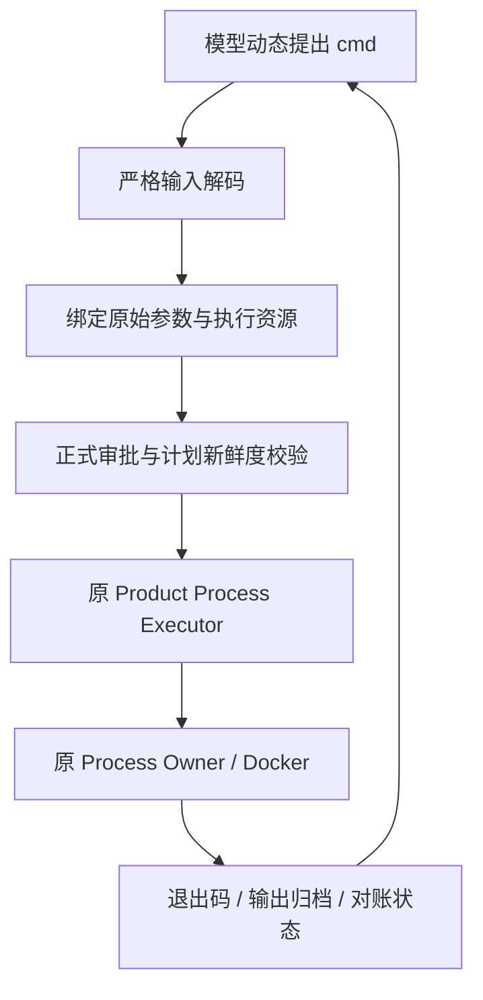

# 通用容器命令执行与任务依赖环境

## 1. 文档摘要

新增可显式选择的 `shell_command` Profile 策略：模型通过 `exec_command.<profile>` 为每次调用提出完整
POSIX Shell 命令，宿主冻结镜像、Shell、工作目录、环境、网络与资源，命令经正式 Trusted Action 审批、
Process Owner 与输出归档执行。可选的任务依赖根让同一 Thread 的后续容器调用复用已安装依赖。源码写入仍只走
受管补丁，容器内工作区只读。该实现于 2026-11-05 从独立工作树整合进 `feat/local-agent-week1`。

## 2. 需求背景

固定 `run_profile.*` 只能在宿主冻结的程序参数后追加受限测试目标，模型无法直接表达
`python -m pytest ...`、Shell 管道或不同工具链的检查命令，通用任务经常需要额外启动脚本。主流 Coding Agent
均以通用命令执行作为构建、测试和复现的核心执行面；Harnessix 需要同等能力，同时不放弃既有审批、
沙箱与对账边界。

## 3. 设计目标与非目标

目标：

- 同一个工具运行不同命令，无需为每个图表、测试文件或业务任务配置一个 Profile；
- 不新增审批、执行或审计权威：复用 Trusted Action、Product Process Executor 与 Process Owner；
- 隔离来自容器策略（只读根、只读工作区、断网、资源限制），而不是对命令文本的关键词过滤；
- 依赖安装结果可在同一任务内复用，效果不确定时隔离而不是继续使用。

非目标：新增原生主机沙箱后端；联网安装依赖；Windows 容器路径；默认自动批准所有 Shell 命令。

## 4. 总体架构与模块上下文

| 模块 | 职责 |
|---|---|
| `product_config/process_command.py` | `RunCommandInput` 严格解码：只接受固定 `profile` 与非空白 `cmd` |
| `product_config/action_contracts.py`、`process_profile.py` | `selector_policy="shell_command"`、`persistent_dependencies` 与 Profile 摘要 |
| `product_config/task_dependencies.py` | `TaskDependencyEnvironments`：按 Thread 与 Profile 派生、校验、隔离依赖根 |
| `product_config/process_action.py` | 原 Product Process Executor 生成 `(固定Shell, *固定参数, cmd)` 并执行 |
| `sandbox/container.py`、`sandbox/planner.py` | 把依赖根叶目录挂载到 `/harnessix/deps`，其余挂载与网络策略不变 |
| `trusted_actions/router.py`、`public_outcomes.py` | 识别 `product.command-profile.<id>` 执行器身份与公开投影 |
| `product_config/agent_context.py` | 探测到通用命令工具时选择通用执行指令 |

## 5. 接口设计与数据结构

继续使用独立 Product Action Config，通过既有 builder 创建并计算规范摘要，避免手写哈希：

```python
from harnessix.product_config.action_contracts import (
    build_product_action_config,
    build_product_process_profile,
)

profile = build_product_process_profile(
    profile_id="workspace",
    version="generic-command-v1",
    description="在项目的固定容器环境中运行批准的命令",
    container_engine="/absolute/path/to/docker",
    image="sha256:" + "1" * 64,  # 换成实际存在并经能力探测的镜像摘要。
    program="/bin/sh",
    arguments=("-c",),
    selector_policy="shell_command",
    timeout_seconds=60,
)
config = build_product_action_config(process_profiles=(profile,))
```

Profile 使用已知 POSIX Shell basename `sh/bash/dash/zsh`，固定参数为 `-c` 或 `-lc`。将
`config.model_dump_json()` 写入私有配置文件，再通过既有 `--action-config` 产品参数加载。成功启用后，
模型得到工具 `exec_command.workspace`：

```json
{"profile":"workspace","cmd":"python -m pytest tests/test_report.py -q"}
```

参数禁止其他字段、NUL 与非法 UTF-8，命令最多 16384 个 UTF-8 字节，原样成为 Shell 的一个参数。新工具使用
独立工具版本 `harnessix.product-command/v1` 与执行器身份 `product.command-profile.<id>`。

`persistent_dependencies` 默认 `false`，只允许与 `shell_command` 一起启用。依赖根身份由受信 Thread UUID、
Profile 摘要、路径摘要、inode 与权限共同校验：

```text
<state_root>/task-dependencies/<thread_uuid_hex>/<profile_sha256>/deps
```

## 6. 流程与生命周期



完整命令进入调用指纹与执行资源；执行前重新解码并复核批准的原参数，再确定性生成执行参数。保持
`process_id=plan_id`，审批前不执行，同一计划不自动重放。工具仍为 HIGH、NON_IDEMPOTENT_WRITE、需审批、
不并行；自动审批需由宿主另行给出预授权策略，Agent 不能自行批准自己的请求。

## 7. 失败、恢复、取消与超时

- 普通非零退出是反馈，模型可按证据继续诊断；任务依赖根可被下一次修复命令继续使用。
- 超时按 Profile 的 `timeout_seconds` 终止进程树并作为失败结果返回。
- 取消、宿主丢失、清理结果不确定或其他 UNKNOWN 状态会把依赖根标记为隔离；隔离根不能被后续普通执行
  重新挂载。受信恢复只检查原根并对账，不自动清除隔离标记，重新执行需要宿主明确重建环境。
- 恢复扫描识别新执行器身份，继续复用既有恢复与孤儿进程处理；未知效果不能盲目重放。

## 8. 持久化与数据流程

不新增数据库表或版本。每次调用的批准计划、执行资源、退出码与分页输出沿用 Trusted Action 账本与产物存储；
依赖根是宿主文件系统上的普通目录，其身份（Thread、Profile 摘要、路径摘要、inode、权限）在每次挂载前复核，
隔离标记随依赖根持久保存。数据流向为：模型参数 → 计划与审批记录 → Process Owner 执行 → 输出产物与公开投影。

## 9. 安全与信任边界

- 信任边界在容器策略：只读根文件系统、只读工作区、`none` 网络、资源限制、仅挂载本任务依赖根；
- 命令文本不作为授权依据，任何命令都需要审批或宿主预授权策略，Agent 不能自行批准；
- 模型不能提交宿主路径、挂载目标或其他 Thread 的依赖根；`secret_refs` 与持久依赖互斥，凭据不进入可变环境；
- 源码修改仍只经受管补丁，`exec_command` 无法直接改写真实工作区。

## 10. 可观测与错误分类

每次执行产生带 Profile 与 Process ID 的公开结果投影与完整输出产物。错误按既有分类公开：输入解码拒绝、
审批拒绝或过期、非零退出（反馈）、超时、取消、UNKNOWN（进入对账并隔离依赖根）；依赖根校验失败与隔离根
重新挂载会被拒绝执行，不会降级为普通执行。

## 11. 兼容性

- `none` 与 `bounded_test_selector` 的默认配置、旧 Descriptor、版本、指纹与 Binding 保持原样。
- `run_profile.*` 不接受 `cmd`；`exec_command.*` 不接受 `selectors`，不能混用合同。
- 未配置执行 Profile 的产品不会自动获得 Shell 工具。
- 既有 Schema 仅增加一个可显式选择的枚举值；没有新增 Process、ContainerExecution、Session、审批或审计
  数据库版本。

## 12. 限制、风险与差距

- 容器内 `/workspace` 只读，测试或构建工具写源码树时需要模型改用依赖根或临时目录，会产生绕路；
- 网络为 `none`，公网依赖不可安装时如实报告为环境不可满足；
- 持久依赖根没有独立磁盘配额与自动回收；`secret_refs` 与持久依赖互斥；
- Process 只在启动前校验 Workspace 观察，不递归冻结运行期间的源码，也没有全程文件锁；
- 只实现 POSIX 容器路径。

## 13. 验证

合同测试覆盖输入边界、原始命令参数保真、批准前零执行、变更命令不能复用原批准、非零退出、完整分页
输出归档、正式公开身份和取消后仅对账。真实 Docker 机械集成测试使用同一工具依次执行不同 Python 命令、
Shell 管道、`exit 7` 与修改只读源码的负例，并验证依赖根在同一 Thread 内保留、在不同 Thread 间隔离。

缺失依赖镜像上的真实模型合成任务（图表修复）完成了诊断、离线安装、业务修复与独立检查；该轮经历多次
宿主发起的正式 Retry 与预算重置，不是单次 Turn 全程无人干预的稳定性验收。验收脚本与证据保留在
`generic-command-execution` 工作树与主工作树的 `experiments/generic-command-chart-20261028`，未合入本分支。
整合进本分支后，受影响测试的失败清单与基线 `f7c59928` 一致，新增 161 个测试通过（2 个 Docker 用例在
无 Docker 的环境中跳过）。

## 14. 源码与测试阅读顺序

1. `src/harnessix/product_config/process_command.py`：输入合同与解码；
2. `src/harnessix/product_config/action_contracts.py`、`process_profile.py`：Profile 策略与摘要；
3. `src/harnessix/product_config/process_action.py`：执行参数生成与执行；
4. `src/harnessix/product_config/task_dependencies.py`、`src/harnessix/sandbox/container.py`：依赖根与挂载；
5. `src/harnessix/trusted_actions/router.py`、`public_outcomes.py`：执行器身份与公开投影；
6. 测试：`tests/product_config/test_command_profile.py`、`test_task_dependencies.py`、
   `test_generic_execution_context.py`、`tests/sandbox/test_task_dependency_mount.py`、
   `tests/integration/test_product_command.py`。
