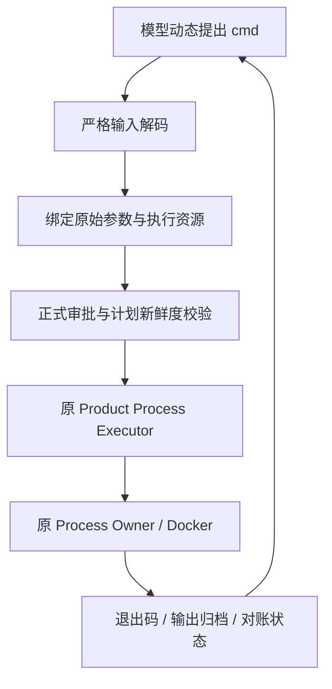

# 通用容器命令执行与任务依赖环境

## 问题与结果

固定 `run_profile.*` 只能在宿主冻结的程序参数后追加受限测试目标。模型无法直接表达
`python -m pytest ...`、Shell 管道或不同工具链的检查命令。这让通用任务经常需要额外启动脚本。

新增显式选择的 `shell_command` 策略：宿主仍冻结容器镜像、Shell、工作目录、环境、网络和资源，
模型为每次调用提出完整 `cmd`，通过正式 Trusted Action 审批、Process Owner 和输出归档执行。
同一个工具可运行不同命令，无需为每个图表、测试文件或业务任务再配置一个 Profile。

这是工作树中基于上述基线的新实现；不是旧基线已经具备的能力，也不代表新增了原生沙箱后端。

## 启用与调用

继续使用独立 Product Action Config。通过已有 builder 创建并计算规范摘要，避免手写哈希：

```python
from harnessix.product_config.action_contracts import (
    build_product_action_config,
    build_product_process_profile,
)

profile = build_product_process_profile(
    profile_id="workspace",
    version="generic-command-v1",
    description="在项目的固定容器环境中运行批准的命令",
    container_engine="/absolute/path/to/docker",
    image="sha256:" + "1" * 64,  # 换成实际存在并经能力探测的镜像摘要。
    program="/bin/sh",
    arguments=("-c",),
    selector_policy="shell_command",
    timeout_seconds=60,
)
config = build_product_action_config(process_profiles=(profile,))
```

Profile 使用已知 POSIX Shell basename `sh/bash/dash/zsh`，固定参数为 `-c` 或 `-lc`。
将 `config.model_dump_json()` 写入私有配置文件，再通过既有 `--action-config` 产品参数加载。
Doctor 和产品启动复用原来的引擎、镜像、Owner、Sandbox 和 Secret 探测；失败时不广告可执行工具。

成功启用后，模型得到工具 `exec_command.workspace`：

```json
{"profile":"workspace","cmd":"python -m pytest tests/test_report.py -q"}
```

也可以使用同一个工具：

```json
{"profile":"workspace","cmd":"printf 'alpha\\nbeta\\n' | sed -n '2p'"}
```

参数只接受固定 `profile` 和非空白 `cmd`，禁止其他字段、NUL、非法 UTF-8，命令最多16384个UTF-8字节。
命令原样成为 Shell 的一个参数，不预先分词或丢弃前后空白。Shell 管道、重定向和多行是显式允许的
命令能力；隔离边界来自容器策略，不来自对命令文本的简单关键词过滤。

## 权限与执行链



新工具使用独立工具版本 `harnessix.product-command/v1` 和执行器身份 `product.command-profile.<id>`。
完整命令进入调用指纹与执行资源；执行前重新解码并复核批准的原参数，再确定性生成
`(固定Shell, *固定参数, cmd)`。保持 `process_id=plan_id`，审批前不执行，同一计划不自动重放。

公开成功/失败投影仅接受精确的 `exec_command.<id>` 与 `product.command-profile.<id>` 配对，
并核对输出中的 Profile 和 Process ID。恢复扫描识别新执行器身份，继续复用旧恢复与孤儿进程处理。

工具仍为 HIGH、NON_IDEMPOTENT_WRITE、需审批、不并行；产品没有默认自动批准所有Shell命令。
自动审批需由宿主另行给出预授权策略，Agent不能自行批准自己的请求。

产品只有实际探测到可执行通用命令工具时，才选择通用执行指令及无固定阶段的工具视图。
这不会关闭注册、审批、Sandbox或Owner检查。普通非零退出是反馈，模型可按证据继续诊断；
未知效果不能盲目重放，退出0也不等于任意业务结果正确。

## 兼容性

- `none` 与 `bounded_test_selector` 的默认配置、旧Descriptor、版本、指纹与Binding保持原样。
- `run_profile.*` 不接受 `cmd`；新 `exec_command.*` 不接受 `selectors`，不能混用合同。
- 原未配置执行Profile的产品不会自动获得Shell工具。
- Product Profile/Action Config的既有Schema仅增加一个可显式选择的枚举值，原数据仍可读取。
- 没有新增Process、ContainerExecution、Session、审批或审计数据库版本。

## 依赖安装与持久环境

`persistent_dependencies` 是 `ProductProcessProfile` 的显式可选项，默认 `false`，且只允许和
`selector_policy="shell_command"` 一起启用。启用后，宿主为每个 Thread 和 Profile 派生一个任务专属依赖根，
只把这个根的叶目录挂载到容器固定目标 `/harnessix/deps`；模型不能提交宿主路径、挂载目标或另一条依赖根。
依赖根的身份由受信 Thread UUID、Profile 摘要、路径摘要、inode 和权限共同校验，格式为：

```text
<state_root>/task-dependencies/<thread_uuid_hex>/<profile_sha256>/deps
```

容器内 `/workspace` 仍然只读，`/harnessix/deps` 才是可写依赖目录，`/tmp` 仍是单次调用临时目录，
网络仍为 `none`，根文件系统仍为只读。不同 Thread 不能看到彼此的依赖根；同一 Thread 在同一 Profile
下的后续容器调用会复用同一个依赖根。`secret_refs` 与持久依赖在当前版本明确互斥，避免把凭据生命周期
和可变依赖环境混在一起。该能力当前只实现 POSIX 容器路径，不宣称 Windows 后端支持。

这使 Agent 可以在容器内自主解决“镜像缺包”问题，但安装来源必须已经由镜像或受管输入提供。例如，
镜像可以只放置离线 wheelhouse，Agent 根据项目的 `requirements.txt` 选择合适的包管理命令，安装到
`/harnessix/deps`，再在同一次或下一次命令中设置相应的解释器搜索路径并验证导入、脚本和测试。执行核心
不硬编码 Python、pip、venv 或 node_modules；模型根据实际错误和项目文件提出命令，Trusted Action 只负责
执行已批准的命令并返回完整输出。网络为 `none` 时无法从公网下载的包会被如实报告为环境不可满足，不能把
“自主安装”解释为无条件联网安装。

正常的非零退出只表示本次命令失败，任务依赖根可以被下一次修复命令继续使用。取消、宿主丢失、清理结果
不确定或其他 UNKNOWN 状态会把依赖根标记为隔离状态；隔离根不能被后续普通执行重新挂载。受信恢复只允许
检查原根并对账，当前不自动清除隔离标记；重新执行需要宿主明确重建环境。这避免把效果不确定的半安装
venv、缓存或 node_modules 当成可信环境继续运行。持久根当前没有独立磁盘配额或自动垃圾回收。

当前Process只在启动前校验所选Workspace观察，不递归冻结运行期间所有源码内容，也没有全程文件锁。
不能把本次读写边界测试提升为并发源码快照、依赖供应链或生产通用任务成功率保证。

## 验证

合同测试覆盖输入边界、原始命令参数保真、批准前零执行、变更命令不能复用原批准、非零退出、
完整分页输出归档、正式公开身份和取消后仅对账。既有Profile及产品恢复测试同时回归。

真实 Docker 机械集成测试使用相同工具依次执行不同 Python 命令、Shell 管道、`exit 7` 和修改只读
源码的负例，并验证持久依赖目录能在同一 Thread 的后续容器调用中保留、在不同 Thread 间隔离。缺失依赖
镜像的预检确认 Matplotlib、NumPy、Pillow 和 pytest 初始均未安装；镜像只提供离线 wheelhouse，未在构建
阶段安装这些包。

`scripts/verify_generic_command_chart.py` 是真实模型验收入口，任务要求 Agent 自主复现图表失败、安装依赖、
修复测试临时目录等环境问题、修复允许修改的代码、运行独立检查和完整项目测试。真实模型 run02 完成了
15 次 Docker 命令：自行发现缺包，观察 pip 的 `ENOSPC`，检查 `/tmp` 的 64 MiB 容量，再自行设置持久根下的
`TMPDIR` 并离线安装；后续独立容器成功导入全部四个依赖。依赖恢复后还复现了收入数字含千分位逗号的
业务错误。该轮随后触发累计 Token 上限；后续续跑遇到摘要截断、Provider 传输和费用上限，这些失败均保留。
最终 run07 自主完成图表补丁和独立图表检查；run09 读到真实 pytest `EROFS` 后，自行改用
`--basetemp=/harnessix/deps/test-tmp`，再关闭只读工作区的缓存插件，得到无警告的 `1 passed`，并完成 Git review。
固定输入与 gold test 未被改动，最终 Agent Turn 为 `completed`。图表原始及扰动数据的统计与 Pillow 完整解码
均通过。宿主另外核对了归档数据与 PNG；这不表示 Harnessix Agent 具备视觉模型验图能力。

首次 `tool_index_limit_exceeded`、续跑失败以及每次原始命令、正式 Docker 输出、不可修改文件哈希均保留在
主工作树的 `experiments/generic-command-chart-20261028`。ScriptedProvider 合同测试不能替代真实模型自主性
结论，也不能把 Docker 环境缺失导致的 skip 当作通过。本轮由宿主修正验收驱动并发起多次正式 Retry，
不是单次 Turn 全程无人干预的稳定性验收；具体安装、环境修复和任务补丁由模型自主提出。
