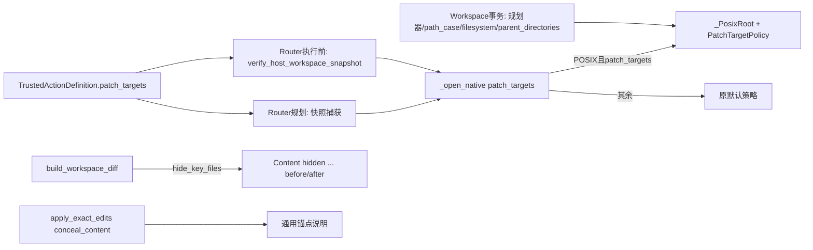

# 补丁可以写密钥与证书文件，其内容从不显示

## 1. 文档摘要

`apply_patch_batch`及其回滚现在可以在macOS、Linux与Windows上新建、替换、编辑、删除`.key`、`.pem`、`.p12`、`.pfx`文件。
这类文件的内容从不显示：审批Review、模型看到的`diff_preview`与回滚Diff只写前后摘要，编辑锚点失败不报行号。
`.git`、`.harnessix`、`.codex`、`.ssh`、`.aws`、`.gnupg`、`.env*`与私钥文件名在两个平台上都不能由补丁写入。
读取工具不变。决策见ADR 0172。

## 2. 需求背景

- 0.10.0b49起，POSIX上补丁写密钥与证书文件以`delivery_path_denied`拒绝；这是复用读取策略的附带行为，不是写入规则。
- Windows规划不按文件名过滤，补丁照常写这类文件，也能写`.ssh`、`.aws`与`id_rsa`。
- Web服务类项目常有示例证书（2026-11-17 NL2RepoBench冒烟：wsgidav新建`sample_bogo_server.key`）。
- 负责人2026-11-18决定选项B2：允许写，内容不显示，凭据名称两个平台都保护。

## 3. 设计目标与非目标

- **目标：**
  - 三个平台上补丁与回滚都能写密钥与证书文件，内容不出现在任何显示面上。
  - 凭据名称在POSIX与Windows上以同一规则拒绝。
  - 读取工具、默认`WorkspaceReadPolicy`与默认`Workspace(...)`逐字节不变。
- **非目标：**
  - 事务Blob与备份里的明文前后镜像（保留，用于发布与回滚）。
  - Git检查点与Git交付来源（仍用读取策略，单独决定）。
  - 命令工具（不按工作区读取策略检查文件名，不变）。

## 4. 总体架构

- `PatchTargetPolicy`只把`denied_suffixes`置空，敏感名称与`.env.*`照旧拒绝。
- 选择是显式参数，不按访问模式推断：父目录以`read`观察，`certs.pem/`这样的目录也要可用。

## 5. 接口设计与数据结构

- **新增：**
  - `tools.workspace.PatchTargetPolicy`、`is_key_or_certificate_file(path)`。
  - `Workspace(..., patch_targets=False)`、`_open_native(..., patch_targets=False)`、`_PosixRoot(..., patch_targets=False)`。
  - `TrustedActionDefinition.patch_targets: bool = False`（补丁与回滚为True）。
  - 快照函数的`patch_targets: bool = False`：`capture_workspace_snapshot`、`verify_workspace_snapshot`、
    `capture_snapshot_facts`、`capture_workspace_snapshot_v2`、`verify_workspace_snapshot_v2`、`verify_host_workspace_snapshot`。
  - `planner._read_existing_file(..., patch_targets=False)`、`build_diff_content(..., hide_key_files=False)`、
    `apply_exact_edits(..., conceal_content=False)`。
- **合并：** `delivery.trusted_action._protected`删除，复用`delivery.planner._protected`。
- **不变：** 公开合同、Schema、错误码、`PROTECTED_COMPONENTS`、快照与事务记录格式。

## 6. 流程与数据流

- **规划：** 补丁定义`resolve` → Router按`patch_targets`捕获快照 → Review准备：`_desired_files`（大小写检查、目标类型、前镜像读取都按写目标策略）→
  事务规划捕获与复核 → 发布Review（Diff里这类文件只有摘要）。
- **执行：** Router按`patch_targets`复核快照 → 事务端口按写目标策略观察与发布 → 结果的`diff_preview`同样只有摘要。
- **回滚：** 同一路径；逆向事务的Review与结果同样只有摘要；回滚后的空目录清理按写目标策略打开。

## 7. 失败、恢复、取消与超时

- 凭据名称在规划前以`delivery_path_denied`拒绝，没有部分效果，本轮继续。
- 锚点失败的错误码不变，只是说明不含位置；模型可以改用`replace`。
- 取消、超时与对账语义不变。

## 8. 持久化与数据流程

- 不新增状态，不改记录格式。Blob里的明文前后镜像照旧保存。
- 已保存的计划照常加载：`PROTECTED_COMPONENTS`未改。

## 9. 安全与信任边界

- **放开的：** 补丁与回滚可以写这四个后缀的文件与目录。
- **收紧的：** Windows上补丁不能再写`.ssh`、`.aws`、`.gnupg`与私钥文件名。
- **不显示的：** Review Artifact、`diff_preview`、回滚Diff。读取工具照旧拒绝，模型读不回内容。
- **残留：** 锚点是否存在由拒绝本身反映；Diff条目的`binary`标记与大小照常记录；模型自己提交的参数仍在会话历史中。

## 10. 可观测与错误分类

- 错误码不变；`delivery_path_denied`的说明改为“例如.git、.env、.ssh或id_rsa”，保留8.3短名称一句。
- Diff里的隐藏行以`Content hidden (key or certificate file):`开头，界面按普通行显示。

## 11. 部署、兼容与回退

- 撤销提交即可回退；回退后POSIX恢复拒绝写这类文件，Windows恢复写凭据名称。
- 升级前在Windows上发布、含这类文件的事务，升级后重新生成的Diff文本不同，只影响跨版本仍在进行中的结果投影。

## 12. 限制与风险

- Git检查点复核与Git交付来源仍用读取策略：事务里有这类文件时会拒绝。
- 提案修复经读取工具观察，读不到这类文件时不补`expected_sha256`与权限。
- 内容整体替换的比例保护（`unsafe_full_replace_error`）照常生效，说明里含原文件大小。

## 13. 验证

- `tests/product_config/test_patch_key_certificate_files.py`：两代快照；新建（含`certs.pem/`目录）、替换、编辑、删除、回滚批准后写入，
  Review、`diff_preview`与回滚结果没有正文；读取工具照旧拒绝；锚点三类拒绝没有位置信息。
- `tests/product_config/test_patch_protected_paths.py`：`.ssh`、`.env`、`.env.local`、`id_rsa`、`.aws`、`.gnupg`只拒绝这次调用，同批的证书文件也未写入。
- `tests/delivery/test_key_certificate_patch_policy.py`：两个平台的`_protected`、`_normalized_files`与`prepare_workspace_transaction`，
  默认读取策略与默认Workspace不变，Diff隐藏与Git树Diff不变，锚点通用说明。
- `tests/delivery/test_windows_short_names.py`照常通过；全量回归与b53对比。

## 14. 源码与测试映射

| 源码 | 测试 |
|---|---|
| `src/harnessix/tools/workspace.py`（`PatchTargetPolicy`、`is_key_or_certificate_file`、`Workspace(patch_targets=)`） | `tests/delivery/test_key_certificate_patch_policy.py` |
| `src/harnessix/workspace/snapshot.py`、`snapshot_capture.py`、`snapshot_v2.py`、`snapshot_verification.py` | `tests/product_config/test_patch_key_certificate_files.py` |
| `src/harnessix/trusted_actions/router.py`、`planning.py` | 同上 |
| `src/harnessix/delivery/planner.py`、`planner_v2.py`、`path_case.py`、`filesystem.py`、`parent_directories.py` | 同上，及`tests/delivery/test_key_certificate_patch_policy.py` |
| `src/harnessix/delivery/trusted_action.py`、`rollback_action.py` | `tests/product_config/test_patch_key_certificate_files.py`、`tests/product_config/test_patch_protected_paths.py` |
| `src/harnessix/delivery/diff_content.py`、`diff.py` | `tests/delivery/test_key_certificate_patch_policy.py` |
| `src/harnessix/patches/planner.py` | `tests/delivery/test_key_certificate_patch_policy.py`、`tests/product_config/test_patch_key_certificate_files.py` |
| `src/harnessix/trusted_actions/preparation_rejection.py` | `tests/product_config/test_patch_protected_paths.py` |
