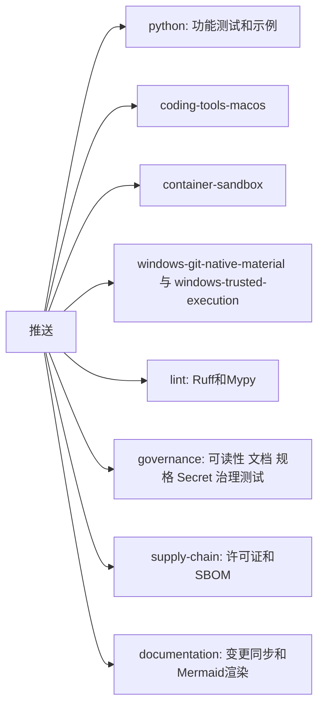

# P0 CI门禁恢复与可读性预算说明

## 1. 需求背景

2026-09-27之后CI持续失败。Linux和macOS任务的第一步是可读性门禁，失败后后面的`pytest`、Ruff和Mypy都不再执行，
因此约六周内没有任何提交经过CI的功能回归。本次恢复过程中发现的积压问题如下：

| 门禁 | 恢复前状态 | 处置 |
|---|---|---|
| 可读性 | 103项错误 | 按第7节逐类说明后更新预算 |
| Ruff | 357项错误、40个文件格式不符，其中356项错误在已冻结的SWE-bench实验脚本中 | 冻结脚本加入排除，其余修复 |
| Mypy | 85项错误 | 全部修复，不改变行为 |
| 容器测试 | 3项失败 | 修复评分器缺陷并更新过期断言 |

## 2. 设计目标与非目标

目标是让功能回归不再被治理门禁阻挡，并恢复每个门禁的真实信号。
非目标：不放宽任何门禁阈值，不改变许可证策略。`supply-chain`在许可证清单补齐前继续失败，属于已知发行阻断项。

## 3. 总体架构与流程

CI拆为互不依赖的任务，治理任务的各步骤也互不阻挡，失败时一次能看到全部结果。

Windows任务曾随首发范围取消移除；2026-11-10用户决定三平台都要支持，两个Windows任务及其形状测试按原样恢复。

CI的墙钟时间取决于最慢的单个任务。恢复后的首轮完整运行中，`python`任务单进程跑约22000个用例需1小时40分，
`coding-tools-macos`约1小时20分；GitHub托管机器为Linux 4核、macOS 3核，单进程只用其中一核。
其中73%的时间在`tests/product_config`的Git审批链路集成测试：最慢的28个用例每个15～39秒，CPU满载，
热点是待审批连接逐步复核数据库文件路径上每一级目录的物理身份（单个用例约18万次复核、约200万次`lstat`）。
这是防篡改设计，本次不为CI提速改动它。现在的处置：

| 处置 | 说明 |
|---|---|
| 并行 | `python`与`coding-tools-macos`的主测试用`pytest -n auto`（pytest-xdist）按核数并行，并输出最慢20个用例 |
| 稳定用例ID | 5个用例在参数中现生成uuid4，各进程收集到的用例ID不同，xdist拒绝运行；`tests/conftest.py`给UUID文本参数固定ID，参数值不变。这些测试文件被历史验证证据按字节引用，不直接修改 |
| 发布门禁不等Windows完整测试集 | 该测试集仍有大量存量失败（1.0门槛，W1），并曾在步骤超时后挂起两个多小时，整轮CI迟迟不结束，发布门禁随之等待。门禁改为：除它以外的任务全部成功即可，不再要求整轮运行结束。Windows任务形状受治理测试冻结，保持不变 |
| 推送标签不触发CI | 推送版本标签曾对同一提交再跑一整轮CI；现在只有分支推送和PR触发 |
| 取消过时运行 | 同一分支有新推送时取消旧运行；`main`不取消 |

## 4. 接口设计与领域契约

- Task Pack评分器把一次成功的`git_review`同时计为状态核对和差异核对。工作流自2026-10-13起只强制调用这个聚合工具，
  评分器未同步，导致Task Pack试次全部无法通过`git_feedback_order`。
- `CODING_EVAL_GRADER_VERSION`保持v1：改动只增加一种等价形式，历史报告中不存在`git_review`，结果不变。
- 越序Patch现在在工具目录层被拒绝，早于原来的审批层，测试断言已更新；安全性质不变。

## 5. 失败与恢复语义

本次不改变运行时的失败、取消、超时或恢复语义。

## 6. 持久化与事务

本次不改变持久化结构。可读性预算和最终报告仍是受版本控制的文件。

## 7. 可读性预算说明（ADR 0076）

ADR 0076要求增长预算前先说明原因，禁止把重新生成策略当作修复手段。本节即该说明，策略文件的完整差异见本次提交。

| 类别 | 恢复前批准数 | 恢复后批准数 | 主要来源 |
|---|---:|---:|---|
| 超大文件 | 11 | 23 | SWE-bench运行配置、Git交付、原生沙箱和命令工具的连续功能迭代 |
| 超大或高复杂度符号 | 138 | 170 | Agent运行时主循环、压缩、预算和工具修复 |
| 一级包依赖边 | 151 | 168 | 新增无头入口`exec_cli`、候选择优和沙箱接线 |
| 依赖强连通分量 | 1 | 2 | `delivery`、`product_config`、`trusted_actions`之间的双向依赖 |
| 公共`__all__`快照 | 14 | 15 | 新增评测与产品公共入口 |

增长最多的热点：

| 位置 | 批准上限 | 当前值 |
|---|---:|---:|
| `agent/runtime.py`文件行数 | 2794 | 3391 |
| `AgentRuntime`类行数 | 2621 | 3130 |
| `AgentRuntime._drive`行数与复杂度 | 145与30 | 259与49 |
| `AgentRuntime._sample_events`行数与复杂度 | 211与60 | 279与85 |
| `product_config/coding_tool_view.py`文件行数 | 新增 | 1024 |

恢复门禁后，P0-10又让`ProductController`增加36行、`ProductApp`增加4行，用于本会话审批规则。相关判断已拆到
[`approval_automation.py`](../../src/harnessix/product_ui/approval_automation.py)，留在类内的只有串行入口。
P1-3又为交互预算增加2行。
P0-9（ADR 0123第6节）让两个模型适配器的`stream`各增加10行，`AgentRuntime`增加13行，用于区分确定未计费与计费未知；
计算逻辑放在`_provider_io.py`和`turn_budget_compaction.py`，类内只保留分支和开关。
P1-2（[ADR 0125](../adr/0125-skill-product-wiring.md)）接入Skill：`agent/runtime.py`和`AgentRuntime`各增加1行，修复只读Trusted Action绕过`prepare`的缺陷；`open_default_product_action_runtime`增加7行，`_serve_product_stdio`增加4行，`build_product_agent_context`增加2行，都是组合根必须持有的新资源，发现和渲染逻辑已放到`skill_composition.py`。新增依赖边`product_config->skills`，方向是组合根依赖能力包。原依赖环`delivery/product_config/trusted_actions`因`trusted_actions`不再导入`product_config`而缩小为`delivery/trusted_actions`。

P1-2的MCP接入（[ADR 0127](../adr/0127-host-stdio-mcp-with-per-server-trust.md)）新增依赖边`product_config->mcp`，方向与`product_config->skills`相同：组合根依赖能力包，`mcp`不反向依赖产品配置。Skill与MCP合并为一个扩展资源（`extension_composition.py`），`open_default_product_action_runtime`与`_serve_product_stdio`的长度不变；`mcp/runtime.py`的目标接口移到`target_protocol.py`，文件长度回到预算内。

W2（Windows沙箱外PowerShell命令，2026-11-10用户决定）让`native_process.py`增加3行：Owner平台检查改为调用`native_owner_problem`并保留空值收窄（+1），新增一条导入（+1），计划核对按实际平台绑定环境后折行（+1）。Shell规则、Windows程序路径与PowerShell查找都放在新的`native_shells.py`，`action_contracts.py`因删除旧的POSIX专用函数减少6行。

2026-11-10合入`main`（`111b546f`）时，另一会话的两项修复带来增长：`5702881f`把工作区根目录的绝对路径按挂载点映射，`CodingToolRuntime`增加6行；`7197c8f9`把字符串化参数的还原提到调用修复之前，`AgentRuntime._sample_events`复杂度加1。两项都是有真实评测证据的行为修复，按原样登记；其中参数还原的类型窄化顺带修正，行为不变。

2026-11-10多语言评测前的修复批次（用户批准的a–f、10–14项）另有11项预算增长，逻辑都已放到新模块，类内只留开关与分支：
- `AgentRuntime`（+18行）、`__init__`（+2）、`_sample_events`（+6行，复杂度+2）、`_run_compaction`（+1），
  文件`agent/runtime.py`（+26）：纯文本截断恢复（ADR 0109 v3，判定与提示在`truncation_recovery.py`）只留开关、
  返回值与一个合并后的预算截断检查；参数字符串还原（7197c8f9）在`_sample_events`里多一个分支；
  压缩摘要说明头（ADR 0058第3版）在`_run_compaction`多一行。
- `SQLiteSessionStore`（+4）与`session/sqlite.py`（+5）：增量历史校验（ADR 0126）的缓存实例与调用参数，
  缓存与校验逻辑在`verified_prefix_cache.py`和`sqlite_publication.py`。
- `CodingToolRuntime`（+6）：工作区根的绝对路径按相对路径读取（5702881f），映射规则不放宽可读范围（ADR 0109）。
- `native_process.py`、`process_action.py`各+1：固定Profile参数可省略（合同v2）后的工具描述文字。
同一批次删除旧SWE-bench路径（审计第12项）时，相关预算按删除后的实际值下调，见
[删除记录](remove-legacy-swebench-path.md)。最终报告`readability-0.9.0-final.json`随之重新生成。

2026-11-10第二次合入`main`（`af16bc87`）时，两边各自登记过的增长叠加，另有两处按实测值登记：
- `product_config/contracts.py`（602行，新列入超大文件）：两边单独都恰为600行，本分支的代理字段（`proxy_url`及其类型导入，+2）
  与主线的压缩点配置字段合在一起后超出。拆分该合同模块需要同步多处导入与规格生成，留到P2-5“拆分超大模块”。
- `native_process.py`（608行）：本分支W2的+3与主线“固定Profile参数可省略”的+1叠加。
- `coding_tool_view.py`、`process_action.py`与`AgentRuntime._sample_events`取合并后的实测值（895、766行，285行、复杂度87），
  其中`coding_tool_view.py`随主线删除复现门禁下调。

0.10.0b2易用性修复：用户拒绝审批时填写的原因原先只进审计，模型只收到固定的“用户拒绝了工具调用”。现在`AgentRuntime._execute_calls`
在记录工具结果前调用`approvals.with_rejection_reason`，按调用找到已决定的审批并把原因附在错误信息后。判定与拼接都在`approvals.py`，
运行时只增加这一行调用和一项导入：`runtime.py`（3473）、`AgentRuntime`（3190）、`_execute_calls`（243）各按实测登记。
同批在247上用PyPI验证脚本试跑`exec --approval-mode auto-edit`时，沙箱内命令的审批在宿主系统策略批准前被薄CLI读到，客户端立即判为需要人工并退出。
`agent_cli.py`现在对自身不处理的待审批项先等3秒系统决定，回归见`test_thin_cli_waits_for_a_system_decision_before_asking_a_person`。
宽限判断与事件等待时长放在模块级函数`_in_grace`、`_wait_ms`中，类内只增加待审批首次出现时间这一项状态和一个判断：
`ThinAgentCLI`（294）、`_answer_pending`（79行，复杂度25）按实测登记。

这些增长发生在门禁失效期间，没有逐项评审，是事实上已经存在的结构债务。本次把预算更新到当前值，让门禁重新生效，
此后任何继续增长都会失败。偿还计划列入发布清单P2-5：优先拆分`AgentRuntime`和`coding_tool_view.py`，
并解除`delivery`、`product_config`、`trusted_actions`之间的循环依赖。

## 8. 安全、权限与信任边界

CI权限保持`contents: read`。`self_hosted`相关的信任边界见[接入自托管模型](../operations/self-hosted-models.md)。

## 9. 可观测性与错误分类

每个门禁在CI中独立显示结果。新增配置错误码`product_configure_self_hosted_required`和预检项`product_self_hosted_key_length`（错误码`self_hosted_key_too_short`）。

`code doctor`的文本输出中，结论为“可启动”时，失败但不影响启动的检查（例如沙箱不可用）显示为“警告”，避免用户误以为无法使用；
结论为“不可启动”时仍显示“失败”。JSON报告的状态值不变（`09c7db1f`）。

## 10. 测试与验收

验收标准是Linux和macOS的功能测试在CI上跑完并全绿，治理门禁单独报告。`supply-chain`的失败不计入本项。

2026-11-10恢复后的第二轮CI（`a30ba880`）暴露的问题均属测试或文档同步，产品行为不变：

| 问题 | 处置 |
|---|---|
| Windows上`write_text`写出CRLF，参数反馈用例读到的正文不以LF结尾 | 夹具改写固定LF字节 |
| Windows产品端Git差异用例早于编码流程视图：没有命令工具时，首次修改前不提供`git_diff` | 改走`harnessix code`使用的零配置入口；Windows上带有逐条批准的PowerShell（W2），失败时列出首步提供的工具 |
| 主线合入的评测选项`network_isolation`未登记 | 登记为评测环境约束，不改变产品配置 |
| 文档门禁以上一次推送为基准，合入主线的完成守卫、参数还原、薄CLI分页和本分支的MCP命令未同步模块设计 | 同步`agent.md`、`app-server.md`、`product-ui.md` |

本地文档检查应以上一次推送的提交为`--changed-from`基准，与CI一致。

2026-11-10在247上用tmux驱动TUI做端到端验证时发现两处易用性问题，已修复：输入框被禁用后焦点落到会话列表且不会返回，
用户按`Ctrl+N`后或每轮任务结束后直接打字，字符进入会话列表；首次进入必须先按`Ctrl+N`才能输入。现在输入框恢复可用时自动获得焦点，
没有会话时第一条输入自动开启新会话。焦点回到输入框后，输入框自带的`Ctrl+A/E/U/X`会截获同名界面快捷键（247上`Ctrl+E`失效），这四个界面快捷键改为优先，弹窗打开时停用。审批窗口原先把差异Artifact的JSON记录原样显示（换行被转义），现在整理成文件清单与着色diff，打开时焦点在“批准”。回归见`tests/product_ui/test_app.py::test_composer_takes_focus_whenever_it_becomes_usable`。

0.10.0b2的发布在Windows全新安装冒烟中失败：GitHub Windows运行器把重定向输出按cp1252编码，`harnessix --help`打印中文帮助时抛`UnicodeEncodeError`退出。
用户在Windows上把输出重定向到管道或文件、或控制台使用西文代码页时同样会崩溃。`harnessix.cli.main`现在先把标准输出和错误重配为UTF-8，
保留各自原有的错误处理方式；交互控制台本来就是UTF-8，不受影响。治理脚本已有同样处理（`scripts/cli_console.py`），产品入口此前遗漏。
回归见`tests/test_cli_output_encoding.py`，以`PYTHONIOENCODING=cp1252:strict`在各平台CI上复现。修复以0.10.0b3发布，b2标签保留但不发布。

## 11. 源码映射

| 内容 | 位置 |
|---|---|
| CI任务 | [`ci.yml`](../../.github/workflows/ci.yml) |
| 发布门禁 | [`release.yml`](../../.github/workflows/release.yml) |
| 稳定用例ID | [`tests/conftest.py`](../../tests/conftest.py) |
| 评分器 | [`grader.py`](../../src/harnessix/evals/grader.py) |
| 录制Provider | [`recorded_task_pack.py`](../../scripts/recorded_task_pack.py) |
| 可读性预算 | [`readability-policy-v1.json`](../../governance/readability-policy-v1.json) |

## 12. 部署、兼容与回退

只影响CI和开发流程，不影响已发布行为。需要回退时还原CI文件和策略文件即可。

## 13. 风险与取舍

一次性接受积压的结构债务，换来门禁重新生效。不这样做，只能先完成数周的重构，CI在此期间继续失效，代价更高。
