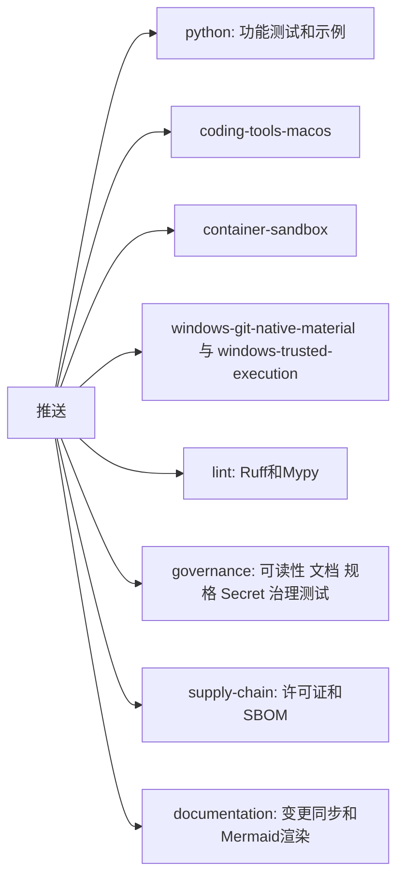

# P0 CI门禁恢复与可读性预算说明

## 1. 需求背景

2026-09-27之后CI持续失败。Linux和macOS任务的第一步是可读性门禁，失败后后面的`pytest`、Ruff和Mypy都不再执行，
因此约六周内没有任何提交经过CI的功能回归。本次恢复过程中发现的积压问题如下：

| 门禁 | 恢复前状态 | 处置 |
|---|---|---|
| 可读性 | 103项错误 | 按第7节逐类说明后更新预算 |
| Ruff | 357项错误、40个文件格式不符，其中356项错误在已冻结的SWE-bench实验脚本中 | 冻结脚本加入排除，其余修复 |
| Mypy | 85项错误 | 全部修复，不改变行为 |
| 容器测试 | 3项失败 | 修复评分器缺陷并更新过期断言 |

## 2. 设计目标与非目标

目标是让功能回归不再被治理门禁阻挡，并恢复每个门禁的真实信号。
非目标：不放宽任何门禁阈值，不改变许可证策略。`supply-chain`在许可证清单补齐前继续失败，属于已知发行阻断项。

## 3. 总体架构与流程

CI拆为互不依赖的任务，治理任务的各步骤也互不阻挡，失败时一次能看到全部结果。

Windows任务曾随首发范围取消移除；2026-11-10用户决定三平台都要支持，两个Windows任务及其形状测试按原样恢复。

CI的墙钟时间取决于最慢的单个任务。恢复后的首轮完整运行中，`python`任务单进程跑约22000个用例需1小时40分，
`coding-tools-macos`约1小时20分；GitHub托管机器为Linux 4核、macOS 3核，单进程只用其中一核。
其中73%的时间在`tests/product_config`的Git审批链路集成测试：最慢的28个用例每个15～39秒，CPU满载，
热点是待审批连接逐步复核数据库文件路径上每一级目录的物理身份（单个用例约18万次复核、约200万次`lstat`）。
这是防篡改设计，本次不为CI提速改动它。现在的处置：

| 处置 | 说明 |
|---|---|
| 并行 | `python`与`coding-tools-macos`的主测试用`pytest -n auto`（pytest-xdist）按核数并行，并输出最慢20个用例 |
| 分片（2026-11-12） | 全量测试按测试文件拆成并行分片（`tests/conftest.py`的`--shard I/N`，同一文件的用例留在同一片）：`python`两个Python版本各6片，`coding-tools-macos`5片（托管macOS最多同时跑5个任务），每片仍按核数并行；只需跑一遍的示例与小测试集放在第1片。慢文件按实测耗时均摊到各片（`tests/shard_weights.json`，由`scripts/shard_weights.py`从带`--durations=0 --durations-min=1`的CI日志生成；表里没有的文件按路径散列，新增测试无需登记）。此前单个任务25～45分钟（同样的用例在不同机房的托管机器上快慢相差约1.7倍），发布要等最慢的一个；3片时实测门禁21分钟 |
| 每日用例（2026-11-12） | 一项容量用例（`tests/delivery/test_parent_closure_runtime.py`的255个成员，托管CI上单项6～12分钟）标记为`nightly`：每次推送的CI用`-m "not nightly"`跳过，`.github/workflows/nightly.yml`每天在main上运行；128个成员的同一用例仍在每次推送时运行。耗时来自发布每个成员都重新解码并校验整份事务记录（随成员数平方增长），属于产品侧的性能问题，另行处理 |
| 内置Git交付测试族改为每日运行（2026-11-12，用户决定） | 内置Git交付（提交、推送的受控流程）尚未接入产品，用户走不到；它的测试族`tests/product_config/test_git_*`（104个文件、5464项用例）占每次推送CI慢用例耗时的74%。`tests/conftest.py`的`runs_nightly_only`按文件路径给这一族加`nightly`标记，不改动测试文件本身（其中有被历史验证证据按字节引用的文件）：每次推送的CI不再运行它们，`.github/workflows/nightly.yml`每天在main上用Linux与macOS各3片运行。例外：`test_git_audit_identity_lifetime.py`测的是已上线的审批运行时在用的函数，留在每次推送里。按文件名直接点名用例的任务（Windows Git原生验收、Windows受控执行等）不带`-m`筛选，照常运行。耗时表`tests/shard_weights.json`相应只保留每次推送都跑的文件。**1.1把Git交付接入产品时，删除该规则，把这一族移回每次推送。** |
| 稳定用例ID | 5个用例在参数中现生成uuid4，各进程收集到的用例ID不同，xdist拒绝运行；`tests/conftest.py`给UUID文本参数固定ID，参数值不变。这些测试文件被历史验证证据按字节引用，不直接修改 |
| 发布门禁不等Windows完整测试集 | 该测试集仍有大量存量失败（1.0门槛，W1），并曾在步骤超时后挂起两个多小时，整轮CI迟迟不结束，发布门禁随之等待。门禁改为：除它以外的任务全部成功即可，不再要求整轮运行结束。Windows任务形状受治理测试冻结，保持不变 |
| 推送标签不触发CI | 推送版本标签曾对同一提交再跑一整轮CI；现在只有分支推送和PR触发 |
| 取消过时运行 | 同一分支有新推送时取消旧运行；`main`不取消 |

## 4. 接口设计与领域契约

- Task Pack评分器把一次成功的`git_review`同时计为状态核对和差异核对。工作流自2026-10-13起只强制调用这个聚合工具，
  评分器未同步，导致Task Pack试次全部无法通过`git_feedback_order`。
- `CODING_EVAL_GRADER_VERSION`保持v1：改动只增加一种等价形式，历史报告中不存在`git_review`，结果不变。
- 越序Patch现在在工具目录层被拒绝，早于原来的审批层，测试断言已更新；安全性质不变。

## 5. 失败与恢复语义

CI门禁恢复本身不改变运行时的失败、取消、超时或恢复语义。门禁恢复后暴露的两处误报在0.10.0b11修正，只改分类、不改停止与观察的流程：

- **在不存在的目录里新建文件（0.10.0b21，ADR 0137）**：`apply_patch_batch`的create在父目录不存在时整批以`workspace_parent_missing`失败，父路径上已有的段是普通文件时整轮被中断；现在macOS与Linux上由同一笔事务补建目录（审批里列出将新建的目录，失败只清理自己建的空目录，回滚时清理原补丁补建的空目录），父级不是目录时作为可修正的失败回传。Windows仍不补建，报错给出先建目录再重发的下一步。来自Beta真实仓复测（0.10.0b20上3次），实现由round-2分支移植。见[Delivery模块设计](../modules/delivery.md)。
- **CRLF与混合换行文件上的edit（0.10.0b21，ADR 0141）**：模型发回的多行`old_text`是LF换行，在CRLF区逐字节永远匹配不上（`patch_context_not_found`），单行锚点命中后又把LF写进CRLF区；现在逐字节匹配失败后忽略CRLF/LF差异再匹配，写入沿用被替换处的换行风格，提案阶段补SHA用同一判定。升级前保存或发布的补丁计划按当时的语义复核，仍可执行与回滚。来自Beta真实仓复测（0.10.0b20上OCR任务两轮共25次拒绝），实现由round-2分支移植。见[Patch模块设计](../modules/patches.md)。
- **模型只思考、不作答（0.10.0b20，ADR 0109第6版，用户决定方案A）**：没有工具调用的步骤里，正常结束却没有正文的回复、以及思考用满输出上限而没有正文的回复，此前让整轮失败（`provider_invalid_provider_output`、`provider_max_output_tokens`）；现在由宿主补发提示继续，连续最多两次，之后仍按原错误失败。压缩摘要没有正文时跳过本次压缩。“没有语义内容”的判定由三处（两个适配器加运行时）收为运行时一处。0.10.0b18的Linux正式测试中出现一次，发布前用假模型端点从安装包端到端验证。见[Agent模块设计](../modules/agent.md)。
- **云端模型给出格式不对的工具参数（0.10.0b18，ADR 0109第5版，用户决定方案B）**：参数不是合法JSON对象或在输出上限处被截断时，此前只有自托管端点只拒绝该次调用，云端端点整轮失败（`chat_protocol/v1:tool_arguments_invalid`）；现在所有端点都只拒绝该次调用，Turn继续。三次正式发布测试中出现两次。见[Models模块设计](../modules/models.md)。
- **补丁目标是目录（0.10.0b16）**：在已有目录的路径上`create`，或对目录`edit`/`replace`/`delete`，此前在所有平台上被审批预览记为未知效果并中断整轮；现在规划前认出目录，判为可修正的拒绝，工作区没有变化，Turn继续。见[Delivery模块设计](../modules/delivery.md)。
- **Windows上带可执行权限位的补丁（0.10.0b15）**：解析阶段拒绝的原码`delivery_metadata_unsupported`此前未登记在公开码表，被换成`action_plan_failed`，整轮按未知效果中断；现在保留原码，作为可修正的失败返回，工作区没有变化。见[Trusted Actions模块设计](../modules/trusted-actions.md)。
- **Windows上补丁目标存在性不符（0.10.0b15）**：`create`遇到已有文件、`edit`/`replace`/`delete`遇到缺失文件，此前在Windows上被审批预览记为未知效果并中断整轮；现在与POSIX一样在规划前判为可修正的拒绝（`workspace_patch_target_exists`、`workspace_patch_target_missing`），工作区没有变化，Turn继续。见[Delivery模块设计](../modules/delivery.md)。
- **Windows上的补丁前置条件补全（0.10.0b15）**：提案修复读取整个目标文件的函数此前在Windows后端恒返回空，精确锚定的edit不会被补上当前SHA；现在Windows后端用同一次原生稳定观察读取，行为与POSIX一致。读不到时仍保持原提案，后续核对不变，见[Coding Tool Runtime模块设计](../modules/tools.md)。
- **Git用户观察的读取超时**：本地读取时限到期此前被报成“来源发生变化”（复核时）或“路径无效”（初次捕获时），现报`git_user_observation_timeout`（可重试）。时限仍为5秒，与执行时快照复核共用，按用户决定不放宽。
- **macOS僵尸进程组，宿主进程运行时一侧（0.10.0b14）**：`HostProcessRuntime._settle`发信号被拒绝时，等asyncio回收直接子进程（最多2秒）后再试一次；此前子进程自行退出、尚未回收时被记为`cleanup_failed`并关闭运行时准入。信号确实发不出去时结论不变。0.10.0b11修的是`posix_owner`里的同类判断，这一处当时没有修到。
- **恢复任务在开始执行前被取消（0.10.0b14）**：取消在`resume_turn`取锁、读取Thread期间到达时，尚未开始的Turn（`accepted`）现在提交取消终态，不再停在`accepted`；等待审批或提问的Turn、其他任务正在执行的Turn不变，见[Agent模块设计](../modules/agent.md)。
- **服务端退出的原因（0.10.0b14）**：SDK子进程传输在输出流关闭时，把服务端写在stderr最后一行的公开错误（固定三字段）带进`server_closed`的消息；其他stderr内容仍不外传，见[SDK模块设计](../modules/sdk.md)。
- **Git来源读取时限（0.10.0b14）**：单次读取的局部时限由5秒放宽到30秒，超时仍报可重试的`git_user_observation_timeout`；执行时快照复核的时限不变。
- **沙箱外命令的审批（0.10.0b14，ADR 0128）**：服务端仍为每条沙箱外命令产生审批；交互客户端对内置只读命令和用户保存的命令前缀自动批准并写明原因。规则文件是工作区状态目录下新增的私有JSON，缺失或损坏时按没有规则处理。无人值守运行不变。
- **Windows命令读取`ProgramFiles(x86)`（0.10.0b14）**：环境变量名合同不变；PowerShell固定前缀在命令运行前向系统查询并补上该变量（用户决定方案A）。命令的启动参数因此变化，旧显式配置的参数仍接受。
- **Windows删除工作区数据（0.10.0b13）**：`harnessix data delete`持有状态宿主锁期间只删除锁目录以外的数据，释放锁后再删除锁目录与工作区目录；POSIX行为不变（删除结果相同），Windows不再因删除仍打开的锁文件而失败。
- **Windows固定目录的共享方式（0.10.0b12）**：目录句柄由只共享读改为共享读写、不共享删除，目录内改名不再因Harnessix持有句柄而失败；目录本身仍不能被改名、删除或替换，见[Workspace模块设计](../modules/workspace.md)。
- **macOS僵尸进程组**：停止命令时组长已退出、尚未回收，`killpg`返回EPERM，此前记为`cleanup_failed`（结局未知）；现先回收组长再发信号，组内无其他成员即按已停止处理。组内仍有存活成员时行为不变，见[进程模块设计](../modules/processes.md)。

## 6. 持久化与事务

本次不改变持久化结构。可读性预算和最终报告仍是受版本控制的文件。

## 7. 可读性预算说明（ADR 0076）

ADR 0076要求增长预算前先说明原因，禁止把重新生成策略当作修复手段。本节即该说明，策略文件的完整差异见本次提交。

| 类别 | 恢复前批准数 | 恢复后批准数 | 主要来源 |
|---|---:|---:|---|
| 超大文件 | 11 | 23 | SWE-bench运行配置、Git交付、原生沙箱和命令工具的连续功能迭代 |
| 超大或高复杂度符号 | 138 | 170 | Agent运行时主循环、压缩、预算和工具修复 |
| 一级包依赖边 | 151 | 168 | 新增无头入口`exec_cli`、候选择优和沙箱接线 |
| 依赖强连通分量 | 1 | 2 | `delivery`、`product_config`、`trusted_actions`之间的双向依赖 |
| 公共`__all__`快照 | 14 | 15 | 新增评测与产品公共入口 |

增长最多的热点：

| 位置 | 批准上限 | 当前值 |
|---|---:|---:|
| `agent/runtime.py`文件行数 | 2794 | 3391 |
| `AgentRuntime`类行数 | 2621 | 3130 |
| `AgentRuntime._drive`行数与复杂度 | 145与30 | 259与49 |
| `AgentRuntime._sample_events`行数与复杂度 | 211与60 | 279与85 |
| `product_config/coding_tool_view.py`文件行数 | 新增 | 1024 |

恢复门禁后，P0-10又让`ProductController`增加36行、`ProductApp`增加4行，用于本会话审批规则。相关判断已拆到
[`approval_automation.py`](../../src/harnessix/product_ui/approval_automation.py)，留在类内的只有串行入口。
P1-3又为交互预算增加2行。
0.10.0b5在247实测时发现F1使用说明在“Agent”后断行（终端按空格折行），段落改为中文与英文之间不留空格。0.10.0b5让状态栏显示当前模型：`ProductController`构造参数增加`model`一行（377→378），读取逻辑在`cost_estimate.chain_model_name`。只有产品入口一处传入展示参数，为省一行另建展示数据类反而增加间接层。
0.10.0b17发布：升版本带来的SBOM、许可证证据与锁文件变化随本说明一并提交。

0.10.0b18发布：升版本带来的SBOM、许可证证据与锁文件变化随本说明一并提交。同一提交把PyPI上的一句话简介（`pyproject.toml`的`description`）改为“在本机终端运行、模型自选、每一步受控的 Coding Agent”（用户2026-11-12同意），与公开README的定位一致。

0.10.0b19发布：升版本带来的SBOM、许可证证据与锁文件变化随本说明一并提交。

0.10.0b20发布：升版本带来的SBOM、许可证证据与锁文件变化随本说明一并提交。
0.10.0b16发布：升版本带来的SBOM、许可证证据与锁文件变化随本说明一并提交。
0.10.0b15发布：升版本带来的SBOM、许可证证据与锁文件变化随本说明一并提交。
0.10.0b14发布：升版本带来的SBOM、许可证证据与锁文件变化随本说明一并提交。
0.10.0b14修正macOS上`HostProcessRuntime`把已退出、未回收的子进程误报为清理失败（见[进程模块设计](../modules/processes.md)）：`HostProcessRuntime`增加17行（261→278），即方法`_signal_group`（含说明共15行）与`_settle`里两处调用换行。等待回收必须拿到本次运行的`capture.exited`并经过可被测试替换的`_signal`，所以留在类内。
0.10.0b14修正恢复任务在开始执行前被取消时Turn停在`accepted`（见[Agent模块设计](../modules/agent.md)）：`agent/runtime.py`（3480→3497）与`AgentRuntime`（3195→3212）各增加17行，即`resume_turn`外层的取消处理（原方法体改名`_resume_turn`，共11行）与`_cancel_task`、`_settle_cancel_task`的`only_accepted`参数及判断（6行）。取消终态的提交复用既有的`_cancel_task`，没有新增第二条路径。
0.10.0b14同时放宽两项测试自身的时间假设（只改测试）：`tests/product_config/test_git_user_observation.py`里“期限内已开始、随后到期”的两个用例给Git操作0.5秒总预算，却要求第一步真实读取或子进程启动先在预算内完成；CI macOS负载高时预算在子进程启动前耗尽，用例等不到启动（2026-11-11）。总预算改为3秒，随后的等待相应延长。
0.10.0b14放宽Git来源读取时限（见[产品配置模块设计](../modules/product-config.md)）：`workspace/snapshot.py`的`_PosixRoot`增加1行（116→117），即`observe`的可选参数`read_timeout_seconds`；读取操作的构造放在模块函数`_read_operation`，默认时限下与原来完全一致。
0.10.0b14按用户决定（2026-11-11）把`windows-trusted-execution`五个原生验证步骤的时限统一放宽到10分钟（原为3分钟，备份与恢复两步为5分钟）：第一步实际用时接近3分钟，经常超时，其后的Windows产品测试全部被跳过。治理测试中冻结的数值同步更新为批准后的10分钟，其余步骤内容仍与基线逐项一致；该任务仍不进入发布门禁。
0.10.0b14沙箱外命令减少询问（[ADR 0128](../adr/0128-host-command-approval-rules.md)）：`ProductController`增加2行（378→380），即构造参数`automation`与对外暴露的`rule_offer`；判定、存储与界面文案分别放在新模块`product_config/command_rules.py`、`product_ui/approval_rules.py`和模块函数`_remember_label`。`InteractionPresenter`通过合并F1帮助的条目选择保持在100行。
0.10.0b13发布：升版本带来的SBOM、许可证证据与锁文件变化随本说明一并提交（见上文b12的文档门禁说明）。
0.10.0b13修正Windows沙箱外命令（见[进程模块设计](../modules/processes.md)）：`product_config/process_action.py`增加2行（766→768），即把`execution_environment_denied`与`process_spec_invalid`列为确定未执行；二者都发生在建立Lease、创建进程之前，此前被报成效果未知并中止整轮。变量名合同不变（冻结），改为不继承`PROGRAMFILES(X86)`。
0.10.0b12发布提交单独推送时，CI以上一次推送为文档门禁基准，升版本带来的SBOM、许可证证据与锁文件变化要求本文同步记录；此后升版本提交与本说明一起提交。
0.10.0b12修正Windows长期持有的根句柄阻止目录内改名（见[Workspace模块设计](../modules/workspace.md)）：`WindowsWorkspaceRoot`增加2行（230→232），即保存构造参数`allow_renames_inside`，以及`_open_chain`告诉`_open`本次打开的是否为放开改名的根；共享方式常量及原因说明放在模块级。
0.10.0b11修正macOS停止命令被误报为清理失败（见[进程模块设计](../modules/processes.md)）：`posix_owner._Owner`增加2行（421→423），即`_request_stop`与`_escalate_if_needed`发信号前各回收一次已退出组长。原因说明放在模块函数`_signal_group`的文档里，类内只留调用。
0.10.0b9实时显示模型思考内容（见[Agent模块设计](../modules/agent.md)“思考预览”）：思考增量从适配器经运行时、协议到界面逐层接入，判断与发布放在新模块`reasoning_preview.py`，各热点只留最小接线。`agent/runtime.py`增加5行（3475→3480）：导入1行，`_sample_events`交给预览2行（287行、复杂度88），`_summary_text`忽略思考增量2行（238行、复杂度53），`AgentRuntime`随之3191→3195。`protocol/contracts.py`增加2行（656→658），即客户端与服务端各一个能力字段。`AgentProtocolServer`增加3行（196→199）：按连接记录能力、握手赋值、透传查询。`AgentApplicationService`增加5行（425→430）：查询参数与过滤。`ChatStream`与`feed`各增加1行（162→163、74→75），提取逻辑在模块函数`_reasoning`。
0.10.0b8让Agent在上一轮被用户取消后补一条宿主说明（见[Agent模块设计](../modules/agent.md)“取消后的宿主说明”）：`agent/runtime.py`增加2行（3473→3475），`AgentRuntime`增加1行（3190→3191），即`_accept`里追加说明事件的1行和导入1行。判断与事件构造放在新模块`cancelled_turn_notice.py`，与完成守卫的宿主提示复用同一机制。
0.10.0b6修复审批预览读取期限（见[delivery模块设计](../modules/delivery.md)“Review规划读取期限”）：`delivery/trusted_action.py`增加8行（614→622），即准备超时转为可恢复失败的4行，以及导入新期限常量和超时错误的4行。超时错误的文案放在同类错误所在的`workspace_patch_errors.py`，期限常量放在共用规划入口`action_transaction_planning.py`。
P0-9（ADR 0123第6节）让两个模型适配器的`stream`各增加10行，`AgentRuntime`增加13行，用于区分确定未计费与计费未知；
计算逻辑放在`_provider_io.py`和`turn_budget_compaction.py`，类内只保留分支和开关。
P1-2（[ADR 0125](../adr/0125-skill-product-wiring.md)）接入Skill：`agent/runtime.py`和`AgentRuntime`各增加1行，修复只读Trusted Action绕过`prepare`的缺陷；`open_default_product_action_runtime`增加7行，`_serve_product_stdio`增加4行，`build_product_agent_context`增加2行，都是组合根必须持有的新资源，发现和渲染逻辑已放到`skill_composition.py`。新增依赖边`product_config->skills`，方向是组合根依赖能力包。原依赖环`delivery/product_config/trusted_actions`因`trusted_actions`不再导入`product_config`而缩小为`delivery/trusted_actions`。

P1-2的MCP接入（[ADR 0127](../adr/0127-host-stdio-mcp-with-per-server-trust.md)）新增依赖边`product_config->mcp`，方向与`product_config->skills`相同：组合根依赖能力包，`mcp`不反向依赖产品配置。Skill与MCP合并为一个扩展资源（`extension_composition.py`），`open_default_product_action_runtime`与`_serve_product_stdio`的长度不变；`mcp/runtime.py`的目标接口移到`target_protocol.py`，文件长度回到预算内。

W2（Windows沙箱外PowerShell命令，2026-11-10用户决定）让`native_process.py`增加3行：Owner平台检查改为调用`native_owner_problem`并保留空值收窄（+1），新增一条导入（+1），计划核对按实际平台绑定环境后折行（+1）。Shell规则、Windows程序路径与PowerShell查找都放在新的`native_shells.py`，`action_contracts.py`因删除旧的POSIX专用函数减少6行。

2026-11-10合入`main`（`111b546f`）时，另一会话的两项修复带来增长：`5702881f`把工作区根目录的绝对路径按挂载点映射，`CodingToolRuntime`增加6行；`7197c8f9`把字符串化参数的还原提到调用修复之前，`AgentRuntime._sample_events`复杂度加1。两项都是有真实评测证据的行为修复，按原样登记；其中参数还原的类型窄化顺带修正，行为不变。

2026-11-10多语言评测前的修复批次（用户批准的a–f、10–14项）另有11项预算增长，逻辑都已放到新模块，类内只留开关与分支：
- `AgentRuntime`（+18行）、`__init__`（+2）、`_sample_events`（+6行，复杂度+2）、`_run_compaction`（+1），
  文件`agent/runtime.py`（+26）：纯文本截断恢复（ADR 0109 v3，判定与提示在`truncation_recovery.py`）只留开关、
  返回值与一个合并后的预算截断检查；参数字符串还原（7197c8f9）在`_sample_events`里多一个分支；
  压缩摘要说明头（ADR 0058第3版）在`_run_compaction`多一行。
- `SQLiteSessionStore`（+4）与`session/sqlite.py`（+5）：增量历史校验（ADR 0126）的缓存实例与调用参数，
  缓存与校验逻辑在`verified_prefix_cache.py`和`sqlite_publication.py`。
- `CodingToolRuntime`（+6）：工作区根的绝对路径按相对路径读取（5702881f），映射规则不放宽可读范围（ADR 0109）。
- `native_process.py`、`process_action.py`各+1：固定Profile参数可省略（合同v2）后的工具描述文字。
同一批次删除旧SWE-bench路径（审计第12项）时，相关预算按删除后的实际值下调，见
[删除记录](remove-legacy-swebench-path.md)。最终报告`readability-0.9.0-final.json`随之重新生成。

2026-11-10第二次合入`main`（`af16bc87`）时，两边各自登记过的增长叠加，另有两处按实测值登记：
- `product_config/contracts.py`（602行，新列入超大文件）：两边单独都恰为600行，本分支的代理字段（`proxy_url`及其类型导入，+2）
  与主线的压缩点配置字段合在一起后超出。拆分该合同模块需要同步多处导入与规格生成，留到P2-5“拆分超大模块”。
- `native_process.py`（608行）：本分支W2的+3与主线“固定Profile参数可省略”的+1叠加。
- `coding_tool_view.py`、`process_action.py`与`AgentRuntime._sample_events`取合并后的实测值（895、766行，285行、复杂度87），
  其中`coding_tool_view.py`随主线删除复现门禁下调。

0.10.0b2易用性修复：用户拒绝审批时填写的原因原先只进审计，模型只收到固定的“用户拒绝了工具调用”。现在`AgentRuntime._execute_calls`
在记录工具结果前调用`approvals.with_rejection_reason`，按调用找到已决定的审批并把原因附在错误信息后。判定与拼接都在`approvals.py`，
运行时只增加这一行调用和一项导入：`runtime.py`（3473）、`AgentRuntime`（3190）、`_execute_calls`（243）各按实测登记。
同批在247上用PyPI验证脚本试跑`exec --approval-mode auto-edit`时，沙箱内命令的审批在宿主系统策略批准前被薄CLI读到，客户端立即判为需要人工并退出。
`agent_cli.py`现在对自身不处理的待审批项先等3秒系统决定，回归见`test_thin_cli_waits_for_a_system_decision_before_asking_a_person`。
宽限判断与事件等待时长放在模块级函数`_in_grace`、`_wait_ms`中，类内只增加待审批首次出现时间这一项状态和一个判断：
`ThinAgentCLI`（294）、`_answer_pending`（79行，复杂度25）按实测登记。

这些增长发生在门禁失效期间，没有逐项评审，是事实上已经存在的结构债务。本次把预算更新到当前值，让门禁重新生效，
此后任何继续增长都会失败。偿还计划列入发布清单P2-5：优先拆分`AgentRuntime`和`coding_tool_view.py`，
并解除`delivery`、`product_config`、`trusted_actions`之间的循环依赖。

## 8. 安全、权限与信任边界

CI权限保持`contents: read`。`self_hosted`相关的信任边界见[接入自托管模型](../operations/self-hosted-models.md)。

## 9. 可观测性与错误分类

每个门禁在CI中独立显示结果。新增配置错误码`product_configure_self_hosted_required`和预检项`product_self_hosted_key_length`（错误码`self_hosted_key_too_short`）。

`code doctor`的文本输出中，结论为“可启动”时，失败但不影响启动的检查（例如沙箱不可用）显示为“警告”，避免用户误以为无法使用；
结论为“不可启动”时仍显示“失败”。JSON报告的状态值不变（`09c7db1f`）。

## 10. 测试与验收

验收标准是Linux和macOS的功能测试在CI上跑完并全绿，治理门禁单独报告。`supply-chain`的失败不计入本项。

2026-11-10恢复后的第二轮CI（`a30ba880`）暴露的问题均属测试或文档同步，产品行为不变：

| 问题 | 处置 |
|---|---|
| Windows上`write_text`写出CRLF，参数反馈用例读到的正文不以LF结尾 | 夹具改写固定LF字节 |
| Windows产品端Git差异用例早于编码流程视图：没有命令工具时，首次修改前不提供`git_diff` | 改走`harnessix code`使用的零配置入口；Windows上带有逐条批准的PowerShell（W2），失败时列出首步提供的工具 |
| 主线合入的评测选项`network_isolation`未登记 | 登记为评测环境约束，不改变产品配置 |
| 文档门禁以上一次推送为基准，合入主线的完成守卫、参数还原、薄CLI分页和本分支的MCP命令未同步模块设计 | 同步`agent.md`、`app-server.md`、`product-ui.md` |

本地文档检查应以上一次推送的提交为`--changed-from`基准，与CI一致。

2026-11-10在247上用tmux驱动TUI做端到端验证时发现两处易用性问题，已修复：输入框被禁用后焦点落到会话列表且不会返回，
用户按`Ctrl+N`后或每轮任务结束后直接打字，字符进入会话列表；首次进入必须先按`Ctrl+N`才能输入。现在输入框恢复可用时自动获得焦点，
没有会话时第一条输入自动开启新会话。焦点回到输入框后，输入框自带的`Ctrl+A/E/U/X`会截获同名界面快捷键（247上`Ctrl+E`失效），这四个界面快捷键改为优先，弹窗打开时停用。审批窗口原先把差异Artifact的JSON记录原样显示（换行被转义），现在整理成文件清单与着色diff，打开时焦点在“批准”。回归见`tests/product_ui/test_app.py::test_composer_takes_focus_whenever_it_becomes_usable`。

0.10.0b2的发布在Windows全新安装冒烟中失败：GitHub Windows运行器把重定向输出按cp1252编码，`harnessix --help`打印中文帮助时抛`UnicodeEncodeError`退出。
用户在Windows上把输出重定向到管道或文件、或控制台使用西文代码页时同样会崩溃。`harnessix.cli.main`现在先把标准输出和错误重配为UTF-8，
保留各自原有的错误处理方式；交互控制台本来就是UTF-8，不受影响。治理脚本已有同样处理（`scripts/cli_console.py`），产品入口此前遗漏。
回归见`tests/test_cli_output_encoding.py`，以`PYTHONIOENCODING=cp1252:strict`在各平台CI上复现。修复以0.10.0b3发布，b2标签保留但不发布。

0.10.0b3候选在247上用tmux驱动TUI做真实开发任务（库存工具新增`--search`，审批时拒绝并补充要求），发现第二轮易用性与稳定性问题：
审批不会自动弹窗；状态栏和会话列表显示内部状态名与“连接代际”；Token与费用把单步用量当累计、数字忽大忽小；并行操作的结果与操作错位；
Agent回复的Markdown原样显示；窄屏下会话列表占去三分之一宽度；每次刷新重绘全部对话，3000行约340ms，长会话会卡顿。
修复以0.10.0b4发布，设计见[Product UI模块设计](../modules/product-ui.md)“终端界面易用性第二轮”。拆出`TranscriptPane`与`ThreadList`、
自动弹窗逻辑放入`InteractionPresenter`，`ProductApp`和`ProductMainView`保持在可读性预算内。

同一轮在247上做稳定性测试时发现：0.10.0b3按`Ctrl+Q`后界面卡住、60秒内没有退出（空闲、刚完成一轮、刚失败三种情形都一样）。
本地用完整进程内栈复现，并跟踪消息派发：Textual的`ExitApp`被`post_message`拒收，原因是`ProductApp`的退出标记`_closing`与消息泵内部属性同名。
已改名并加真实按键回归。同时把用户取消显示为“任务已取消”、常见失败改为白话。运行中取消、退出后重开回到上次会话、错误API Key均不崩溃。

0.10.0b5的macOS CI在xdist并行下有一个产品用例失败：16个文件、24层父目录的补丁在审批预览阶段超过5秒读取期限，整轮被收尾为`uncertain_effect`，而工作区并未改动。本机10进程并发时10次全部复现。b6给预览规划单独的30秒期限，超时转为“本次Patch未执行”的可恢复失败，同样负载下10次全部通过（详见[delivery模块设计](../modules/delivery.md)“Review规划读取期限”）。TUI同时把`uncertain_effect`改为白话说明。b5本身只重跑了失败的macOS任务后发布，因为失败路径与b5的TUI改动无关，b4已经存在。

b6发布前在247上用b5做对照：一次修改8个各在12层子目录下的文件，空闲机器上45秒完成、1次审批、实际改动正好8行，说明5秒期限只在负载高或补丁更大时不够用。截图中审批标题因8条长路径被截断，b7改为“修改 N 个文件：第一个路径 等”。

2026-11-10在用户本机macOS上做端到端测试（PyPI安装0.10.0b5，Homebrew Python 3.14.5，经代理访问百炼）：安装、配置、功能检查和真实TUI任务均通过。发现API Key错误后按F1仍显示通用使用说明，b7改为按最近一轮的失败显示对应条目。

用户在本机macOS自装0.10.0b6后实测发现两个缺陷：用`configure`把模型从DeepSeek换成百炼后，用过的工作区每次启动都以`product_config_conflict`退出（界面只显示server_closed）；百炼qwen3.8-flash写较长文件时，写文件工具参数整段静默生成超过30秒空闲读取，被当成断线。b8分别以启动时提供当前活动指针、对默认思考模型套用思考型传输限额修复，见[产品配置模块设计](../modules/product-config.md)。

用户在本机验证0.10.0b8时输入`harnessix --version`得到“缺少子命令”，b9在顶层命令加入`-V/--version`。

用户升级到0.10.0b8后未重新配置，写长代码仍超时；b9在构造Provider时把默认思考模型的旧默认等待时间按思考型等待时间使用，见[产品配置模块设计](../modules/product-config.md)。

用户在新终端标签页启动时缺少`MODEL_API_KEY`，界面打印整张预检清单，原因只是其中一行英文原因码，用户不知道怎么办；b9改为先说原因、再给可照做的命令，完整清单留给doctor。

用户要求核查状态栏Token与费用。逐轮复算确认成功步骤准确；修正中断请求被当作上限、按前缀匹配牌价、DeepSeek以美元显示三处，状态栏标注“本轮”，见[Product UI模块设计](../modules/product-ui.md)“费用显示的准确性”。

智谱端点真实验证（2026-11-11，用户提供Key）：按Harnessix实际请求形状探测`glm-5.3-flash`，流式用量、工具调用、`max_tokens`均被接受，带工具的多轮对话不回传思考内容不报错，思考Token计入输出；产品层面配置向导、`doctor --probe-model`与一个完整的TUI缺陷修复任务（含运行测试）通过，状态栏按人民币牌价显示费用上限。免费的`glm-4.7-flash`第二轮请求遇到限流（429），不作为推荐模型。

Windows完整测试集（2026-11-11）：CI的Windows任务只跑到一部分，改在Windows实机上用真实git检出跑完整测试集。首轮3557项失败或报错，归为93类原因，绝大多数出在测试与仓库设置：文本文件按CRLF检出（现统一LF）、测试按本机编码读文件、参数值过长的用例名超过Windows环境变量上限、临时目录权限不是“本人与SYSTEM”、Git交付夹具把Windows路径声明为POSIX平台、只在POSIX上存在的原生沙箱用例。修正这些之后剩413项，从中查出三处产品缺陷（上文三条“Windows上…”）。其余失败集中在尚未接入产品的内置Git交付用例，另行处理。

## 11. 源码映射

| 内容 | 位置 |
|---|---|
| CI任务 | [`ci.yml`](../../.github/workflows/ci.yml) |
| 发布门禁 | [`release.yml`](../../.github/workflows/release.yml) |
| 稳定用例ID | [`tests/conftest.py`](../../tests/conftest.py) |
| 评分器 | [`grader.py`](../../src/harnessix/evals/grader.py) |
| 录制Provider | [`recorded_task_pack.py`](../../scripts/recorded_task_pack.py) |
| 可读性预算 | [`readability-policy-v1.json`](../../governance/readability-policy-v1.json) |

## 12. 部署、兼容与回退

只影响CI和开发流程，不影响已发布行为。需要回退时还原CI文件和策略文件即可。

## 13. 风险与取舍

一次性接受积压的结构债务，换来门禁重新生效。不这样做，只能先完成数周的重构，CI在此期间继续失效，代价更高。
