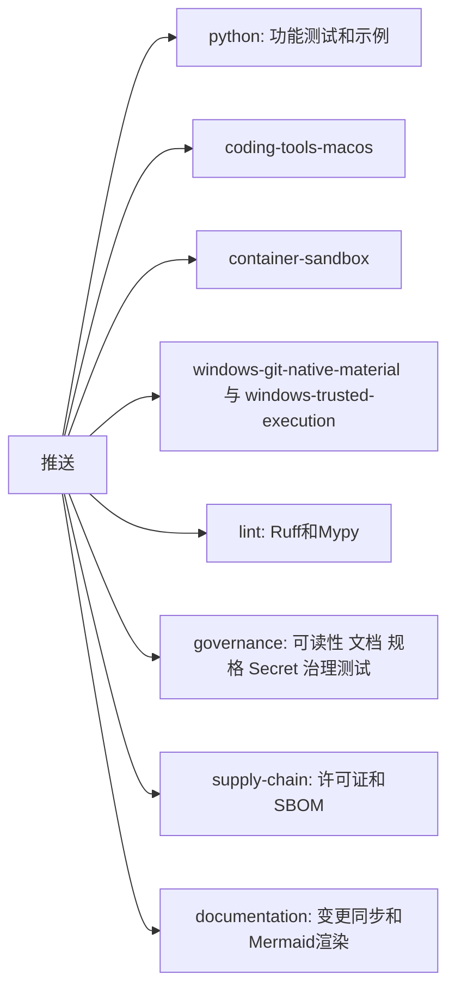

# P0 CI门禁恢复与可读性预算说明

## 1. 需求背景

2026-09-27之后CI持续失败。Linux和macOS任务的第一步是可读性门禁，失败后后面的`pytest`、Ruff和Mypy都不再执行，
因此约六周内没有任何提交经过CI的功能回归。本次恢复过程中发现的积压问题如下：

| 门禁 | 恢复前状态 | 处置 |
|---|---|---|
| 可读性 | 103项错误 | 按第7节逐类说明后更新预算 |
| Ruff | 357项错误、40个文件格式不符，其中356项错误在已冻结的SWE-bench实验脚本中 | 冻结脚本加入排除，其余修复 |
| Mypy | 85项错误 | 全部修复，不改变行为 |
| 容器测试 | 3项失败 | 修复评分器缺陷并更新过期断言 |

## 2. 设计目标与非目标

目标是让功能回归不再被治理门禁阻挡，并恢复每个门禁的真实信号。
非目标：不放宽任何门禁阈值，不改变许可证策略。`supply-chain`在许可证清单补齐前继续失败，属于已知发行阻断项。

## 3. 总体架构与流程

CI拆为互不依赖的任务，治理任务的各步骤也互不阻挡，失败时一次能看到全部结果。

Windows任务曾随首发范围取消移除；2026-11-10用户决定三平台都要支持，两个Windows任务及其形状测试按原样恢复。

## 4. 接口设计与领域契约

- Task Pack评分器把一次成功的`git_review`同时计为状态核对和差异核对。工作流自2026-10-13起只强制调用这个聚合工具，
  评分器未同步，导致Task Pack试次全部无法通过`git_feedback_order`。
- `CODING_EVAL_GRADER_VERSION`保持v1：改动只增加一种等价形式，历史报告中不存在`git_review`，结果不变。
- 越序Patch现在在工具目录层被拒绝，早于原来的审批层，测试断言已更新；安全性质不变。

## 5. 失败与恢复语义

本次不改变运行时的失败、取消、超时或恢复语义。

## 6. 持久化与事务

本次不改变持久化结构。可读性预算和最终报告仍是受版本控制的文件。

## 7. 可读性预算说明（ADR 0076）

ADR 0076要求增长预算前先说明原因，禁止把重新生成策略当作修复手段。本节即该说明，策略文件的完整差异见本次提交。

| 类别 | 恢复前批准数 | 恢复后批准数 | 主要来源 |
|---|---:|---:|---|
| 超大文件 | 11 | 23 | SWE-bench运行配置、Git交付、原生沙箱和命令工具的连续功能迭代 |
| 超大或高复杂度符号 | 138 | 170 | Agent运行时主循环、压缩、预算和工具修复 |
| 一级包依赖边 | 151 | 168 | 新增无头入口`exec_cli`、候选择优和沙箱接线 |
| 依赖强连通分量 | 1 | 2 | `delivery`、`product_config`、`trusted_actions`之间的双向依赖 |
| 公共`__all__`快照 | 14 | 15 | 新增评测与产品公共入口 |

增长最多的热点：

| 位置 | 批准上限 | 当前值 |
|---|---:|---:|
| `agent/runtime.py`文件行数 | 2794 | 3391 |
| `AgentRuntime`类行数 | 2621 | 3130 |
| `AgentRuntime._drive`行数与复杂度 | 145与30 | 259与49 |
| `AgentRuntime._sample_events`行数与复杂度 | 211与60 | 279与85 |
| `product_config/coding_tool_view.py`文件行数 | 新增 | 1024 |

恢复门禁后，P0-10又让`ProductController`增加36行、`ProductApp`增加4行，用于本会话审批规则。相关判断已拆到
[`approval_automation.py`](../../src/harnessix/product_ui/approval_automation.py)，留在类内的只有串行入口。
P1-3又为交互预算增加2行。
P0-9（ADR 0123第6节）让两个模型适配器的`stream`各增加10行，`AgentRuntime`增加13行，用于区分确定未计费与计费未知；
计算逻辑放在`_provider_io.py`和`turn_budget_compaction.py`，类内只保留分支和开关。
P1-2（[ADR 0125](../adr/0125-skill-product-wiring.md)）接入Skill：`agent/runtime.py`和`AgentRuntime`各增加1行，修复只读Trusted Action绕过`prepare`的缺陷；`open_default_product_action_runtime`增加7行，`_serve_product_stdio`增加4行，`build_product_agent_context`增加2行，都是组合根必须持有的新资源，发现和渲染逻辑已放到`skill_composition.py`。新增依赖边`product_config->skills`，方向是组合根依赖能力包。原依赖环`delivery/product_config/trusted_actions`因`trusted_actions`不再导入`product_config`而缩小为`delivery/trusted_actions`。

2026-11-10多语言评测前的修复批次（用户批准的a–f、10–14项）另有11项预算增长，逻辑都已放到新模块，类内只留开关与分支：
- `AgentRuntime`（+18行）、`__init__`（+2）、`_sample_events`（+6行，复杂度+2）、`_run_compaction`（+1），
  文件`agent/runtime.py`（+26）：纯文本截断恢复（ADR 0109 v3，判定与提示在`truncation_recovery.py`）只留开关、
  返回值与一个合并后的预算截断检查；参数字符串还原（7197c8f9）在`_sample_events`里多一个分支；
  压缩摘要说明头（ADR 0058第3版）在`_run_compaction`多一行。
- `SQLiteSessionStore`（+4）与`session/sqlite.py`（+5）：增量历史校验（ADR 0126）的缓存实例与调用参数，
  缓存与校验逻辑在`verified_prefix_cache.py`和`sqlite_publication.py`。
- `CodingToolRuntime`（+6）：工作区根的绝对路径按相对路径读取（5702881f），映射规则不放宽可读范围（ADR 0109）。
- `native_process.py`、`process_action.py`各+1：固定Profile参数可省略（合同v2）后的工具描述文字。
同一批次删除旧SWE-bench路径（审计第12项）时，相关预算按删除后的实际值下调，见
[删除记录](remove-legacy-swebench-path.md)。最终报告`readability-0.9.0-final.json`随之重新生成。

这些增长发生在门禁失效期间，没有逐项评审，是事实上已经存在的结构债务。本次把预算更新到当前值，让门禁重新生效，
此后任何继续增长都会失败。偿还计划列入发布清单P2-5：优先拆分`AgentRuntime`和`coding_tool_view.py`，
并解除`delivery`、`product_config`、`trusted_actions`之间的循环依赖。

## 8. 安全、权限与信任边界

CI权限保持`contents: read`。`self_hosted`相关的信任边界见[接入自托管模型](../operations/self-hosted-models.md)。

## 9. 可观测性与错误分类

每个门禁在CI中独立显示结果。新增配置错误码`product_configure_self_hosted_required`和预检项`product_self_hosted_key_length`（错误码`self_hosted_key_too_short`）。

## 10. 测试与验收

验收标准是Linux和macOS的功能测试在CI上跑完并全绿，治理门禁单独报告。`supply-chain`的失败不计入本项。

## 11. 源码映射

| 内容 | 位置 |
|---|---|
| CI任务 | [`ci.yml`](../../.github/workflows/ci.yml) |
| 评分器 | [`grader.py`](../../src/harnessix/evals/grader.py) |
| 录制Provider | [`recorded_task_pack.py`](../../scripts/recorded_task_pack.py) |
| 可读性预算 | [`readability-policy-v1.json`](../../governance/readability-policy-v1.json) |

## 12. 部署、兼容与回退

只影响CI和开发流程，不影响已发布行为。需要回退时还原CI文件和策略文件即可。

## 13. 风险与取舍

一次性接受积压的结构债务，换来门禁重新生效。不这样做，只能先完成数周的重构，CI在此期间继续失效，代价更高。
