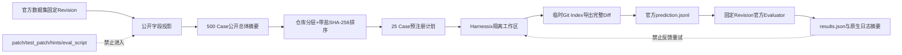

# SWE-bench Adapter 与 Verified 25 Case 预注册 Pilot

## 1. 需求背景、设计目标与当前结论

本切片建立 Harnessix Code 与官方 SWE-bench v5 之间的最小正式边界：

1. 从固定 `SWE-bench_Verified/test` 总体只投影 Agent 可见公开字段；
2. 在模型请求前确定性冻结 25 个 Case、模型、预算、网络与重试规则；
3. 从隔离 Git 工作区导出官方三字段 prediction JSONL；
4. 用固定源码 Revision 的官方 CLI 评分，并校验结果范围和原生日志摘要。

已生成的预注册计划位于
[`benchmarks/swebench/verified-25-v1/plan.json`](../../benchmarks/swebench/verified-25-v1/plan.json)。
它是 **25 Case 分层 Pilot**，不是 500 Case 完整榜单结果，也不是已完成 25 次模型执行。

## 2. 固定输入

| 输入 | 固定值 |
|---|---|
| 数据集 | `SWE-bench/SWE-bench_Verified`，`test`，500 Case |
| 数据集 Revision | `78f471bf655a3137b2e8a75af1501690ec009ec3` |
| Parquet SHA-256 | `030cfd7f2a704c4c0226e7f104c725a3b41230b1d3517f9c915ad7ea5be3fa25` |
| 官方 SWE-bench | `5.0.2`，Revision `02e7a74ffd0b707aab73d203fe87bdc7c76afc8e` |
| Task Repo | Revision `3d07b464b7b311a0cbfb5ed5b2d8a3b96f84a33d` |
| Harnessix Agent执行实现 | Revision `ff3d25c83f445430ff3c87f258b8cd5122ea7855` |
| 模型身份 | `harnessix-qwen3.8-max`，`openai_chat`，thinking disabled |
| 单 Case 预算 | 16 step、50K token、900 秒、每 step 最多 8 次工具调用 |
| 试验语义 | pass@1、Agent 禁网、无模型自动重试 |

## 3. 总体架构、数据流程与持久化



预注册与评分之间只传递冻结的 prediction。官方隐藏测试、Golden、Hint、`eval.sh`和评分日志不进入
Agent Workspace，不允许依据评分结果换题或启动第二次模型修补。

## 4. 数据结构、领域契约、接口设计与源码映射

| 合同 | 源码 | 责任 |
|---|---|---|
| `SweBenchPublicCase` | [`contracts.py`](../../src/harnessix/evals/swebench/contracts.py) | 公开字段白名单，拒绝额外字段 |
| `SweBenchPreRegistrationPlan` | [`contracts.py`](../../src/harnessix/evals/swebench/contracts.py) | 固定总体、版本、模型、预算、25 Case和计划摘要 |
| `select_swebench_cases` | [`selection.py`](../../src/harnessix/evals/swebench/selection.py) | 仅按公开身份字段分层选样 |
| `SweBenchPrediction` | [`predictions.py`](../../src/harnessix/evals/swebench/predictions.py) | 官方三字段格式；空补丁仍合法并计入分母 |
| `run_swebench_agent_suite` | [`execution.py`](../../src/harnessix/evals/swebench/execution.py) | 按预注册顺序恢复同一 pass@1 Turn、冻结 Patch 与 Prediction |
| `materialize_swebench_workspace` | [`workspace.py`](../../src/harnessix/evals/swebench/workspace.py) | 物化公开仓库精确 base commit，隔离缓存、Agent 工作区与官方 Task Repo |
| `collect_workspace_patch` | [`predictions.py`](../../src/harnessix/evals/swebench/predictions.py) | 临时 Index 捕获修改、新增、删除和二进制 Diff，不改真实 Index |
| `build_official_evaluation_command` | [`official.py`](../../src/harnessix/evals/swebench/official.py) | 无 Shell 拼接；核对 Evaluator 与 Task Repo Revision |
| `import_official_result` | [`official.py`](../../src/harnessix/evals/swebench/official.py) | 核对 25 Case 范围、计数、patch 和原生日志摘要 |

## 5. 选样语义、风险与取舍

`repo_round_robin_sha256_v1`先按公开盐值排序仓库，再在每个仓库内按
`repo + instance_id + base_commit`的 SHA-256 排序，按轮次取满 25 个。输入行顺序、Golden、测试补丁和
测试 ID 不参与选择。

该策略优先覆盖不同仓库，适合小样本工程 Pilot；它不是从 500 Case 做等概率抽样，因此不得把 25 Case
通过率外推为完整 Verified 总体通过率。

## 6. 失败语义、错误分类与可观测性

| 失败 | 处理 |
|---|---|
| 候选少于25、重复ID、计划摘要或顺序漂移 | 预注册失败，不创建模型请求 |
| Prediction 缺失、重复、越界、模型身份漂移 | 拒绝评分 |
| 工作区 HEAD 不等于 `base_commit` | 拒绝导出 |
| Git Diff 超过8 MiB或不是UTF-8 | 拒绝导出，不截断 |
| 未显式传入`--allow-network` | 不读取计划或凭据，不启动官方进程 |
| Evaluator/Task Repo Revision漂移 | 在容器评分前失败关闭 |
| 结果不是精确25 Case或存在 incomplete | 拒绝导入 |
| 完成Case缺少官方五项日志或patch不一致 | 拒绝发布摘要 |
| 空补丁 | 合法 prediction，由官方计入`empty_patch`，不得删除该Case |

CLI只输出有界状态、数量和摘要。问题正文、Diff、测试输出与绝对路径不进入公开摘要；诊断仍保留在受控的
官方原生日志目录，由文件数量与SHA-256形成可复核证据。

## 7. 安全、权限与信任边界

- Agent侧只接收`SweBenchPublicCase`和上游源码工作区；未知字段由严格合同拒绝；
- Evaluator侧可读取Task Repo、隐藏测试与日志，但这些目录不能位于Agent Workspace；
- 网络只在官方评分命令显式启用，预注册、验证、导出和结果复核均不需要Provider网络；
- Evaluation结果只用于计分，不允许反馈给Agent重试；
- 计划、Prediction、Evaluator源码、Task Repo和结果日志分别以Revision或SHA-256绑定。

## 8. CLI 流程

```text
harnessix coding-eval-swebench preregister ...
harnessix coding-eval-swebench validate --plan plan.json
harnessix coding-eval-swebench run-agent --allow-repository-network --allow-provider-network ...
harnessix coding-eval-swebench export-predictions --plan plan.json --workspaces ...
harnessix coding-eval-swebench evaluate --allow-network --plan ... --predictions ...
harnessix coding-eval-swebench verify-results --plan ... --predictions ...
```

官方评测必须使用位于固定 SWE-bench 源码目录内的可执行文件，并提供固定 Task Repo；`run_id`由
`plan_sha256 + predictions_sha256`确定，避免官方按 `run_id + instance_id`复用旧补丁缓存。

## 9. 验证、部署兼容、回退与未完成项

当前完成：

- 500 Case公开总体投影、摘要和25 Case预注册真实生成；
- 无泄漏、重排稳定、篡改、预算、空补丁、Git完整Diff、官方命令与结果证据单元测试；
- 适配层42项测试及既有Task Pack/Provider CLI相关回归通过；
- Ruff与全源码Mypy通过。

当前未完成：

- 已实现并验证25 Case真实 Agent 执行、恢复、费用边界与Prediction冻结宿主；
- 尚未完成本计划的25次真实模型 Turn，`predictions.jsonl`尚未生成；
- 尚未运行官方 Docker 评分，因此当前没有`resolved/25`质量结论；
- 25 Case完成后仍只能发布 Pilot 结果，完整排行榜需要独立的完整数据集评测。

首轮只支持macOS上的计划、导出和CLI合同验证；正式官方评分使用Docker，执行环境必须另行保存环境证据。
回退时可删除`coding-eval-swebench`顶层分派和独立`swebench`包，不修改既有Task Pack、Provider Suite、
Session或Agent Runtime合同；已冻结计划仍作为历史证据保留，不改写Case。

## 10. 官方依据

- [SWE-bench Evaluation Guide](https://github.com/SWE-bench/SWE-bench/blob/02e7a74ffd0b707aab73d203fe87bdc7c76afc8e/docs/guides/evaluation.md)
- [SWE-bench Dataset Guide](https://github.com/SWE-bench/SWE-bench/blob/02e7a74ffd0b707aab73d203fe87bdc7c76afc8e/docs/guides/datasets.md)
- [SWE-bench results.json 实现](https://github.com/SWE-bench/SWE-bench/blob/02e7a74ffd0b707aab73d203fe87bdc7c76afc8e/swebench/harness/reporting.py)
