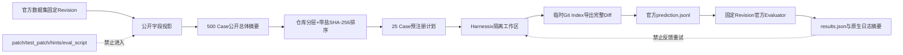

# SWE-bench Adapter 与 Verified 25 Case 预注册 Pilot

## 1. 需求背景、设计目标与当前结论

本切片建立 Harnessix Code 与官方 SWE-bench v5 之间的最小正式边界：

1. 从固定 `SWE-bench_Verified/test` 总体只投影 Agent 可见公开字段；
2. 在模型请求前确定性冻结 25 个 Case、模型、预算、网络与重试规则；
3. 从隔离 Git 工作区导出官方三字段 prediction JSONL；
4. 用固定源码 Revision 的官方 CLI 评分，并校验结果范围和原生日志摘要。

已生成的预注册计划位于
[`benchmarks/swebench/verified-25-v1/plan.json`](../../benchmarks/swebench/verified-25-v1/plan.json)。
它是 **25 Case 分层 Pilot**，不是 500 Case 完整榜单结果。当前已完成25次真实模型执行及官方Docker
评分，冻结结果为`resolved 1/25`、`unresolved 2/25`、`empty_patch 22/25`、基础设施失败0。

## 2. 固定输入

| 输入 | 固定值 |
|---|---|
| 数据集 | `SWE-bench/SWE-bench_Verified`，`test`，500 Case |
| 数据集 Revision | `78f471bf655a3137b2e8a75af1501690ec009ec3` |
| Parquet SHA-256 | `030cfd7f2a704c4c0226e7f104c725a3b41230b1d3517f9c915ad7ea5be3fa25` |
| 官方 SWE-bench | `5.0.2`，Revision `02e7a74ffd0b707aab73d203fe87bdc7c76afc8e` |
| Task Repo | Revision `3d07b464b7b311a0cbfb5ed5b2d8a3b96f84a33d` |
| Harnessix Agent执行实现 | Revision `ff3d25c83f445430ff3c87f258b8cd5122ea7855` |
| 模型身份 | `harnessix-qwen3.8-max`，`openai_chat`，thinking disabled |
| 单 Case 预算 | 16 step、50K token、900 秒、每 step 最多 8 次工具调用 |
| 试验语义 | pass@1、Agent 禁网、无模型自动重试 |

## 3. 总体架构、数据流程与持久化



预注册与评分之间只传递冻结的 prediction。官方隐藏测试、Golden、Hint、`eval.sh`和评分日志不进入
Agent Workspace，不允许依据评分结果换题或启动第二次模型修补。

## 4. 数据结构、领域契约、接口设计与源码映射

| 合同 | 源码 | 责任 |
|---|---|---|
| `SweBenchPublicCase` | [`contracts.py`](../../src/harnessix/evals/swebench/contracts.py) | 公开字段白名单，拒绝额外字段 |
| `SweBenchPreRegistrationPlan` | [`contracts.py`](../../src/harnessix/evals/swebench/contracts.py) | 固定总体、版本、模型、预算、25 Case和计划摘要 |
| `select_swebench_cases` | [`selection.py`](../../src/harnessix/evals/swebench/selection.py) | 仅按公开身份字段分层选样 |
| `SweBenchPrediction` | [`predictions.py`](../../src/harnessix/evals/swebench/predictions.py) | 官方三字段格式；空补丁仍合法并计入分母 |
| `run_swebench_agent_suite` | [`execution.py`](../../src/harnessix/evals/swebench/execution.py) | 按预注册顺序恢复同一 pass@1 Turn、冻结 Patch 与 Prediction |
| `materialize_swebench_workspace` | [`workspace.py`](../../src/harnessix/evals/swebench/workspace.py) | 物化公开仓库精确 base commit，隔离缓存、Agent 工作区与官方 Task Repo |
| `collect_workspace_patch` | [`predictions.py`](../../src/harnessix/evals/swebench/predictions.py) | 临时 Index 捕获修改、新增、删除和二进制 Diff，不改真实 Index |
| `build_official_evaluation_command` | [`official.py`](../../src/harnessix/evals/swebench/official.py) | 无 Shell 拼接；核对 Evaluator 与 Task Repo Revision |
| `import_official_result` | [`official.py`](../../src/harnessix/evals/swebench/official.py) | 核对 25 Case 范围、计数、patch 和原生日志摘要 |

## 5. 选样语义、风险与取舍

`repo_round_robin_sha256_v1`先按公开盐值排序仓库，再在每个仓库内按
`repo + instance_id + base_commit`的 SHA-256 排序，按轮次取满 25 个。输入行顺序、Golden、测试补丁和
测试 ID 不参与选择。

该策略优先覆盖不同仓库，适合小样本工程 Pilot；它不是从 500 Case 做等概率抽样，因此不得把 25 Case
通过率外推为完整 Verified 总体通过率。

## 6. 失败语义、错误分类与可观测性

| 失败 | 处理 |
|---|---|
| 候选少于25、重复ID、计划摘要或顺序漂移 | 预注册失败，不创建模型请求 |
| Prediction 缺失、重复、越界、模型身份漂移 | 拒绝评分 |
| 工作区 HEAD 不等于 `base_commit` | 拒绝导出 |
| Git Diff 超过8 MiB或不是UTF-8 | 拒绝导出，不截断 |
| 未显式传入`--allow-network` | 不读取计划或凭据，不启动官方进程 |
| Evaluator/Task Repo Revision漂移 | 在容器评分前失败关闭 |
| 结果不是精确25 Case或存在 incomplete | 拒绝导入 |
| 完成Case缺少官方五项日志或patch不一致 | 拒绝发布摘要 |
| 空补丁 | 合法 prediction，由官方计入`empty_patch`，不得删除该Case |

CLI只输出有界状态、数量和摘要。问题正文、Diff、测试输出与绝对路径不进入公开摘要；诊断仍保留在受控的
官方原生日志目录，由文件数量与SHA-256形成可复核证据。

## 7. 安全、权限与信任边界

- Agent侧只接收`SweBenchPublicCase`和上游源码工作区；未知字段由严格合同拒绝；
- Evaluator侧可读取Task Repo、隐藏测试与日志，但这些目录不能位于Agent Workspace；
- 网络只在官方评分命令显式启用，预注册、验证、导出和结果复核均不需要Provider网络；
- Evaluation结果只用于计分，不允许反馈给Agent重试；
- 计划、Prediction、Evaluator源码、Task Repo和结果日志分别以Revision或SHA-256绑定。

## 8. CLI 流程

```text
harnessix coding-eval-swebench preregister ...
harnessix coding-eval-swebench validate --plan plan.json
harnessix coding-eval-swebench run-agent --allow-repository-network --allow-provider-network ...
harnessix coding-eval-swebench export-predictions --plan plan.json --workspaces ...
harnessix coding-eval-swebench evaluate --allow-network --plan ... --predictions ...
harnessix coding-eval-swebench verify-results --plan ... --predictions ...
```

官方评测必须使用位于固定 SWE-bench 源码目录内的可执行文件，并提供固定 Task Repo；`run_id`由
`plan_sha256 + predictions_sha256`确定，避免官方按 `run_id + instance_id`复用旧补丁缓存。

## 9. 验证、部署兼容、回退与未完成项

首轮v1完成（历史结果，不代表后续轮次成绩）：

- 500 Case公开总体投影、摘要和25 Case预注册真实生成；
- 无泄漏、重排稳定、篡改、预算、空补丁、Git完整Diff、官方命令与结果证据单元测试；
- 适配层88项测试及受影响Task Pack/Provider CLI回归共181项通过；
- Ruff与全源码Mypy通过。
- 已实现并验证25 Case真实 Agent 执行、恢复、费用边界与Prediction冻结宿主；
- 25/25真实模型Turn已完成：1个正常完成、23个达到任务预算、1个Provider输出无效；最终3个非空补丁、
  22个空补丁；
- 官方固定Task Repo Dockerfile在Docker Desktop上本地构建3个`x86_64`镜像，没有回退拉取；
- 官方评分完成且独立复核通过：`resolved 1/25`、`unresolved 2/25`、`empty_patch 22/25`、
  基础设施失败0；结构化证据见
  [`runs/harnessix-64c385da3fcf-290a0c97ab1a.json`](../../benchmarks/swebench/verified-25-v1/runs/harnessix-64c385da3fcf-290a0c97ab1a.json)。

当前边界：

- 25 Case完成后仍只能发布 Pilot 结果，完整排行榜需要独立的完整数据集评测。

首轮只支持macOS上的计划、导出和CLI合同验证；正式官方评分使用Docker，执行环境必须另行保存环境证据。
回退时可删除`coding-eval-swebench`顶层分派和独立`swebench`包，不修改既有Task Pack、Provider Suite、
Session或Agent Runtime合同；已冻结计划仍作为历史证据保留，不改写Case。

## 10. 官方依据

- [SWE-bench Evaluation Guide](https://github.com/SWE-bench/SWE-bench/blob/02e7a74ffd0b707aab73d203fe87bdc7c76afc8e/docs/guides/evaluation.md)
- [SWE-bench Dataset Guide](https://github.com/SWE-bench/SWE-bench/blob/02e7a74ffd0b707aab73d203fe87bdc7c76afc8e/docs/guides/datasets.md)
- [SWE-bench results.json 实现](https://github.com/SWE-bench/SWE-bench/blob/02e7a74ffd0b707aab73d203fe87bdc7c76afc8e/swebench/harness/reporting.py)

## 11. 25 Case 开发集优化与后续泛化评测

首轮25个Case经过多轮失败分析后，现作为开发集。目标为Resolved至少22/25、空补丁至多2/25、
补丁应用失败及基础设施失败均为0。目标仍需官方评分确认，局部回归通过不能计为Resolved。
每轮保留独立计划、固定实现提交、同样的Case顺序及50K token / 16 step / 900秒预算。

本轮修改的通用机制及边界：

- [公开测试Profile](../../src/harnessix/evals/swebench/public_test_profile.py)：
  优先从只读Workspace导入被修改的Python源码；缺少的构建生成模块及编译扩展从该Case绑定的
  官方基础镜像读取，运行目录为临时目录。pytest使用实际存在的公开测试文件，忽略猜测的node后缀；
  目标文件缺失时，只按修改源码与基础镜像的字节差异匹配公开`test_<module>.py`。
  无测试匹配仍报错，不把未运行测试当作成功。
- [工具目录](../../src/harnessix/product_config/coding_tool_view.py)：
  按持久化事实暴露调查、修改、测试、诊断和复核工具。`git_review`仅在最新修改经测试成功后开放；
  测试失败需诊断和重测。预注册显式声明`parallel_tool_calls=true`的轮次允许一次响应带多个
  独立读取调用，写入和测试继续遵循Runtime的权限及顺序边界。
- [Git复核](../../src/harnessix/tools/git.py)：`git_review`复用既有`git_status`和工作区`git_diff`，
  返回[严格聚合契约](../../src/harnessix/tools/git_contracts.py)。两次观察顺序执行、并非原子快照；
  任一步失败、取消、输出无效或合并输出越界，都不返回部分成功。评测还独立核验类型与截断标志。
- [Suite状态v2](../../src/harnessix/evals/swebench/execution_contracts.py)：
  已尝试Case与证据成功Case分别统计。预算耗尽、空补丁、代码测试失败、缺少复核等质量失败
  保存原终态与Patch并继续后面的Case，官方分母始终为25。取消、未知状态、环境或身份错误
  停止；恢复重用原Turn，不创建同Case第二次尝试。v1历史状态及结果保留原语义。

调用链：公开计划 → 隔离Workspace → Agent调查/修改 → 公开测试 → Git复核 → Case终态 →
完整25条prediction → 官方Docker评分。Case证据失败与官方Resolved是不同指标，均须如实报告。

下一步在实现及参数冻结后，使用排除全部开发集Case、未向Agent或开发者展示答案的新数据集，
先冻结选择规则、seed、数据版本、完整manifest与评分门槛，再做一次正式执行。
正式集结果不反馈给Agent追加修补，不选择性删除失败，不与开发集结果合并发布。

本轮v13计划见[plan.json](../../benchmarks/swebench/verified-25-v13/plan.json)，实现提交`cd628938aa463bacd46e050fdf247fd43de80bce`。
v13真实执行在第3个Case停止：前2个达到Token预算，第3个模型未返回要求的工具调用；
3个Case均留下非空Patch，22个尚未尝试，未做官方评分。已计量用量按非缓存原价计算的
上界为1.606608元，没有未决请求；详见[执行摘要](../../benchmarks/swebench/verified-25-v13/execution-summary.json)。
首个Case公开测试和Git复核成功，不代表整个Turn或官方Resolved成功。

后续修正仅针对通用失败边界和调查流程：完全结算的模型契约错误只终止该Case；
未知工具状态和未决费用仍停止整批。移除有公开测试场景中“四次读取后强制修改”的限制，
避免尚未定位准确方法就仓促修改；改为精确符号定位、窄窗口读取，并保持原任务硬预算。
Token阻断的根因还包含重复发送完整历史：v13首个Case实际累计用量为45300，
下一请求输入保守估算11520，而剩余预算仅4700；默认压缩尚未触发。
预算感知压缩本轮不引入，避免把新的摘要费用和调查策略同时混入一次实验。

下一轮v14已按相同Case、模型参数与硬预算冻结：[计划](../../benchmarks/swebench/verified-25-v14/plan.json)、[预检](../../benchmarks/swebench/verified-25-v14/preflight.json)。
本轮范围是失败隔离和调查流程，不将离线回归或预算结算当作Resolved。
v14完整执行结果见[执行摘要](../../benchmarks/swebench/verified-25-v14/execution-summary.json)：
25个Case全部尝试，3个Turn完整闭环，10个非空Patch、15个空Patch；17个预算失败、5个已结算模型契约失败。
这些失败未触发同Case重试，也没有被计入成功。
[官方首轮摘要](../../benchmarks/swebench/verified-25-v14/official-summary-initial.json)经独立导入校验：
Resolved 3/25、空Patch 15/25、8个完成评分、2个错误，未达标。
两项错误来自Docker并行构建期间Conda内存不足；虽然官方“likely infrastructure”字段为0，
这不能解释为环境无故障。保留原失败，以同一份冻结prediction在新目录串行重建及评分，
不增加模型请求、不替换Patch、不挑选最优Case结果。
[串行复验摘要](../../benchmarks/swebench/verified-25-v14/official-summary-serial.json)已独立校验：
所需10个镜像全部由固定Task Repo本地构建，无拉取回退；Resolved **5/25（20%）**，
空Patch 15/25、评测错误0、官方基础设施失败0。10个非空Patch均完成评分，仍未达到质量目标。
官方基础设施分类字段为0不代表环境达标：[原始镜像探测](../../benchmarks/swebench/verified-25-v14/infrastructure-probes.json)
确认requests/pylint测试依赖trustme/appdirs缺失；另一个零测试收集问题尚未闭环。
保留原评分，不通过修改隐藏测试或临时安装依赖抬高成绩。环境门槛仍未验收。

v15在相同开发集、模型及任务硬预算下引入两项共性修复：

- [预算感知压缩](../../src/harnessix/agent/turn_budget_compaction.py)在冻结下一模型历史前，
  按剩余Token与重复输入压力派生候选窗口，复用原压缩计划、摘要账本与活动窗口。
  保留原用户消息和至少两个近期闭合工具组；窗口目标必须能够容纳这些固定项，不能直接
  用未来三次请求的均摊额度强制缩小。先核算完整摘要请求、摘要输出、下一历史的完整摘要Item、
  工具目录、Context和收尾余量。无可压前缀、无缩减、固定项溢出或不可支付时不调用摘要模型。
  主请求、摘要与重试尝试共用原16次请求上限，摘要用量计入原50K预算，不额外增加额度。
- [历史准备](../../src/harnessix/agent/model_history_runtime.py)及Runtime在摘要后正常重新观测Context，
  对比指令指纹、来源、权限片段与一致性事实；来源漂移失败关闭，不复用未经复核的指令缓存。
  取消、未知费用、历史损坏及恢复继续沿用原账本语义。
- [目录拒绝反馈](../../src/harnessix/agent/runtime.py)不再把全部结构完整的目录外工具提案误判为
  “没有工具调用”。拒绝仍只形成闭合反馈、零执行，模型只能在原预算内纠正；纯文本、空响应、
  畸形、重复及强制工具已接受违规调用仍失败。既有冻结失败不改判成功。

新增专项测试覆盖预付成本、完整摘要封装、请求计数、来源漂移与拒绝纠正；同一Turn的真实Runtime
测试验证提前激活、用量结算及事件重放。相关回归1592项通过、1项跳过、4项因本机Git能力未选择；
Ruff及552个源码文件Mypy通过。这是机制验证，不是Resolved成绩。
[v15计划](../../benchmarks/swebench/verified-25-v15/plan.json)与[预检](../../benchmarks/swebench/verified-25-v15/preflight.json)
已经冻结并完成25 Case：[执行摘要](../../benchmarks/swebench/verified-25-v15/execution-summary.json)、
[官方摘要](../../benchmarks/swebench/verified-25-v15/official-summary.json)及独立导入校验。
结果为Resolved **4/25（16%）**、空Patch **18/25**，0个Turn完整闭环；20个预算失败、
5个摘要契约失败。相比v14未获得质量收益，结论为 **NO_GO**，不把提前压缩默认发布；
既有窗口阈值压缩和溢出恢复机制保留。评分错误0，环境缺依赖的风险仍未验收。
当前100元周期累计保守计价上界 **22.290948元**，无未决预留，剩余额度 **77.709052元**；
这是按完整用量计算的计价上界，不是实扣账单。

### v16：出站输入预算与磁盘余量门禁（尚未付费执行）

- [可选预算端口](../../src/harnessix/models/contracts.py)不改变`ModelProvider.stream`。
  [Chat实现](../../src/harnessix/models/openai_chat.py)复用正式请求mapper，计入UTF-8字节和512边界余量；
  不读取Key、不发送HTTP，不把未发送的输出Schema或执行元数据计入模型输入。
- [Runtime预算](../../src/harnessix/agent/model_input_budget.py)仅在Provider、请求模型、实际模型
  与持久历史前缀全部匹配时复用上一完整实际输入，重新计入新增出站内容、全部当前工具与指令。
  历史改写、模型别名、来源不匹配回到完整输入上界；未声明能力的Provider保持旧算法。
  能力返回非法值或抛异常在请求前失败关闭。实际用量硬门、未知费用及原任务预算不变。
- v15提前压缩没有质量收益，现改为显式实验选项、默认关闭；原窗口阈值压缩和溢出恢复不变。
- [磁盘门禁](../../src/harnessix/evals/swebench/disk_space.py)在初始化、克隆、下一新Case及
  官方评测启动前保留10 GiB余量；不足或无法读取余量则停止新写入/付费调用。
  已完成Case及原费用记录保留，不把未尝试Case计作成功。此门禁是阶段准入，不是运行中Docker
  守护进程或其他本机程序的磁盘配额，也不自动删除镜像、容器、Volume或原始评测证据。

最终改动范围368项测试通过，553个源码文件Mypy及改动文件Ruff通过。
扩大输入候选回归曾出现4项重试测试失败，已在未改动v15基线上复现，原测例保留，
没有删除或跳过来制造全绿；最终扩大回归因磁盘余量跌破768 MiB而自动终止，不能宣称全量通过。
日志摘要及当前阻断见[v16预检](../../benchmarks/swebench/verified-25-v16/preflight.json)。
[v16计划](../../benchmarks/swebench/verified-25-v16/plan.json)只更新源码身份，25 Case、顺序、模型及
50K/16次/900秒预算不变；磁盘不足10 GiB，不创建新Workspace批次、不增加付费请求。
当前正式可报告结果仍是v14串行5/25、v15为4/25，目标22/25和环境零失败均未验收。
