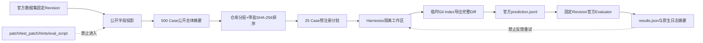
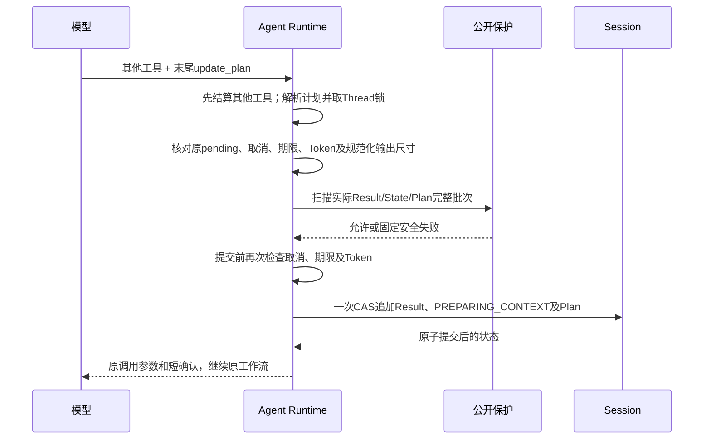

# SWE-bench Adapter 与 Verified 25 Case 预注册 Pilot

## 1. 需求背景、设计目标与当前结论

本切片建立 Harnessix Code 与官方 SWE-bench v5 之间的最小正式边界：

1. 从固定 `SWE-bench_Verified/test` 总体只投影 Agent 可见公开字段；
2. 在模型请求前确定性冻结 25 个 Case、模型、预算、网络与重试规则；
3. 从隔离 Git 工作区导出官方三字段 prediction JSONL；
4. 用固定源码 Revision 的官方 CLI 评分，并校验结果范围和原生日志摘要。

已生成的预注册计划位于
[`benchmarks/swebench/verified-25-v1/plan.json`](../../benchmarks/swebench/verified-25-v1/plan.json)。
它是 **25 Case 分层开发集**，不是500 Case完整榜单或独立泛化集。最新完整官方结果为
[v27：Resolved 3/25、空补丁19](../../benchmarks/swebench/verified-25-v27/official-summary.json)，
6项补丁应用成功，但3项模糊失败使基础设施门禁仍OPEN。历史v1的1/25不代表当前成绩；
后续三项预算／思考对照不是正式评分，22/25及全新泛化集目标仍未完成。

## 2. 固定输入

| 输入 | 固定值 |
|---|---|
| 数据集 | `SWE-bench/SWE-bench_Verified`，`test`，500 Case |
| 数据集 Revision | `78f471bf655a3137b2e8a75af1501690ec009ec3` |
| Parquet SHA-256 | `030cfd7f2a704c4c0226e7f104c725a3b41230b1d3517f9c915ad7ea5be3fa25` |
| 官方 SWE-bench | `5.0.2`，Revision `02e7a74ffd0b707aab73d203fe87bdc7c76afc8e` |
| Task Repo | Revision `3d07b464b7b311a0cbfb5ed5b2d8a3b96f84a33d` |
| Harnessix Agent执行实现 | Revision `ff3d25c83f445430ff3c87f258b8cd5122ea7855` |
| 模型身份 | `harnessix-qwen3.8-max`，`openai_chat`，thinking disabled |
| 单 Case 预算 | 16 step、50K token、900 秒、每 step 最多 8 次工具调用 |
| 试验语义 | pass@1、Agent 禁网、无模型自动重试 |

## 3. 总体架构、数据流程与持久化



预注册与评分之间只传递冻结的 prediction。官方隐藏测试、Golden、Hint、`eval.sh`和评分日志不进入
Agent Workspace，不允许依据评分结果换题或启动第二次模型修补。

## 4. 数据结构、领域契约、接口设计与源码映射

| 合同 | 源码 | 责任 |
|---|---|---|
| `SweBenchPublicCase` | [`contracts.py`](../../src/harnessix/evals/swebench/contracts.py) | 公开字段白名单，拒绝额外字段 |
| `SweBenchPreRegistrationPlan` | [`contracts.py`](../../src/harnessix/evals/swebench/contracts.py) | 固定总体、版本、模型、预算、25 Case和计划摘要 |
| `select_swebench_cases` | [`selection.py`](../../src/harnessix/evals/swebench/selection.py) | 仅按公开身份字段分层选样 |
| `SweBenchPrediction` | [`predictions.py`](../../src/harnessix/evals/swebench/predictions.py) | 官方三字段格式；空补丁仍合法并计入分母 |
| `run_swebench_agent_suite` | [`execution.py`](../../src/harnessix/evals/swebench/execution.py) | 按预注册顺序恢复同一 pass@1 Turn、冻结 Patch 与 Prediction |
| `materialize_swebench_workspace` | [`workspace.py`](../../src/harnessix/evals/swebench/workspace.py) | 物化公开仓库精确 base commit，隔离缓存、Agent 工作区与官方 Task Repo |
| `collect_workspace_patch` | [`predictions.py`](../../src/harnessix/evals/swebench/predictions.py) | 临时 Index 捕获修改、新增、删除和二进制 Diff，不改真实 Index |
| `build_official_evaluation_command` | [`official.py`](../../src/harnessix/evals/swebench/official.py) | 无 Shell 拼接；核对 Evaluator 与 Task Repo Revision |
| `import_official_result` | [`official.py`](../../src/harnessix/evals/swebench/official.py) | 核对 25 Case 范围、计数、patch 和原生日志摘要 |

## 5. 选样语义、风险与取舍

`repo_round_robin_sha256_v1`先按公开盐值排序仓库，再在每个仓库内按
`repo + instance_id + base_commit`的 SHA-256 排序，按轮次取满 25 个。输入行顺序、Golden、测试补丁和
测试 ID 不参与选择。

该策略优先覆盖不同仓库，适合小样本工程 Pilot；它不是从 500 Case 做等概率抽样，因此不得把 25 Case
通过率外推为完整 Verified 总体通过率。

## 6. 失败语义、错误分类与可观测性

| 失败 | 处理 |
|---|---|
| 候选少于25、重复ID、计划摘要或顺序漂移 | 预注册失败，不创建模型请求 |
| Prediction 缺失、重复、越界、模型身份漂移 | 拒绝评分 |
| 工作区 HEAD 不等于 `base_commit` | 拒绝导出 |
| Git Diff 超过8 MiB或不是UTF-8 | 拒绝导出，不截断 |
| 未显式传入`--allow-network` | 不读取计划或凭据，不启动官方进程 |
| Evaluator/Task Repo Revision漂移 | 在容器评分前失败关闭 |
| 结果不是精确25 Case或存在 incomplete | 拒绝导入 |
| 完成Case缺少官方五项日志或patch不一致 | 拒绝发布摘要 |
| 空补丁 | 合法 prediction，由官方计入`empty_patch`，不得删除该Case |

CLI只输出有界状态、数量和摘要。问题正文、Diff、测试输出与绝对路径不进入公开摘要；诊断仍保留在受控的
官方原生日志目录，由文件数量与SHA-256形成可复核证据。

## 7. 安全、权限与信任边界

- Agent侧只接收`SweBenchPublicCase`和上游源码工作区；未知字段由严格合同拒绝；
- Evaluator侧可读取Task Repo、隐藏测试与日志，但这些目录不能位于Agent Workspace；
- 网络只在官方评分命令显式启用，预注册、验证、导出和结果复核均不需要Provider网络；
- Evaluation结果只用于计分，不允许反馈给Agent重试；
- 计划、Prediction、Evaluator源码、Task Repo和结果日志分别以Revision或SHA-256绑定。

## 8. CLI 流程

```text
harnessix coding-eval-swebench preregister ...
harnessix coding-eval-swebench validate --plan plan.json
harnessix coding-eval-swebench run-agent --allow-repository-network --allow-provider-network ...
harnessix coding-eval-swebench export-predictions --plan plan.json --workspaces ...
harnessix coding-eval-swebench evaluate --allow-network --plan ... --predictions ...
harnessix coding-eval-swebench verify-results --plan ... --predictions ...
```

官方评测必须使用位于固定 SWE-bench 源码目录内的可执行文件，并提供固定 Task Repo；`run_id`由
`plan_sha256 + predictions_sha256`确定，避免官方按 `run_id + instance_id`复用旧补丁缓存。

## 9. 验证、部署兼容、回退与未完成项

首轮v1完成（历史结果，不代表后续轮次成绩）：

- 500 Case公开总体投影、摘要和25 Case预注册真实生成；
- 无泄漏、重排稳定、篡改、预算、空补丁、Git完整Diff、官方命令与结果证据单元测试；
- 适配层88项测试及受影响Task Pack/Provider CLI回归共181项通过；
- Ruff与全源码Mypy通过。
- 已实现并验证25 Case真实 Agent 执行、恢复、费用边界与Prediction冻结宿主；
- 25/25真实模型Turn已完成：1个正常完成、23个达到任务预算、1个Provider输出无效；最终3个非空补丁、
  22个空补丁；
- 官方固定Task Repo Dockerfile在Docker Desktop上本地构建3个`x86_64`镜像，没有回退拉取；
- 官方评分完成且独立复核通过：`resolved 1/25`、`unresolved 2/25`、`empty_patch 22/25`、
  基础设施失败0；结构化证据见
  [`runs/harnessix-64c385da3fcf-290a0c97ab1a.json`](../../benchmarks/swebench/verified-25-v1/runs/harnessix-64c385da3fcf-290a0c97ab1a.json)。

当前边界：

- 25 Case完成后仍只能发布 Pilot 结果，完整排行榜需要独立的完整数据集评测。

首轮只支持macOS上的计划、导出和CLI合同验证；正式官方评分使用Docker，执行环境必须另行保存环境证据。
回退时可删除`coding-eval-swebench`顶层分派和独立`swebench`包，不修改既有Task Pack、Provider Suite、
Session或Agent Runtime合同；已冻结计划仍作为历史证据保留，不改写Case。

## 10. 官方依据

- [SWE-bench Evaluation Guide](https://github.com/SWE-bench/SWE-bench/blob/02e7a74ffd0b707aab73d203fe87bdc7c76afc8e/docs/guides/evaluation.md)
- [SWE-bench Dataset Guide](https://github.com/SWE-bench/SWE-bench/blob/02e7a74ffd0b707aab73d203fe87bdc7c76afc8e/docs/guides/datasets.md)
- [SWE-bench results.json 实现](https://github.com/SWE-bench/SWE-bench/blob/02e7a74ffd0b707aab73d203fe87bdc7c76afc8e/swebench/harness/reporting.py)

## 11. 25 Case 开发集优化与后续泛化评测

首轮25个Case经过多轮失败分析后，现作为开发集。目标为Resolved至少22/25、空补丁至多2/25、
补丁应用失败及基础设施失败均为0。目标仍需官方评分确认，局部回归通过不能计为Resolved。
每轮保留独立计划、固定实现提交、同样的Case顺序及50K token / 16 step / 900秒预算。

本轮修改的通用机制及边界：

- [公开测试Profile](../../src/harnessix/evals/swebench/public_test_profile.py)：
  优先从只读Workspace导入被修改的Python源码；缺少的构建生成模块及编译扩展从该Case绑定的
  官方基础镜像读取，运行目录为临时目录。pytest使用实际存在的公开测试文件，忽略猜测的node后缀；
  目标文件缺失时，只按修改源码与基础镜像的字节差异匹配公开`test_<module>.py`。
  无测试匹配仍报错，不把未运行测试当作成功。
- [工具目录](../../src/harnessix/product_config/coding_tool_view.py)：
  按持久化事实暴露调查、修改、测试、诊断和复核工具。`git_review`仅在最新修改经测试成功后开放；
  测试失败需诊断和重测。预注册显式声明`parallel_tool_calls=true`的轮次允许一次响应带多个
  独立读取调用，写入和测试继续遵循Runtime的权限及顺序边界。
- [Git复核](../../src/harnessix/tools/git.py)：`git_review`复用既有`git_status`和工作区`git_diff`，
  返回[严格聚合契约](../../src/harnessix/tools/git_contracts.py)。两次观察顺序执行、并非原子快照；
  任一步失败、取消、输出无效或合并输出越界，都不返回部分成功。评测还独立核验类型与截断标志。
- [Suite状态v2](../../src/harnessix/evals/swebench/execution_contracts.py)：
  已尝试Case与证据成功Case分别统计。预算耗尽、空补丁、代码测试失败、缺少复核等质量失败
  保存原终态与Patch并继续后面的Case，官方分母始终为25。取消、未知状态、环境或身份错误
  停止；恢复重用原Turn，不创建同Case第二次尝试。v1历史状态及结果保留原语义。

调用链：公开计划 → 隔离Workspace → Agent调查/修改 → 公开测试 → Git复核 → Case终态 →
完整25条prediction → 官方Docker评分。Case证据失败与官方Resolved是不同指标，均须如实报告。

下一步在实现及参数冻结后，使用排除全部开发集Case、未向Agent或开发者展示答案的新数据集，
先冻结选择规则、seed、数据版本、完整manifest与评分门槛，再做一次正式执行。
正式集结果不反馈给Agent追加修补，不选择性删除失败，不与开发集结果合并发布。

本轮v13计划见[plan.json](../../benchmarks/swebench/verified-25-v13/plan.json)，实现提交`cd628938aa463bacd46e050fdf247fd43de80bce`。
v13真实执行在第3个Case停止：前2个达到Token预算，第3个模型未返回要求的工具调用；
3个Case均留下非空Patch，22个尚未尝试，未做官方评分。已计量用量按非缓存原价计算的
上界为1.606608元，没有未决请求；详见[执行摘要](../../benchmarks/swebench/verified-25-v13/execution-summary.json)。
首个Case公开测试和Git复核成功，不代表整个Turn或官方Resolved成功。

后续修正仅针对通用失败边界和调查流程：完全结算的模型契约错误只终止该Case；
未知工具状态和未决费用仍停止整批。移除有公开测试场景中“四次读取后强制修改”的限制，
避免尚未定位准确方法就仓促修改；改为精确符号定位、窄窗口读取，并保持原任务硬预算。
Token阻断的根因还包含重复发送完整历史：v13首个Case实际累计用量为45300，
下一请求输入保守估算11520，而剩余预算仅4700；默认压缩尚未触发。
预算感知压缩本轮不引入，避免把新的摘要费用和调查策略同时混入一次实验。

下一轮v14已按相同Case、模型参数与硬预算冻结：[计划](../../benchmarks/swebench/verified-25-v14/plan.json)、[预检](../../benchmarks/swebench/verified-25-v14/preflight.json)。
本轮范围是失败隔离和调查流程，不将离线回归或预算结算当作Resolved。
v14完整执行结果见[执行摘要](../../benchmarks/swebench/verified-25-v14/execution-summary.json)：
25个Case全部尝试，3个Turn完整闭环，10个非空Patch、15个空Patch；17个预算失败、5个已结算模型契约失败。
这些失败未触发同Case重试，也没有被计入成功。
[官方首轮摘要](../../benchmarks/swebench/verified-25-v14/official-summary-initial.json)经独立导入校验：
Resolved 3/25、空Patch 15/25、8个完成评分、2个错误，未达标。
两项错误来自Docker并行构建期间Conda内存不足；虽然官方“likely infrastructure”字段为0，
这不能解释为环境无故障。保留原失败，以同一份冻结prediction在新目录串行重建及评分，
不增加模型请求、不替换Patch、不挑选最优Case结果。
[串行复验摘要](../../benchmarks/swebench/verified-25-v14/official-summary-serial.json)已独立校验：
所需10个镜像全部由固定Task Repo本地构建，无拉取回退；Resolved **5/25（20%）**，
空Patch 15/25、评测错误0、官方基础设施失败0。10个非空Patch均完成评分，仍未达到质量目标。
官方基础设施分类字段为0不代表环境达标：[原始镜像探测](../../benchmarks/swebench/verified-25-v14/infrastructure-probes.json)
确认requests/pylint测试依赖trustme/appdirs缺失；另一个零测试收集问题尚未闭环。
保留原评分，不通过修改隐藏测试或临时安装依赖抬高成绩。环境门槛仍未验收。

v15在相同开发集、模型及任务硬预算下引入两项共性修复：

- [预算感知压缩](../../src/harnessix/agent/turn_budget_compaction.py)在冻结下一模型历史前，
  按剩余Token与重复输入压力派生候选窗口，复用原压缩计划、摘要账本与活动窗口。
  保留原用户消息和至少两个近期闭合工具组；窗口目标必须能够容纳这些固定项，不能直接
  用未来三次请求的均摊额度强制缩小。先核算完整摘要请求、摘要输出、下一历史的完整摘要Item、
  工具目录、Context和收尾余量。无可压前缀、无缩减、固定项溢出或不可支付时不调用摘要模型。
  主请求、摘要与重试尝试共用原16次请求上限，摘要用量计入原50K预算，不额外增加额度。
- [历史准备](../../src/harnessix/agent/model_history_runtime.py)及Runtime在摘要后正常重新观测Context，
  对比指令指纹、来源、权限片段与一致性事实；来源漂移失败关闭，不复用未经复核的指令缓存。
  取消、未知费用、历史损坏及恢复继续沿用原账本语义。
- [目录拒绝反馈](../../src/harnessix/agent/runtime.py)不再把全部结构完整的目录外工具提案误判为
  “没有工具调用”。拒绝仍只形成闭合反馈、零执行，模型只能在原预算内纠正；纯文本、空响应、
  畸形、重复及强制工具已接受违规调用仍失败。既有冻结失败不改判成功。

新增专项测试覆盖预付成本、完整摘要封装、请求计数、来源漂移与拒绝纠正；同一Turn的真实Runtime
测试验证提前激活、用量结算及事件重放。相关回归1592项通过、1项跳过、4项因本机Git能力未选择；
Ruff及552个源码文件Mypy通过。这是机制验证，不是Resolved成绩。
[v15计划](../../benchmarks/swebench/verified-25-v15/plan.json)与[预检](../../benchmarks/swebench/verified-25-v15/preflight.json)
已经冻结并完成25 Case：[执行摘要](../../benchmarks/swebench/verified-25-v15/execution-summary.json)、
[官方摘要](../../benchmarks/swebench/verified-25-v15/official-summary.json)及独立导入校验。
结果为Resolved **4/25（16%）**、空Patch **18/25**，0个Turn完整闭环；20个预算失败、
5个摘要契约失败。相比v14未获得质量收益，结论为 **NO_GO**，不把提前压缩默认发布；
既有窗口阈值压缩和溢出恢复机制保留。评分错误0，环境缺依赖的风险仍未验收。
v15结束时，该100元周期累计保守计价上界 **22.290948元**，无未决预留，剩余额度 **77.709052元**；
这是按完整用量计算的计价上界，不是实扣账单。

### v16：出站输入预算与磁盘余量门禁

- [可选预算端口](../../src/harnessix/models/contracts.py)不改变`ModelProvider.stream`。
  [Chat实现](../../src/harnessix/models/openai_chat.py)复用正式请求mapper，计入UTF-8字节和512边界余量；
  不读取Key、不发送HTTP，不把未发送的输出Schema或执行元数据计入模型输入。
- [Runtime预算](../../src/harnessix/agent/model_input_budget.py)仅在Provider、请求模型、实际模型
  与持久历史前缀全部匹配时复用上一完整实际输入，重新计入新增出站内容、全部当前工具与指令。
  历史改写、模型别名、来源不匹配回到完整输入上界；未声明能力的Provider保持旧算法。
  能力返回非法值或抛异常在请求前失败关闭。实际用量硬门、未知费用及原任务预算不变。
- v15提前压缩没有质量收益，现改为显式实验选项、默认关闭；原窗口阈值压缩和溢出恢复不变。
- [磁盘门禁](../../src/harnessix/evals/swebench/disk_space.py)在初始化、克隆、下一新Case及
  官方评测启动前保留10 GiB余量；不足或无法读取余量则停止新写入/付费调用。
  已完成Case及原费用记录保留，不把未尝试Case计作成功。此门禁是阶段准入，不是运行中Docker
  守护进程或其他本机程序的磁盘配额，也不自动删除镜像、容器、Volume或原始评测证据。

最终改动范围368项测试通过，553个源码文件Mypy及改动文件Ruff通过。
扩大输入候选回归曾出现4项重试测试失败，已在未改动v15基线上复现，原测例保留，
没有删除或跳过来制造全绿；最终扩大回归因磁盘余量跌破768 MiB而自动终止，不能宣称全量通过。
日志摘要及当前阻断见[v16预检](../../benchmarks/swebench/verified-25-v16/preflight.json)。
[v16计划](../../benchmarks/swebench/verified-25-v16/plan.json)只更新源码身份，25 Case、顺序、模型及
50K/16次/900秒预算不变；首次预检因磁盘不足10 GiB，没有创建新Workspace或增加付费请求。
当前正式可报告结果仍是v14串行5/25、v15为4/25，目标22/25和环境零失败均未验收。

用户释放磁盘空间后，源码绑定、25个冻结镜像及只读挂载均重新验证通过，磁盘余量恢复到60 GiB以上。
[v16部分执行记录](../../benchmarks/swebench/verified-25-v16/execution-partial-summary.json)
保留13项已尝试、12项未尝试、1项自主闭环、3个非空Patch；第13项已结算协议失败的
`provider_invalid_provider_output`未被旧分类器隔离，整轮停止，未生成正式25 Case分数。

### v17～v18：重复封装证明、协议失败隔离与预算告知

- v17增加[进程内封装证明](../../src/harnessix/models/_chat_input_anchor.py)，避免在实际输入锚点
  已包含同一工具/指令时再次全额预留；仅保存摘要，重启和漂移保守回退。没有扩大50K/16步预算。
- [执行器](../../src/harnessix/evals/swebench/execution.py)对两种已结算协议错误码统一映射为单项
  质量失败；必须有完整价格覆盖、响应身份和终态尝试。未知费用、传输失败及工具状态未知仍停止，
  原失败Case不重试、不改判成功；负控和重放摘要检查继续保留。
- v18的[任务提示](../../src/harnessix/evals/swebench/agent_execution.py)从冻结Budget生成明确的累计
  Token、步骤和期限说明，指出历史与目录每次重发都会计数。只提供资源事实和通用调查建议，
  不引入仓库/Case专用规则、隐藏断言或答案，原Problem Statement不变。

v17最终专项345项通过，稳定HEAD的扩大回归3721项通过、4项原重试失败；554个源码文件Mypy通过。
一次回归中途提交导致历史Eval的环境身份变化，`eval_run_mismatch`正确拒绝恢复；固定HEAD后
单项及扩大回归均不再出现此额外失败，原日志保留，没有删除测例。v18最终专项347项通过。

[v17部分记录](../../benchmarks/swebench/verified-25-v17/execution-partial-summary.json)为9项尝试、
16项未尝试、0项自主闭环、2个非空Patch；第9项传输失败且缺响应身份和Usage，保留3.147456元预留。
[v18部分记录](../../benchmarks/swebench/verified-25-v18/execution-partial-summary.json)为11项尝试、
14项未尝试、1项自主闭环、3个非空Patch，同样没有正式全量分数；
其已持久化诊断为`httpx_connect_failure`，不能据此推断供应商已扣款或本机具体网络根因。
两条路线的`/models`只读查询当前可用，不证明原失败请求成功，也不替代真实推理验证。
原预注册计划、Case失败、未尝试状态及费用预留全部保留；这些部分执行不与历史Case挑选组合成25/25。
该100元周期已知保守费用上界为37.349580元，另保留两笔未决请求共6.294912元，
可用余额56.355508元；预留不是实扣费用，预算和磁盘目前都不是阻塞点。

目前没有建立新的完整25 Case编码质量收益，仍不得宣布达到22/25或发布质量达标。
下一步应先完成推理连接稳定性排查，再验证调查、修改、测试、修复和复核的完整收尾能力；
原镜像缺依赖和零测试收集问题仍属于开放验收项。只清理已结束的合成测试目录，
源码、业务数据、真实Session/Workspace及官方证据均保留；10 GiB准入门禁和运行监控继续有效。

### v19：累计资源反馈与可继续调查的失败闭环

**背景与共同根因证据。** v14原生轨迹中875157输入/11401输出Token，148次模型请求主要用于
75次grep和59次read；7次公开测试非零退出。v18的11项部分执行中，2项测试失败后产生6次拒绝调用。
现行工具视图把修改后的诊断限制为read_file，无法继续搜索调用者或重选已观察的测试目标；
余额只在初始任务说明中出现，模型没有每步累计资源事实。以上仅分析自主轨迹、公开工具和资源，
没有读取隐藏断言、参考Patch或新增Case专用指令。

**方案与取舍。** 修复共享工具视图，而不是为某个仓库开特例：非零测试退出后开放原grep/glob、read
和同一受控Profile；Patch需新重读、Patch后强制验证、验证成功后Git复核的次序不变。
普通Runtime还从Turn累计Usage生成可选预算事实，只对已有wire输入估算端口的Provider启用。
Chat每轮实际发送累计剩余额度和步骤，提示成本由原mapper/估算端口计入；旧Provider不隐式改变输入。
预算反馈是规划辅助，不授予提前完成权、强制盲写或扩大50K/16步；原Profile审批与参数验证也不变。

**关键流程。**

```text
已验证Turn投影 → 选择当前合法工具 → 构造可选累计余额 → mapper计入真实wire
→ 原预算准入/实际Usage硬门 → Agent提案 → 原审批执行 → 持久结果
非零测试退出 → 搜索/读诊断或重选测试 → 重读目标后修复 → 强制重测 → 成功后Git复核
```

选择器只读原持久Item；不存在第二份状态或新增Session迁移。未知效果、取消、超时、启动/输出失败
仍关闭视图。动态提示从已认证历史重新构造；改变余额不能进入旧请求封装扣减。未知费用仍按原规则
停止整轮，不自动重试或删除失败Case。

字段、源码、重放和字节负控见[Models预算反馈](../modules/models.md#累计预算反馈)；
工具边界、完整Runtime闭环与负控见[共享产品工作流](../modules/product-config.md#当前编码工作流非零测试退出后的诊断)。
离线完整闭环是接线证据，不是实际模型修复能力或官方Resolved。
直连及显式本机代理各20次认证模型目录GET成功；没有推理请求，不能据此认定之前连接故障已修复、
费用为零或代理优于直连，因此不临时改路由、放宽停止规则或增加重试。

[v19部分执行记录](../../benchmarks/swebench/verified-25-v19/execution-partial-summary.json)
保留20项已尝试、5项未尝试：1项自主闭环、8个非空Patch，18项预算失败、1项传输失败。
目录拒绝调用降为0，但大部分任务仍在完整收尾前耗尽原预算，不能认定编码质量已提高。
停止请求已观察到响应身份，随后出现`httpx_read_timeout`，最终Usage未知；没有自动重试，
没有完整prediction或官方分数，也没有将未尝试项补为成功。已知计价上界10.119216元、
该请求预留3.147456元。此周期累计已知上界47.468796元、未决预留9.442368元，
可用43.088836元；预留不是实扣费用。现行完整新轮最坏情况准入为48.147456元，
可用额度低于该准入值，不等于100元已消费完。下一轮前须明确资金准入与独立Case失败边界，
不能暗中删除预留、放宽预算或改写旧轮结果。磁盘余量约55 GiB，未触发10 GiB停止门槛。

### 后续共性优化：有界搜索前后文与失败隔离

共享grep新增可选0～3行前后文，减少符号搜索后额外宽窗口读取的往返；默认0，扫描和24 KiB输出
硬门不变，不能替代Patch摘要或失败后重读。实现、字段及失败边界见[Tools](../modules/tools.md#当前搜索前后文减少调查往返不放宽写入前置条件)。
新v2合同与旧v1分开冻结，Agent公共协议不变，没有Case专用逻辑、参考答案或评分输入。
相关专项529项通过；扩大回归曾出现24项失败，其中23项在未改动v19源码上复现，
新增一项是旧测例要求所有非read_file工具为1.x，现按grep正式2.x更新版本断言，仍验证旧授权拒绝。
扩大集包含旧迁移版本断言和本机Git不支持`--object-format`的问题，原日志保留，不能宣称全仓库全绿。
这些是离线接线及边界证据，不是新25 Case质量分数。

用户已对齐后续规则：冻结传输故障Case、足额保留未决费用，允许继续后续隔离Case；不自动重试、
不改失败评分，全部已知费用与预留仍受原100元总额约束。工具效果未知或状态损坏仍停止。
此规则已实现独立版本的执行契约、原生费用重算和负控，不追改v17～v19的冻结停止状态。


#### v3独立Case故障隔离：保留失败，不把网络恢复等同于质量恢复

**需求与边界。** 传输故障导致未决Usage时，v2停止整轮，连续三轮无法形成完整25项评分。
用户明确允许新轮隔离这种失败，但禁止重试、删失败、释放预留或超过原100元周期。
因此新增显式`run-config/v3`和`suite-state/v3`；v1/v2继续按原规则读取与停止，
CLI只有`--continue-isolated-provider-failures`可创建v3，既有配置与该开关不一致立即拒绝。
Agent、模型、工具权限、评分、50K/16-step/900s限制均不改变。

**执行流程与数据事实。**

```text
固定配置/源码/目录身份 → 以累计已知费用+全部未决预留+下一Case最坏预留准入
→ 原产品Runtime运行一个Turn → 认证原生终态与工具闭合 → 采集原Git Patch
→ 原生Attempt逐笔计价 → 持久Case失败/成功与Suite连续尝试前缀
→ 满足隔离条件才允许下一Case → 全25项尝试完毕才导出predictions并官方评测
```

[费用与主循环](../../src/harnessix/evals/swebench/execution.py)以原生模型尝试为唯一用量来源。
只允许终态`provider_transport`，普通步骤完整覆盖且每步一次尝试；全部尝试已关闭，
普通末次是传输失败，所有其他请求必须可按冻结模型、计费上下文与有效价格快照计价。
最多普通末次Usage可未知/不完整，按`max_request_bytes × 输入上界 + max_output_tokens × 输出价`
足额预留3.147456元。每个未知Case分别累加，不共用一笔预留。价格、请求来源、响应身份
不符，未知摘要请求、未配对工具、未知效果、取消或测试执行基础设施失败仍停止。
失败Case始终`failed`，错误码`swebench_provider_transport_isolated`，不计入质量成功；
`attempted_case_ids`可包含失败，`completed_case_ids`只包含成功，不能把尝试完成当Resolved。

[版本化配置](../../src/harnessix/evals/swebench/run_config.py)声明v3整轮理论上界123.6864元，
但不要求一次预付整轮；每个下一Case必须先覆盖1.8元已知最坏额加3.147456元未知预留，
合计4.947456元。新轮最多占用本周期尚可用43.088836元，历史9.442368元预留不变；
资金不足在打开下一Case前停止，不生成缺项或补零的完整评分。

**恢复与失败顺序。**
[Case终态重放](../../src/harnessix/evals/swebench/agent_execution.py)必须找到原Session、
原Thread和原终态Turn，才返回历史；缺失或漂移不得创建Thread、发新请求、审批或恢复执行。
主循环再核对Patch摘要、Turn身份、用量和错误分类。原状态前缀不可改写，v2不能静默升级v3。
最终完整predictions包含每项原Patch（包括失败项），不删除故障Case，也不拼接旧轮答案。

**验证范围。** 搜索、工具视图、原生契约与SWE-bench联合562项通过，554个源码文件Mypy通过，合同与改动范围Ruff通过；不覆盖已保留的扩大集历史失败。

[隔离回归](../../tests/evals/swebench/test_failure_isolation.py)覆盖多次传输失败
分别预留、完整失败prediction、逐Case额度不足的请求前停止、重放状态字节不变、错误模型/Provider/
响应身份/价格周期/开放尝试/步骤缺失/额外尝试/旧契约拒绝，以及工具未知优先停止。
[终态负控](../../tests/evals/swebench/test_agent_execution.py)验证缺失或漂移的Session、Thread、
Turn与非终态不能触发新请求。离线通过只证明运行边界；真实长流稳定性、Resolved和基础设施目标
必须由新冻结轮次的完整原生证据和官方Docker评分另行验收。


### v20完整执行与官方结果：传输恢复不代表质量达标

[执行摘要](../../benchmarks/swebench/verified-25-v20/execution-summary.json)记录25项全部尝试、
无传输故障、23项预算失败、1项已计费模型输出契约失败、1项自主工具闭环。
[官方摘要](../../benchmarks/swebench/verified-25-v20/official-summary.json)独立核验40件原生日志：
Resolved **5/25**、空补丁**17/25**、8个非空补丁均成功应用；未达到22/25与空补丁≤2目标。
分类器基础设施失败为0，但2项missing_module被标为ambiguous，旧零测试收集问题也未独立复验，
故基础设施门槛仍OPEN，不能把分类器0等同于全部环境已验收。
新增已知费用上界12.720252元、未决预留0；原周期累计已知60.189048元、历史预留9.442368元，
剩余30.368584元。上述为计价上界/预留，不是实际账单；没有重试或删除故障/空补丁Case。

下一增量针对共性的错误输入反馈：不改变正式范围、Case或预算，只补充注册数值上下限，
避免模型重复提交已拒绝参数；实现与负控集中见[安全反馈详设第8节](m09-r3-safe-tool-argument-feedback.md#8-直接数值范围反馈防止同类拒绝消耗调查预算)。
源代码与验证仍不等于新质量分数；后续模型预算按原v3逐Case准入，不追加100元周期。


### v21完整复验：失败隔离已实际运行，质量仍NO_GO

[执行摘要](../../benchmarks/swebench/verified-25-v21/execution-summary.json)保留25项完整尝试：
2项原生传输失败分别保留3.147456元预留并继续后续独立Case，不重试，不把失败改为成功；
另有20项预算失败、1项已计费输出契约失败，2项自主工具闭环。
[官方摘要](../../benchmarks/swebench/verified-25-v21/official-summary.json)核验35件原件：
Resolved **4/25**、空补丁**18/25**，7个非空补丁均成功应用；基础设施分类0但2项缺依赖歧义
仍保留，基础设施门槛仍OPEN。不能因安全反馈或失败隔离生效，就宣称编码质量提高。
固定目标22/25仍未达成，不拼接v20/v21的成功Case，不进行旧轮重试或提前泛化评测。

本轮已知费用上界11.737572元、未决预留6.294912元；周期累计已知上界71.92662元、
全部未决预留15.73728元、可用12.3361元。初始30.368584元整轮分配已按原生证据结算，
并非全额实扣；历史费用和预留均未删除。源码研究与离线负控继续，后续付费调用仍使用原周期
逐Case最坏准入，不为用完额度而盲目重复评测，也不先以费用问题解释当前质量差距。
后续重点应从重复历史、调查预算与收尾预算的整体分配查明根因；默认仍不启用已记录NO_GO的
压力压缩，必须先建立明确失败诊断、输出与历史预算契约及回归证据。

### v22候选：预算窗口与摘要容量整改，尚无新真实评分

**背景与源码求证。** 对v15、v21各25个原Session只读认证，读取前后核对Case状态、SQLite原件及
WAL摘要，未改写证据、未调用云模型。v15有12次摘要，其中5次契约失败均报告178个输出Token；
旧Plan预留固定1024，窗口常仅覆盖很小一段前缀。没有持久化精确finish reason，故不能反推
这5次全部必然截断。v21仍有20项预算失败，138次grep/read调用反复进入后续输入，说明需要
治理整条重复输入链，而非为单个Case更改提示、路径或答案。

**设计目标与调用流程。** 仍使用既有Planner、尝试账本、窗口CAS和来源复核；不新增摘要执行通道。
[压力策略](../../src/harnessix/agent/turn_budget_compaction.py)派生均摊目标与有界摘要容量，
[模型历史准备](../../src/harnessix/agent/model_history_runtime.py)调用
[同一Planner](../../src/harnessix/context/compaction.py)后先判断摊销与完整预付，满足才发摘要请求；
[Runtime](../../src/harnessix/agent/runtime.py)完成用量核验、候选验证、发布和Context复核后才继续主循环。

```text
allocation = remaining / min(3, remaining_request_slots) - fixed_input - closing_reserve
floor = bytes(user_pins + explicit_pinned_groups + recent_complete_groups)
target = max(clamp(allocation, 512, original_ceiling), floor + summary_reserve)
拒绝 target > original_ceiling
savings = original_history - retained_history - summary_reserve
拒绝 summary_request_upper > savings * (horizon - 1)
拒绝 summary + next_history + catalog + context + closing > remaining
满足后才调用摘要；正常终态且完整投影合法才发布窗口
```

这里历史/来源大小延续`utf8-bytes/v1`保守估算，Provider输出上限仍为Token。
摊销比较只是避免明显不划算的小幅压缩，不保证真实Tokenizer上的节约，也不预测模型解题成功。
50K累计输入/输出、16次含摘要的总请求上限及900秒期限均不变。

**接口、持久化与失败语义。**

| 位置 | 变化与约束 |
|---|---|
| `plan_compaction.preferred_history_tokens` | 内部可选参数，必须是512至原上限的严格整数；省略保持原规划。近期完整组和全部Pin的保留下限优先 |
| `CompactionPlan.policy` | 保存最终有效目标；不新增持久字段、不升级旧v1，重放仍由原历史重算同一计划 |
| `pressure_policy` | 不再固定1024，预留至多原配置及候选历史上限的四分之一；完整摘要Item封装仍计入预算 |
| `pressure_summary_instructions` | 只拼接可信基础指令及真实输出上限；明确简短事实段落、正常结束，不把低信任来源复制成指令 |
| 摘要终态 | 先核验文本、原尝试、响应身份与Usage。账本一致但`max_output_tokens`时仍用`invalid_provider_output`失败，消息明确说明截断；不激活、不重试 |
| 取消/未知用量/来源漂移 | 沿原失败、结算及恢复边界处理；不得借本增量继续未知效果或未知计费请求 |

**兼容、回退及验收。** 默认`budget_pressure_compaction=False`不变；窗口阈值及溢出恢复仍用原策略。
本增量没有默认开启SWE-bench或产品提前压缩，没有改动Case、模型、隐藏测试或历史评分。
[纯规划负控](../../tests/context/test_turn_budget_compaction.py)覆盖原Plan字节兼容、完整组/Pin下限、
非法目标拒绝、完整预付边界及容量指令；[Runtime/SDK链路](../../tests/agent/test_pressure_compaction_loop.py)
覆盖无摊销价值时零摘要请求，以及原50K/16次内两次窗口发布、实际SDK出站容量和事件重放。
[截断与恢复负控](../../tests/context/test_compaction_runtime.py)验证Usage不一致优先、已结算截断拒绝、
零窗口、关闭流、重新附着不补发摘要。SDK使用MockTransport，不是云模型质量验证。

扩大回归1852项：**1847通过、1跳过、4失败**；4项重试失败在未改动的`54888848`源码上逐项复现，
原失败与原日志保留，不宣称全套通过。554个源码文件Mypy、改动范围Ruff及契约生成检查通过。
本轮真实模型请求0、新增费用0。实际Resolved仍为v21 **4/25**，最佳完整轮次5/25，22/25目标和
基础设施门槛未完成；不把离线机制测试记入质量评分或泛化验证。


### 阶段目录预付对齐与显式v4候选

**根因与目标。** 摘要预付原先计入全部注册目录，主请求却经过执行端口和阶段过滤；
这会把不可见工具计入固定输入，导致原本可预付的压缩被拒绝。此次修复共用正式选择入口，
不删除注册项、不放宽工具权限，不为单个Case选择特殊目录或提示。

```text
原生Turn → 执行端口过滤 → 阶段目录严格验证 → 深拷贝单步快照
        → 同一目录准备Context/估算预付 → 摊销与完整预算准入 → 已结算摘要/合法窗口
        → 取消检查 → 重选当前目录并比对快照 → 来源复核 → 下一主请求
```

| 源码接口 | 约束与失败语义 |
|---|---|
| [`AgentRuntime._model_tools_for_turn`](../../src/harnessix/agent/runtime.py) | 预付与主请求共用端口及阶段过滤；`choice`只接受严格字符串`auto`或`required`，非法视图在付费前拒绝 |
| [`_budget_plan`](../../src/harnessix/agent/model_history_runtime.py) | 按选择后的Schema和同一规范JSON准备Context与计量；不计不可见工具。工具描述的嵌套Schema深拷贝，避免后续原地改动污染快照 |
| `PreparedHistoryStep.budget_tool_selection` | 仅保存已准入压力摘要对应的单步临时快照，不新增Session/Event字段。恢复沿原生事实重新规划，不是新的持久权限票据 |
| 摘要后复核 | 先检查取消；工具集合、Schema、`choice`或`forced_tool`漂移以`context_compaction_source_changed`停止下一主请求。合法窗口及已知费用仍保留，不回滚或重试 |
| [`SweBenchBudgetWindowAgentRunConfig`](../../src/harnessix/evals/swebench/run_config.py) | 显式v4及`context_budget_policy=amortized_pressure_window`进入完整执行指纹；保留v3故障隔离、逐Case预付和未知费用规则 |
| [`CLI与Case装配`](../../src/harnessix/evals/swebench/cli.py) | 新轮须同时显式选择故障隔离和`--budget-pressure-compaction`；恢复拒绝策略漂移，v2/v3不会自动升级。Case入口传入同一Runtime选项，非布尔值在打开Provider前拒绝 |

**验收及回退。** 纯规划负控证明隐藏大目录不误占本步骤额度，全部注册项仍存在；
Runtime负控覆盖工具/选择/强制工具/嵌套Schema漂移、取消优先、零下一主请求、结算与重放；
版本测试覆盖v2/v3/v4私有读写、非法激活、指纹及CLI恢复拒绝漂移。
对应测试见[预算规划](../../tests/context/test_turn_budget_compaction.py)、
[实际Runtime与SDK](../../tests/agent/test_pressure_compaction_loop.py)、
[执行配置](../../tests/evals/swebench/test_run_config.py)、
[Case传递](../../tests/evals/swebench/test_failure_isolation.py)和
[CLI恢复](../../tests/evals/swebench/test_cli.py)。默认产品不启用，回退使用新v3轮次；不得改写已冻结v4配置。
固定25项顺序、50K累计Token、16次含摘要请求、900秒、原模型与隐藏答案边界不变。
新候选的离线通过不等于质量提升；没有新完整官方评分前，实际最新结果仍为v21的4/25。

本增量最终专项400项通过；扩大2768项为2763通过、1跳过、4项原有重试失败，
不宣称全套通过。554个源码文件Mypy、改动范围Ruff、原契约生成检查和文档门禁通过。
初始取消负控误将正式`cancelled`错误期望为空，已按既有取消契约修正并复验；原失败日志保留。
宿主3次直连认证目录查询均200（推理请求0），25个Profile与原冻结映射相同；
这不证明长流稳定、容器业务健康或编码质量提高。

新[开发集v22计划](../../benchmarks/swebench/verified-25-v22/plan.json)及
[前置检查](../../benchmarks/swebench/verified-25-v22/preflight.json)冻结上述v4候选，
最多分配原100元周期剩余额度12.3361元，每个下一Case仍先覆盖4.947456元最坏情况。
资金不足在下一请求前停止，未尝试项不补零、不拼接历史补丁；部分运行不能产生完整25项官方成绩。

### v22部分实跑：零摘要是负面证据，不以追加预算重复同一候选

[原生执行摘要](../../benchmarks/swebench/verified-25-v22/execution-summary.json)记录16项尝试、
9项未尝试：14项预算失败、1项已计费输出契约失败、1项自主工具闭环；16项中有6个非空补丁。
96次原生已结算请求中**摘要请求为0**，不能声称v4已改善窗口或质量。本轮新增已知费用上界
7.846068元、未决预留0；原100元周期下一Case最坏准入不足，在第17项请求前停止。
没有完整predictions或官方评分，不能将部分结果填零为完整25项，也不能重试终态Case、拼接旧补丁。
最近完整官方结果仍是v21 **4/25**，最佳完整轮次5/25，目标22/25未达成。

[诊断摘要](../../benchmarks/swebench/verified-25-v22/diagnostic-summary.json)复用正式认证历史carrier，
对16项的110个原生准备前缀进行当前源码/Schema的反事实规划，云请求0：61个保留下限拒绝、
33个未达到摊销、15个无法完整预付、1个无压力候选，准入0。该实验使用当前项目Source及同长度
工具版本摘要，**不是历史原请求的精确重建或新质量评分**；它证明拒绝链需要继续研究，而不证明
缩减保留组、解除预算或更改估算比例即可改善质量。原生SQLite主文件及CaseState字节核验不变。
初始诊断误用了普通events读取，因可选WAL消失而失败，原日志保留；复验正式Reader观察到一项
WAL从缺失变成空文件，其余空WAL不变，不将主文件不变夸大为所有文件不变。

用户随后明确重置为200元新周期，旧费用与全部未决预留仍保留，不计入新周期。新增付费请求
从新周期逐笔预留、结算，不修改本轮冻结费用上限或宣称原v22已经恢复/完成。
产品默认仍关闭压力提前摘要；先整改共性预算与工具交互根因，再冻结新候选验证。

### 原生测试入口v6：仓库家族适配，而非Case专用修补

**背景。** v22的7次公开测试调用中，3次是实际源码断言失败、1次通过，另3次不能作为代码失败
使用：Requests出现递归httpbin fixture依赖，2次Django在禁用IPC的容器中初始化共享内存信号量
失败。[诊断摘要](../../benchmarks/swebench/verified-25-v22/diagnostic-summary.json)保留原件摘要；
独立只读镜像导入确认pytest_httpbin、httpbin、werkzeug均不存在，未下载、安装或修改原镜像。
因此原基础设施门槛仍OPEN，不能因process_nonzero_exit就将所有失败归给模型补丁。

**目标与实现。** [`public_test_profile.py`](../../src/harnessix/evals/swebench/public_test_profile.py)
新增`swebench-public-tests-v6`：Django家族通过固定Python入口把通用测试路径/节点转换为原生模块
标签，插入原tests导入根，始终`--parallel=1`调用原runtests.py，并保留原退出码。首次仅增加串行
参数的诊断仍因路径标签未安装测试App而失败；该失败保留，整改覆盖入口语义而不是隐藏错误。

```text
固定Profile与完整摘要 → 原有有界选择器校验 → Django路径/节点转换为模块标签
→ 标签逐段标识符校验 → 固定原生串行入口 → 原退出码/双流归档 → Agent按原预算观察结果
```

例：`tests/feature/tests.py::Tests::test_case`转换为`feature.tests.Tests.test_case`；已有原生点分标签
保持不变。非法或空标签在加载runner前拒绝，不猜测测试、不替换为成功、不排除失败测试。
没有Case ID分支、隐藏测试或答案；pytest和SymPy参数未修改。断网、只读工作区、非root、禁用IPC、
CPU/内存/进程/期限限制保持不变，不为并行测试开放权限。

**兼容及证据。** 版本化校验按原Profile.version选择精确参数；既有v5配置、摘要和执行指纹不变，
不静默升级或重跑旧Case，新生成Profile为v6并进入新执行配置指纹。
[测试入口回归](../../tests/evals/swebench/test_public_test_profile.py)覆盖路径/节点/原生标签、非法标签、
原退出码、原导入路径、旧v5不升级、跨版本参数与未知版本拒绝。SWE-bench专项352项通过，
554个源码文件Mypy及公共Schema检查通过；这不覆盖已保留的全仓库历史重试失败。

宿主只读诊断在原镜像和原公开选择器上完成56个实际测试，2项跳过、11项源码运行错误，
原共享内存和测试App导入失败消失。**该诊断不是Agent自主复验或官方评分，也不是测试通过**；
保留原退出码1和全部失败，原Session、CaseState和目标源码摘要核验不变。
Requests的缺失测试依赖尚未整改，摘要零准入和编码质量差距也未解决，不能据此启动无差别付费重跑
或标记22/25、基础设施0或生产质量达标。

额外扩大集因选入大量不相关Git/平台测试而受控中止：已观察2835项，其中2692通过、143失败，
并非完整结果或全绿。最先两项失败在原8f09f83b源码上独立复现，均是本机Git不接受`--object-format`；其余141项失败未据此批量归因，
原日志保留。针对本增量的Process Profile/目录/Codec消费者34项另行通过，不以缩小范围掩盖扩大集
失败。后续验证先界定关联范围与规模，避免用无关大集反复阻塞编码质量整改。

### v25候选：有界摘要容量与原生pytest上下文

**需求与根因。** 原v22零摘要准入保留。110个认证历史前缀的只读反事实规划显示，
按整段历史分配摘要容量会把必须保留的用户/近期组也计入容量基数，阻塞较小可压缩前缀。
最多三个容量候选使8个前缀可准入，涉及6项Case；这是纯规划诊断，不是原请求复原、费用节约或质量评分。

**领域与执行契约。** [`pressure_policies`](../../src/harnessix/agent/turn_budget_compaction.py)
先试原容量，再试不超过原上限的512/256输出Token容量；摘要Item完整封装仍计入reserve。
[`_budget_plan`](../../src/harnessix/agent/model_history_runtime.py)只准备一次Context与可见目录快照，
对每个容量执行原Planner及完整预付，首个有效Plan才进入摘要账本：

```text
原剩余额度/可见目录/Context → 原容量Plan → 保留完整组 → 摊销与完整预付
  ├─有效：唯一摘要请求 → 原身份/Usage/长度校验 → 原窗口发布 → 漂移核验 → 下一主请求
  └─不可准入：较小纯候选（最多两个）；取消/非法历史直接失败，不退化授权
```

原Pin、近期至少两个完整组、50K累计Token、16次请求（含摘要）、900秒和无重试不变。
所有候选失败时零摘要请求；截断摘要不得发布或自动改用另一容量重试。实验开关仍默认关闭。
小容量可能遗漏调查事实或触发正常长度拒绝，这一质量风险只能由新真实评测判断。

**公开测试执行。** 依照冻结公开requirements-dev.txt补齐Requests测试依赖后，原v6入口运行88项通过，
但因cwd错误在相对文件读取处失败。Profile v7在只读仓库根运行，缓存和临时目录仍为/tmp，
原样保留`::`节点（原实现会扩大为整文件）；Django/SymPy入口、只读挂载、网络/IPC/权限不变。
v5/v6精确字节兼容，旧配置不重签，派生依赖镜像不覆盖官方原镜像；不修改测试或排除失败项目。
原全模块复验239通过、1 xfail、1失败：出站tarpit超时用例与断网边界不兼容，原失败保留，
不能宣称完整公开测试通过、Agent自主验证通过或基础设施清零。依赖准备成功标记曾因宿主引号错误
退出1，原日志保留，之后另用只读非root容器独立核验安装导入与实际测试，不改写首次失败。

**验证与新轮边界。** 838项相关回归、554个源码文件类型检查、Schema及变更文件Ruff通过，
覆盖纯候选去重、首选原容量、完整预付边界、取消/非法历史早停、SDK实际容量及事件重放；
既有全仓库扩大集失败仍未因此关闭。新[预注册计划](../../benchmarks/swebench/verified-25-v25/plan.json)
及[前置检查](../../benchmarks/swebench/verified-25-v25/preflight.json)冻结全新根和pass@1；
200元新周期内先分配124元最坏额度，旧费用/预留保留但不计入新周期，不恢复旧v22或拼接旧成功。
新轮真实Agent与官方评分完成前，Resolved仍以既有完整轮次为准，22/25目标未达标。

**完整实跑结论：NO_GO。** [原生执行摘要](../../benchmarks/swebench/verified-25-v25/execution-summary.json)
记录25项尝试、157次已结算模型请求（含9次成功摘要）、9项非空补丁、3项自主测试/交付闭环，
22项在保守输入准入处停止。[官方结果](../../benchmarks/swebench/verified-25-v25/official-summary.json)
为 **4/25（16%）**，空补丁16，9项补丁均成功应用，评测器错误0；3项模糊失败分别为
2项`missing_module`和1项`no_tests_collected`，不能用分类基础设施失败0宣告验收清零。
45件官方原件已核验，与完整prediction和新计划绑定，不拼接历史成功。

[认证终态诊断](../../benchmarks/swebench/verified-25-v25/diagnostic-summary.json)显示，22项失败均有
6302～17073个已知剩余Token，而且持久历史前缀全部保持一致；不能把主因笼统归为丢失前缀
或预算实耗已满。下一步求证实际出站封装锚点、通用增量读取/检索结果尺寸和阶段预算预告，
先负控和同源离线重建再冻结新轮，不降低50K、不以强迫过早修改制造非空补丁。
摘要容量准入确已进入真实链路，但Resolved没有提升，因此仍默认关闭，不重跑本轮终态。

本200元周期费用估算上界 **12.014808元**、未决预留0，结算后可用 **187.985192元**；
这是定价上界而非账单实扣。原124元运行预留已按原生用量结算，旧周期仍排除。

### v26候选：输入成本反馈与聚焦源码分页

**需求与求证。** 同源认证重建22项v25终态，逐项核对历史投影和持久Context指纹。
即使假设进程内封装证明可用，其下一请求输入上界仍全部超过已知余额；不据此宣称实际
封装缓存丢失。共性风险是新增源码/搜索结果及重复输入的增长，模型只看余额不能可靠预留收尾。
重建不发模型/工具请求、不保存出站正文、不读取黄金测试；原Session和CaseState摘要不变。

**契约与流程。** [Models](../modules/models.md#累计预算反馈)新增可选输入上界及已配置压缩时的
剩余请求事实；提示全文进入原准入。调用链为：

```text
原已知Usage/步骤账本 → 预付最长数字的请求说明 → 原wire/prefix估算
→ 原剩余输入+输出准入 → 填实际输入上界 → SDK → 原Usage/事件结算
```

[Tools](../modules/tools.md#当前源码读取显式utf-8分页不截断证据)新增独立ReadFileInputV2；
4096字节页保留完整行、续页和全文SHA-256，不省略原结果、修改旧事件或除以经验Token系数。
共享Coding指令v21与SWE-bench提示v6建议40～60行/4096字节、字面量检索、窄路径和10项命中；
缺证据可扩读，不按Case硬编码、不强迫补丁、不改变原测试/修复/审阅顺序。

**失败与兼容。** v1输入Schema/24 KiB默认页、原输出和无输入估算Provider保持旧行为。
无效容量在读取前拒绝；分页漂移、长行、扫描超限、取消/超时仍原错退出。新增提示不是
Token实际用量或费用授权，主请求/摘要合计16次、累计50K、900秒、无重试及权限边界不变。

**验证与放行范围。** 真实SDK分页/续页、持久重放、数字预付和摘要请求计数专项通过。
扩大相关集1721通过、4失败；这4项重试失败在未修改f817e1c0源码独立全部复现，记录保留，
不宣称全仓库全绿。Tools扩大集666通过、35跳过、4失败，均在本机Apple Git 2.24.3初始化
`--object-format`处退出129，未进入被改读取路径。554个源码文件类型检查及公共Schema一致性通过。
这些仅允许冻结新25项开发集；Resolved≥22/25、空补丁≤2及基础设施清零仍须新原生/官方证据。
实验性提前压缩仍默认关闭，不恢复旧v22或拼接历史成功。

**v26完整实跑：NO_GO。** [原生结果](../../benchmarks/swebench/verified-25-v26/execution-summary.json)
完成25项尝试，但0项自主闭环、3项非空补丁：14项预算拒绝、10项连接失败、1项已结算Provider契约失败。
39/41次源码页显式使用4096字节上限，27/65次搜索显式使用10项上限，能力已进入真实链路，
但不能据此认定质量提升。[官方评分](../../benchmarks/swebench/verified-25-v26/official-summary.json)
为2/25，空补丁22；3件原生报告均核验补丁成功应用，15件官方原件已验真，错误0。
仍有1项模糊失败，基础设施验收未关闭；不能将网络干扰剔除后拼接旧成功。

10笔连接失败的认证尝试均为`httpx_connect_failure`，未获得完整用量，已足额保留31.47456元，
不是限流证据或实扣账单。后续3次生产直连的只读models查询均成功，只证明查询连通，
不证明推理稳定、历史费用为零或允许重跑原终态。[终态行为诊断](../../benchmarks/swebench/verified-25-v26/diagnostic-summary.json)
显示健康请求仍在调查和重复输入上耗尽额度；下一步研究源码定位效率与输入增长，不再单凭提示词盲重跑。
本200元周期累计计价上界19.905864元、未决预留31.47456元，可用148.619576元；旧周期继续排除。
磁盘剩余约25.8 GiB，10 GiB硬门保留，没有删除业务数据、旧评测原件或重启Docker。

## v27候选：已知文件的唯一锚点源码页

v26同源终态诊断：65次grep中58成功、3参数错误、4扫描超限、11零命中，4次重复查询，
没有正则误用证据。4次超限只读复现均在内容扫描超过16 MiB，目录枚举正常；
因此不实施无证据的目录剪枝、不放宽扫描上限。

已知文件的定位与完整摘要原来需要grep→read_file两步。新增read_file输入v3的唯一字面
锚点，完整有界扫描→定位整行页→保持原始全文件摘要与稳定观察；不存在／重名／
不可见时显式失败。它不是AST解释器或Case专用定位器，原v1/v2合同逐字保留。
详细字段、错误、源码与测试统一见[Tools合同](../modules/tools.md#唯一锚点源码页输入v3)。

只读宿主诊断将旧30次已知文件查询输入新合同：15成功、12歧义、3未找到，覆盖9个Case；
这不是自主运行或质量分数。46项聚焦回归通过（含两个真实SDK适配器、审批、恢复、
SQLite重放），扩大回归638通过／35跳过／4旧Git环境失败；mypy 554源文件、Schema及Ruff通过。
原retry及官方基础设施门禁仍开放。原失败日志和费用预留保留，没有静默清零。

[新25项开发集计划](../../benchmarks/swebench/verified-25-v27/plan.json)与
[预检](../../benchmarks/swebench/verified-25-v27/preflight.json)冻结新源码；
保持50K/16次（含摘要）、900秒、原顺序／模型／Profile、无重试、10 GiB磁盘余量。
预算沿用200元周期，启动前另预付124元最坏情况；旧未决仍足额保留，新增未决冻结对应
Case后继续独立Case，不伪造实扣、不合并旧成功。当前仍须完整真实执行及官方评测验证收益。

### v27完整实跑结果：NO_GO

25/25完成尝试，官方独立重导入验证30项原生文件：
[Resolved 3/25、空补丁19](../../benchmarks/swebench/verified-25-v27/official-summary.json)，
6项原生Patch报告均应用成功；错误0，但3项模糊失败使基础设施验收仍OPEN。
[同源终态诊断](../../benchmarks/swebench/verified-25-v27/diagnostic-summary.json)：
24项budget_exceeded、1项自主闭环完成；传输与Provider输出契约失败0，6次摘要。
实际69次read_file（35次指定anchor、29次成功）、88次grep、12次Patch调用、4次测试、1次Review；
17次参数失败中9次grep context_lines超3、6次Patch files为字符串，不能自动转换成写入意图。
新能力已实际使用，但尚未证明质量收益；不得以v26受传输故障影响的2/25宣称因果提升，v25仍为4/25。

本轮费用估算上界12.994656元，新增未决预留0；200元周期累计估算上界32.900520元、
旧未决预留31.474560元、可用135.624920元，均非实扣账单。磁盘仍约22 GiB、未停止或删除业务容器。
接下来先整改重复输入开销／闭环余量与通用参数约束问题；不盲目重复本候选、不扩大50K/16次、
不重试终态Case，不合并旧成功。22/25目标及全新泛化集验收未完成。

### 后续只读求证与任务包装收敛

[只读输入诊断](../../benchmarks/swebench/verified-25-v27/post-run-input-diagnostic.json)
重建180个请求位置，历史及Context指纹均匹配，原数据库和Case状态摘要不变，模型／工具请求0。
规划改用出站字节上界的假设被否定：固定保守估算反而增加257～1916，摘要候选无一更便宜，
24个预算失败末次位置仍无解锁候选。这不是实际Token测量；不更改原预算、保留组、摘要预付或摊销准入。

已实施提示v8：[`build_swebench_agent_prompt`](../../src/harnessix/evals/swebench/agent_execution.py)
只持有公开任务、完整问题原文、测试目标选择及评测隔离约束；通用读取、Patch、验证、
修复和Review规则继续由原[共享Runtime Context](../../src/harnessix/product_config/agent_context.py)
持有，动态预算事实仍来自Provider的`budget_instruction`。固定前言1954→633字节；上述180个
出站映射每次减少1321字节。这是UTF-8字节，不是实际Token、闭环收益或成绩。

原公开字段投影、审批、取消／超时、未知效果、模型／工具、50K/16次均不变；v8进入Turn请求
身份，旧提示终态不得被新版本恢复或重跑。聚焦46项及扩大588项离线回归均通过，含问题原文
不截断／不规范化、隐藏字段隔离、真实Context装配、旧提示恢复负控及原预算／压缩／工具视图。
上述字节诊断没有付费请求；原3/25仍是最新正式成绩。

### 独立三项配对预算诊断（非正式成绩）

[冻结范围](../../benchmarks/swebench/verified-25-budget-sensitivity-v28/preregistration.json)
固定取原顺序前三项，各以全新目录和会话执行50K/16次与100K/24次，共六次；只改变
任务Token／步骤上限。两组共享源码`e82c69f`、提示v8、qwen3.8-max、完整问题原文、
base commit、工具和镜像；900秒、摘要计费、隔离／审批和无重试规则不变。
不拿旧提示v7的成绩充当同源对照。当前200元周期先预付42元上界，旧未决预留不撤销。
本实验只观察预算耗尽位置、Patch、公开测试和Review闭环；三组pass@1不能证明统计显著性，
也不替代25项官方评分或全新泛化集。正式22/25门槛和50K/16次口径不变。

[完整诊断结果](../../benchmarks/swebench/verified-25-budget-sensitivity-v28/result-summary.json)
已对六个新原生Turn独立认证复核：两组均0/3自主闭环、非空Patch 0/3，全部为
`budget_exceeded`，没有测试或Review调用。50K组主请求6/6/8次，100K组13/12/14次；
源码读取／搜索20→39次，累计输入121,659→279,601 Token，仍未转入修改。
100K组不是解决质量问题的有效候选；这三组pass@1不能证明所有任务均与预算无关。
正式成绩仍是v27的3/25，未把诊断失败／成功填入原25项，也未执行剩余22项。

本实验成本估算上界5.073024元、新增未决预留0；启动时42元预付已按原生请求结算。
当前200元周期已知上界37.973544、旧未决预留31.474560、可用130.551896元，均非实际账单。
运行后磁盘约13 GiB，未触发10 GiB保护线，不清理其他项目或业务容器。

只读调用核查还观察到：一项50K任务将多行文本作为`read_file.anchor`，被正式契约拒绝
后又重复两次；错误反馈只给字段清单，未指出单行约束。100K组另有一次超范围grep及
一次错误字面锚点。下一步优先核对Schema与实际约束一致性、可安全修正的反馈及有效
调查进展，而不是继续加预算／整轮盲跑；任何改动仍须新源码和新目录验证，不改写本实验。

### v29三项原预算源码候选：NO_GO

共享源码`e92c038e`补齐[注册约束反馈](m09-r3-safe-tool-argument-feedback.md#9-注册跨字段约束反馈唯一锚点输入)
并允许有Profile的post-patch-only调查阶段诚实结束，修改后强制测试与Review不变；没有补丁的
正常Turn结束仍判未解决。它不自动修正参数，不以调查次数逼迫Patch，不增加任务预算。

[预注册](../../benchmarks/swebench/verified-25-prefix3-v29/preregistration.json)只执行原顺序前三项：
50K/16次、900秒、提示v8、原模型/工具/Profile、无重试及10 GiB磁盘硬门不变。
[独立原生复核结果](../../benchmarks/swebench/verified-25-prefix3-v29/result-summary.json)
认证三份原Turn，并核对六份Session/Case状态前后摘要、请求身份、预算、费用和补丁。
3/3仍`budget_exceeded`、空补丁3、自主闭环0；未调用公开测试或Review。
22项未执行、原Suite仍running，没有生成完整25项predictions或官方评分，不拼接旧成功。
两项源码修复同时启用，不能作单因素归因或宣称统计显著性；最新正式成绩仍v27的3/25。

本候选费用估算上界1.608180元、新增未决0。200元周期累计已知上界39.581724元、旧未决
31.474560元、可用128.943716元，均非实扣账单。最终关联扩大回归1092通过／35跳过，
554源文件Mypy、冻结Schema与Ruff通过；全局可读性旧基线FAIL保留，未改基线为通过。
下一步聚焦模型规划与有效调查进展，不重复全25项盲跑；任何模型模式诊断都独立预注册，
不得静默修改主评测的非思考条件、累计Token或费用边界。

### 独立有界思考配置配对诊断（非正式成绩）

v29真实调用仍反复调查及提交已知非法参数；不能据此直接归因模型缺少思考能力。新增**独立v5**
以检验有界思考配置整体，不修改原主评测的非思考模型条件。
[`SweBenchThinkingAgentRunConfig`](../../src/harnessix/evals/swebench/run_config.py)保留原隔离、
逐Case预付与压力压缩，显式思考上限1024、整体输出4096，使用`max_completion_tokens`。
配置、模式参数、价格模式及执行指纹必须一致；旧三版序列化字节回归不变，CLI默认仍非思考。

[`_next_case_reserve`](../../src/harnessix/evals/swebench/execution.py)和完整轮次费用上界同时覆盖
官方10 Token输出容差：v5下一Case4.948176元（已知1.800360＋未决3.147816），
25项全轮123.704400元。只覆盖最后请求的计价尾差，不扩大任务50K硬预算；原版本容差0、费用公式不变。
公开字段、原Problem全文、审批、工具、Profile、模型地域和无重试仍沿原流程。

[预注册](../../benchmarks/swebench/verified-25-thinking-sensitivity-v30/preregistration.json)
在同一源码`a3a4ed00`固定前三项、原顺序、相同任务与50K/16次，交错执行非思考与有界思考两组，
共6次pass@1；各Case全新目录，不恢复终态。900秒、推理与摘要全计费、10 GiB保护线不变。
只改变预注册声明的模式配置及必要价格/容差身份；不是纯单参数消融，不证明统计显著性。
200元周期先预付36元、旧31.474560元未决保留；新未决立即停止该诊断，不自动重试。
预检必须核对脚本、源码、计划和配置哈希及费用负控，未执行的22项保持ready，不能写完整predictions。

配置及SDK聚焦回归通过；扩大回归1738通过／4项既有重试预期失败，在修改前独立快照同样失败，
未豁免为全绿。Mypy 554源文件、Schema与Ruff通过。首次真实诊断已经完成原生认证（结果如下）；
最新正式成绩保留3/25，不将离线接线、模式切换或诊断结果换算成25项成绩。


[配对诊断结果](../../benchmarks/swebench/verified-25-thinking-sensitivity-v30/result-summary.json)
已独立认证6个Turn及12份原生Session/Case状态，前后SHA、请求身份、原预算、费用及补丁匹配：

| 配置 | 自主闭环 | 非空Patch | 输入Token | 输出Token（含推理） | 报告的推理子项 | 估算费用上界 |
|---|---:|---:|---:|---:|---:|---:|
| 非思考 | 0/3 | 0/3 | 124601 | 1839 | 0 | 1.561416元 |
| 有界思考 | 0/3 | 1/3 | 111613 | 2530 | 1167 | 1.430436元 |

六项均`budget_exceeded`，没有传输／Provider格式故障或摘要调用；两组均未执行公开测试及Review。
思考组第三项成功事务写入Patch，但在后继模型请求准入前停止，不能据非空Patch称自主交付。
该Turn已知累计40492 Token，仍剩9508；末次已准备历史视图仍为全内联、工具结果合计18362 UTF-8字节。
这些字节不等同于实际Token，也不能据剩余额度推断未发送请求一定应被准入。
三项对照尚不支持推广思考模式或完整质量重跑；两组各22项未触碰，未生成全25项predictions。

本实验估算费用上界2.991852元、新增未决0；36元预付按原生用量结算，旧预留不撤销。
200元周期累计已知上界42.573576元、旧未决31.474560元、可用125.951864元，均非实扣账单。
结束后磁盘约11.5 GiB，10 GiB运行前及运行中保护始终启用，未删除其他项目或业务数据。
下一步优先核对搜索结果密度／历史占用、有效调查进展及修改后闭环余量；复用现有Artifact和模型历史视图，
不绕过原来源、批准、完整测试与Review，不靠强制Patch、提高预算或拼接旧成功制造成绩。

### 后续只读密度核查：否定两项未经证明的优化

[搜索密度统计](../../benchmarks/swebench/verified-25-v27/post-run-search-density.json)
认证完整25项终态并核对50份Session／Case状态文件前后摘要，模型与工具请求0。
工具结果共356374 UTF-8字节：源码页178052、grep 164662，其余为修改／测试／Review结果。
78个成功grep无一超过默认64 KiB单结果视图上限；不能据此降低全局上限，特别是源码页
没有同等的完整Artifact替换契约。

按文件与revision无损分组的离线反事实仅净省9084字节（5.657%），60/78项反而更大；
重复context文本仅781字节。相同行号的合法截断预览还可能不同，不能直接合并。
因此**不实施搜索分组契约升级**。这些是结构字节，不是实际Token、累计重发收益或新成绩。

[六项同源请求封装核查](../../benchmarks/swebench/verified-25-thinking-sensitivity-v30/wrapper-input-diagnostic.json)
认证12份原生文件未变化，重建38个请求位置，历史与Context指纹全部匹配。
其中31个位置工具目录不变、32个位置指令不变；既有
[`CompletedChatInput`](../../src/harnessix/models/_chat_input_anchor.py)已对成功连续请求证明并扣除
不变封装的**新增准入估算**，实际Provider仍会计费重复输入。不能把这两者混淆，继续未经证明地
减费用或降低准入上界。改写、失败、重启与目录变化仍须保守核验。

思考组已写入Patch的第三项，后继验证请求保守输入上界15061，任务剩余9508；
没有可预付输出而停止。这里没有实测后继用量，不能声称“尚有余额就应放行”。下一步需改善
有效调查进展及整个修改／验证／Review闭环开销，而不是继续加预算或盲跑同候选。

101项原有预算／模型历史视图关联回归全部通过，没有据此宣布新的质量成绩；产品源码未修改。

2026-10-13本轮只读核查时，磁盘从约5.9降至3.5 GiB，付费与大容量评测暂停；明确可再生旧缓存
仅约64 MiB，不足以补齐10 GiB保护线。业务容器、源码和评测证据均未删除。200元周期可用
125.951864元、旧未决31.474560元保留，本轮新增付费0；当前资源问题是磁盘，不是资金。

### 原生规划控制候选：默认关闭，真实质量未验收

**背景与取舍。** 三项配对诊断中，预算增加仅延长了调查，没有产生Patch；已有
`PlanContent`/`PlanStep`和UI投影却没有模型可调用的Runtime生产者。本增量复用这些契约，
增加短计划控制，不新增调度框架，不按调查次数强迫盲写，也不把模型自报当作任务完成。
本机Codex源码`a0dcfe2a`的`codex-rs/core/src/tools/handlers/plan.rs`展示了内置清单工具、
独立计划事件和短确认的分工；这里借鉴该边界，自行补齐Harnessix的原子持久化及恢复。

**当前范围。** `AgentRuntime(enable_planning=False)`与共享产品Context默认关闭；仅显式
启用的Runtime及SWE私有v6配置可以使用。没有改默认CLI/SDK产品入口，没有生产质量通过
声明；正式50K/16次/900秒、原模型、公开测试、审批、取消、无重试和22/25目标不变。

| 源码／数据 | 职责及关键边界 |
| --- | --- |
| [`UpdatePlanInput`、`planning_tool_descriptor`](../../src/harnessix/agent/planning.py) | `update_plan` v1：1～8个唯一`step_id`，最多一个`in_progress`；沿用`PlanStep`三种状态。整个参数JSON最多4096 UTF-8字节，禁止额外身份字段、NUL、非有限数及错误编码 |
| [`execute_plan_update`](../../src/harnessix/agent/planning.py) | 最后一个待结算调用才可发布Plan；无效参数／非末尾调用只产生安全配对失败。Plan与结果的UUID由原`call_id`确定，`supersedes`由宿主取最新已完成计划，不由模型指定 |
| [`AgentRuntime._execute_calls`](../../src/harnessix/agent/runtime.py) | 原工具契约核验后执行控制工具。它不进入Workspace执行器、不授予文件权限、不并行；仍占原模型步骤和每步工具数量额度 |
| [`CodingWorkflowToolView`](../../src/harnessix/product_config/coding_tool_view.py) | 只在调查／确定测试失败后的修复窗口开放。pre-edit baseline首次调用仍最后；强制Patch／Profile／Review及失败空目录不开放计划。已有单Profile分支按阶段拆分，保持原默认选择结果 |
| [`build_product_agent_context`](../../src/harnessix/product_config/agent_context.py) | 可选独立`harnessix.coding-planning/v1`片段；原指令v22正文不变。要求记录事实、简短、同响应末尾更新，不能仅为重述计划花请求 |
| [`planning_history_anchors`](../../src/harnessix/agent/planning.py) | 最新Plan必须与原调用的版本、fingerprint、确定身份、步骤和完整确认输出一致。只固定原调用所属完整工具组，不向模型重复注入Plan正文；人工旧Plan不追补规则 |
| [`SweBenchPlanningAgentRunConfig`](../../src/harnessix/evals/swebench/run_config.py) | 独立v6配置含`planning_policy=native-model-plan`，固定非思考、故障隔离和压力压缩；旧v2～v5序列化及默认行为不变。10 Token容差只进入费用上界，不增加任务额度 |



**核心流程与失败语义。**

```text
解析有限且有界的steps
在原Thread锁内验证当前待结算调用
若无效或非末尾：构造固定tool_invalid_arguments结果，不产生Plan
否则：构造短确认和宿主拥有身份／版本链的Plan；核对两种正文输出上限
扫描将实际发布的全部事件；再次核对取消／期限／Token
一次CAS追加结果、状态和计划；提交后故障不得重复发布计划
```

规范化Plan可能比省略默认字段的输入更长，因此输入4096字节不替代原
`max_output_chars`。公开保护拒绝、超时、Token耗尽或提交前崩溃均不产生新Plan；
Runtime沿原失败结算配对调用。SQLite提交后崩溃保留同一批事实，重开不重执行。
确认只含`plan_item_id`、`step_count`、`self_reported=true`，不复述步骤正文。
`completed`只表达模型意见，不能代替Patch、Profile成功、Review或官方Resolved。

正常、Provider已记账的context overflow及压力压缩均传入原生计划Anchor；
压缩必须保留配对完整组，无法在原预算内保留时拒绝候选，不删Pin或扩预算。
连续窗口及重放使用已持久化的Anchor与原事实；旧窗口不被新规则静默改写。
固定整个调用组可能增加保留成本，原生规划是否有效须真实对照，不能从回放绿灯推断。

**测试及当前结论。** 新增聚焦107项通过，包含输入／输出／公开保护负控、末尾规则、
SQLite真实进程崩溃、取消／期限、SDK线协议、正式SWE装配、旧配置字节兼容、正常／反应式／
压力压缩与连续窗口重放。SWE装配测试只替代模型网络与容器环境探测，不执行真实Profile，
不能当作Docker或编码质量验收。相关扩大回归仍保留四项既有未知用量重试失败，未放开重试
或隐藏失败；完整结果见本地`v32-planning-expanded-final.xml`。

Ruff、555源文件Mypy、冻结Schema和Secret扫描通过。全局可读性旧门禁仍FAIL，
Runtime既有热点有本增量接线增长，未重设基线为通过；新规划模块及拆分后的视图／工厂没有
新增超大或高复杂度符号。没有新增ADR，设计与证据统一维护本节。

本轮无付费请求、无容器变更；磁盘不足10 GiB时禁止新的付费Case。空间恢复后才冻结同源、
新目录、小范围配对验证：仅改变规划策略及其工具／Context，保持原模型和50K/16次边界，
不选成功项、不拼接历史、不注入隐藏测试。候选无收益或多占预算则回退，不继续盲跑25项。
最新完整官方成绩仍v27的3/25；本增量没有新正式分数或泛化结论。

### v32原生规划同源配对实跑：NO_GO，不推广

[预注册](../../benchmarks/swebench/verified-25-planning-v32/preregistration.json)固定原顺序前三项，
在源码`ed6c0e4d`上交错执行baseline／planning两组，共6个新Turn。两组问题、模型、
非思考配置、50K/16次/900秒、公开Profile与无重试规则相同；只改变原生规划策略及其工具／
Context。任务Plan摘要相同，Session请求和费用记录按独立`execution_fingerprint`区分，
不修改选择Salt制造身份。v6的10 Token费用容差不增加任务额度。

Docker原VM停止后残留Backend不能响应，官方CLI启动／重启未能恢复；在核验VM进程不存在
后回收残留Backend并冷启动。三个正式Profile的[能力预检](../../benchmarks/swebench/verified-25-planning-v32/host-preflight.json)
通过，6个新工作区的[只读容器直接读取](../../benchmarks/swebench/verified-25-planning-v32/workspace-visibility-preflight.json)
与宿主SHA匹配。这不是公开测试或编码质量通过。另有4个既有业务容器进入重启循环，
不得把Engine恢复写成业务恢复；本轮未修改其配置或删除镜像、卷、数据库。

[独立原生复核](../../benchmarks/swebench/verified-25-planning-v32/result-summary.json)
认证6个原Turn及12份Session／Case状态，验证原请求身份、预算、补丁、费用及文件前后SHA：

| 组 | 自主闭环 | 非空Patch | 输入Token | 输出Token | 原生Plan／update_plan调用 | 估算费用上界 |
| --- | ---: | ---: | ---: | ---: | ---: | ---: |
| baseline | 0/3 | 0/3 | 133348 | 2403 | 0／0 | 1.686684元 |
| planning | 0/3 | 0/3 | 127477 | 1130 | 0／0 | 1.570404元 |

baseline两项预算耗尽、一项已计费响应契约失败；planning三项预算耗尽。两组均未调用测试
或Review。[只读请求重建](../../benchmarks/swebench/verified-25-planning-v32/input-summary.json)
核对44个历史／指令指纹匹配位置、39次已计费请求；planning的22个位置（19次实际请求）
均有规划工具，但模型没有采用，不能据此称规划算法已被真实检验或有泛化收益。
baseline末次输出124 Token与保守准入上限相同，存在输出裁断风险；未持久原finish_reason，
不据此认定响应失败唯一根因。UTF-8结构字节与未发送请求上界不冒充实测Token。

后续无损Schema核查：正式调查目录已由既有Provider投影从7001降到6318 UTF-8字节；
可额外删除的纯注解为0，不新增收益仅42字节的名称前缀微优化。官方DashScope SDK源码
[`get_tokenizer`](https://github.com/dashscope/dashscope-sdk-python/blob/main/dashscope/tokenizers/tokenizer.py)
将所有`qwen*`映射到同一词表，编码还有NFC归一化；尚无固定模型快照及Chat工具封装的
精确性证明，不用该近似结果降低硬输入上界，也未安装或据其发起新请求。

本轮估算费用上界3.257088元、新未决0；36元预付按原生证据结算。同Plan／不同执行指纹的
重复费用预付负控已拒绝，账本SHA不变。200元周期已知上界45.830664元、旧未决预留
31.474560元、可用122.694776元，均非实扣账单。每组其余22项未执行，没有完整25项
predictions或官方评分，不拼接旧成功。保持规划默认关闭，不继续同候选全25项盲跑；
下一步聚焦调查到修改／测试闭环的有效进展与整条请求预算，不用更多功能代替质量证据。

空间治理已按用户授权回收约3.22 GiB对象，其中78个旧计划未执行工作区永久退役，并验证
旧入口拒绝静默重建；费用、状态、报告及已执行证据保留。本次只准备实际诊断的6个工作区，
没有预建两组其余44项。正式Suite仍整批预建、尚无自动回收机制，不能声称已完成自动GC。
10 GiB运行前／运行中保护保留，已执行工作区归档解耦前不自动删除。最新官方成绩仍3/25。
