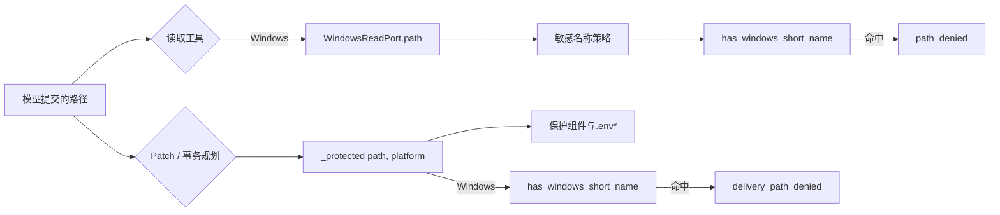

# Windows上模型提交的读写路径拒绝8.3短名称

## 1. 文档摘要

Windows上，模型按8.3短名称（`ENV~1`、`GIT~1`）提交的路径会被系统解析到长名称（`.env`、`.git`），
绕过按名称的敏感读取拒绝与写入保护。现在Windows读取端口与Patch、事务规划拒绝含“`~`数字”的路径段：
读取报`path_denied`，写入报`delivery_path_denied`，本轮继续。macOS与Linux不变。决策见ADR 0170。

## 2. 需求背景

2026-11-17验证0.10.0b49受保护路径修复时，在Windows 11真机（D:盘8.3名称已开启）上发现：

- **读取：** `read_file(".env")`被拒绝；`read_file("ENV~1")`把`.env`内容交给模型。
- **写入：** 新建`.git/x`被拒绝；新建`GIT~1/x`写进了`.git\`。

复现用的是已发布的0.10.0b48、假密钥与无害内容。命令审批规则早已拒绝`~`（ADR 0128）。

## 3. 设计目标与非目标

- **目标：**
  - 模型无法在Windows上用短名称读到敏感文件，或写进保护目录。
  - 拒绝属于可修正的工具失败，不中断本轮。
- **非目标：**
  - 取打开后的真实名称比较（后续加固）。
  - `git_diff`的路径参数（另一条读取通道，单独评估）。
  - Linux上的VFAT卷。
  - 是否在所有平台拒绝写入密钥与证书文件（负责人决定，见受保护路径变更）。

## 4. 总体架构

形状判断只有一份（`workspace.paths`），读写两侧共用。目录遍历的逐条目过滤不加这条规则。

## 5. 接口设计与数据结构

- **新增函数：** `has_windows_short_name(path: str) -> bool`，任一段匹配`~[0-9]`即为真。
- **签名变化：** `delivery.planner._protected`与`delivery.trusted_action._protected`增加`platform`参数。
- **不变：**
  - 公开合同、Schema与错误码都不变。
  - 只是`delivery_path_denied`写给模型的说明多了一句。

## 6. 流程与数据流

- **读取：** `WindowsReadPort.path`先走敏感名称策略，再判断短名称；之后的句柄打开与观察不变。
- **写入：** 规范化之后、加入比较键之前，与保护组件同处判断；命中时整批不写入。

## 7. 失败、恢复、取消与超时

- 拒绝发生在打开任何句柄之前，没有部分效果，取消与超时语义不变。
- 模型收到说明（改用完整名称）后可以重试。

## 8. 持久化与数据流程

不写新状态，不改记录格式。已记录的事务与审阅记录不受影响。

## 9. 安全与信任边界

- **关闭的绕过：**
  - 读取侧：敏感名称（`.env`、`.ssh`、`.aws`、`.gnupg`、私钥名、`.pem/.key/.p12/.pfx`）。
  - 写入侧：保护组件（`.git`、`.harnessix`、`.codex`、`.agents`、`.gitattributes`、`.gitmodules`、`.lfsconfig`、`.env*`）。
- **为什么只看形状：**
  - 系统生成的短名称都含“`~`数字”，只靠形状就能拒绝，不必知道某个短名称对应哪个长名称。
  - 用户没有管理员权限时不能自定义短名称。

## 10. 可观测与错误分类

- **读取：** 错误码与其他拒绝相同（`path_denied` / `tool_path_denied`）。
- **写入：** 错误码为`delivery_path_denied`，说明里提到8.3短名称。
- 两侧都不新增遥测字段。

## 11. 部署、兼容与回退

- **影响范围：** 只影响Windows。
- **兼容代价：** 仓库里真名含“`~`数字”的文件，在Windows上不能经读取工具与Patch按这个名称访问，可改用命令工具。
- **回退：** 回退即恢复绕过，不提供开关。

## 12. 限制与风险

- **误伤：** 真名含“`~`数字”的普通文件在Windows上被误拒（少见）。
- **覆盖面：** 真实名称比较能覆盖所有别名，留作后续。

## 13. 验证

- **单元测试：** 新测试中三个短名称用例在0.10.0b49代码上失败，本分支通过。
  - 形状判断。
  - Windows Patch与事务规划拒绝、POSIX保留`a~1.txt`。
  - Windows读取端口拒绝`ENV~1`、`SSH~1/config`、`src/GIT~1/config`，`notes~`、`a~b.txt`可读。
- **Windows真机：** 用候选包重跑读写复现，期望两者都被拒绝、`.git`里没有探测文件。

## 14. 源码与测试映射

| 源码 | 测试 |
|---|---|
| `src/harnessix/workspace/paths.py` | `tests/delivery/test_windows_short_names.py` |
| `src/harnessix/tools/windows_read_port.py` | `tests/tools/test_windows_read_adapter.py` |
| `src/harnessix/delivery/trusted_action.py` | `tests/delivery/test_windows_short_names.py` |
| `src/harnessix/delivery/planner.py` | `tests/delivery/test_windows_short_names.py` |
| `src/harnessix/trusted_actions/preparation_rejection.py` | `tests/product_config/test_patch_protected_paths.py` |
