## 当前增量：同一步骤在只显示过思考时接受新的尝试（ADR 0144第3版）

- `_sample_events`收到第2次及以后的`ModelAttemptStarted`时不再一律以`invalid_provider_output`结束：[`model_text.restart_attempt`](../../src/harnessix/agent/model_text.py)在还没有正文Item与工具调用时放行，响应身份清空、等新尝试的`ResponseStarted`；已有正文或工具调用时照旧拒绝。运行时主文件行数不变。
- [`GenerationProgress.attempt`](../../src/harnessix/agent/generation_progress.py)在新尝试开始时把思考、正文、参数计数清零并立即发布（不节流），界面马上显示“第 N 次尝试，上次网络中断或超时”。
- [`ReasoningPreview.restart`](../../src/harnessix/agent/reasoning_preview.py)先放出上一段被公开保护扣住的尾部，新尝试的思考空一行接着显示，用新的保护内容身份（`SecretTextStep`拒绝向已收尾的文本块写入；预览在参数进度出现时已收尾）。序号连续，单步64 KiB上限跨尝试共用。
- 断开的尝试按“用量未知”预留，付费交互模式的连续次数照旧（`service_failure_retries`）。回归见`tests/agent/test_retry_after_thinking_break.py`；[ADR 0144](../adr/0144-automatic-retry-after-service-failures-in-interactive-mode.md)第3版。

## 当前增量：生成进度带上重试的尝试序号与失败类别

- [`ModelTextPublication.watch`](../../src/harnessix/agent/model_text.py)包住Provider事件流：事件原样传下去，模型尝试的开始与结束同时交给[`GenerationProgress.attempt`](../../src/harnessix/agent/generation_progress.py)。`_sample_events`只把`self.provider.stream(...)`换成`texts.watch(self.provider.stream(...))`，运行时主文件行数不变。
- 失败尝试只记下类别：`provider_transport`→`network`、`provider_rate_limit`→`rate_limit`、`provider_provider_internal`→`server`，其余为`other`；不发布原始错误。第2次及以后的尝试开始时发布一行，进度行在四项之后追加`<尝试序号> <失败类别或->`；没有重试时仍是原来的四项。
- 回归见`tests/agent/test_retry_progress.py`（含真实OpenAI Chat适配器503后重试）。Beta Issue #11。

## 当前增量：补SHA认得只差换行的锚点（0.10.0b21，ADR 0141）

- 提案修复[`call_repair._anchored_sha256`](../../src/harnessix/agent/call_repair.py)在edit的`expected_sha256`缺失或过期、而每段`old_text`都在当前文件中唯一出现时补上当前文件的SHA-256。“唯一出现”此前只按逐字计数；CRLF文件上模型发回的多行`old_text`是LF换行，计数为0，不补，调用随后因SHA不符被拒。
- 现在与编辑规划同一顺序判定（`_anchors_once`）：先逐字计数，一处也没有时忽略CRLF/LF差异再计数，都要求恰好一处。规划器仍是最终裁决，补上的SHA在规划与执行前照常核对。回归见`tests/agent/test_call_repair.py`。

## 当前增量：空回复补发提示继续（0.10.0b20，ADR 0109第6版）

- 模型步骤的终态由[`truncation_recovery.settle_reply`](../../src/harnessix/agent/truncation_recovery.py)一处判定：回复可用、可补发提示继续，或按原错误失败。`AgentRuntime._sample_events`只调用它，不再自己写这三项检查。
- 没有任何工具调用的步骤里，两种回复由宿主补发提示继续（开关`recover_truncated_replies`，产品服务端开启）：以输出上限结束的**截断**（有没有正文都算），和正常结束却没有正文的**空回复**（思考模型只推理、不作答）。两种合并计数，连续最多两次，之后按原错误失败（`provider_max_output_tokens`／`invalid_provider_output`）。
- 空回复那一步不留下助手消息，用量照常记账；补发的提示是用户消息Item，按Steering语义重入下一步。Item身份沿用`harnessix.truncation-recovery/v1`加步骤号，重放确定。
- 压缩摘要没有正文时不补发提示：正常结束的记为`provider_summary_empty`，用满上限的记为`provider_summary_truncated`，主动压缩时本步保留原历史继续（见[Context模块](context.md)）。
- 回归见`tests/agent/test_truncation_recovery.py`与`tests/agent/test_pressure_compaction_loop.py`。文档版本48～56由round-2与Beta反馈分支使用。

## 当前增量：恢复任务在开始执行前被取消（0.10.0b14）

- 宿主关闭时取消后台的恢复任务。取消在`resume_turn`取锁、读取Thread期间到达时，此前Turn停在`accepted`：没有任务执行它，也没有终态（2026-11-11 CI负载下`test_service_shutdown_is_bounded_and_persists_cancel`复现，关闭的宽限期很短时才遇到）。现在`resume_turn`对尚未开始的Turn同样提交确定性的取消终态（`cancelled`，“调用方任务取消”），与进入执行循环之后被取消的结果一致。
- 只处理状态仍为`accepted`的Turn。正在由另一个任务执行的Turn、等待审批或等待提问回答的Turn保持原状，下次打开仍可继续。回归见`tests/agent/test_resume_cancel_before_start.py`（三种情况各一例）。

## 当前增量：生成进度（ADR 0156）

- [`generation_progress.GenerationProgress`](../../src/harnessix/agent/generation_progress.py)由`ModelTextPublication`按需创建，累计本步骤已生成的UTF-8字节数：
  思考（`preview`里遇到`ReasoningDelta`时计数，覆盖思考预览到64 KiB上限之后的部分）、正文（`accept`里的`TextDelta`）、
  工具参数（适配器的`ToolArgumentsProgress`，在`preview`里消费，不会走到“不支持的Provider事件”）。
- 有变化时每秒至多发布一次，落在节流期内的变化到期补发（`asyncio`定时器；`ResponseCompleted`到达时`close`取消）。
  补发不可省：实测百炼在补丁内容生成完之前不返回任何片段，参数开头的十个字节之后可能几十秒没有新事件。
  每次发布一行`<思考> <正文> <参数> <工具名或->`，每行都是累计值；以临时`ItemDelta`发出，
  条目身份为`uuid5(turn_id, "harnessix.generation-progress/v1:<step>")`，使用独立序号。只有数字和工具名，不经公开文本保护
  也不含任何模型输出；不建Item、不进模型历史、不写入会话记录、不计入输出上限。
- `latest_counts`供客户端读出最近一行；格式不符时返回空，客户端不显示估算。
- 回归见`tests/agent/test_generation_progress.py`。详见[ADR 0156](../adr/0156-generation-progress-and-live-usage-estimate.md)。

## 当前增量：计划调用位置与给模型的英文反馈（ADR 0136）

- **计划调用位置。** 一次评测里`update_plan`被拒28次，其中24次是“先`update_plan`、再一个其他调用”：计划Item只能在整组调用
  结算后进入准备阶段时与结果同事务发布，旧规则因此要求模型把它写在最后。现在模型可以写在任意位置：
  [`plan_calls_last`](../../src/harnessix/agent/planning.py)在`_sample_events`形成持久调用组时把计划调用稳定移到其余调用之后，
  其余调用保持模型给出的相对顺序；事件、Reducer与计划结果合同不变。同一响应有多个计划调用时只记录最后一个，较早的以
  `tool_invalid_arguments`说明原因；未启用内置规划时同名工具不重排。
- **计划的说明与错误。** 工具说明与全部校验错误改为英文，形状与字段错误仍附完整合法调用示例；界面对
  `tool_invalid_arguments`显示固定文案，不受影响。工具说明变化使`update_plan`的工具指纹变化：升级前的会话在模型再次更新计划
  之前，压缩不再固定旧的计划调用组。
- **目录拒绝的反馈。** [`tool_rejections.rejection_feedback`](../../src/harnessix/agent/tool_rejections.py)给出每个拒绝原因的
  英文说明，只在模型线协议视图中替换固定结果的`message`（见[Model Runtime](models.md)）；持久固定结果、追加与重放校验、界面
  显示不变。执行时已无定义的已登记调用复用同一份固定未注册结果。
- 回归见[计划工具测试](../../tests/agent/test_planning_tool.py)与[拒绝反馈测试](../../tests/models/test_rejection_feedback.py)。

## 当前增量：会话基线（ADR 0131）

- **缺陷**：会话开始时工作区已有的未提交改动（用户的在途修改、任务环境预置的文件），模型在`git status`里看到后无从判断来历，曾在收尾清理时还原（`projectlombok__lombok-3009__jGA3Cpp`第38步，源码修复正确却整题失败）。此前只有评测适配器的补丁导出知道开始前的工作区。
- **启用**：`AgentRuntime(session_baseline=<WorkspaceChangeObserver>)`，默认`None`时行为不变。端口只有一个方法`workspace_changes(cancel, paths=())`，返回与`git_status`相同的`GitStatusOutput`；产品传入`CodingToolRuntime`。逻辑全部在[`session_baseline`](../../src/harnessix/agent/session_baseline.py)，Runtime只有三处接线。
- **记录与告知**（`_continue`，Turn为`accepted`时）：Thread还没有运行过模型步骤、不是Fork、也没有记录时观察一次；有改动则追加一条已完成的`user_message`宿主说明，身份`uuid5(turn_id, "harnessix.session-baseline/v1")`。正文是英文说明加末行JSON记录（`changes`逐条为`git status --short`写法，至多64条、4 KiB，`truncated`标明是否完整）。宿主此后只读这一行（`recorded_baseline`），不新增事件类型或存储。改动多到状态读取超限时，说明改为“多到无法列出”。
- **标记**（`_execute`）：`git_status`、`git_review`的成功结果里，属于基线的条目加`pre_existing: true`，状态对象加`pre_existing_note`；标记后超出结果上限时返回原结果。
- **完成前复核**（`_drive`，本步无工具调用且不需要回复恢复——既未截断也不是空回复，先于`_close_model_step`）：只对基线路径观察一次。路径不再出现在状态里，或开始前不是删除状态而现在是，记为丢失；HEAD已移动时不判断。有未提示过的丢失路径时追加一条`user_message`（身份`uuid5(turn_id, "harnessix.session-baseline-loss/v1")`，末行JSON列出路径），`_close_model_step`随即按既有Steering语义重入，本函数未改动。每个Turn至多一条，提示过的路径在整个Thread里不再提示，预算用尽时不补发。
- **与完成守卫的先后**：复核说明先落账，该步完成守卫不再判定；模型回应后的下一次无工具调用回复照常经过完成守卫。
- **失败与恢复**：观察失败（不是仓库、Git不可用、超时）按没有观察处理，不影响Turn；取消照常传播。说明落账后崩溃，恢复时按Item身份识别，不重复记录。
- **界面**：Product UI按`is_session_baseline_notice`不显示这两条说明。
- **测试**：[`tests/agent/test_session_baseline.py`](../../tests/agent/test_session_baseline.py)、[`tests/agent/test_session_baseline_git.py`](../../tests/agent/test_session_baseline_git.py)（真实Git仓库端到端）。局限见ADR 0131。

## 当前增量：请求只追加与压缩点校准（ADR 0132）

- **请求只追加（`history_notes`，默认关闭）**：[`request_notes`](../../src/harnessix/agent/request_notes.py)在每步准备模型历史之前判断是否有到期的宿主说明，有则在线程CAS内追加为已完成的`user_message` Item（与完成守卫同一机制，正文以`[Harnessix host notice]`开头），并让`ModelRequest.notes_in_history`为真，Provider映射不再逐请求附加预算与目录说明。说明写在本步`ModelHistoryPrepared`之前，属于本步消费的历史，不是待处理的Steering；之后一直留在历史里，请求等于“上一请求＋新内容”。
  - 预算说明每个关口一次：剩余调用数、剩余累计Token或Turn剩余时间≤1/2、≤1/4，以及过了四分之一关口后剩余调用数≤10、按上一请求实际尺寸只够再发≤10次或剩余时间≤1/10。只读Turn的持久事实（`budget`、`model_steps`、`model_attempts`、`usage`、`created_at`）与当前时刻，不依赖Provider是否实现输入估算端口，产品路径同样生效。身份`uuid5(turn_id, "harnessix.request-notes/v1:budget:<half|quarter|final>")`；较紧的关口发过后不补发较松的。
  - 目录说明只在配置了`model_tool_view`时发：每个Turn首个请求一条，此后正文（可执行别名、受限原因、选择约束）与本Turn上一条不同才再发，身份`uuid5(turn_id, "harnessix.request-notes/v1:catalog:<序号>")`。没有工具视图时不发。
  - 工具视图拿到的Turn副本不含这些说明（`without_request_notes`）；Product UI按身份隐藏。大多数步骤没有到期的说明，判断只用调用方手里的Turn快照，不加锁、不读Session。
- **压缩点校准（`compaction_window`，默认不校准）**：[`compaction_calibration`](../../src/harnessix/agent/compaction_calibration.py)取Thread内最近一次已完成主请求的Context检查（估算字节）与Provider报告的真实输入Token，把触发点、目标与输入上限换算到真实窗口的同一比例：触发时整个请求的真实输入约为窗口的一半。只放宽固定比例换算的数值；输入上限不超过出站请求容量，触发点另在其下留出一次退避（历史增长四分之一后重试）的余量。[`model_history_runtime`](../../src/harnessix/agent/model_history_runtime.py)用校准后的触发点判断，`_run_compaction`用校准后的策略规划，校准的输入上限经`ContextBuildInput.input_limit_tokens`交给Planner。没有声明窗口、没有Context Planner或没有完整用量时配置原样返回。
- **回放**：不新增事件类型或版本；说明是普通Item事件，压缩计划记录它实际使用的策略，Reducer重放与历史哈希按既有规则覆盖。回归见[`test_request_notes.py`](../../tests/agent/test_request_notes.py)与[`test_compaction_calibration.py`](../../tests/agent/test_compaction_calibration.py)。

## 当前增量：思考预览（0.10.0b9）

- [`reasoning_preview.ReasoningPreview`](../../src/harnessix/agent/reasoning_preview.py)由`ModelTextPublication.preview`按需创建：思考增量经公开文本保护后以临时`ItemDelta`发布，条目身份为`uuid5(turn_id, "harnessix.reasoning-preview/v1:<step>")`，使用独立序号，不占用正文增量序号（否则界面会把正文判为缺口）。单步最多发布64 KiB。公开保护会扣住末尾可能构成密钥的字节，思考转入正文、工具调用或结束时收尾放出；收尾后本步骤再有思考只是不再预览。思考不建Item、不进模型历史、不计入输出上限。上下文摘要请求忽略思考增量。
- 2026-11-10 macOS实测：未收尾时短思考一个字也不显示（保护扣住了全部字节），收尾后正常。

## 当前增量：取消后的宿主说明（0.10.0b8）

- **缺陷**：模型历史收录每一轮已完成的Item，但不含轮次终态。用户取消的请求在模型看来仍是“做到一半”，接着问别的事时，模型会把两者混成“同一条消息”，或反问是否继续（2026-11-10 macOS实测）。
- **行为**：[`cancelled_turn_notice`](../../src/harnessix/agent/cancelled_turn_notice.py)在`_accept`里检查：Thread最近一轮为`cancelled`、且新Turn不是`retry_turn`重试它时，在用户输入之后追加一条已完成的`user_message`宿主说明（“[Harnessix host notice] The user cancelled the previous task…”）。身份为`uuid5(turn_id, "harnessix.cancelled-turn-notice/v1")`，与完成守卫的宿主提示同一机制，走既有Steering通道（Event v19）。只说明紧接着的那一轮。
- **不变**：不改写任何既有Item、历史视图或检查记录；旧会话无需迁移，不影响逐字节复现。失败、中断的轮次不加说明，用户通常会直接重试或说“继续”。
- **界面**：Product UI按该身份不显示这条说明，对话里上一轮已有“任务已取消”。

## 当前增量：宿主自动批准钩子（ADR 0113）

- **钩子**：`AgentRuntime` 新增可选参数 `approval_responder`，默认 `None`，行为与原来完全相同。
- **触发**：`run_turn`、`retry_turn`、`resume_turn` 的最外层在执行停在“等待审批”时调用它。应答器返回决定时，经公开的 `reply_approval` 落盘，然后继续执行。
  - 调用时不持有会话锁。
  - `resume_turn` 进入时先补批一次，覆盖“审批请求已落盘、决定未落盘”时崩溃后的恢复。
- **内核约束不变**：写调用成功前必须已有已批准的审批项，这正是不用“策略直接放行”的原因。
- **幂等规则**：`approval_was_decided` 在已记录的决定来自系统身份（`harnessix:` 前缀）时，结论相同的晚到回复幂等成功、审批只记一次；结论相反仍报 `approval_conflict`。
- 产品应答器与策略标记见 [ADR 0113](../adr/0113-sandboxed-command-approval-and-host-escalation.md)。

## 单响应工具互斥约束

`ModelToolSelection.exclusive_tool_groups`仅约束本次宿主选择，默认空组；不进入
ModelRequest、Provider Wire或Session公共合同。Kernel验证规则只能引用当前已公开工具，
完整流关闭及费用结算后、任何ToolCall持久化前校验互斥组。冲突整体失败且执行/审批为零；
同名重复调用及Read+Test不冲突。既有取消、预算和流错误优先。实现及测试见
[闭环整改详设](../changes/swebench-adapter-verified-25-pilot.md#工具闭环与工作区生命周期整改)。

# Agent Runtime模块设计

## 可选原生规划控制（默认关闭）

[`planning.py`](../../src/harnessix/agent/planning.py)复用Plan契约，一次受保护CAS发布短结果、
准备状态和模型自报计划；取消／期限、输出上限和崩溃恢复不授予Workspace权限。
计划调用由宿主排到持久调用组末尾（ADR 0136），模型可把它写在响应的任意位置。
缺少`step_id`的步骤按位置补齐（不改已给出的ID、不制造重复；回放时同样补齐，压缩Pin仍能识别最新计划），
被拒时英文失败说明指出具体违反的规则（步骤数、重复ID、多个进行中、字节上限、字段，或同一响应里有更晚的计划调用），
不回显参数值；参数形状或步骤字段错误（常见为只发单个步骤或漏写`description`）另附一份固定的完整合法调用示例，
并说明每次调用都发送整份计划；Schema与版本不变。
完整契约及源码／测试映射统一见[规划候选设计](../changes/swebench-adapter-verified-25-pilot.md#原生规划控制候选默认关闭真实质量未验收)。
[`test_planning_tool.py`](../../tests/agent/test_planning_tool.py)的离线绿灯不构成真实编码验收。

固定Profile新输出的有界诊断与共享指令v6见[Process当前设计](processes.md#当前增量经审计的有界诊断预览)。
只减少不必要的日志往返，不改变调用发布前Token门控、恢复、审批或完整评测要求。

原 Runtime 的 Thread 锁现采用实际 Task 归属检查，沿原 acquire／release 记录持有者，
不以 `locked()`布尔值代替当前 Task 来源。原 `_lock`上下文接口保持；私有检查不创建锁，
不产生批准或执行权。详见[锁归属总体及详细设计](../changes/m09-r4-runtime-thread-lock-ownership.md)。
`observe_owner()`仅由当前持锁 Task 签发，冻结原 Task 和每次 acquire 的独立对象代际。
受管子 Task 可检查父 Task 原持锁生命周期，不因此获得当前持有者或释放权限；
释放后即使同 Task 重新获取也不能恢复旧观察函数。
Git 消费者接线见[原 Runtime Thread 绑定](../changes/m09-r4-git-runtime-thread-scope.md)。
该原语不是完整 Git dispatch、SQLite FD 或 R4 验收；通用执行及取消顺序未改变。

当前普通请求会向支持输入估算的Provider提供已预付的输入成本说明；配置Compaction时剩余请求数
按原摘要/尝试账本生成，未声明能力的Provider不改旧线协议。字段与负控见
[Models累计预算反馈](models.md#累计预算反馈)。这不扩大50K/16-step，也不替代实际Usage、取消或准入门。

## 当前增量：实验性预算压力窗口

预算压力提前压缩仍默认关闭，阈值/溢出压缩及原预算、取消、恢复边界不变。
[`_budget_plan`](../../src/harnessix/agent/model_history_runtime.py)现在在原Planner中选择受完整组/Pin
下限保护的紧凑目标，检查保守摊销与完整预付，再发摘要；实际输出容量同时进入可信指令及SDK请求。
[`_summary_text`](../../src/harnessix/agent/runtime.py)先核验原尝试、响应身份及Usage，再拒绝达到输出上限
的摘要，不发布半截窗口，也不重试。Plan持久契约不变，临时优选目标已落实到可重放的有效Policy。
预付与实际请求复用`_model_tools_for_turn`，只计本步骤可见目录。摘要前深拷贝工具及选择约束，
摘要后先检查取消，再重新验证目录；漂移在下一主请求前失败，不重新摘要、不授权新效果。
候选容量先保留原值；不满足规划、摊销或完整预付时，才尝试最多两个较小容量，
所有候选保持相同Pin、近期完整组和原预算。选择过程不调用Provider；只有一个已准入Plan可发摘要。
完整设计与验证集中见[SWE-bench增量详设](../changes/swebench-adapter-verified-25-pilot.md)，
不把MockTransport/离线通过当作Resolved提升，默认开启仍须真实质量验收。

## 当前增量：类型化工具拒绝与配套协议升级

拒绝事实属于独立 `ToolCallRejectionContent`，不进入 `pending_calls`、审批或执行。v21由migration31引入；当前新写Agent Event/Thread v22（migration32，承载工作集视图`ModelHistoryInspectionV3`），旧事件只读兼容且v22以下不得携带该视图。全拒绝步骤按有证据的 `tool_rejection` 沿原预算重入。Fork新建v2，旧v1快照重建与确定性请求身份不变。

完整契约、流程/时序/数据流、异常、迁移与回退见[专项详细设计](../changes/m09-r3-unknown-tool-recovery.md)。
对应回归见[验证用例](../../tests/agent/test_tool_rejection_runtime.py)。此增量不构成R3真实编码质量或R4完整Git交付通过。
以下历史版本小节用于解释演进；新写版本与新连接行为以此节及现行摘要为准。

## 当前增量：已知 Token 用量的调用发布前门控

固定真实评测发现：已耗尽用量的模型步骤仍将写入提案发布为 `ToolCallContent`，随后
`_finish`按未结算写入保守转为 `uncertain_effect`。网关虽未准备或执行，评测仍必须拒绝
缺少可信进程终态的结果；这不是 Docker 执行失败，也不能靠放宽证据提取解决。

[`_sample_events`](../../src/harnessix/agent/runtime.py)现在遵循以下顺序：
**持久记录全部已知用量 → 校验完整流及正常关闭 → 预算检查 → 原子发布调用组 → 原调度／审批**。
沿用 `accounted: Usage`，它包含原步骤及已知失败尝试，不只读取末次响应的用量；不额外查询
Session、不缓存未知效果、不变更协议、迁移、期限或 Token 上限。

| 情况 | 正式结果 |
|---|---|
| 存在已注册调用且累计用量 `>= max_tokens` | `FAILED / budget_exceeded`；用量保留，整个调用组不发布，不准备／执行工具 |
| 仅拒绝或未知名称 | 原拒绝事实及反馈保留；沿原预算决定是否再次调用模型 |
| 无调用、最终文本且用量恰好等于上限 | 原成功收尾语义保留；超上限仍失败 |
| 不完整／畸形流、取消或到期 | 原错误顺序和已知用量保留；不授予草稿执行权 |
| 已发布写入或实际执行存在未知效果 | 原保守恢复不变；准备后审批前崩溃仍可为 `uncertain_effect` |

[十五项边界测试](../../tests/agent/test_runtime_sampled_token_budget.py)覆盖真实网关、累计尝试、
混合调用组、拒绝审计、实际未知、准备崩溃、取消、期限及事件 replay。当前非 editable 安装包
391 个唯一关联节点通过；原复现失败及夹具修正前结果保留。这只闭环预算发布顺序缺陷，
不降低已发生模型输入用量，不构成 R3 完整真实质量或 R4 商用验收。

## 当前增量：字符串化容器参数还原（默认关闭）

部分模型把数组/对象参数序列化为JSON字符串（实测qwen3.8-max常把`apply_patch_batch.files`发成`"[...]"`，
被严格合同拒绝后原样重发直至预算耗尽）。`AgentRuntime(normalize_stringified_arguments=True)`时，
[参数还原](../../src/harnessix/agent/argument_normalization.py)仅在工具`input_schema`于该位置声明array/object
（含本地`$defs`引用与嵌套items/properties）且字符串可严格解析为同类型容器时还原（文本以已闭合内层容器结尾而仅缺外层闭合符时，补齐后再严格解析）；其余值原样交给工具原有严格校验。
还原按提案逐个进行（`normalize_proposal`，未注册工具与目录拒绝提案原样返回），位于结构修复`repair_proposal`和补丁前置条件补全之前，二者看到的是真实数组与对象；调用组发布时参数已是规范值，审批、审计与执行看到的都是规范参数。回归见[参数还原测试](../../tests/agent/test_argument_normalization.py)。

## 当前增量：提案阶段调用修复

[调用修复](../../src/harnessix/agent/call_repair.py)在调用组发布前、按本步可执行集改写模型常见的错误调用：
`read_file`只携带存档编号（`artifact_id`或作为`path`）与`offset`/`limit`时改为`read_artifact`，页大小超过200截到200
（2026-11-08 holdout中占剩余`read_file`参数错误的28/42）。本步未开放`read_artifact`、强制工具选择、`path`另指工作区文件或
带有其他字段时不改写，交给原有严格校验与`read_artifact`提示。改写后的规范调用才进入审批、审计与执行，存档分页核验按
`read_artifact`身份进行。

同一阶段修复Workspace Patch（标准与紧凑Schema解码到同一模型）：外层单文件字段并入`files`，补齐只有edits时的edit操作，
去掉edit上的默认mode与null content，`content_sha256`并入`expected_sha256`；多文件、字段冲突、edit同时给出content或
可执行权限等意图不明的写法原样保留。edit的SHA缺失或过期、而每段`old_text`都在当前文件中唯一出现时，经
`CodingToolRuntime.read_workspace_file`读取当前文件（同一工作区边界与扫描上限）补上SHA-256。
2026-11-08 holdout的65次补丁失败中，结构修复可解8次，另有6次缺SHA与15次SHA过期可由锚定补齐。回归见
[调用修复测试](../../tests/agent/test_call_repair.py)与[产品路径补丁修复测试](../../tests/product_config/test_patch_call_repair.py)。

**2026-11-11修订（[ADR 0129](../adr/0129-file-tool-leniency-and-correctable-rejections.md)）。** Multilingual评测的57次
Patch参数拒绝中，离线重放有32次在下列修复后通过参数校验：

- 结构修复新增：值为null的未知字段与文本`"null"`的mode视为未给出；create缺mode取420，delete去掉默认mode；文件项上的
  `old_text`/`new_text`包成`edits`；`operation: replace`带`edits`而无`content`时取edit；同一路径的多个edit项
  （SHA相同或只有部分给出）合并为一项。带值的未知字段、`old_text`与`new_text`相同的编辑不改，照常被拒并指出位置。
- 前置条件补全新增两类事实，入口仍是`fill_patch_preconditions`：
  [`file_observations.py`](../../src/harnessix/agent/file_observations.py)从本步发给模型的历史（`ModelRequest.history`）
  取各文件最近一次完整内容SHA-256（`read_file`、带摘要的`grep`命中、Patch成功结果）。replace/delete缺SHA时补它
  ——是模型读到的摘要而不是当前文件的，文件此后变化照常因SHA不符被拒；缺`path`而SHA恰好对应历史中唯一一个文件时补路径。
  replace缺mode时经`CodingToolRuntime.workspace_file_mode`沿用现有文件的可执行位。模型给出的SHA与mode不改写。
- 改道新增：`read_file`带着grep的`query`且全部字段都属于本步grep合同时改为`grep`；`read_artifact`的`offset`/`limit`
  接受纯数字字符串并截到页上限。后者必须在调用形成前完成：存档分页核验按调用记录中的参数重算，执行时再修复会让
  已成功的读取在核验时被判为`artifact_corrupt`。

**2026-11-12修订（ADR 0129第2版）。** “每段`old_text`都在当前文件中唯一出现”的判定（`_anchors_once`）与编辑规划同一顺序：
先逐字匹配，一处也没有时忽略CRLF/LF差异再匹配。CRLF文件上模型发回的多行`old_text`常是LF换行，此前这类编辑得不到SHA补全。
只补摘要，记录与审批的仍是模型发来的文本；换行风格在规划时按文件决定（见[Patch模块设计](patches.md)）。

## 当前增量：稳定线上工具目录（默认关闭）

`AgentRuntime(stable_tool_catalog=True)`时，`ModelRequest.catalog_tools`携带本轮全部可向模型广告的已注册工具，`tools`仍是阶段视图
选出的本步可执行子集（须逐字属于目录）。Provider按目录发送定义以保持前缀缓存，目录说明只列可执行别名；目录内但本步不可执行的调用
沿原路径成为拒绝事实，不准备、不执行。回归见[稳定目录测试](../../tests/agent/test_stable_tool_catalog.py)。

## 当前增量：工具门禁说明（默认无说明）

`ModelToolSelection.notice`是视图对本步工具受限原因与解锁条件的说明（1～1024字符，类型或长度无效时`model_tool_view_invalid`），
Runtime原样写入`ModelRequest.tool_notice`；目录说明在列出可执行别名后追加该原因。它只是模型提示：不改变可执行集合、
不授予权限，拒绝事实仍为固定无效果结果。回归见[门禁说明测试](../../tests/agent/test_tool_gate_notice.py)。

视图可另实现`ModelToolCallAdmission.admit_call(turn, call)`：Runtime在需审批调用首次准备前调用它，返回`AgentFailure`时
该调用以可纠正的失败结果结束（不请求审批、不准备计划、不执行），返回`None`时沿原审批路径继续。判定只依赖持久Turn事实，
恢复重放结论相同；返回值类型无效时按写入类工具阶段的既有规则中断为`uncertain_effect`。未实现该方法的视图行为不变。

## 当前增量：预算压低上限的截断归类（默认关闭）

单次输出上限取`min(输出上限, 剩余预算 − 保守输入)`。临近预算耗尽时上限被压到很小，模型正常回答也会以
`max_output_tokens`结束；该响应在发布调用组之前即失败，提案从不持久化或执行。默认仍记为
`provider_max_output_tokens`。`AgentRuntime(budget_capped_truncation=True)`时，仅当本步允许输出低于未压低上限、
且本步已记账输出达到该允许值（证明约束来自预算而非更紧的Provider上限）才改记`budget_exceeded`；未压低上限的
截断、未用满的截断或未知用量均保持原失败。回归见[截断归类测试](../../tests/agent/test_budget_capped_truncation.py)。

## 当前增量：只读Trusted Action走串行路径（ADR 0125）

`_parallel_read_prefix`现在跳过Trusted Action。这类工具必须先经`prepare`建立路由，直接进并行读路径会报`approval_mismatch`。压缩规划在默认策略下遇到费用未知即停止，只有无人值守宿主按预留额继续。

## 1. 文档摘要

| 项目 | 内容 |
|---|---|
| 当前能力 | Provider中立的Thread/Turn Agent Loop、事件溯源Session、Context准备、Tool调度、审批、提问、Steering、取消、Retry、崩溃恢复、统一Trusted Action Gateway，以及历史Process等待事实的只读兼容 |
| 本文状态 | 当前实现；本文是`agent`包现行实现的事实源 |
| 代码版本 | 既有单Runtime基线 `aa3372c0eb0c3b4ab674b19d26754a80dd035b46`；类型化拒绝当前增量见专项设计；0.9.1f3单Runtime边界由[CI 35453082992](https://github.com/carrie1988/Harnessix/actions/runs/35453082992)验收 |
| 默认产品装配 | Provider、SQLite Session、只读Coding Tool、POSIX Trusted Workspace Patch、经证明的固定Container Process、外部Action Config、启动恢复和App Server |
| 稳定版本 | Agent Protocol `2.0`；新Agent Event写`schema_version=21`；SQLite Session迁移连续到31 |
| 关键入口 | [`AgentRuntime`](../../src/harnessix/agent/runtime.py)、[`apply_event`](../../src/harnessix/agent/reducer.py)、[`SQLiteSessionStore`](../../src/harnessix/session/sqlite.py) |

本文把“已实现”和“默认已装配”分开描述。当前Process能力经统一Trusted Action组合进入Agent，
旧`ProcessRuntime`、`ProcessArtifactPublisher`及独立Action Plane服务均已删除；历史
`ProcessApprovalRequestContent`与`WAITING_ACTION`仅为旧Session回放合同，不是当前可执行入口。
代码库中存在的Patch、Patch Batch、Artifact和Compaction端口，也不等于薄CLI默认启用了对应写能力；默认产品边界以
[`product_config/server.py`](../../src/harnessix/product_config/server.py)的装配为准。

## 2. 需求背景

真实Coding Agent的执行跨度远大于一次模型请求。模型可能分多步产生文本和Tool Call；工具可能要求
审批、等待用户回答或在执行中被取消；宿主可能在模型响应、审批提交或外部效果边界崩溃。若Agent
Loop只保存在内存中，重启后无法区分“尚未执行”和“已经执行但结果未提交”，也无法向客户端提供稳定
的历史、错误和恢复结果。

Agent Runtime因此解决五类核心问题：

1. 用Provider中立事件把模型差异隔离在Adapter之外；
2. 用Thread/Turn/Item/Event表达可重放的会话事实，而不是保存易损的内存对象；
3. 在模型调用、Tool执行和用户交互前后规定持久事实顺序；
4. 把取消、预算、审批、提问、Retry和崩溃恢复变成显式状态；
5. 通过端口约束让Agent编排不直接拥有文件系统、进程、网络或数据库副作用权限。

## 3. 设计目标与非目标

### 3.1 目标

1. 同一事件流在在线处理和离线重放时得到等价`Thread`投影；
2. 对同一Thread实行单写者串行化，同时受控并行执行显式声明可并行的只读Tool；
3. Tool Call必须先持久化再执行，结果必须先持久化再进入下一次模型请求；
4. 取消、超时、Provider失败、Tool失败和未知副作用都收敛为稳定公开错误；
5. 重启恢复不依赖丢失的Future，并且不能自动重放无法证明安全的副作用；
6. Retry创建新Turn并保留原失败事实，不修改历史Turn；
7. Model、Context、Tool、Patch、Trusted Action和Session均通过稳定端口替换实现。

### 3.2 非目标

1. 本模块不实现LLM HTTP协议、鉴权或计价；这些属于`models`及Provider Adapter；
2. 本模块不直接解释路径、执行Shell或提交Git；这些属于Tool、Trusted Action、Process Supervisor和Delivery边界；
3. 本模块不提供跨主机分布式Thread所有权；当前Session Runtime Owner是本地单宿主边界；
4. 本模块不提供多Agent/Subagent调度；1.0当前目标仍是本地单Agent；
5. 本模块不保证任意非幂等外部效果自动恢复；无法证明时必须中断或进入专用对账状态；
6. 本文不把尚未进入默认装配的写工具描述为已面向最终用户开放。

## 4. 约束、假设与术语

| 术语/约束 | 定义 | 设计影响 |
|---|---|---|
| Thread | 一个工作区内可持续、可Fork和可归档的会话 | 同一时刻最多一个`active_turn_id` |
| Turn | 一次用户输入触发的有预算Agent执行 | 可含多个Model Attempt和多个Item |
| Item | 用户消息、模型文本、Tool Call/Result、审批、问题、计划或错误等语义单元 | Item ID在Thread及Fork历史内唯一 |
| Agent Event | 带严格递增`sequence`的持久事实 | 在线投影与重放共享Reducer |
| Item Delta | 面向实时UI的瞬时增量 | 不作为Session权威事实 |
| Model Attempt | 一次Provider流式调用及其用量/失败 | 一个Turn可有多次；语义输出暴露后不透明重试 |
| Provider中立历史 | 只由Harnessix领域Item构造的历史 | 禁止把上游SDK响应对象写入Session |
| Runtime Owner | SQLite Session数据库的单宿主所有权 | 两个Agent Runtime不能同时驱动同一库 |
| CAS | `expected_sequence`条件追加 | 防止并发更新静默覆盖 |
| 安全恢复 | 能根据持久事实证明不会重复危险效果的恢复 | 证明不足时不自动重放 |

预算由[`Budget`](../../src/harnessix/agent/models.py)定义：默认最多16步、100,000 Token、120秒、
65,536输出字符和每步32个Tool Call；字段都有上限，不能使用无限预算绕开状态机。
`timeout_seconds` 的默认字面量为 `120.0`，与原 float 字段一致；默认时长及 `(0,86400]` 约束不变。
旧整数 JSON 仍通过原 Schema 读取，不重写原事件或改变其认证字节。

## 5. 模块上下文与信任边界

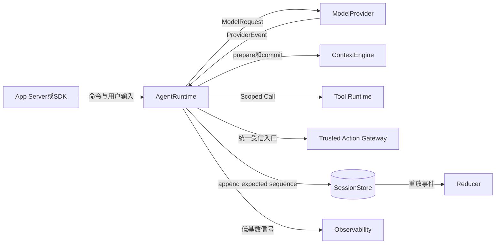

### 5.1 图示说明

- Client只能通过Runtime命令改变会话，不能直接修改`Thread`投影；
- Provider只接收归一化`ModelRequest`，返回归一化`ProviderEvent`，没有Workspace权限；
- Context负责预算内上下文选择和检查事实，Runtime决定何时准备及提交；
- 普通Tool通过`ToolRuntime`或`ScopedToolRuntime`二选一注入；当前高风险Patch和Process经统一Trusted Action Gateway进入，保留的原Patch端口只服务兼容恢复；
- Session先保存`EventDraft`，再由Reducer生成权威投影；
- Observability失败不能改变领域结果，敏感正文不进入低基数标签。

### 5.2 源码映射

Runtime入口见[`agent/runtime.py`](../../src/harnessix/agent/runtime.py)的`AgentRuntime`；端口见
[`agent/ports.py`](../../src/harnessix/agent/ports.py)；Provider合同见
[`models/contracts.py`](../../src/harnessix/models/contracts.py)；Session端口见
[`session/ports.py`](../../src/harnessix/session/ports.py)；投影入口见
[`agent/reducer.py`](../../src/harnessix/agent/reducer.py)的`apply_event`和`replay`。

## 6. 职责、依赖与禁止边界

| 组件 | 核心职责 | 允许依赖 | 禁止事项 | 生命周期/所有权 |
|---|---|---|---|---|
| `AgentRuntime` | Agent Loop、命令、锁、预算、交互与恢复编排 | 领域模型和注入端口 | 直接打开文件、启动进程、调用Provider SDK | Async context拥有Session；每Thread一把内存锁 |
| `models.py` | 持久领域对象、状态、事件Schema | 稳定跨包合同 | 保存SDK响应、Exception或Secret值 | 事件版本兼容期内稳定 |
| `reducer.py` | Thread级顺序、身份和生命周期守卫 | Item/Turn Reducer | I/O、网络、时钟或随机副作用 | 纯函数，可在线/重放复用 |
| `turn_reducer.py` | Turn状态、预算和终态不变量 | 领域事件 | 跳过非法状态或容忍悬空Item | 每个Event纯投影 |
| `item_reducer.py` | Item创建、完成和关联约束 | Item合同 | 跨Turn修改Item | 每个Event纯投影 |
| `CancelToken` | 领域取消协作和子Task回收 | `asyncio` | 仅取消父Task而不持久化意图 | 每活动Turn一个Token |
| `ToolExecutionScope` | 绑定Thread/Turn/Call/Workspace/请求指纹 | Agent模型 | 充当文件系统能力或凭据容器 | 每次Tool Call新建 |
| `SQLiteSessionStore` | 事件追加、快照、迁移、Owner和重放 | SQLite、Reducer | 绕过Reducer写入投影 | 数据库生命周期 |

依赖方向固定为“Runtime依赖Port，Adapter实现Port”。任何Tool都不能通过持有`AgentRuntime`回调来
修改Turn；它只能返回合同结果，由Runtime按序提交事件。

## 7. 领域对象与重点字段

### 7.1 Thread、Turn与Item

| 结构/字段 | 类型/必填 | 来源 | 语义与约束 | 敏感级别 | 持久化/兼容 |
|---|---|---|---|---|---|
| `Thread.thread_id` | UUID/是 | Runtime生成 | Session范围唯一身份 | 低 | Event与快照；Fork使用新ID |
| `Thread.workspace` | 绝对路径字符串/是 | 创建请求 | Thread绑定的工作区；拒绝NUL和相对路径 | 中 | Thread创建事实；读取时校验 |
| `Thread.sequence` | int/是 | Store分配 | 最后持久事件序号，必须连续 | 低 | CAS依据，不可回退 |
| `Thread.active_turn_id` | UUID或空 | Reducer | 非终态Turn唯一所有者 | 低 | 终态Event后清空 |
| `Turn.request_id` | string/是 | Client/App Service | 同一Thread命令幂等身份，长度1～256 | 低 | 重复同请求返回原Turn；变体冲突 |
| `Turn.request_fingerprint` | 64位摘要/是 | Runtime | 绑定用户输入、预算等请求事实 | 低 | Retry和交互关联依据 |
| `Turn.execution_mode` | immediate/deferred | 调用方 | deferred只先接受，稍后显式`resume_turn` | 低 | `TurnStarted`事实 |
| `Turn.status` | `TurnStatus`/是 | Reducer | 当前生命周期状态 | 低 | 只能按合法转换改变 |
| `Turn.budget` | `Budget`/是 | 请求或默认 | 步数、Token、时间、输出和Tool数上限 | 低 | 开始后不可变 |
| `Turn.model_attempts` | tuple/是 | Provider事件 | 每次调用开始、暴露和终止账本 | 中 | 用于恢复与禁止不安全重试 |
| `Turn.items` | tuple/是 | 领域事件 | 顺序语义历史 | 高 | 用户/模型内容需按数据策略保护 |
| `Item.item_id` | UUID/是 | Runtime | Thread及Fork历史内唯一 | 低 | Reducer拒绝重复 |
| `Item.status` | started/completed/failed/cancelled | Reducer | Item生命周期 | 低 | 终止后不可重新打开 |
| `ToolCallContent.call_id` | UUID/是 | Runtime归一化 | Harnessix Tool Call身份 | 低 | Tool Result必须匹配 |
| `provider_call_id` | string/是 | Provider Adapter | 上游调用关联，不作为内部主键 | 中 | 最大256字符 |
| `tool_fingerprint` | 64位摘要/可空 | Tool定义快照 | 防止定义漂移后误执行 | 低 | 有值时严格格式校验 |

### 7.2 Event与Delta

`EventDraft`携带版本、`event_id`、可选`turn_id`、发生时间和Payload；Store在持久化时补充
`thread_id`与严格递增`sequence`形成`AgentEvent`。当前写版本是20，可读取1至20并在加载时Upcast。`ItemDelta`只用于当前连接的流式
体验，权威文本以持久Item完成事实为准；断线客户端通过Protocol Event重放而不是依赖丢失Delta。

## 8. Turn状态机与不变量

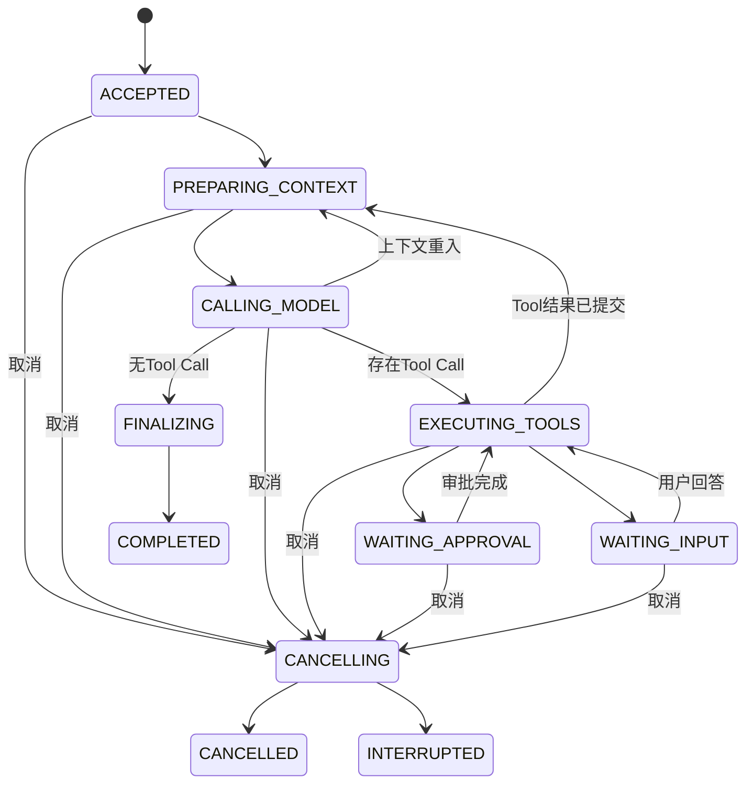

`WAITING_ACTION`不在当前命令状态机中；它只作为历史Process Event的可回放枚举值保留。图中未逐条
绘制的通用失败边：当前任何非终态且非`CANCELLING`状态可在记录公开`ErrorItem`后进入
`FAILED`或`INTERRUPTED`。`COMPLETED`、`FAILED`、`CANCELLED`和`INTERRUPTED`是终态，不可重开。

关键不变量由[`turn_reducer.py`](../../src/harnessix/agent/turn_reducer.py)执行：

1. `CALLING_MODEL`前检查步数和Token预算并记录Model Attempt；
   普通请求仅对声明wire输入估算端口的Provider填入`ModelRequest.consumed_usage`，来自当前Turn累计
   Usage，未声明端口仍为`None`并保留旧输入/估算。反馈从已验证投影重建，不新建持久状态，
   不替代实际用量硬门；字段、出站消息及负控见[Models累计预算反馈](models.md#累计预算反馈)。
2. `WAITING_APPROVAL`必须存在已开始的Approval Item及对应待处理Tool Call；
3. `WAITING_INPUT`只接受Event v19及以上，且必须绑定`ask_user` Call和已完成Question Request；
4. `WAITING_ACTION`只允许旧Event重放；当前命令不得创建、决定或恢复该历史Process等待状态；
5. 终态前不能存在运行中的Model Attempt、开放Compaction、`STARTED` Item或待处理Call；
6. `COMPLETED`不能携带错误、未知Tool结果、恢复副作用或未完成Batch；
7. 非成功终态必须有与最终失败一致的Error Item；
8. Steering只在Model Step边界触发重入，不中断当前Provider Attempt。

## 9. Reducer、事件顺序与持久化模型


`apply_event`同时服务在线追加和`replay`。它拒绝首事件不是Thread创建/Fork、序号不连续、重复
Thread创建、活动Turn之外的修改、归档活动Thread和终态重开。`replay`额外拒绝重复Event ID、空
Transcript和序列缺口。SQLite Store在同一事务中追加一组事件并更新Snapshot；调用方通过
`expected_sequence`进行CAS。进程重启后可从Event Log重建并校验Snapshot，不信任单独的缓存投影。

`apply_event`返回的Thread与输入的Thread、事件共享未变化的子对象，不再逐事件深拷贝整个聚合
（[ADR 0133](../adr/0133-parsed-projection-reuse-and-reducer-sharing.md)）：深拷贝的代价与历史长度成正比，
60步的会话里一次追加约12毫秒。聚合内全部是冻结模型，共享不改变取值；调用方不得原地修改其中的JSON容器。
Store边界仍把调用方的Draft经JSON往返冻结。回归见
[结构共享测试](../../tests/agent/test_reducer_structural_sharing.py)。

## 10. 公共端口与方法合同

| 接口/方法 | 调用者与实现者 | 输入/输出 | 前置与后置 | 错误、取消、超时 | 幂等与顺序 | 权限边界 |
|---|---|---|---|---|---|---|
| `AgentRuntime.run_turn` | App Service/SDK → Runtime | Thread、输入、预算 → 终态或等待态Turn | Thread无活动Turn；先持久化接受 | `KernelError`公开；Cancel Token协作；受Turn deadline约束 | `request_id + fingerprint`幂等；每Thread串行 | 不授予Tool权限 |
| `accept_turn` | App Service → Runtime | 同上 → `ACCEPTED` Turn | 仅持久接受，不打开Provider流 | 存储失败不返回已接受 | 同请求重放安全 | 用于先响应后后台驱动 |
| `resume_turn` | App Service/恢复器 → Runtime | Thread/Turn → 推进结果 | Turn必须处于可驱动等待边界 | 非法状态失败关闭 | 同Thread锁内执行 | 不绕过审批/提问 |
| `retry_turn` | Client → Runtime | 失败Turn、新请求身份 → 新Turn | 仅最后一个失败/取消/中断Turn；无未知效果 | `turn_retry_not_latest`、`retry_unsafe_effect` | 新Turn身份；原Turn不变 | 不重用旧审批授权 |
| `cancel` | Client/关闭流程 → Runtime | Thread/Turn → 取消结果 | 必须为当前活动Turn | 先持久取消意图，再通知Token；无法安全停止则中断 | 重复取消读取已有状态 | 不等于操作系统强杀副作用 |
| `steer_turn` | Client → Runtime | Steering消息 → Turn | 当前Turn活动且边界允许 | 当前Attempt不被透明中断 | 用户消息持久化一次 | 内容仍是不可信输入 |
| `reply_question` | Client → Runtime | Question ID、Call ID、答案 | 精确匹配当前等待问题 | 过期/错配拒绝 | 相同事实幂等，不同答案冲突 | 只解除绑定问题 |
| `reply_approval` | Client → Runtime | Approval ID、请求指纹、决定 | ID与原请求指纹匹配 | 过期、关闭、错配拒绝 | 相同决定幂等；不同决定冲突 | 授权仅限绑定Call |
| `ModelProvider.stream` | Runtime → Adapter | `ModelRequest` → 事件流 | 历史已归一化 | 关闭流响应取消/超时；Provider错误分类 | Attempt身份稳定 | Provider无Workspace权限 |
| `ScopedToolRuntime.execute_scoped` | Runtime → Tool | Call、Scope、Token → Result | Call已持久且状态为执行中 | 输出有界；异常转稳定Tool失败 | Scope绑定请求指纹；结果按Call关联 | Scope不是FS能力或Secret |
| `ToolStepNoticeSource.step_notice` | Runtime → 产品来源 | Thread、当前Turn → 说明正文或`None` | 该步工具结果已全部落账 | 来源异常按Runtime错误结束Turn；不涉及IO | 只读持久事实，重放结论相同；每步至多调用一次 | 只是模型提示，不授予执行权限、不改写工具结果 |
| `SessionStore.append` | Runtime → Store | EventDraft批次、期望序号 → Thread | Thread存在且序号一致 | 存储/投影错误关闭 | 单事务、严格顺序 | Store不替Runtime授权 |

## 11. 正常Agent Loop

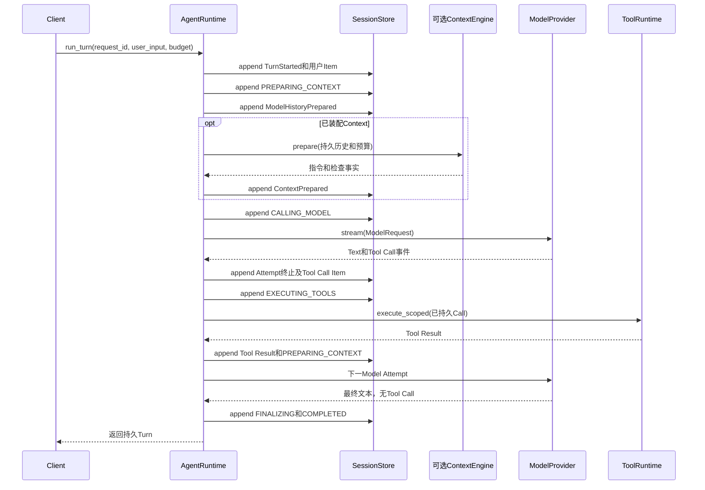

关键顺序是“意图先于副作用，结果先于下一决策”。Context准备结果、Model Attempt、Tool Call、Tool
Result和终态均先进入Session，再向后推进。流式Delta可提前显示，但不能替代完成后的持久文本。
每个模型步骤前的历史Artifact引用验证由Runtime委托`artifacts/batch_verify.py`执行：`SQLiteArtifactStore`
经批量入口共享只读连接与每归属一次快照，其他Verifier回退逐条路径；5秒预算、错误码与首个失败优先级
与逐条语义一致（见[Artifact模块设计](artifacts.md)第13.2节）。

## 12. 多Tool调度

Runtime只并行一个连续的、全部声明`READ_ONLY`且`supports_parallel_calls=True`的前缀，并受
`max_parallel_tools`限制；写Tool、未选择并行的只读Tool和Trusted Action形成串行屏障。多个并行
结果即使实际完成顺序不同，也按Provider给出的Call顺序持久化。任一并行兄弟失败时，Runtime取消并
完整回收其余Task，避免孤儿执行跨越下一Model Step。

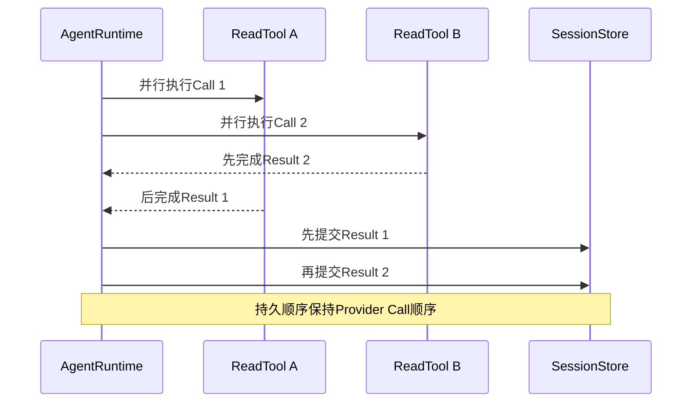

## 13. 审批、提问与Steering

### 13.1 审批

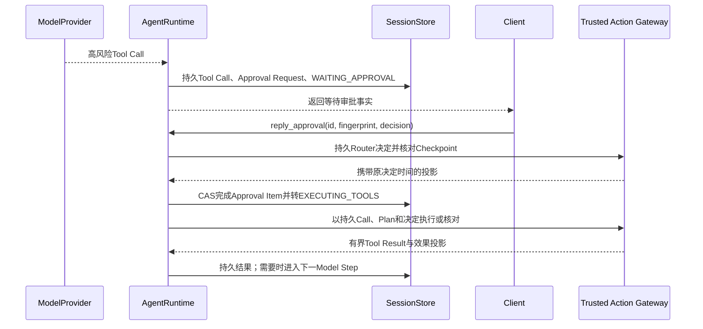

被拒绝的调用照常记录失败结果（`approval_rejected`）。用户在决定里填写了原因时，`approvals.with_rejection_reason`
按调用找到已决定的审批，把“用户说明：<原因>”附在错误信息后（总长不超过2000字符），模型下一步据此调整；
原因本就是公开审批事实的一部分，重放时由同一持久决定得到相同结果。

审批ID和请求指纹共同绑定当次请求；相同决定可重复读取，不同决定形成冲突。批准不是会话级权限提升。
当前Patch与Process均由统一Trusted Action Session/Router核对批准、执行及恢复；`WAITING_ACTION`不再由
新命令创建。旧`ProcessApprovalRequestContent`或`WAITING_ACTION`只可回放，`reply_approval`和
`resume_turn`稳定返回`legacy_process_state_archived`，且不得追加或改写任何Session事件。

### 13.2 提问

内置`ask_user` Call先产生Question Request并转`WAITING_INPUT`；`reply_question`必须同时匹配
Question和Call。答案持久化后转回`EXECUTING_TOOLS`，生成对应Tool Result，再进入Context准备。宿主
重启时，未过期问题保持等待；已回答且尚未继续的安全边界可继续推进。

### 13.3 Steering

Steering作为新的用户消息持久化。它不粗暴终止正在消费的Provider流，而是在当前Attempt完成且没有
待处理Tool Call时，通过Event v19允许`CALLING_MODEL`边界重入，使下一步模型看到新指令。这样既保留
当前Attempt的用量和输出事实，也避免把半个Provider响应静默丢弃。

Steering也允许发生在首个模型步骤的历史准备期间。历史准备包含“读取Session、生成模型视图、验证Artifact、
持久化`ModelHistoryPrepared`”多个步骤，不能假定其间Session不变。实际实现把该并发边界提取到
[`model_history_runtime.py`](../../src/harnessix/agent/model_history_runtime.py)：验证完成后在Thread锁内重新
从最新Session事实生成同一`PreparedModelHistory`；若与已验证快照不同，则丢弃旧准备结果并重新执行准备和
Artifact验证，不提交过期检查记录。若最新状态已经是`CANCELLING/CANCELLED`，则转入`TurnCancelled`收敛路径。

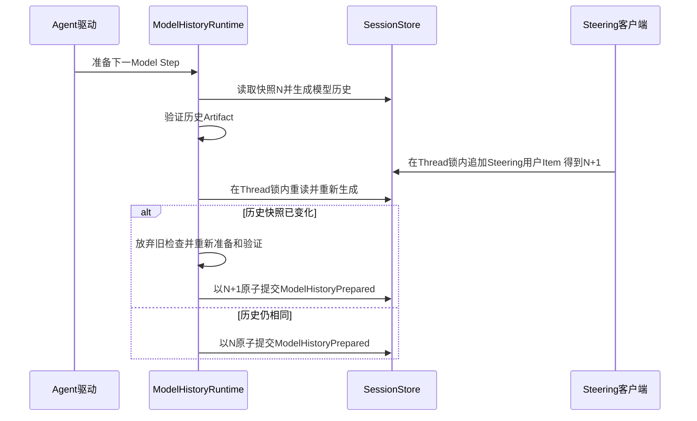

这不是对`invalid_event`的事后重试：旧准备结果在进入Reducer前就完成确定性比较，因此真实合同损坏仍按
`invalid_event`失败，只有可证明由并发Session变化造成的快照失效才重新准备。

### 13.4 完成守卫（显式开启）

模型一步没有工具调用即被视为最终答复。无人值守任务里，小模型偶尔只写一句进展、照抄上下文摘要、
输出一段截断的JSON或把工具调用写进正文就停下，任务以空补丁结束。
[`completion_guard`](../../src/harnessix/agent/completion_guard.py)在`_close_model_step`的同一Thread CAS内判定
（仅当本步既无Steering也无目录拒绝）。回复形态由纯文本模块[`reply_shape`](../../src/harnessix/agent/reply_shape.py)
给出，它不读Turn状态，也不解析或执行正文里的调用。自上而下取第一条成立的规则：

| 本步回复 | 处理 |
|---|---|
| 整条回复是只包着文本的线上外壳（`{"type":"text","text":…}`、内容块数组、助手消息外壳） | 去壳，按壳内正文继续判定；持久化的回复不变 |
| 空正文；照抄宿主记录（上下文摘要、占位）；整条回复是一个JSON对象 | 补发“不是答复，继续用工具”提示 |
| 以JSON记录开头却无法解析（截断或写坏）；行首工具调用标记（`<tool_call>`等）后没有完整JSON | 补发“回复被截断、什么都没执行，请改小后经工具接口重发”提示 |
| 整条回复是带工具调用的线上外壳；行首工具调用标记后跟着完整JSON | 补发“工具调用被写成了文本，请改用真正的工具调用”提示；宿主不执行正文里的调用 |
| 上一步是对补发的回应 | 照常完成（以下两行不再判定） |
| 回复宣布还要继续：去掉行首Markdown标记后以“next step”“let me”“I'll”“下一步”“让我”“我将”等开头，以半角/全角冒号结尾，或结尾句说了自己的下一步（“my next step”“let me”“I'll”“I need”“让我”“我将”等；“Let me know…”与泛指的“next step”不算） | 补发“刚才宣布了下一步却没有工具调用”提示；与是否已有补丁无关 |
| 本Turn尚无成功补丁（Trusted Action `patch_batch`或旧补丁效果） | 补发“尚未修改代码”提示；模型再次给出纯文本结论即照常完成 |
| 其他 | 照常完成 |

前四行是结构判定，每次都补发；后两行靠措辞与状态推断，问一次即止。补发次数随可观察状态变化：看不出未完成迹象时
每Turn至多2次（`BASE_COMPLETION_NOTICES`）；本Turn尚无成功补丁、最新计划有未完成步骤，或最近一次工具结果不是成功，
任一成立即放宽到硬上限6次（`MAX_COMPLETION_NOTICES`）。硬上限与状态无关，守卫必然终止；步骤或Token预算已用尽时不补发。
每条提示末尾写明剩余模型调用次数（“Model calls left in this task: at most N.”）：产品路径的Provider包装
（`SafeFallbackProvider`）不实现输入估算端口，逐请求的预算说明不会发送，守卫因此在自己的提示里给出这一宿主已知的事实。

以上是完整模式（`full`，无人值守）。交互模式（`interactive`，产品终端界面的默认值，[ADR 0147](../adr/0147-interactive-prompt-for-announced-steps.md)）
只保留“回复宣布还要继续”一行，判定用[`reply_shape.leaves_a_step_undone`](../../src/harnessix/agent/reply_shape.py)：认开头的说法与结尾的冒号，
另认首句破折号之后以宣布的说法开头的分句；结尾句的意图不认（给用户的答复常以建议收尾），以问号结尾的回复是在等用户回答，不算。
结构判定与“尚无补丁”两类在交互模式下不补发（空回复与截断由回复恢复处理，问答本来就没有补丁）；补发次数取基础值2次，
提示不附剩余调用次数。`completion_guard_mode`把运行时开关（布尔值或模式名）归一为`off`、`interactive`、`full`。

补发提示以用户消息Item持久化（身份`uuid5(turn_id, "harnessix.completion-guard/v1:<step>")`，正文以
`[Harnessix host notice]`开头），并以`TurnStateChanged(reason="steering")`重入，沿用§13.3的Event v19
语义，事件版本不变。产品配置`completion_guard`开启或`harnessix exec`时为完整模式（ADR 0124第2版），否则终端界面用交互模式；
Context压缩把当前Turn的全部用户消息（含Steering与补发提示）作为锚点保留。

**历史占位。** 判为不是答复的结构化乱码留在历史里会被模型照抄。`without_non_answers`在出站映射处
（[`messages_for`](../../src/harnessix/models/_history.py)）把它换成固定短占位：只替换紧跟“不是答复”类提示、
形态仍是JSON对象、截断片段或写成文本的调用、且比占位长的助手消息；照抄宿主记录的回复不替换（与宿主投影的
上下文摘要无法区分）。持久Item、模型历史检查记录与重放不变，出站输入只减不增。判定只看相邻的两条历史消息，因此对较早Turn与
Fork继承的历史同样生效；由多条助手消息拼成的回复不替换。回归见[守卫测试](../../tests/agent/test_completion_guard.py)
与[形态测试](../../tests/agent/test_reply_shape.py)。

### 13.5 工具步骤说明（注入来源时）

模型改坏了原本通过的检查时，常把失败归咎于环境；“哪条命令在哪次补丁之前通过、之后失败”宿主早已落账。
`AgentRuntime(step_notices=...)`注入[`ToolStepNoticeSource`](../../src/harnessix/agent/ports.py)后，
`_drive`在一步的全部工具结果落账（`_execute_calls`返回）之后调用
[`append_step_notice`](../../src/harnessix/agent/step_notices.py)一次：

| 项 | 规则 |
|---|---|
| 内容 | 来源的`step_notice(thread, turn)`只读Thread持久事实给出，没有事实为`None`；内核不解释内容 |
| 落账 | 一条用户消息Item，正文以`[Harnessix host notice] `开头，身份`uuid5(turn_id, "harnessix.tool-step-notice/v1:<step>")`；经`_commit`提交，公开输出保护照常生效 |
| 位置 | 该步全部工具结果之后、下一次模型请求之前；与§13.3的Steering同一通道（Event v19），不新增事件类型 |
| 上限 | 每个Turn至多6条、每条至多2000字符；同一步已发布则不再询问来源，恢复重入不重复 |
| 状态 | 只在`EXECUTING_TOOLS`或`PREPARING_CONTEXT`（计划更新已提前切换）发布；取消中的Turn不发布 |

说明不写进工具结果：命令结果的`output`与输出Artifact逐字段绑定，补丁结果与审计摘要绑定，追加字段会使
既有校验失败（ADR 0135第2.3节）。当前Turn的用户消息在压缩时整组保留，所以说明在压缩后仍对模型可见。
默认不注入；产品实现是[`product_config/command_ledger.py`](../../src/harnessix/product_config/command_ledger.py)。

## 14. 取消、超时和关闭

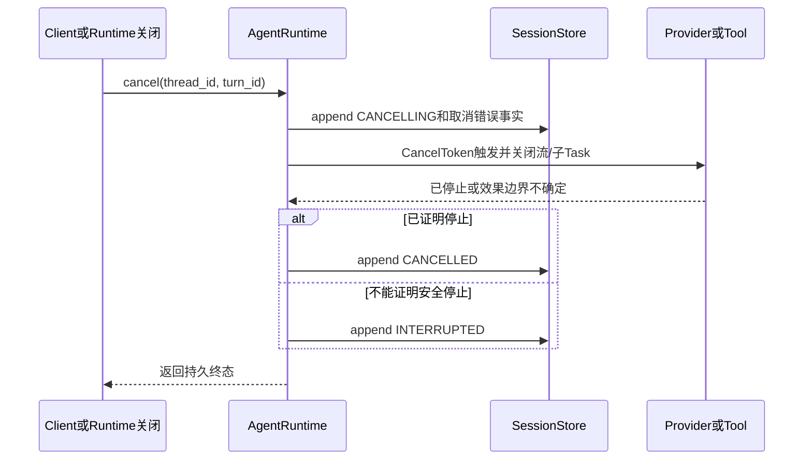

用户取消由领域`CancelToken`表达；父`asyncio.Task`被取消属于宿主中断，两者不能混同。Token的
`run`无论成功、失败或取消都会取消并等待子Task及等待器。Turn deadline在打开Provider流和派发Tool
前检查，超时关闭流并记录`time_budget_exceeded`。Runtime退出时先取消活动Token，回收Task，再等待
Thread锁并释放Session Owner；关闭不能留下仍可提交事件的后台执行。

## 15. Retry与崩溃恢复

### 15.1 Retry

Retry不是把旧Turn改回活动态，而是创建一个引用`retry_source_turn_id`的新Turn。仅同一Thread中紧邻
当前、状态为`FAILED`、`CANCELLED`或`INTERRUPTED`的Turn可重试；若旧Turn包含未知Tool效果则拒绝。
新Turn重新计算请求指纹和预算，旧错误、用量和Items保持审计可见。

### 15.2 重启恢复

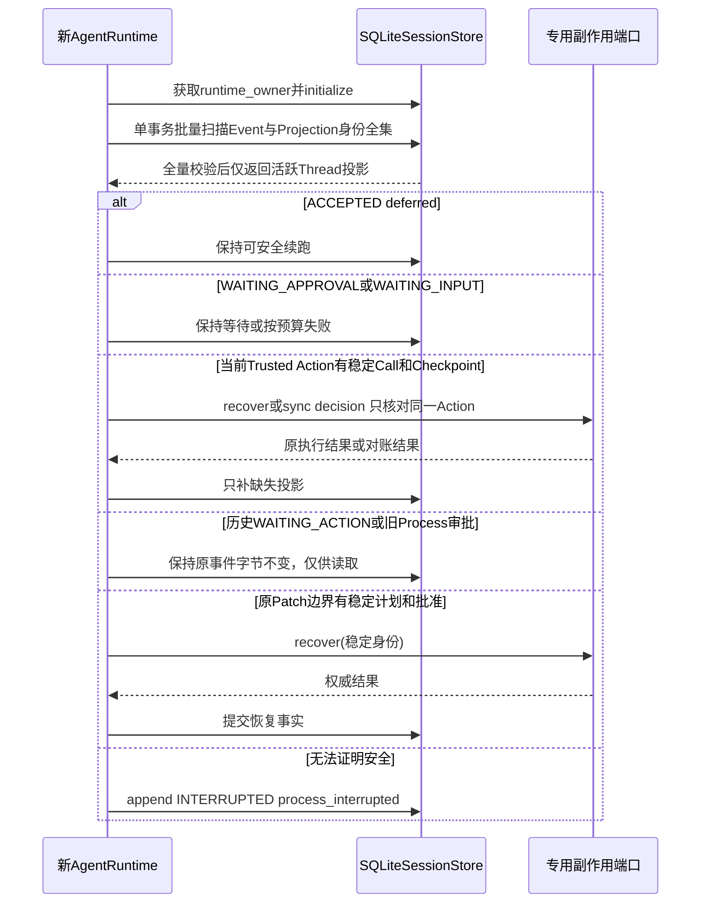

[`AgentRuntime.__aenter__`](../../src/harnessix/agent/runtime.py)先取得Session Owner并初始化数据库，再调用
[`SessionStore.recovery_threads`](../../src/harnessix/session/ports.py)。SQLite实现通过同一读事务核对全部Thread的
Event最大序号/数量、投影SHA、版本、身份和Sequence；即使损坏Thread没有活跃Turn，启动仍失败关闭并释放
Owner。只有校验通过且`active_turn_id`非空的Thread进入既有`_recover`分支，避免每个非活跃Thread都新建
连接和重复读取。批量扫描只优化数据访问形态，**不改变**审批、未知效果、历史Process与取消的恢复决定。
详细失败边界及500 Thread验证见[Thread读路径专项详设](../changes/m09-3d-thread-list-and-recovery-read-path.md)。

| 崩溃时状态/边界 | 恢复行为 | 防重复依据 |
|---|---|---|
| deferred `ACCEPTED` | 保留并允许显式`resume_turn` | Provider从未打开 |
| `WAITING_APPROVAL` | 预算内保持等待；过期则失败 | 高风险效果尚未获得批准 |
| `WAITING_INPUT` | 未回答保持等待；已回答安全边界继续 | Answer与Call均已持久化 |
| 当前Trusted Action批准/终态提交边界 | 按稳定Plan、Call与Router Checkpoint同步或核对 | 不创建第二个Action，不重放已完成效果 |
| 历史Process审批或`WAITING_ACTION` | 保持旧事实只读；拒绝决定和恢复命令 | `legacy_process_state_archived`；启动不改写 |
| Patch/Batch稳定计划边界 | 调用专用`recover`对账 | Plan、Approval、Fingerprint已持久化 |
| 普通活动调用且安全性不明 | 转`INTERRUPTED` | 宁可中断，不猜测执行结果 |

## 16. Provider中立历史、Context与Compaction

Runtime根据持久Item构造Provider中立历史，再由Adapter翻译为上游格式。Provider事件必须先通过流式
协议校验：开始、文本、Tool Call、完成和失败顺序不合法时，Runtime记录`invalid_provider_output`，且
不得派发其中任何Tool。Context Engine在每个Model Step前选择Source、执行预算和生成检查记录；Runtime
提交这些事实后才调用模型。

长会话可通过Compaction创建摘要和活动窗口。Compaction有独立Attempt Ledger，开放尝试不能与终态
并存；重启仅激活已经完整持久化的摘要窗口。Tool结果面向模型的视图可被有界压缩或替换为Artifact
引用，但审计层保留原始领域结果或稳定引用。相关实现见
[`context/engine.py`](../../src/harnessix/context/engine.py)、
[`context/compaction_ledger_contracts.py`](../../src/harnessix/context/compaction_ledger_contracts.py)和
[`context/tool_result_contracts.py`](../../src/harnessix/context/tool_result_contracts.py)。

## 17. 持久化、事务、并发与迁移

### 17.1 Session持久化

SQLite Session Store初始化时校验22个迁移及校验和，启用WAL，并获取数据库旁路Owner锁。每次
`append`冻结输入Draft，在事务内校验期望序号、追加事件、应用Reducer并更新Snapshot。读取时解析及
Upcast旧Event；`rebuild`从完整Event Log重新投影，可发现快照与历史不一致。

### 17.2 并发和一致性

- Runtime内每个Thread一把锁，所有状态命令串行；不同Thread可并行；
- `_active`记录活动Turn的Token和Task，关闭和取消必须完整回收；
- Session `expected_sequence`提供跨调用CAS，冲突不会静默覆盖；
- 模型历史Artifact验证后必须在Thread锁内重建并比较最新模型视图；并发Steering导致差异时重新准备，不能把
  过期`ModelHistoryPrepared`提交给Reducer；
- 单数据库Runtime Owner防止两个本地Agent宿主并发驱动同一Session；
- 并行只读Tool的完成顺序不影响持久顺序；写效果不进入并行组；
- App Service先持久`ACCEPTED`再启动后台Task，崩溃不会形成“已响应但无接受事实”的空洞。

## 18. 错误、未知结果与安全

### 18.1 错误分类

[`agent/errors.py`](../../src/harnessix/agent/errors.py)将稳定错误映射为`input`、`provider`、`tool`、
`approval`、`budget`、`cancelled`、`interrupted`、`storage`、`conflict`和`internal`。`KernelError`
只携带可公开code、message和retryable；第三方异常原文、请求头、Token或SDK对象不得写入Session。

### 18.2 未知结果

普通Tool结果若是`unknown`或携带不可信恢复结果，Agent Loop停止而不是继续让模型决策。当前高风险
Patch和Process必须通过Trusted Action Gateway使用稳定Plan/Action身份恢复；原Patch/Batch端口仅保留
兼容核对。Retry也拒绝跨越未知效果，防止用户重试造成第二次
副作用。

### 18.3 数据流与信任

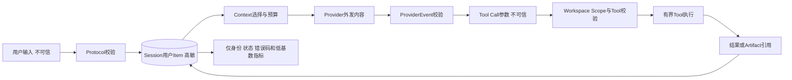

用户文本、模型文本、Tool参数和Tool输出均可能包含源码或敏感业务数据，应按Session数据保护。Secret值
不属于Agent Event合同；只允许受控边界传递`SecretRef`。`ToolExecutionScope`绑定身份但不直接授予
文件能力；路径安全、Sandbox和网络策略由具体执行模块负责。模型输出永远是不可信建议，不能绕过Tool
Registry、Effect Class或审批。

## 19. 可观测性

| 信号 | 触发点 | 关键属性 | 基数与敏感规则 | 用途 |
|---|---|---|---|---|
| Trace | Turn接受、Model Step、Tool、审批、恢复、取消 | thread/turn/call、状态、公开错误码 | 不记录Prompt、Tool正文、Secret；身份字段按策略采样 | 跨组件定位延迟和失败 |
| Metric | Turn终态、Provider用量、Tool结果、恢复 | 状态、类别、Tool稳定名 | 禁止request_id等无界标签 | 成功率、预算和故障趋势 |
| Log | 生命周期和异常边界 | 操作、状态、公开错误 | 异常原文仅经清洗后记录；Session正文不进入结构化字段 | 运维诊断 |
| Agent Event | 所有权威领域变化 | sequence、event_type、领域数据 | 属于持久审计，不等同遥测 | 重放、恢复和客户端Replay |

观测实现通过注入端口进入Runtime；观测失败不能回滚已提交领域事实，也不能改变Tool结果。

## 20. 核心业务逻辑伪代码

```text
run_turn(thread, request):
    acquire thread_lock
    validate no active turn
    if request_id exists:
        require same request_fingerprint
        return existing turn
    append atomically: TurnStarted(initial status ACCEPTED) + UserItem start/finish
    create CancelToken and managed Task
    return drive(turn)

drive(turn):
    while turn is active:
        checkpoint cancellation and deadline
        append PREPARING_CONTEXT
        repeat:
            prepared_history = prepare_from_durable_history()
            verify_all_artifact_references(prepared_history)
            under thread_lock:
                current_history = prepare_from_latest_session()
                if current_history differs from prepared_history:
                    continue repeat
                append ModelHistoryPrepared atomically
        context = build_from_committed_history()
        append ContextPrepared and CALLING_MODEL
        events = consume_and_validate_provider_stream(context)
        append ModelAttempt terminal facts and completed Items
        if no tool calls:
            append FINALIZING then COMPLETED
            return durable turn
        append EXECUTING_TOOLS
        for each serial barrier or bounded parallel read prefix:
            require call already persisted
            if approval or input required:
                append request fact and waiting state
                return durable waiting turn
            execute through injected port with scope and CancelToken
            append results in provider call order
        continue with next context preparation

on cancellation_or_timeout:
    append CANCELLING before signalling children
    cancel and drain provider/tool tasks
    append CANCELLED when stopped, otherwise INTERRUPTED

recover(thread):
    rebuild only from durable events
    preserve explicit waiting boundaries
    reconcile only through a stable dedicated effect identity
    never replay an effect whose non-execution cannot be proven
    otherwise append INTERRUPTED with a public failure
```

## 21. 源码与测试双向映射

| 设计元素 | 源码文件 | 关键符号 | 测试文件 | 测试函数/合同 | 证明内容 |
|---|---|---|---|---|---|
| Runtime生命周期 | [`runtime.py`](../../src/harnessix/agent/runtime.py) | `AgentRuntime.__aenter__`、`__aexit__` | [`test_runtime.py`](../../tests/agent/test_runtime.py) | `test_only_one_runtime_host_and_lock_released`、`test_shutdown_cancels_managed_turn` | 单Owner和有界关闭 |
| Turn接受与驱动 | [`runtime.py`](../../src/harnessix/agent/runtime.py) | `accept_turn`、`run_turn`、`_drive` | [`test_runtime.py`](../../tests/agent/test_runtime.py) | `test_cancellation_at_admission_commit_does_not_leave_active_turn` | 接受提交边界 |
| Thread投影 | [`reducer.py`](../../src/harnessix/agent/reducer.py) | `apply_event`、`replay` | [`test_store.py`](../../tests/agent/test_store.py) | `test_replay_and_projection_rebuild`、`test_terminal_cannot_reopen` | 在线/重放同一规则 |
| Turn状态 | [`turn_reducer.py`](../../src/harnessix/agent/turn_reducer.py) | `_change_state`、`_model_attempt` | [`test_runtime.py`](../../tests/agent/test_runtime.py) | `test_step_budget`、`test_token_budget_prevents_tool_dispatch` | 状态和预算守卫 |
| Item状态 | [`item_reducer.py`](../../src/harnessix/agent/item_reducer.py) | `_start_item`、`_finish_item` | [`test_store.py`](../../tests/agent/test_store.py) | `test_tool_result_pairing_and_order_in_reducer` | Item不可错配/重开 |
| Provider流 | [`runtime.py`](../../src/harnessix/agent/runtime.py) | `_sample` | [`test_runtime.py`](../../tests/agent/test_runtime.py) | `test_invalid_provider_stream_never_dispatches_tools`、`test_text_deltas_idempotency_and_trace_context` | 协议校验和Delta |
| Tool调度 | [`runtime.py`](../../src/harnessix/agent/runtime.py) | `_execute_calls`、`_execute_tool` | [`test_tool_scheduling.py`](../../tests/agent/test_tool_scheduling.py) | `test_parallel_read_results_commit_in_provider_order`、`test_non_opt_in_reads_remain_serial_barrier` | 有界并行和稳定顺序 |
| 取消 | [`cancellation.py`](../../src/harnessix/agent/cancellation.py) | `CancelToken`、`TurnCancelled` | [`test_runtime.py`](../../tests/agent/test_runtime.py) | `test_user_cancel_during_provider_and_active_turn_conflict`、`test_cancel_during_tool_stops_follow_up_model` | 取消和子Task回收 |
| Retry | [`runtime.py`](../../src/harnessix/agent/runtime.py) | `retry_turn` | [`test_runtime.py`](../../tests/agent/test_runtime.py) | `test_terminal_turn_retry_creates_new_turn_and_is_idempotent`、`test_retry_rejects_completed_and_non_latest_turns` | 新Turn与安全限制 |
| 审批 | [`runtime.py`](../../src/harnessix/agent/runtime.py) | `reply_approval` | [`test_approval_crash_recovery.py`](../../tests/agent/test_approval_crash_recovery.py) | `test_approval_crash_boundaries` | 各提交边界恢复 |
| 交互与历史并发 | [`runtime.py`](../../src/harnessix/agent/runtime.py)、[`model_history_runtime.py`](../../src/harnessix/agent/model_history_runtime.py) | `steer_turn`、`prepare_and_commit_model_history` | [`test_interactions.py`](../../tests/agent/test_interactions.py) | `test_steering_during_history_verification_restarts_preparation`及Steering、Question、错配与恢复用例 | Steering在历史验证竞态中不会提交过期检查或误失败 |
| 工具步骤说明 | [`step_notices.py`](../../src/harnessix/agent/step_notices.py) | `step_notice_text`、`append_step_notice` | [`test_step_notices.py`](../../tests/agent/test_step_notices.py) | `test_runtime_appends_the_notice_after_the_tool_results`、`test_a_step_is_noticed_at_most_once`、`test_notices_stop_at_the_per_turn_cap` | 说明落在结果组之后、每步一次、有界 |
| Trusted Action恢复 | [`runtime.py`](../../src/harnessix/agent/runtime.py)、[`trusted_action_runtime.py`](../../src/harnessix/agent/trusted_action_runtime.py) | `_recover`、`resume_recovery` | [`test_trusted_action_runtime.py`](../../tests/agent/test_trusted_action_runtime.py) | 终态响应丢失、决定同步与UNKNOWN核对用例 | 不重复当前Patch或Process效果 |
| 历史Process兼容 | [`runtime.py`](../../src/harnessix/agent/runtime.py) | `_recover`、`resume_turn`、`_reply_approval` | [`test_legacy_process_compatibility.py`](../../tests/agent/test_legacy_process_compatibility.py) | `test_historical_process_state_is_readable_but_never_mutated_or_replayed` | 旧等待事实可读、启动零改写、命令稳定拒绝 |
| Patch恢复 | [`runtime.py`](../../src/harnessix/agent/runtime.py) | `_recover_patch`、`_recover_patch_batch` | [`test_kernel_patch_crash.py`](../../tests/patches/test_kernel_patch_crash.py) | Patch崩溃边界参数化用例 | 稳定计划对账 |
| Session CAS/重放 | [`sqlite.py`](../../src/harnessix/session/sqlite.py) | `SQLiteSessionStore.append`、`rebuild` | [`test_session_upgrade.py`](../../tests/agent/test_session_upgrade.py) | 旧Schema升级和重放用例 | 迁移、CAS、投影一致 |
| 公开错误 | [`errors.py`](../../src/harnessix/agent/errors.py) | `failure_category`、`KernelError` | [`test_runtime.py`](../../tests/agent/test_runtime.py) | `test_raw_exception_not_persisted`、`test_provider_failure_is_classified_without_retry` | 错误脱敏和分类 |

### 21.1 推荐源码阅读路线

1. 从[`models.py`](../../src/harnessix/agent/models.py)阅读`TurnStatus`、`Thread`、`Turn`、`Item`和
   `AgentEvent`，先建立持久领域词汇；
2. 阅读[`reducer.py`](../../src/harnessix/agent/reducer.py)，再进入
   [`turn_reducer.py`](../../src/harnessix/agent/turn_reducer.py)和
   [`item_reducer.py`](../../src/harnessix/agent/item_reducer.py)，掌握不变量；
3. 阅读[`ports.py`](../../src/harnessix/agent/ports.py)和
   [`session/ports.py`](../../src/harnessix/session/ports.py)，确认依赖倒置边界；
4. 按`run_turn` → `accept_turn` → `_drive` → `_sample` → `_execute_calls` → `_execute_tool`阅读
   [`runtime.py`](../../src/harnessix/agent/runtime.py)；
5. 在`_drive`的历史准备调用处转读
   [`model_history_runtime.py`](../../src/harnessix/agent/model_history_runtime.py)，理解Artifact验证与
   `ModelHistoryPrepared`提交之间的乐观重备边界；
6. 最后阅读`_recover`、[`runtime_recovery.py`](../../src/harnessix/agent/runtime_recovery.py)及对应崩溃测试；
7. 用本节表中的测试函数正向验证每个设计结论，而不是只阅读Happy Path。

## 22. 测试设计与验收标准

| 层级 | 必测内容 | 当前证据 |
|---|---|---|
| 领域单元 | Event序列、状态转换、身份唯一、终态不变量 | `tests/agent/test_store.py`、`tests/agent/test_semantic_items.py` |
| Runtime合同 | 多步模型、预算、Provider非法流、公开错误、取消、Retry | `tests/agent/test_runtime.py` |
| 并发 | 只读并行上限、提交顺序、兄弟Task回收、写屏障 | `tests/agent/test_tool_scheduling.py` |
| 交互 | Approval、Question、Steering、历史验证竞态、错配、过期和重复答复 | `tests/agent/test_interactions.py`、审批恢复测试 |
| 故障注入 | Provider、Session、Tool、Patch和Trusted Action各提交边界崩溃 | `tests/agent/test_crash_recovery.py`、`tests/agent/test_trusted_action_runtime.py`等 |
| 兼容 | Event 1～20 Upcast、Session迁移1～25、旧Reader行为、历史Process等待只读归档 | `tests/agent/test_session_upgrade.py`、`tests/agent/test_legacy_process_compatibility.py` |
| 产品集成 | 接受后重启、客户端恢复、有界关闭 | [`test_server_sdk.py`](../../tests/app_server/test_server_sdk.py) |

DOC-1.2对本文执行的验收：至少反向核对`AgentRuntime`、`_drive`、`_execute_calls`、`_recover`、
`apply_event`、`replay`、`_change_state`、`CancelToken`、`ToolExecutionScope`、`SessionStore.append`、
`SQLiteSessionStore.rebuild`和`failure_category`十二个符号；至少正向定位正常循环、并行顺序、取消、
审批崩溃、Trusted Action恢复、历史Process只读兼容、Retry和错误脱敏等测试。

## 23. 兼容性、限制、风险与后续工作

| 项目 | 当前边界/影响 | 后续归属 |
|---|---|---|
| 默认产品的外部Action Config、Doctor能力报告与启动全局恢复已通过全矩阵CI | Agent内Trusted Action主链已关闭；旧HTTP/Worker执行服务已物理删除，历史Process Session仅保留只读兼容 | 0.9.1f3已关闭 |
| Windows默认产品仅具原生四项只读Tool | Patch被明确省略，Git、写入和Process仍未开放 | 0.9.5 |
| 本地SQLite单Owner | 不支持跨主机Thread并发和云端HA | 1.x候选，不提前侵入1.0 |
| 数据保留、导出和删除策略未完成发布验收 | Session可能随长期使用增长 | 0.9.5和1.0发布门禁 |
| Provider真实能力和计价证据仍有待关闭项 | 离线合同通过不代表所有真实Provider组合 | 0.9.6 |
| Subagent与多Agent不在1.0当前范围 | 不应在Runtime中提前引入分布式调度抽象 | 1.x候选 |

本文及其接口、字段、状态机和映射表作为DOC-1.3/1.4模块迁移的黄金范式：后续模块必须保持
“当前/默认边界、图文说明、失败恢复矩阵、字段语义、伪代码、源码与测试双向映射、明确限制”结构，
不得机械复制本文内容或用空章节达标。

## 24. 统一Trusted Action Agent接入（0.9.1e2）

### 24.1 组件与职责

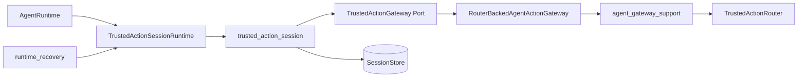

`AgentRuntime`只负责判断一个持久Tool Call是否属于统一Action、提交交互Item并继续Agent Loop。目录核对、确定性Invocation、Policy/Plan、执行与Reconcile属于Gateway和Router；Router决定向Session的CAS传播属于`trusted_action_session`；旧Patch与统一Action的终结核对集中在`runtime_recovery`。该拆分使`runtime.py`和既有热点均不超过0.9.0治理基线。

### 24.2 Session合同

| 合同 | 关键字段 | 不变量 |
|---|---|---|
| `TrustedActionApprovalRequestContent` | Call/Plan ID、三类Fingerprint、Policy、presentation、route_state、decision、Diff Ref | 请求≤16 KiB；Patch Batch必须有Diff；Process禁止Diff；决定与请求指纹及Route拒绝状态一致 |
| `TrustedActionEffect` | Plan ID/Fingerprint、state、origin、Artifact SHA | `action_id == plan_id`；效果状态与Tool Result outcome一致；只保存有界元数据 |
| `TrustedActionReview` | `diff_artifact` | Review只传递Artifact引用，不让Gateway直接依赖Artifact Store |
| `TrustedActionGateway` | `definitions/prepare/decide/sync_decision/execute/recover/close` | Router是批准与执行权威；Session对象不能直接触发Executor |

Agent Event v20首次允许上述审批和效果。v19仍专用于提问、回答、Steering与`WAITING_INPUT`，旧版本Event不能承载统一Action语义。

### 24.3 执行与决定时序

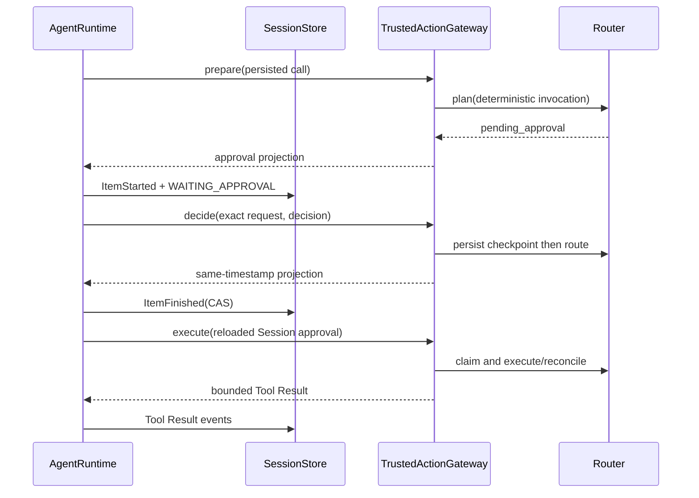

执行前由`TrustedActionSessionRuntime.execute`重新读取Session，不接受调用栈中游离的审批对象。Router已经有决定但Session尚未完成审批Item时，`sync_action_decision`读取原Checkpoint并以同一时间戳补投影；冲突决定失败关闭。

[`TrustedActionSessionRuntime`](../../src/harnessix/agent/trusted_action_runtime.py)提供两种锁入口，
但共享[`trusted_action_session._sync_action_decision`](../../src/harnessix/agent/trusted_action_session.py)的唯一业务算法：

| 入口 | 调用前提 | 锁及失败语义 |
|---|---|---|
| `sync_decision` | 调用方未持有该 Thread 锁 | 沿原工厂获取非重入锁；继续支持通用 `asyncio.Lock` 和原 Session 端口 |
| 私有 `_sync_decision_in_owned_thread` | 当前 Task 已持有原实际 `RuntimeThreadLock` | 不获取或释放锁；冻结 acquire 代际，在 Session 读取、工具合同、Gateway 投影、CAS append 前后核对锁身份与原 Task |

借用入口拒绝未持锁、外 Task／回调、锁子类及工厂换锁；同一 Task 释放后重新获取也不能复用旧代际。
它只同步原 Router 决定，不新建 `ApprovalDecision`，不调用 execute/reconcile，不重试或刷新 Turn 预算。
原 Store／Gateway 异常和取消优先保留原对象；CAS 成功后才发现漂移时，已提交 Session 事实不撤销，
调用方必须停止后续 Git 事务。原正常入口行为及旧恢复流程不变。

新增原语的窄端口负控见[`test_trusted_action_locked_sync.py`](../../tests/agent/test_trusted_action_locked_sync.py)。
真实认证 SDK 的同锁恢复、原时间戳、失败先于 Git BEGIN 及提交门验证见
[Git 决定恢复边界](../changes/m09-r4-git-approved-link.md#83-原-owner重启与授权边界)。
这不是已装配的默认 Git 恢复屏障，也不代替跨资源 Owner、完整来源或 B7 认证。

### 24.4 失败与恢复

- 参数、资源和敏感字段等可公开准备失败转换为失败Tool Result；Router/Store故障继续抛出，禁止伪装为业务失败；
- `pending_approval`和`ready`在Turn终结路径不会隐式执行；
- `running/reconciling`先进入`unknown`，之后只允许Reconcile；
- 取消已经Claim的Action会保留`unknown`事实并重抛取消；
- 未知内部恢复异常只保存稳定`trusted_action_recovery_failed`，不持久化原始异常正文；
- reducer要求恢复来源效果不能把中断Turn变成成功，未知效果不能标记完成或取消；
- Router先提交、Session后提交窗口由`sync_decision`恢复；Session已有决定、Router缺Checkpoint窗口由`execute`按原时间补写。

完整计划、状态、错误矩阵和源码映射见[0.9.1e详细设计](../changes/m09-1e-default-trusted-action-composition.md#2211-091e2实际交付边界)。

### 24.5 Trusted Action终态响应丢失恢复

当Router和专用效果Owner已经形成确定终态、但Session的Tool Result提交前宿主退出时，重开会再次进入同一Call的Trusted Action恢复。Gateway必须区分两类来源：

1. Router在本次恢复前已是`denied/succeeded/failed`：只补原执行结果，`origin=execution`；
2. Router原为`unknown/reconciling`并经只读Reconcile得到结果：保持`origin=recovery`，继续受Reducer“恢复效果不得把中断Turn伪装为正常成功”的守卫。

Session已经存在完整Trusted Action Tool Result且无Pending Call时，`EXECUTING_TOOLS`是安全的显式`resume_turn`边界；Runtime启动恢复保留该状态，调用者恢复后继续下一次模型循环。`_execute_calls`不会为了恢复再次追加非法的`executing_tools → executing_tools`转移。该规则只允许推进Session，不授权再次执行副作用。

专项测试在Router终态后分别重入`execute`与调用`recover`，均断言Executor调用次数保持1；实际UNKNOWN对账仍产生`origin=recovery`。历史Eval进一步以Process Lease计数证明响应丢失后未生成第二个进程。

## 25. 默认Workspace Patch分派（0.9.1e3）

[`AgentRuntime`](../../src/harnessix/agent/runtime.py)构造模型请求时，不再仅按内部Definition字典筛选高风险工具；名称还必须由[`TrustedActionSessionRuntime.action_name_owned`](../../src/harnessix/agent/trusted_action_runtime.py)明确持有。该约束保证模型看到的`apply_patch_batch`一定存在完整Gateway、Router和Session投影链，任意误注入Definition不能扩大模型能力面。

模型调用Patch后的Agent状态仍沿用e2统一流程：Prepare持久化Route，Review Provider物化Delivery并发布`action_review`，Reducer写入`WAITING_APPROVAL`；批准后Router执行，最终效果以同一Artifact引用投影到Tool Result。取消发生在运行中的文件效果边界后时，Session不得把恢复来源效果伪装成正常成功或已取消；`unknown/manual_intervention`保持可见终态。

真实纵向测试[`test_trusted_action_patch.py`](../../tests/delivery/test_trusted_action_patch.py)覆盖Agent→Router→Delivery→文件系统，[`test_server_and_cli.py`](../../tests/product_config/test_server_and_cli.py)覆盖真实SDK广告、Artifact读取、审批和最终回答。

## 26. 变更记录

| 文档版本 | 代码版本 | 日期 | 变更摘要 |
|---|---|---|---|
| 64 | 第二轮合入 | 2026-11-14 | 文档版本48～54随第二轮分支合入主线（第54版在分支上编为47，与主线第47版重号）。合入时的取舍：完成守卫的完整模式沿用第48版（按回复形态判定、补发2～6次、提示写明剩余调用次数），交互模式沿用第60版（只认宣布的下一步、至多2次、提示不附剩余次数），`leaves_a_step_undone`移到`reply_shape.py`；没有正文的摘要沿用第57版，第53版的“摘要输出不成立时跳过”不再保留；会话基线的完成前复核改为在本步不需要回复恢复时进行 |
| 63 | `8b07c214` 增量 | 2026-11-13 | 只显示过思考与生成进度的步骤接受新的尝试：`model_text.restart_attempt`、思考预览另起一段、进度清零并立即说明重试（ADR 0144第3版） |
| 62 | `f24afce5` 增量 | 2026-11-13 | 生成进度在重试时带上尝试序号与失败类别（`ModelTextPublication.watch`、`GenerationProgress.attempt`），界面据此说明为什么还在等（Beta Issue #11） |
| 61 | `a22e64ee` 增量 | 2026-11-13 | 模型请求进行中的生成进度：`generation_progress.py`按类别（思考、正文、工具参数）累计本步骤已生成的UTF-8字节数，每秒至多以临时`ItemDelta`发布一行累计值，条目身份确定、序号独立，不建Item、不进模型历史（ADR 0156） |
| 60 | `74b08375` 增量 | 2026-11-12 | 完成守卫增加交互模式`interactive`：只在回复宣布了下一步却没有动作时补发提示，向用户提问的回复不算，完整守卫的判定不变；`AgentRuntime(completion_guard=...)`接受布尔值或模式名（ADR 0147） |
| 59 | `151ab594` 增量 | 2026-11-12 | `continue_after_unknown_usage`开关改为`UnknownUsagePolicy`：交互模式下服务方故障（连接与超时、429、5xx）造成的用量未知连续至多自动重试5次，其他原因照旧停止；判定在`provider_stop.service_failures_within`（ADR 0144，Beta 0.10.0b20复测） |
| 58 | `d387a5cd` 增量 | 2026-11-12 | 补SHA的锚点唯一性判定忽略CRLF/LF差异，与编辑规划一致（0.10.0b21，ADR 0141） |
| 57 | `e5141ec7` 增量 | 2026-11-12 | 空回复与无正文截断由宿主补发提示继续；步骤终态判定集中到`settle_reply`；空摘要用独立代码并可跳过（0.10.0b20，ADR 0109第6版） |
| 54 | `feat/r2-regress` 增量 | 2026-11-11 | 新增工具步骤说明端口：一步的工具结果落账后，注入的来源可补发一条宿主事实说明（ADR 0135） |
| 53 | `944361a3` 增量 | 2026-11-12 | 预算关口加入Turn时间预算这一维（ADR 0132）；主动压缩的摘要输出不成立且用量完整时跳过本次压缩（ADR 0109第4版；合入主线时由第57版的空摘要处理取代，见第64版） |
| 52 | ADR 0133增量 | 2026-11-11 | Reducer结构共享：`apply_event`不再逐事件深拷贝整个Thread，取值不变，共享对象不得原地修改 |
| 51 | `b7c7eb01` 增量 | 2026-11-11 | 预算与目录说明落为历史Item、请求只追加；压缩点按上一请求的真实输入Token校准（ADR 0132） |
| 50 | `feat/r2-baseline` | 2026-11-11 | 会话基线：线程开始时记录工作区里已有的未提交改动并告知模型，收尾前检查是否被还原或删除（ADR 0131） |
| 49 | `feat/r2-protocol` | 2026-11-11 | 计划调用可写在一次响应的任意位置，由宿主排到持久调用组末尾；计划校验错误与被拒调用的反馈改为英文（ADR 0136） |
| 48 | `feat/r2-guard` | 2026-11-11 | 完成守卫第2版（ADR 0124）：截断或写成文本的工具调用不算完成，只包着文本的外壳去壳判定，继续意图检测扩展到结尾句，补发次数随状态在2～6次间变化，提示写明剩余模型调用次数，结构化乱码在出站历史里换成占位 |
| 47 | `dad55d32` 增量 | 2026-11-11 | 恢复任务在开始执行前被取消时，尚未开始的Turn提交取消终态；等待中的Turn不动（0.10.0b14） |
| 46 | `1d857b39` 增量 | 2026-11-10 | 模型思考内容经公开保护作为临时增量实时预览（0.10.0b9） |
| 45 | `abd7b48e` 增量 | 2026-11-10 | 上一轮被用户取消时，新一轮在用户输入后补一条宿主说明（0.10.0b8） |
| 44 | `cc5bb6d3` 增量 | 2026-11-10 | 拒绝审批时填写的原因附在失败结果中交给模型（0.10.0b2） |
| 43 | `44d044fe12a04cb33482143bd5a03b1183685394` | 2026-11-10 | 同步合入主线的两项行为：完成守卫在回复宣布下一步却没有工具调用时补发提示；字符串化容器参数还原移到结构修复之前按提案进行 |
| 42 | `feat/p0-beta-readiness` | 2026-11-09 | 新增`continue_after_unknown_usage`：费用未知的尝试按已知单次最大消耗预留后继续，默认维持停止（ADR 0123第6节） |
| 41 | `b35c46217aec51c154158e802bd35c8ccb122ff7` | 2026-11-09 | 仅类型标注修复，行为不变 |
| 14 | `aa3372c0eb0c3b4ab674b19d26754a80dd035b46` | 2026-09-24 | 启动恢复改用Session全库单事务校验后仅恢复活跃Turn；多Thread三平台冻结候选及同Revision常规CI通过 |
| 13 | `a81868cae5b8092d565a6f465e8a9441b0e1c67b` | 2026-09-20 | 记录Agent单一运行时边界由CI 35453082992完成Linux双版本、macOS、Windows、Container和文档全矩阵验收 |
| 12 | `3f37fe8ae0646d3327254ce9677110b94f7c5e80` | 2026-09-19 | 登记0.9.1f3独立Action Plane执行服务删除后的Agent边界：当前Process统一经Trusted Action进入，历史Process审批及WAITING_ACTION仅可读取且命令稳定拒绝 |
| 11 | `89485f321b1a0f73a2e552818298c24b30e3cb3e` | 2026-09-19 | 记录Trusted Action终态响应丢失恢复与不重放由CI 35446341997完成全矩阵验收 |
| 10 | `c67f48dfffb683d61c3a91d813c0add25596202f` | 2026-09-19 | 同步Trusted Action Router终态响应丢失只补原执行投影、EXECUTING_TOOLS安全续跑及不重放候选 |
| 9 | `e5b7a8a4072dcb0ed4992ea94e2e0a8420f24a58` | 2026-09-19 | 记录e5外部Action Config与启动恢复通过CI 35439332019并关闭 |
| 8 | `27e0b5918c6497dfe9df10e3f5a9d4c0ed08d8f7` | 2026-09-19 | 同步固定Container Process已验收事实，登记e5外部Action Config与启动恢复候选边界 |
| 5 | `71a479439edcdd29b863ec3a9bad7a52586dd1bf` | 2026-09-13 | 接入默认POSIX Workspace Patch，收紧模型工具目录所有权，记录Review、审批、执行、取消和SDK纵向链 |
| 4 | `328aa2d6c8ee85a75ab2baef51b80869dc4089a8` | 2026-09-13 | 接入Agent Event v20、统一Trusted Action审批/效果、Router先行决定恢复、Session migration23和结构化恢复模块；默认高风险产品目录仍未开放 |
| 3 | `684a17ecc013549e3472978f1c0e8c1eca4db92e` | 2026-09-13 | 记录0.9.1c Steering历史重备实现、取消协作语义、测试同步提交`84ffd59`及[CI 34727612571](https://github.com/carrie1988/Harnessix/actions/runs/34727612571)全矩阵验收 |
| 2 | `35e9e889f78534fd8866f76cfe24d936b08d345d` | 2026-09-13 | 同步0.9.1c Steering与模型历史验证/提交竞态治理，增加乐观重备算法、源码、时序和确定性回归映射 |
| 1 | `7c50a5815e3d859fcdd93176d8a5019bf419b6bc` | 2026-09-12 | DOC-1.2 Agent Runtime黄金样例初版 |

## 产品公开结果保护

AgentRuntime新增可选`public_output_protection`纯端口，在ToolResult提交前检查原DTO；Artifact预览与完整正文分别检查。命中进入原失败结算，已确认Trusted Action只补核验后的效果元数据，不再Execute。历史用户/模型/Session已保存正文不是该入口的保护范围。

完整架构、接口、数据与失败语义见[产品公开边界详细设计](../changes/m09-4a-product-publication-boundary.md)，对应[ADR-0096](../adr/0096-product-credential-and-artifact-publication-boundary.md)。

## 0.9.4a 类型化二进制公开与持久前保护

纯`PublicBinaryOutputProtection`端口与`protect_binary_jsonl`使用原公开期限和父Task取消，不导入正式解析器；已配置普通能力不能静默代替二进制能力。

[完整增量详设](../changes/m09-4a-typed-binary-output-publication.md)提供接口/字段、四种图、伪代码和逐步源码阅读路径；
[固定版本验收](../validation/typed-binary-publication-2026-09-28-v1/README.md)区分真实本机Owner、产品合同替身、独立旧版负例及完整回归。
普通自定义Base64、历史Session、跨重启正文证明、其他出口与整体发布仍开放，不能从当前切片推导全部Secret安全。


## 0.9.4a 模型直接文本公开保护

模型流式文本使用纯可选保护器，所有content_id共享输入字节和模式工作预算，独立尾窗保留跨增量模式，
对齐UTF8后发布原文安全前缀。完整原事件批次在CAS前检查，主模型/摘要模型完整请求在消费Provider前检查。
保留原尝试意图、用量结算、批准身份、原Hash与公开Schema，失败或取消均关闭流和窗口。

[完整详细设计](../changes/m09-4a-model-text-publication.md)包含架构、流程、时序、数据流、类/接口/字段、
伪代码、错误、取消、预算及源码导航；[ADR-0098](../adr/0098-model-stream-publication-boundary.md)说明取舍。
当前值旧历史出站拒绝不授权旧正文；历史Replay、跨重启证明和全部公开出口仍独立开放。


## 0.9.4a 用户输入持久前保护

原prompt、请求身份、预算与有效Trace在接受事务前检查；create/archive/fork/steer/question/approval原字段
在持久或审批副作用前检查。原调用方Trace和批准决定先于新观测操作检查。问答仍由原CAS事务一次提交五条事件。
安全检查不改原文、Hash或Schema；拒绝不虚构失败Turn，不覆盖原等待状态。直接cancel/宿主排空仍独立，
Scope关闭后SDK命令拒绝的可用性边界未合并。

[完整详设](../changes/m09-4a-input-persistence-boundary.md)覆盖架构、流程、两种时序、数据流、字段、伪代码与源码阅读路径。
[ADR-0099](../adr/0099-input-persistence-and-command-publication.md)和[证据目录](../validation/input-persistence-2026-09-28-v1/README.md)
区分入口保护与历史授权；Protocol原id/path在[后续帧详设](../changes/m09-4a-protocol-frame-publication.md)中保护，旧历史授权和全部凭据仍开放。


## 0.9.4a 原封套与完整原帧公开边界

原协议id先单独检查，再检查完整原封套含method、未知字段和键；准入先于类型化Params、ACK、握手与Store。
`validate_public_frame`复用纯`protect_jsonl`，`publish_frame`对完整原UTF8含换行响应检查协商限额和当前材料。
initialize由`prepare_initialization`返回未提交候选，检查通过后Server复核NEW/关闭状态再原子提交；通知拒绝无响应。
动态错误路径亦受原字节检查；固定紧急控制错误是有限例外，不回显未检查字段、不递归使用失效保护器。

完整架构、五图、接口/字段、取消/超时/并发、部署与源码导航见[原帧详细设计](../changes/m09-4a-protocol-frame-publication.md)。
[ADR-0100](../adr/0100-protocol-frame-and-handshake-publication.md)与[固定证据](../validation/protocol-frame-publication-2026-09-28-v1/README.md)
该固定版本证据保留直接Service查询等开放边界；后续[查询边界详设](../changes/m09-4a-query-publication-boundary.md)补齐当前材料的Service原DTO保护。
旧历史授权、全部Provider和跨重启Seal仍开放，不授予整个0.9发布。


## 历史来源认证与当前出口许可

事件认证核心验证原保护完成候选，不证明原事件已提交或当前公开许可；Runtime恢复和模型请求前的持久证明检查尚待实施。
完整现行状态及总体/详细设计见[认证历史详设](../changes/m09-4a-authenticated-history-and-seal.md)。

## 显式认证SQLite Session合同

[完整设计](../changes/m09-4a-authenticated-sqlite-session.md)接入独立Binding、Migration 0029、新事件CAS同事务Seal、认证前缀与派生Checkpoint。
Snapshot、重放、恢复、Fork、重建和Artifact混合事务中的Session事实均已测试。
此处原切片的Root/Epoch结论为历史阶段状态；当前默认Root已强制托管Binding，新Artifact正文经Migration 0030持久认证。
旧无Seal正文仍不可供模型历史使用；备份迁移、三平台正式部署与整体0.9未完成。

## 当前模型历史Artifact来源条件

有Key产品恢复后，模型历史中的Artifact引用按[持久来源认证详设](../changes/m09-4a-authenticated-artifact-body.md)
先验证原行MAC和Session权威引用，再复验当前Workspace、TTL、全文及当前Secret。
同Key重启不以新Epoch拒绝已签新行；旧无Seal行、错Key或篡改导致历史准备失败且不调用Provider。
这不授权旧Session历史、全部Provider材料或其他公开出口。

## 认证历史内部读取的错误分类

[`failure_category`](../../src/harnessix/agent/errors.py)将新增内部历史选择器错误
`invalid_history_request`归入原INPUT分类；没有新增协议命令、模型Tool或错误重试策略。
[Session同事务历史读取](../changes/m09-r4-authenticated-thread-history.md)保留原Owner异常对象、
驱动存储失败及父Task取消的原结算边界。普通认证历史不是当前执行授权，不能凭返回对象恢复外部效果。


## 正式审阅完整原文的公开保护

[`protect_review_jsonl`](../../src/harnessix/agent/publication.py)先调用原Scope的JSONL校验，
再由纯[`review_text_for_protection`](../../src/harnessix/domain/review_text.py)识别已知
Workspace/Git审阅并重组完整原文，以同一原Scope执行JSON保护。两步共享原10秒同步扫描期限，
不重置取消/期限、不要求二进制输出能力，也不改变JSONL、正文Hash或授权。

原Artifact Guard在发布和每次读取时复用此端口；重开后Scope新增受保护材料，即使材料跨
Chunk边界也必须拒绝。未知旧通用审阅只沿原JSONL保护，不猜测正文语义。
失败保留原公开保护错误；纯重组不产生Session认证或执行权。完整接口、流程与时序见
[Git Review详设](../changes/m09-r4-git-review.md)，
[保护用例](../../tests/product_config/test_git_delivery_review_protection.py)和
[实际认证读侧负例](../../tests/product_config/test_git_delivery_review_controls.py)分别记录证据等级。

纯保护端口的入口与末端调度交接不计入同步扫描工作；入口仍交付既有父取消，
末端仍交付扫描中排队的领域及父 Task 取消，不能用取消后的正文继续公开。
端口调用及扫描前后检查全部沿原10秒上限，字节、深度、节点及工作量不变。
这不是整个异步调用10秒总耗时承诺；外层请求、Turn与工具期限独立保留。
具体失败路径、原调度误超时及验收边界见[公开保护详设](../changes/m09-4a-product-publication-boundary.md#62-调度等待与同步扫描期限的整改设计)。

## 效果结算托管的取消合同

[Checkpoint详细设计](../changes/m09-r4-git-checkpoint-preparation.md)要求取消不能覆盖Owner未知结算。
`CancelToken.run(operation, *, preserve_failure=False)`保留既有默认行为；显式True在原回收所有子任务后，
重新传播非取消子任务异常的原对象。实际Checkpoint准备器和原Agent可信预规划入口使用True，
正常取消依旧传播，成功但已取消的结果不发布，共享Owner不由准备器关闭。
该标志不授权重放，不改变持久事件或Schema，不把模拟结算测试当作原生Owner故障验收。


## v37 完整摘要预付

[`compaction_input_budget`](../../src/harnessix/agent/compaction_input_budget.py)与
[`model_history_runtime`](../../src/harnessix/agent/model_history_runtime.py)在内置mapper显式承诺下，
以完整wire覆盖摘要输入、输出和后继请求；不能复用已付前缀折扣。
Native完整组、用户锚点、未知费用、Context及目录漂移守卫不变，逐请求准入仍是最终控制。
详见[本轮设计与诊断边界](../changes/swebench-adapter-verified-25-pilot.md#v37完整-wire-预付与调查收尾对照默认关闭)；
回归[`test_compaction_wire_prepay`](../../tests/context/test_compaction_wire_prepay.py)不是性能证明。

## v39 压缩候选完备性

先保留原容量候选顺序，再有限尝试紧窗口偏好，完整保留与支付门禁不变；不是新付费重试。
见[实现和实际适用性](../changes/swebench-adapter-verified-25-pilot.md#v39压缩候选漏选回归与实际适用性审计)。

## 当前增量：强制选择违约拒绝（默认关闭）

`AgentRuntime(reject_forced_choice_violations=True)`且视图把本步可执行集收窄为唯一强制工具时，模型调用其他工具不再使Turn以
`invalid_provider_output`失败：这些调用本就不在可执行集，沿原目录拒绝路径记为固定无效果失败结果，强制工具调用照常执行，
模型在原预算内纠正。关闭或可执行集不止强制工具时行为不变。回归见[稳定目录测试](../../tests/agent/test_stable_tool_catalog.py)。
