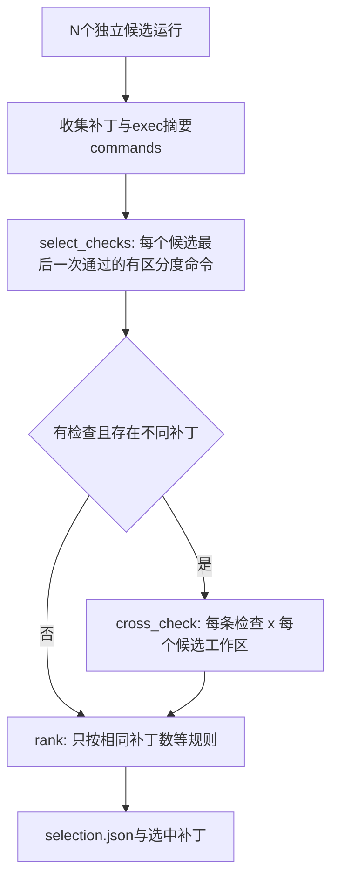

# Candidates模块设计

## 1. 文档摘要

`candidates`在多次互相隔离的完整单Agent运行之后，选出一个补丁：从各候选自己执行过并在自己补丁上通过的
检查命令中选出有区分度的命令，在与候选相同的容器策略下交叉运行到每个候选的工作区上，按通过数打分。
它不改变Agent运行时，也不让多个Agent协作；候选之间没有通信。本模块是“多候选并行 + 验证择优”的选择层，
编排层原在SWE-bench本地评测执行器（`scripts/swebench_local_run.py`的`A2x4`配置）中；该执行器已于2026-11-10
随旧SWE-bench路径删除，本模块当前没有产品调用方。

## 2. 需求背景

本地模型单次尝试的成功率有限，但同一任务多跑几次常有一次做对。只要能在不接触隐藏测试的前提下挑出做对的
那次，就能用本地算力换质量。候选在运行中已经写过复现脚本、跑过相关测试，这些命令就是最便宜的判据。

## 3. 设计目标与非目标

目标：

- 选择只依据候选自己实际执行并通过的命令，不读取隐藏测试、参考补丁或评测器产物；
- 交叉检查与候选运行使用同一镜像和同一Process Profile限制；
- 每次选择都留下可审计记录：检查命令、逐格结果、排序与理由；
- 选择逻辑是纯函数，可脱离容器单测。

非目标：多Agent协作或分工；把选中补丁写回用户工作区。

## 4. 模块上下文与总体架构

| 文件 | 职责 |
|---|---|
| `candidates/selection.py` | `Candidate`、`Check`、`select_checks`（选检查命令）、`rank`（排序与理由），纯逻辑 |
| `candidates/judge.py` | `judge_pair`（双顺序评审）、`tied_leaders`（并列且补丁不同的领先者）、`break_tie`（循环赛） |
| `candidates/verification.py` | `container_argv`（与Profile一致的容器命令）、`overlay_workspace`（叠加他人草稿）、`cross_check`（矩阵执行） |

输入来自`harnessix exec`摘要中的`commands`字段（每条`exec_command`的命令、结果与返回码）与各候选工作区的补丁；
容器策略来自候选使用的`ProductProcessProfile`。

## 5. 核心数据结构与字段设计

| 结构 | 字段 | 含义 |
|---|---|---|
| `CommandRecord` | `cmd`、`outcome`、`returncode` | 候选运行中的一条沙箱命令及结果 |
| `Candidate` | `candidate_id`、`patch`、`status`、`commands` | 一次独立运行的产出；`patch_sha256`用于识别相同补丁 |
| `Check` | `cmd`、`origin` | 交叉检查命令及提出它的候选（决定叠加谁的草稿文件） |
| `CheckRun` | `candidate_id`、`check_index`、`result`、`returncode`、`seconds`、`output_tail` | 矩阵中的一格；`result`为`passed`、`failed`或`error` |
| `Ranked` | `passed`、`duplicates`、`completed`、`patch_bytes` | 排序键 |
| `Selection` | `selected`、`checks`、`ranking`、`matrix`、`reason` | 选择结果与理由 |

## 6. 流程、状态与数据流



检查命令按候选轮流选取并去重，最多8条；命令须是测试、复现或运行代码的命令，查看类命令（`cat`、`grep`、`git`等）
没有区分度，不入选。识别只用通用测试入口（pytest、unittest、tox、经`python`启动的脚本、各语言常见测试命令），
不再为Django的`tests/runtests.py`或SymPy的`bin/test`单独开例；它们经`python`启动时仍按通用规则计入。只收在提出者自己补丁上返回0的命令。

## 7. 接口设计与核心伪代码

```python
checks = select_checks(candidates)  # 纯函数
runs = cross_check(profile, workspaces, checks, scratch_root)
matrix = {run.candidate_id: {run.check_index: run.result} for run in runs}
selection = rank(candidates, checks, matrix)  # 纯函数
```

排序键依次为：通过检查数多、相同补丁出现次数多、候选正常结束、补丁更小。空补丁不参与。
若领先者在通过数与相同补丁数上与其他不同补丁并列，`break_tie`对它们做循环赛两两评审：同一对补丁按两种顺序
各问一次模型（只给题面与两个diff），两次结论一致才记一票；最高票唯一时改选它，否则保持原排序。评审记录
（每对的正反顺序回答与胜者）写入`selection.json`。

## 8. 失败、恢复、取消与超时

- 每条检查受Profile的`timeout_seconds`约束，超时记为`error`；
- 容器引擎自身错误（返回码125及以上：镜像缺失、挂载失败等）记为`error`，不算被测命令失败；
- 交叉检查只读运行，失败不影响候选工作区；叠加草稿用硬链接副本，替换文件前先断开链接，结束即删除副本；
- 编排层逐候选持久化`outcome.json`与`patch.diff`，中断后已完成的候选不重跑。

## 9. 持久化与兼容策略

本模块不写数据库。编排层为每个任务写`selection.json`（检查、逐格结果、排序、理由、候选摘要），并为每个候选
单独输出prediction，便于计算单次尝试、择优后与“至少一个正确”三个指标。exec摘要`commands`是`exec-summary/v1`
的增量字段。

## 10. 安全、权限与信任边界

检查命令不是模型新提出的动作：它们来自候选运行中已经过审批并执行的命令，由宿主挑选后重放。交叉运行与
Product Process Profile保持同一边界：只读根文件系统、工作区只读挂载、`--network none`、非root用户
`65532:65532`、丢弃全部能力、`no-new-privileges`、`/tmp`为`noexec`的tmpfs、资源上限取自Profile。
限制见第13节：这些重放目前不经Trusted Action账本，记录写在`selection.json`中。

## 11. 测试、验证与验收

- `tests/candidates/test_selection.py`：有区分度命令识别（含不再特殊识别仓库自带Runner）、只取最后一次通过的命令、轮流去重与上限、排序键与空补丁；
- `tests/candidates/test_verification.py`：容器参数保持隔离、默认与自定义挂载路径、草稿叠加不改原工作区、
  跨候选检查叠加提出者草稿、引擎错误不计为失败。

验收以开发集报告单次尝试、择优后、至少一个正确三个数字及选择器准确率。

## 12. 源码映射与阅读顺序

1. [selection.py](../../src/harnessix/candidates/selection.py)；
2. [verification.py](../../src/harnessix/candidates/verification.py)；
3. [judge.py](../../src/harnessix/candidates/judge.py)；
4. 编排（已删除，仅作历史参考）：[swebench_local_run.py](https://github.com/carrie1988/Harnessix/blob/4992c2e7937ef7da35fad6468e0acee7940a9cbc/scripts/swebench_local_run.py)中的`select_candidate`与任务调度；
5. 测试：[test_selection.py](../../tests/candidates/test_selection.py)、
   [test_verification.py](../../tests/candidates/test_verification.py)、
   [test_judge.py](../../tests/candidates/test_judge.py)。

## 13. 限制、风险与后续差距

- 交叉重放由宿主直接启动容器，不进入Trusted Action账本与Process Owner对账；后续应提供宿主发起的Action入口；
- 容器参数与`sandbox/container.py`各自维护，两处需同步；
- 评审模型与生成模型相同时可能偏向自身风格；双顺序一致只抵消位置偏差；候选都没写有效检查时主要依赖评审；
- 尚未作为产品命令提供（如`harnessix exec --candidates N`），也不写回用户工作区；旧编排随本地SWE-bench执行器删除后，
  本模块暂无调用方，接入产品前需重新设计编排层。

## 14. 变更记录

- v1（2026-11-06）：首版，选择逻辑、交叉检查与SWE-bench本地评测编排。
- v2（2026-11-06）：并列时双顺序两两评审；交叉检查遵循快照模式与环境预设，在私有写时复制副本上执行。
- v3（2026-11-10）：本地SWE-bench执行器（原编排层）删除，本模块暂无调用方；有区分度命令的识别去掉Django/SymPy专用Runner模式。
