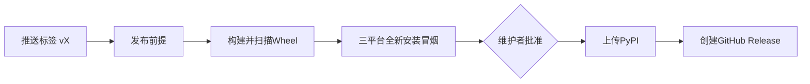

# 发布流程

## 1. 适用范围

本文说明 Harnessix Code 如何发布到 PyPI 和 GitHub Release。用户安装方式见[用户手册](user-manual.md)。

发布由推送版本标签触发，全程在 GitHub Actions 中完成，仓库里不保存任何上传密钥：



| 阶段 | 内容 | 失败时 |
|---|---|---|
| 发布前提 | 标签等于 `v` 加 `pyproject.toml` 中的版本；`CHANGELOG.md` 有该版本小节且已写明发布日期；标签指向的提交在 `main` 上；该提交的 CI 已有一次全部通过 | 停止，不构建 |
| 构建 | 只构建一次 Wheel，扫描制品中的密钥，核对文件名并记录 SHA-256 | 停止 |
| 冒烟 | 在 Ubuntu、macOS、Windows 上用 `uv tool install` 安装同一个 Wheel，运行 `harnessix --help` 和 `harnessix license` | 停止 |
| 批准 | `pypi` 环境要求维护者在 Actions 页面点击批准 | 不批准就不上传 |
| 上传 | 用 PyPI 可信发布（OIDC）上传，并由官方 Action 生成来源证明（PEP 740） | 可重新运行该任务 |
| GitHub Release | 附上 Wheel、`SHA256SUMS` 和该版本的 CHANGELOG 小节；预发布版本标为 Pre-release | 可重新运行该任务 |

## 2. 一次性设置（维护者）

以下设置只需做一次，必须由项目所有者本人完成。

### 2.1 PyPI

1. 注册 [PyPI](https://pypi.org) 账号并开启双重验证（上传要求）。
2. 打开 Account settings → Publishing → Add a new pending publisher，选择 GitHub，填写：

   | 字段 | 值 |
   |---|---|
   | PyPI Project Name | `harnessix` |
   | Owner | `carrie1988` |
   | Repository name | `Harnessix` |
   | Workflow name | `release.yml` |
   | Environment name | `pypi` |

   首次发布成功后，待定发布者会自动转为该项目的正式可信发布者，项目名归属于该账号。

### 2.2 GitHub

在仓库 Settings → Environments 中新建环境 `pypi`：

- **Required reviewers：** 添加维护者本人。每次上传前都需要在 Actions 页面批准。
- **Deployment branches and tags：** 选择 Selected branches and tags，添加标签规则 `v*`。

## 3. 每次发布的步骤

1. **确定版本号。** 预览期使用 `0.10.0b2` 这类预发布号，正式版从 `1.0.0` 开始。版本号必须是 PEP 440 规范形式，且在 PyPI 上从未用过。
2. **更新版本相关文件：**

   ```bash
   # pyproject.toml 中的 version 改为新版本后：
   uv lock
   uv run python scripts/sbom_generate.py
   uv run python scripts/license_scan.py
   ```

   - `CHANGELOG.md`：把该版本的标题写成 `## 0.10.0b2（2026-11-20）` 这样的发布日期，不能保留“未发布”；
   - `docs/operations/installation.md` 和 `docs/operations/user-manual.md` 中的当前版本号；
   - `scripts/installed_product_upgrade_acceptance.py` 中的 `CANDIDATE_VERSION`（按其测试提示同步）。

   遗漏时 `governance` 和 `supply-chain` 检查会失败并指出位置。
3. **合入 `main`，等待 CI 全部通过。** 发布工作流只认可在该提交上全部通过的 CI 运行。
4. **打标签并推送：**

   ```bash
   git tag -a v0.10.0b2 -m "Harnessix Code 0.10.0b2"
   git push origin v0.10.0b2
   ```

5. **批准上传。** 在 Actions 页面打开这次 Release 运行，冒烟通过后点击 Review deployments → 批准 `pypi`。
6. **验证。** 在一台没有装过的机器上运行 `uv tool install harnessix==0.10.0b2`，再按用户手册做一次 `doctor`。国内镜像通常在数分钟到数小时内同步。

## 4. 失败与重试

| 情况 | 处理 |
|---|---|
| CI 还没跑完就推了标签 | 等 CI 通过后，在 Actions 页面重新运行这次 Release |
| 发布前提、构建或冒烟失败 | 尚未上传。修复后删除远端标签（`git push origin :refs/tags/vX`）再重新打；或者直接使用新版本号 |
| 上传因网络等原因失败 | 重新运行失败的任务 |
| 上传成功后发现问题 | **同一版本号不能再次上传。** 在 PyPI 项目页将该版本标为 Yank，修复后发布新版本号 |
| GitHub Release 创建失败 | 重新运行该任务；若已部分创建，先删除该 Release 再重跑 |

## 5. 安全

- 只有上传任务拥有 `id-token: write` 权限，且必须经过 `pypi` 环境批准；其他任务只读，创建 GitHub Release 的任务额外拥有 `contents: write`。
- 不使用长期 API Token，PyPI 只信任本仓库 `release.yml` 在 `pypi` 环境中签发的身份。
- 所有 Action 固定到完整提交 SHA。
- 上传的只有 Wheel。源代码按 AGPL-3.0-only 在 GitHub 公开，`harnessix license` 给出源码地址。

## 6. 回退

PyPI 上的版本不能覆盖。需要撤回时，在 PyPI 项目管理页将其 Yank：已固定该版本的安装仍可用，新安装不再选中它。用户可以用 `uv tool install harnessix==<旧版本>` 回到旧版本，数据兼容性见[升级与回退](upgrade-and-rollback.md)。

## 7. 源码映射

| 内容 | 位置 |
|---|---|
| 发布工作流 | [`release.yml`](../../.github/workflows/release.yml) |
| 版本、CHANGELOG 检查与发布说明提取 | [`release_check.py`](../../scripts/release_check.py) |
| 工作流形状与检查逻辑的测试 | [`test_release_workflow.py`](../../tests/governance/test_release_workflow.py) |
