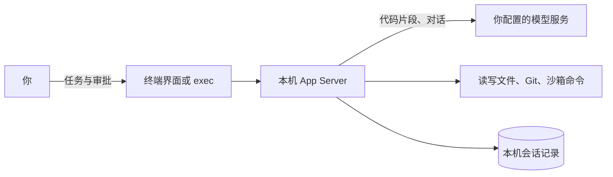

# Harnessix Code 用户手册

适用版本：`0.10.0b22`（预览版）

> **当前是预览版，不是正式商用版本，不提供任何担保。** 请只在可以通过 Git 回退的仓库里使用，并且只处理你有权发送给模型服务商的代码。

本手册面向第一次使用 Harnessix Code 的开发者，按“安装 → 配置 → 检查 → 使用 → 进阶”的顺序编写。只想尽快跑起来，读完第 2～6 章即可；其余章节在需要时查阅。

## 目录

1. [产品简介](#1-产品简介)
2. [系统要求](#2-系统要求)
3. [安装](#3-安装)
4. [配置模型](#4-配置模型)
5. [启动前检查](#5-启动前检查)
6. [第一次使用](#6-第一次使用)
7. [终端界面](#7-终端界面)
8. [审批与安全控制](#8-审批与安全控制)
9. [Agent 的能力](#9-agent-的能力)
10. [费用、预算与长任务](#10-费用预算与长任务)
11. [无头模式：harnessix exec](#11-无头模式harnessix-exec)
12. [本机数据管理](#12-本机数据管理)
13. [状态备份与恢复](#13-状态备份与恢复)
14. [升级与卸载](#14-升级与卸载)
15. [隐私与数据去向](#15-隐私与数据去向)
16. [故障排查](#16-故障排查)
17. [进阶与集成](#17-进阶与集成)
18. [已知限制](#18-已知限制)
19. [反馈与支持](#19-反馈与支持)
- [附录 A：命令速查](#附录-a命令速查)
- [附录 B：文件与目录](#附录-b文件与目录)
- [附录 C：环境变量](#附录-c环境变量)

---

## 1. 产品简介

Harnessix Code 是在你本机终端里运行的 Coding Agent：它读代码、改代码、跑测试，最后给出总结。它有三个特点：

- **模型自选：** 可以用 DeepSeek、阿里云百炼等云服务，也可以用你自己部署的模型（vLLM、Ollama，同机或局域网）。
- **每一步受控：** 修改文件前给你看完整差异并等你批准；命令默认在系统沙箱里执行，需要越过沙箱的操作逐条请你批准。
- **可恢复、可审计：** 会话、审批和每一步操作都记录在本机。进程崩溃或断线后可以继续，已经发生的副作用不会被盲目重放。

工作方式：



代码和对话只发送给你配置的模型服务商。Harnessix 没有遥测，不向项目方发送任何数据。

---

## 2. 系统要求

| 项目 | 要求 |
|---|---|
| 操作系统 | macOS 或 Linux。Windows 为预览支持，见 [2.1](#21-windows-说明) |
| 包管理器 | [uv](https://docs.astral.sh/uv/)。它会自动准备 Python 3.12，不需要单独安装 Python |
| 沙箱 | macOS 自带 Seatbelt，无需安装；Linux 需要 bubblewrap，见 [3.4](#34-linux准备沙箱) |
| Git | 推荐安装。工作区在 Git 仓库内时自动启用 Git 工具 |
| 模型 | 一个模型服务的 API Key（DeepSeek、百炼或其他 OpenAI 兼容接口），或你自己部署的模型端点 |
| 终端 | 支持全屏界面的现代终端。macOS 上请使用系统“终端”或 iTerm2 等，不要在其他工具提供的沙箱终端里运行 |

### 2.1 Windows 说明

Windows 目前处于预览验证阶段，暂不建议用于日常工作：

- Windows 没有本机沙箱。命令只在沙箱外的 PowerShell 中运行（优先 PowerShell 7 的 `pwsh.exe`，否则使用系统自带的 Windows PowerShell），**每条都需要你批准**。
- 希望命令在沙箱中自动执行时，请在 WSL2 里按 Linux 方式安装和使用。

---

## 3. 安装

### 3.1 安装 uv

已经装过 uv 可以跳过本节。

```bash
# macOS / Linux（官方安装脚本）
curl -LsSf https://astral.sh/uv/install.sh | sh

# 或使用 Homebrew
brew install uv
```

Windows（PowerShell）：

```powershell
powershell -ExecutionPolicy ByPass -c "irm https://astral.sh/uv/install.ps1 | iex"
```

安装后重新打开终端，运行 `uv --version` 确认可用。

### 3.2 安装 Harnessix Code

从 PyPI 安装：

```bash
uv tool install harnessix
```

一条命令会装好终端界面和模型接口所需的全部依赖，并把 `harnessix` 命令放到 uv 的工具目录（通常是 `~/.local/bin`）。如果提示找不到命令，运行 `uv tool update-shell` 后重新打开终端。

- **国内网络：** 使用镜像，`uv tool install harnessix --index-url https://mirrors.huaweicloud.com/repository/pypi/simple`。镜像同步新版本可能有数小时延迟，刚发布时可能还装不到最新版。
- **指定版本：** `uv tool install harnessix==0.10.0b22`。预览期内所有版本都是预发布版本，不指定时安装最新的预览版。
- **离线或内网：** 从 GitHub 仓库的 Releases 页面下载 wheel 文件（附有 `SHA256SUMS` 可核对），再运行 `uv tool install ./harnessix-0.10.0b22-py3-none-any.whl`。依赖仍需从 PyPI 或镜像下载。

**从源码构建（开发者）：**

```bash
git clone https://github.com/carrie1988/Harnessix.git
cd Harnessix
uv build --wheel
uv tool install dist/harnessix-*.whl
```

### 3.3 确认安装成功

```bash
harnessix --help       # 列出全部子命令
harnessix license      # 显示许可证信息（社区版为 AGPL-3.0-only）
```

### 3.4 Linux：准备沙箱

Linux 上的命令沙箱依赖 bubblewrap。没有可用的沙箱时，Harnessix 仍能工作，但所有命令都要逐条批准。

1. 安装 bubblewrap：

   ```bash
   sudo apt install bubblewrap      # Debian / Ubuntu
   sudo dnf install bubblewrap      # Fedora
   ```

2. 允许普通用户创建隔离环境（多数发行版默认已允许）。如果 `harnessix code doctor` 提示“系统禁止普通用户创建隔离环境”：
   - 较老的 Debian 系统：`sudo sysctl kernel.unprivileged_userns_clone=1`；
   - Ubuntu 24.04 及以后：需要为 bwrap 配置 AppArmor 例外。常见做法是创建 `/etc/apparmor.d/bwrap`：

     ```text
     abi <abi/4.0>,
     include <tunables/global>

     profile bwrap /usr/bin/bwrap flags=(unconfined) {
       userns,
       include if exists <local/bwrap>
     }
     ```

     然后运行 `sudo apparmor_parser -r /etc/apparmor.d/bwrap`。
   - 在 Docker 等容器里运行时，通常无法创建嵌套的隔离环境，请改到宿主机上运行。

3. 用第 5 章的 `harnessix code doctor` 确认，看到 `native_sandbox_bubblewrap` 即为可用。

---

## 4. 配置模型

配置只需做一次，结果保存在 `~/.harnessix/config.json`。**API Key 不写入任何文件**，Harnessix 只记录环境变量的名字，每次运行时从环境变量读取。

### 4.1 选择服务商和模型

运行向导，按提示选择即可：

```bash
harnessix code configure
```

```text
选择模型服务商：
  1) DeepSeek 官方
  2) 阿里云百炼（通义千问、DeepSeek）
  3) 智谱 GLM
  4) 其他兼容 OpenAI 接口的服务（手动填写地址和模型名）
输入序号 [1]: 2
选择模型（阿里云百炼，价格为每百万 Token）：
  1) qwen3.8-flash  便宜、速度快（推荐） · 输入 ¥0.8 / 输出 ¥2.7
  2) qwen3.8-max  千问能力最强 · 输入 ¥12 / 输出 ¥36
  3) deepseek-v4-pro  百炼提供的 DeepSeek · 输入 ¥12 / 输出 ¥24
  4) 手动输入其他模型名
输入序号 [1]:
```

直接回车选第一项。每家的第一个模型便宜、够日常编码用，需要更强的效果再选其他型号。接口地址、上下文窗口、思考方式和等待时间都会自动填好。完成后向导会告诉你下一步，例如：

```text
配置已保存：~/.harnessix/config.json
模型：qwen3.8-flash（阿里云百炼） · 每百万 Token 输入 ¥0.8 / 输出 ¥2.7

下一步：
  1. 在当前终端设置 API Key：
       export DASHSCOPE_API_KEY=你的API Key
     想以后打开终端都生效，把上面这一行加到 ~/.zshrc（zsh）或 ~/.bash_profile（bash）末尾。
  2. 进入项目目录，运行 harnessix code
```

### 4.2 API Key

**API Key 不写入任何文件**，Harnessix 只记录环境变量的名字，每次运行时从环境变量读取。各服务商使用的变量名与其官方文档一致，可以同时设好几家的 Key，切换服务商时不必改环境变量：

| 服务商 | 环境变量 | 在哪里获取 Key |
|---|---|---|
| DeepSeek 官方 | `DEEPSEEK_API_KEY` | DeepSeek 开放平台 |
| 阿里云百炼 | `DASHSCOPE_API_KEY` | 百炼控制台（使用按量付费的 API Key） |
| 智谱 GLM | `ZAI_API_KEY` | 智谱开放平台 |
| 其他服务、自己部署的模型 | `MODEL_API_KEY` | — |

macOS 上比写进 `~/.zshrc` 更安全的做法是存进钥匙串，再在 shell 配置文件里读取：

```bash
security add-generic-password -a "$USER" -s harnessix-model -w   # 按提示输入 Key
# 在 ~/.zshrc 中：
export DASHSCOPE_API_KEY=$(security find-generic-password -s harnessix-model -w)
```

想用别的变量名，配置时加 `--api-key-env 变量名`。

### 4.3 在脚本里配置

不想交互时，用 `--vendor` 指定服务商（`deepseek`、`bailian`、`zhipu`），不写 `--model` 时使用该家的默认模型：

```bash
harnessix code configure --vendor bailian --non-interactive
harnessix code configure --vendor deepseek --model deepseek-v4-pro --non-interactive
```

需要机器可读的结果时加 `--json`：成功时输出 JSON 收据，失败时在 stderr 输出 JSON 错误（0.10.0b11 起不加 `--json` 时输出中文说明）。

其他 OpenAI 兼容服务手动填写地址和模型名：

```bash
harnessix code configure --provider-kind openai_chat \
  --base-url https://你的服务地址/v1 --model 模型名 --non-interactive
```

下列模型已内置上下文窗口和思考设置，并核对过牌价，界面会显示费用上限：

| 服务 | 模型 | 上下文窗口 | 牌价（每百万 Token，输入/输出，人民币） |
|---|---|---|---|
| DeepSeek 官方 | `deepseek-flash`（旧名 `deepseek-v4-flash` 同价） | 100 万 | ¥2 / ¥8（高峰价；闲时半价） |
| DeepSeek 官方 | `deepseek-v4-pro` | 100 万 | ¥9 / ¥27（高峰价；闲时半价） |
| 百炼 | `deepseek-v4-pro` | 100 万 | ¥12 / ¥24 |
| 百炼 | `deepseek-v4-pro-0813` | 100 万 | ¥9 / ¥27（高峰价） |
| 百炼 | `qwen3.8-max`、`qwen3.8-max-0902` | 100 万 | ¥12 / ¥36 |
| 百炼 | `qwen3.8-flash` | 100 万 | ¥0.8 / ¥2.7 |
| 智谱 | `glm-5.3-flash` | 100 万 | ¥0.8 / ¥2.8 |
| 智谱 | `glm-5.3-flashx` | 100 万 | ¥2 / ¥7 |
| 智谱 | `glm-5.3` | 100 万 | ¥8 / ¥28 |

牌价核对于 2026-11-10，以服务商官网为准；金额一律以人民币显示。只有表中的确切型号会显示费用，带其他日期或后缀的型号可能另有价格，显示为“费用未知”。其他 OpenAI 兼容服务和 Anthropic 接口（`--provider-kind anthropic`）也可以使用，但费用显示为“未知”。没有内置窗口的模型，建议用 `--context-window-tokens` 写明上下文窗口。

### 4.4 自己部署的模型

**同一台机器**（地址是 `127.0.0.1`、`localhost` 或 `::1`）：无需额外声明，自动按本地模型配置。

```bash
export MODEL_API_KEY=$(openssl rand -hex 16)
harnessix code configure --provider-kind openai_chat \
  --base-url http://127.0.0.1:8000/v1 --model your-model \
  --context-window-tokens 32768 --non-interactive
```

**局域网里的服务器：** 加 `--self-hosted`，声明这是你自己部署的端点，才允许明文 HTTP：

```bash
export MODEL_API_KEY=$(openssl rand -hex 16)
harnessix code configure --provider-kind openai_chat \
  --base-url http://192.168.1.20:8000/v1 --model your-model \
  --self-hosted --context-window-tokens 32768 --non-interactive
```

注意事项：

- 即使服务端不校验 Key，也必须设置 `MODEL_API_KEY`，且**至少 16 字节**（上例生成随机值）。`local` 这类短值会被启动检查拒绝。
- 可声明为自托管的只有内网地址：私网 IPv4、`100.64.0.0/10`（Tailscale 等）、IPv6 ULA、单段主机名（如 `gpu01`），以及 `.local`、`.lan`、`.internal`、`.intranet`、`.home.arpa` 后缀的主机名。公网地址会被拒绝。
- 端点需要兼容 OpenAI Chat Completions、支持工具调用，并能在流式响应中返回用量。已实测 vLLM 和 Ollama；LM Studio 尚未验证。
- **Ollama 默认上下文只有 4096 Token**，超出部分会被静默截断。启动 Ollama 前设置 `OLLAMA_CONTEXT_LENGTH`（如 32768），并让 `--context-window-tokens` 与它一致。
- 服务端不支持思考参数时，加 `--thinking-protocol none`。
- 本地模型费用显示为“本地 0 元”，并使用更宽的 Token 上限（见第 10 章）。

详见[接入自托管模型](self-hosted-models.md)。

### 4.5 使用代理

需要经代理访问云模型时，任选一种方式：

- 设置环境变量 `HTTPS_PROXY`（或 `HTTP_PROXY`），并遵守 `NO_PROXY`，与大多数开发工具相同；
- 配置时加 `--proxy-url http://127.0.0.1:端口`，它优先于环境变量。

只支持 HTTP 代理。只设置了 SOCKS 代理（如 `ALL_PROXY=socks5://…`）不会生效，`doctor` 会提示。本机和内网的自托管模型总是直连。

### 4.6 修改已有配置

换服务商或模型时，再运行一次 `harnessix code configure`。向导会先显示当前模型并询问是否替换，回答 `y` 后按 4.1 重新选择；回答其他内容则保留原配置。

在脚本里修改时，为了防止误覆盖，需要带上当前配置的摘要：

```bash
harnessix code configure [新的完整参数] --replace \
  --expected-source-sha256 <当前摘要> --non-interactive
```

当前摘要可以从上一次配置输出的收据，或 `harnessix code doctor --json` 的报告中取得。不带 `--replace` 直接覆盖时，命令会报错，并在错误信息中给出可用的命令。

改完配置后直接打开已有的工作区即可，新配置会在下次启动时生效，之前的会话照常保留（0.10.0b8 起；更早的版本会显示“连接中断……server_closed”）。

使用百炼 qwen3.8 系列时，Harnessix 会为它默认的思考过程留出更长的等待时间（空闲读取 180 秒、单次请求 900 秒）。0.10.0b9 起，用更早版本配置过的也会自动使用这组时间，无需重新配置；你自己改过的等待时间保持不变。

### 4.7 configure 参数一览

**思考模式怎么选**

- **默认（不写 `--thinking`）**：DeepSeek 以及百炼的 `deepseek-v4`、`qwen3.8-max`、`qwen3.8-flash` 只在调用工具的步骤思考；整理上下文的摘要这类不带工具的请求不思考，输出额度全部用于正文。0.10.0b19 之前百炼的两个 qwen3.8 型号每个请求都思考，窗口较小时摘要常被思考占满而作废；已有的配置不会自动改变，重新运行 `harnessix code configure` 即可用上新默认值。
- **小窗口默认不思考**：思考内容计入单次输出上限，至少需要 16384 Token 的输出额度。上下文窗口小于 64K 时，四分之一窗口放不下这个额度，向导默认关闭思考。确实需要时可以显式加 `--thinking tool_steps` 或 `--thinking every_step`，这时输出上限会放到窗口允许的最大值，留给对话历史的空间相应变小。
- **关闭思考（`--thinking off`）有代价**：回复更快、输出更省，但模型更容易做出与任务无关的操作。实测百炼 `qwen3.8-flash` 关闭思考后，出现过自作主张新建无关文件、搜索无关内容的情况。窗口够用时建议保留默认的 `tool_steps`；关闭思考后请留意审批窗口里的每一处修改。

| 参数 | 说明 |
|---|---|
| `--vendor` | 服务商：`deepseek`、`bailian`（阿里云百炼）、`zhipu`（智谱），自动填写地址和 Key 变量名 |
| `--provider-kind` | `openai_chat`（OpenAI 兼容接口）或 `anthropic` |
| `--base-url` | 模型服务地址，云服务必须是 HTTPS |
| `--model` | 模型名 |
| `--api-key-env` | 读取 Key 的环境变量名，默认按服务商（见 4.2），手动填写时为 `MODEL_API_KEY` |
| `--context-window-tokens` | 上下文窗口（Token）。已知云模型自动填写；自托管模型建议填写。填写后，默认的单次输出上限不超过窗口的四分之一（32K 窗口为 8192），其余留给对话历史 |
| `--self-hosted` | 声明为自己部署的内网端点 |
| `--proxy-url` | 经本机 HTTP 代理访问 |
| `--thinking` | 思考模式：`tool_steps`（只在工具步骤思考，已知服务的默认值）、`every_step`、`off`。没有已核对思考开关的服务会拒绝这个参数并提示怎么改。详见下方“思考模式怎么选” |
| `--thinking-protocol` | 思考参数格式：`auto`（默认，按已知服务预设）、`none`、`dashscope_enable_thinking`、`deepseek_thinking_type` |
| `--tool-choice` | 是否发送 `tool_choice`：`auto`、`send`、`omit` |
| `--service-failure-retries` | 终端界面使用付费模型时，网络中断、限流、模型服务内部错误之后最多连续自动重试的次数，0～20，默认 5；填 0 表示不自动重试，出错即停下。见 [10.3](#103-费用未知时) |
| `--output-token-parameter` | 输出上限参数名：`max_completion_tokens` 或 `max_tokens` |
| `--provider-id`、`--profile-id` | 自定义配置中的标识，一般不需要 |
| `--config` | 配置文件路径，默认 `~/.harnessix/config.json` |
| `--replace`、`--expected-source-sha256` | 修改已有配置，见 [4.6](#46-修改已有配置) |
| `--non-interactive` | 不询问，缺少参数时直接报错 |
| `--json` | 输出 JSON 收据和 JSON 错误，供脚本使用 |

---

## 5. 启动前检查

```bash
harnessix code doctor /path/to/repo --probe-model
```

- 不带 `--probe-model` 时完全离线，检查配置文件、Key 是否已设置、工作区、状态目录、沙箱和 Git，不会创建任何数据。
- 带 `--probe-model` 时额外联网探测一次：模型是否存在、工具调用参数能否正确解析。
- 输出第一行是结论：“可启动”或“不可启动”。每个检查项标为 `[通过]`、`[警告]`、`[失败]` 或 `[跳过]`。结论为“可启动”时，不影响启动的问题（例如沙箱不可用）显示为“警告”。
- 失败项会附带“修复动作”，按说明处理即可。
- 配置了 MCP Server 时，末尾会列出每个 Server 的信任状态。
- 加 `--json` 输出机器可读的报告。报告不含绝对路径、Key 或原始异常，可以放心转发。

退出码：可以启动且探测通过时为 0，否则为 2。

---

## 6. 第一次使用

下面用一个完整例子走一遍。

**第 1 步：进入一个可以回退的 Git 仓库。** 建议先提交或暂存手头的改动，以便随时用 Git 回退 Agent 的修改。

**第 2 步：启动。**

```bash
cd /path/to/repo
harnessix code            # 不写目录时使用当前目录
```

**第 3 步：确认信任目录。** 第一次在某个目录运行时，终端会说明：

- 目录里的 `AGENTS.md` 等指令文件会被读取，并发送给你配置的模型；
- 沙箱内的命令会自动执行，并可以修改这个目录里的文件。

输入 `y` 确认后会记住，之后（包括其子目录）不再询问。只信任你自己的或来源可靠的代码。

**第 4 步：描述任务。** 进入全屏界面后，直接在底部输入框输入任务，按 `Enter` 发送；第一条输入会自动开启新会话。例如：

```text
运行 tests 目录下的单元测试，修复导致失败的缺陷，不要修改测试文件。修复后再跑一次测试确认全部通过。
```

**第 5 步：观察与审批。** Agent 会读代码、运行测试、提出修改：

- 需要你审批时，审批窗口会自动弹出（约 2 秒后），开头一句话说明 Agent 要做什么，下面是完整差异，选择“批准”或“拒绝”。拒绝时可以写明原因，Agent 会据此调整。选“暂不处理”关闭后不会反复弹出，之后按 `Ctrl+A` 再打开；
- 沙箱内的命令（如运行测试）会自动执行，无需审批；
- 状态栏实时显示当前进展（如“思考中”“执行中”“等待你审批”）、累计 Token 用量和费用上限。
- Agent 在运行时，对话下方有一行转动的提示，例如“⠹ 思考中 · 已运行 23 秒”。模型思考或生成较长代码时可能几十秒没有文字输出，只要这一行还在转，任务就在正常进行；等待你审批或回答时不显示。
- 模型思考时，对话下方会以浅色实时显示它最近在想的内容（“思考：…”），开始回复后自动收起。思考内容只用于显示，不会保存到会话记录，也不会回传给模型。

**第 6 步：查看结果。** 任务结束后，Agent 给出总结。用 `git diff` 检查改动；满意后可以自己提交，也可以对 Agent 说“提交这些改动”（见 [9.4](#94-git)）。

**第 7 步：退出。** 按 `Ctrl+Q`。下次在同一目录运行 `harnessix code`，会自动回到上次的会话。

---

## 7. 终端界面

### 7.1 界面布局

| 区域 | 内容 |
|---|---|
| 会话列表 | 当前目录下的会话，显示创建时间、状态和轮数，选中即可切换。终端宽度不足 90 列时自动收起 |
| 对话记录 | 你的消息、Agent 的回复（按 Markdown 排版）、计划（✓ 已完成、▸ 进行中、○ 待办）。每个操作占一行，结果跟在箭头后，例如“读取 src/app.py → 完成”；尚未完成的操作以“…”结尾，显示在对话记录下方 |
| 输入框 | “输入任务，Enter发送”。任务运行期间输入框不可用，需要补充要求时用 `Ctrl+S`；任务结束后光标自动回到输入框 |
| 状态栏 | 当前进展（就绪、思考中、执行中、等待你审批、已完成等）、当前模型、沙箱状态（如“沙箱：已启用（macOS Seatbelt）”）、是否自动接受修改、本轮累计 Token 用量、费用上限以及最近的错误 |

### 7.2 快捷键

| 按键 | 作用 |
|---|---|
| `Enter` | 发送输入框中的内容 |
| `Ctrl+N` | 新建会话 |
| `Ctrl+A` | 打开待处理的审批（有待审批时可用） |
| `Ctrl+E` | 切换“本会话自动接受修改” |
| `Ctrl+U` | 回答 Agent 提出的问题（有问题时可用） |
| `Ctrl+S` | 向正在运行的任务追加说明（任务运行时可用） |
| `Ctrl+X` | 取消正在运行的任务（任务运行时可用） |
| `Ctrl+R` | 与后台服务重新连接（连接中断时可用） |
| `F1` | 有错误时查看原因和处理办法（包括上一轮任务因 API Key、网络、限流、上下文超长等原因未完成）；没有错误时显示使用说明 |
| `Ctrl+Q` | 退出 |
| `Esc` | 关闭弹出窗口（不会产生审批或回答结果） |

底部快捷键栏只显示当前可用的操作，例如有待审批时才出现“审批”。

### 7.3 会话管理

- 没有会话时，第一条输入自动开启新会话；`Ctrl+N` 可随时另开一个。
- 同一目录可以有多个会话，在会话列表中切换。
- 重新打开同一目录时，自动回到上次选中的会话。
- 指定恢复某个会话：`harnessix code --resume <会话 ID>`。
- 每个目录的会话数据相互独立，保存在 `~/.harnessix/workspaces/<目录指纹>/`。

### 7.4 任务运行中

- **追加说明（`Ctrl+S`）：** 例如“只改 `src/` 下的文件”。说明会在下一步交给模型，不必取消重来。
- **取消（`Ctrl+X`）：** 立即停止当前任务。已经批准并执行的修改会保留，可以用 Git 回退。
- **回答问题（`Ctrl+U`）：** Agent 需要你做选择时，输入答案或选项序号。
- **断线：** 后台服务连接中断时，按 `Ctrl+R` 重连。正在执行的操作不会被盲目重做，结果以记录为准。

---

## 8. 审批与安全控制

### 8.1 哪些操作需要审批

| 操作 | 默认处理 |
|---|---|
| 读取文件、搜索、查看 Git 状态和差异 | 自动执行 |
| 修改文件 | 需要批准，审批窗口显示完整差异 |
| 沙箱内命令（如运行测试） | 自动执行 |
| 沙箱外命令（需要联网、写 `.git` 等；Windows 上的所有命令） | 需要批准；只读命令和你保存过规则的命令除外，见 [8.3](#83-减少询问) |
| 撤销 Agent 之前的修改 | 需要批准，显示逆向差异 |
| 调用 MCP Server 的工具 | 每次都需要批准 |
| 提交 Git | 通过沙箱外命令执行，需要批准；Agent 不会推送 |

### 8.2 审批窗口

窗口顶部显示操作类型、工具和效果。修改文件时，下方先列出涉及的文件，再显示统一格式的差异（新增行绿色、删除行红色）；其他操作显示完整参数，例如要运行的命令。差异从开头显示，一屏放不下时按 `PgUp`/`PgDn` 翻看，不必先把焦点移进差异区。打开窗口时焦点在“批准”上：按 `Enter` 确认所选按钮，`Tab` 切换按钮或进入原因输入框，`Esc` 关闭。可以填写决定原因（可选），然后选择：

| 按钮 | 效果 |
|---|---|
| 批准 | 只批准这一次 |
| 批准并自动接受本会话的修改 | （修改文件时显示）本次批准，并在本会话中自动批准后续的文件修改 |
| 批准并以后不再询问：`命令前缀 *` | （沙箱外命令可以保存规则时显示）本次批准，并保存这条规则：以后这个工作区里以该前缀开头的简单命令不再询问，重启后仍然有效 |
| 批准并在本会话允许相同操作 | （其他情况显示）本次批准，之后**工具和参数都完全相同**的操作在本会话自动通过 |
| 拒绝 | 不执行；Agent 会收到拒绝结果并调整方案 |
| 暂不处理 | 关闭窗口，审批保持待处理，任务继续等待 |

注意：等待审批的时间计入任务时限（默认 1 小时）。

### 8.3 减少询问

**本会话内：**

- `Ctrl+E` 随时开关“自动接受修改”，状态栏会显示“自动接受修改”。它只覆盖文件修改，退出或重启后恢复为逐次审批。
- MCP 调用和不能保存规则的命令，只有在你选择“允许相同操作”后，完全相同的调用才会在本会话自动通过。

**沙箱外命令（Windows 上是所有命令）：**

- **只读命令不询问。** 例如列目录（`ls`、`dir`、`Get-ChildItem`）、查看工作区内的文件（`cat`、`Get-Content`）、`git status`、`git diff`、`git log`。条件是单条简单命令、路径在工作区内、不涉及 `.env` 和密钥等敏感文件；不满足时照常询问。
- **保存规则后不再询问。** 在审批窗口选择“批准并以后不再询问：`python -m unittest *`”，以后这个工作区里以这段开头的简单命令自动通过。规则保存在本机，不进入代码仓库。
- **始终询问：** 带 `|`、`;`、`&&`、重定向或变量的复合命令；删除、提权和 `bash -c`、`python -c` 这类能执行任意代码的命令不能保存规则。
- 查看和撤销已保存的规则：

  ```bash
  harnessix code approvals              # 列出当前目录这个工作区的规则
  harnessix code approvals --remove 1   # 撤销第 1 条
  ```

- 自动通过的命令同样有审批记录，并注明原因（“只读命令”或“匹配你保存的规则”）。无人值守的 `exec` 不使用这些规则。

### 8.4 工作区信任

- 首次在某个目录运行时需要确认，确认结果记录在 `~/.harnessix/trusted-workspaces.json`，对子目录同样有效。
- 非交互场景（`harnessix exec`、CI）使用 `--trust-workspace`，只对本次运行有效，不会记录；也可以设置 `HARNESSIX_TRUST_WORKSPACE=1`。
- 信任只拦截首次运行。信任之后，仓库里的 `AGENTS.md` 和 Skill 等内容会被加载，仍可能包含提示注入，打开不熟悉的仓库前请先查看。

### 8.5 命令沙箱

沙箱默认开启，由系统提供：macOS 使用 Seatbelt，Linux 使用 bubblewrap。

沙箱内的命令：

- 可以读写工作区，但 `.git` 目录只读，工作区内的 `.harnessix` 目录不可访问；
- **不能联网**。Linux 沙箱完全断网；macOS 沙箱只放行本机回环地址，已配置的本机代理端口也被拦截；
- **读不到凭据和隐私数据**，包括 `~/.ssh`、`~/.gnupg`、`~/.aws`、`~/.config/gcloud`、`~/.azure`、`~/.kube`、`~/.docker`、`~/.netrc`、`~/.git-credentials`、`~/.npmrc`、`~/.pypirc`、各类 shell 历史、`~/.harnessix`，以及钥匙串和浏览器数据；
- 读不到工作区里的 `.env` 和 `.env.*` 文件，Agent 的读文件工具同样不能读取它们；
- 只继承必要的环境变量，模型 API Key 等机密不会传给命令。

需要联网（如安装依赖）或写 `.git` 时，Agent 会改为申请在沙箱外运行，由你逐条批准。

### 8.6 沙箱不可用时

Harnessix 不会静默降级：所有命令都改为沙箱外执行，并逐条要求批准。状态栏显示“沙箱：不可用，命令逐条审批”，运行 `harnessix code doctor` 可查看原因和修复方法。

常见原因：Linux 未安装 bubblewrap 或禁止了用户命名空间（见 [3.4](#34-linux准备沙箱)）；macOS 上 Harnessix 运行在另一个沙箱里（例如其他工具提供的沙箱终端，macOS 不允许嵌套），请在系统自带的“终端”里运行。

---

## 9. Agent 的能力

### 9.1 读代码

| 工具 | 作用 |
|---|---|
| `read_file` | 按行或锚点读取文件片段 |
| `grep` | 按文本或正则搜索 |
| `glob`、`list_files` | 按模式查找、列出文件 |
| `read_artifact` | 分页读取较大的工具输出 |

读取限制在工作区内，不读取 `.env` 和 `.env.*` 文件。

### 9.2 改代码

- **`apply_patch_batch`：** 一次修改一个或多个文件，作为一个事务整体生效。修改前校验文件没有被其他人改过，审批窗口显示完整差异。
- **`rollback_workspace_patch`：** 撤销本会话中 Agent 自己做过的某次修改。需要重新批准；如果文件之后又被改动，会拒绝撤销，不覆盖后续改动。

### 9.3 运行命令

| 工具 | 运行位置 | 审批 |
|---|---|---|
| `exec_command.shell` | 沙箱内，使用你的 shell（zsh 或 bash，其他 shell 时使用 `/bin/sh`） | 自动执行 |
| `host_command.host-shell` | 沙箱外，与你本人权限相同 | 每条都需要批准 |

沙箱不可用或在 Windows 上时，只有沙箱外命令。不想让 Harnessix 自动配置命令工具时，设置 `HARNESSIX_ZERO_CONFIG_ACTIONS=0`。

### 9.4 Git

- 工作区在 Git 仓库内时，自动启用 `git_status`、`git_diff` 和 `git_review`（状态加差异），无需额外配置。git 不在 `PATH` 上时，用 `--git-executable` 指定。
- **提交：** 只在你明确要求时（如“提交这些改动”）进行。Agent 先检查改动，再通过需要你批准的沙箱外命令执行 `git add` 和 `git commit`。
- **推送：** Agent 不会推送，请自己执行 `git push`。

### 9.5 任务计划

较复杂的任务中，Agent 会用 `update_plan` 维护分步计划，并在对话记录中显示进展。

### 9.6 项目指令：AGENTS.md

在仓库中放置 `AGENTS.md`（或优先级更高的 `AGENTS.override.md`），写明项目约定，例如测试命令、代码风格、禁止修改的目录。Agent 每次任务开始时读取，合计最多 64 KiB。这些内容会发送给模型服务商。

### 9.7 上下文与长任务

- 对话接近模型上下文窗口时，Harnessix 自动压缩较早的内容，保留当前任务的要求和关键事实。
- 声明了上下文窗口（已知模型自动声明）时，压缩阈值按窗口计算；小窗口模型的输出上限也会相应收紧。
- 模型服务暂时不可用（限流、5xx、网络中断）时，Harnessix 会按服务端的 `Retry-After` 和退避策略自动重试，连续最多 5 次，长任务不会因偶发故障中断。

### 9.8 Skills

Skill 是写给 Agent 的任务说明，可以附带参考文件。Agent 启动时只看到名称和描述，任务相关时才读取全文。

| 位置 | 范围 |
|---|---|
| `~/.harnessix/skills/<目录名>/SKILL.md` | 个人使用，所有仓库可见 |
| `<仓库>/.harnessix/skills/<目录名>/SKILL.md` | 随仓库共享给团队 |

```markdown
name: python-style
description: 这个仓库的 Python 约定。修改 Python 代码时使用。
version: 1.0.0

具体要求写在这里。需要时可以让 Agent 读取 references/banner.md。
```

用 `harnessix skills list [仓库]` 查看哪些 Skill 可用、哪些未被采用及原因。Skill 只是文本，不会自动运行其中提到的脚本，也不改变任何权限。修改后需重启会话才生效。完整说明见[使用 Skills](skills.md)。

### 9.9 MCP

MCP Server 是为 Agent 提供额外工具的程序，例如操作 GitHub、查询数据库。Harnessix 在本机启动它，经标准输入输出通信。

**添加 MCP Server 等于以你本人的权限在本机运行一个第三方程序，只添加来源可信的 Server。**

1. 在 `~/.harnessix/mcp.json` 中声明（格式与其他常见工具相同，可直接复制）：

   ```json
   {
     "mcpServers": {
       "my-server": {
         "command": "npx",
         "args": ["-y", "<包名>@<固定版本>"],
         "env": { "API_TOKEN": "${MY_TOKEN}" }
       }
     }
   }
   ```

   `env` 中的 `${NAME}` 在启动时从你的环境变量读取，不要把明文 Key 写进文件。`npx`、`uvx` 的包请固定版本。

2. 逐个信任：

   ```bash
   harnessix mcp list               # 查看状态
   harnessix mcp trust my-server    # 显示命令、参数和环境变量名后记录信任
   harnessix mcp untrust my-server  # 撤销信任
   ```

3. 已信任的 Server 在会话开始时启动、结束时退出。每次调用其工具都需要批准；`harnessix exec` 不会自动批准 MCP 调用。命令、参数或命令文件变化后需要重新信任。

暂不支持仓库内的 MCP 配置和远端（HTTP）MCP。完整说明见[使用 MCP](mcp.md)。

### 9.10 尚未提供的能力

Hooks、IDE 插件、Web 搜索、子代理、图片输入、自动更新。

---

## 10. 费用、预算与长任务

### 10.1 费用显示

- 已核对牌价的模型（见 [4.3](#43-在脚本里配置) 的价格表），状态栏显示“费用≤¥x.xxxx”。这是按牌价估算的**上限**：所有输入都按未命中缓存的价格计算，实际账单通常更低。
- 费用越过提醒档位时，状态栏会提示可以按 `Ctrl+X` 取消。档位：5、20、50、100、200 元。
- 本地模型显示“本地 0 元”；其他模型显示“费用未知”。

### 10.2 单个任务的上限

| 项目 | 终端界面 | `harnessix exec` |
|---|---|---|
| 最多步数 | 100 | 100（可用 `--max-steps` 调整） |
| 时限 | 1 小时，含等待审批的时间 | 1 小时（`--timeout-seconds`） |
| 累计 Token | 费用可见或本地模型：不限；费用未知的云模型：300 万 | 云模型 300 万，本地模型 600 万（`--max-tokens`） |
| 金额上限 | 无，按档位提醒 | 可选 `--max-cost`，只支持已核对牌价的模型 |

累计 Token 包含每一步重复发送的上下文，其中大部分会命中服务商缓存，所以它不等于费用。

### 10.3 费用未知时

网络中断等情况下，可能无法确认某次模型请求是否计费：

- 终端界面使用付费模型时：
  - 网络中断、限流或模型服务内部错误造成的，会自动重试，连续 5 次仍失败才停下。重试的那几次请求有可能被服务商计费。次数可以用 `harnessix code configure --service-failure-retries N` 修改，0 表示不自动重试。
  - 模型已经开始输出之后才断开的，以及其他原因造成的费用未知，任务会停下，交给你决定。发送新消息（例如“继续”）即可接着做。
- `harnessix exec` 和本地模型会按该次请求可能的最大用量预留后继续。

---

## 11. 无头模式：harnessix exec

`harnessix exec` 运行一个任务，结束后输出 JSON 摘要，适合脚本、CI 和批量任务。

### 11.1 常用示例

```bash
# 在当前目录运行任务，自动接受文件修改
harnessix exec --trust-workspace --approval-mode auto-edit \
  --prompt "修复 tests/test_parser.py 中失败的用例，不要修改测试"

# 从文件读取任务，限制费用，摘要写入文件
harnessix exec --workspace /path/to/repo --trust-workspace \
  --prompt-file task.md --approval-mode auto-edit --max-cost 2 \
  --summary-file summary.json --events-file events.jsonl --quiet
```

### 11.2 审批模式

| 模式 | 效果 |
|---|---|
| `manual`（默认） | 所有审批都交给人。在交互式终端里运行时会在终端提示你；非交互运行时遇到审批即停止，退出码 2 |
| `auto-edit` | 自动批准文件修改 |
| `auto` | 在 `auto-edit` 基础上，再自动批准沙箱内命令的审批请求 |

无论哪种模式，**沙箱外命令和 MCP 调用都不会被自动批准**；审批模式也不会放宽沙箱、网络和凭据边界。`exec` 默认开启“完成守卫”：模型在没有真正完成时就想结束，会被提示继续。

### 11.3 参数

| 参数 | 说明 |
|---|---|
| `--prompt` / `--prompt-file` | 任务描述，二选一（或用 `--resume-thread`） |
| `--workspace` | 工作区，默认当前目录 |
| `--trust-workspace` | 本次信任工作区，不记录 |
| `--approval-mode` | `manual`、`auto-edit`、`auto` |
| `--max-cost` | 费用上限，单位为人民币（元），按输入单价折算为 Token 上限 |
| `--max-steps`、`--max-tokens`、`--timeout-seconds` | 覆盖默认上限 |
| `--max-output-chars`、`--max-tool-calls-per-step` | 单步输出与工具调用数量上限 |
| `--summary-file` | 摘要写入文件，默认输出到标准输出 |
| `--events-file` | 按发生顺序把事件逐行写成 JSONL |
| `--quiet` | 不输出过程文本（过程文本默认写到标准错误） |
| `--resume-thread <ID>` | 进程中断后，恢复该会话并等待任务结束 |
| `--config`、`--profile`、`--action-config`、`--state-directory`、`--git-executable` | 同 `harnessix code` |

### 11.4 退出码

| 退出码 | 含义 |
|---|---|
| 0 | 任务完成 |
| 1 | 任务失败或被中断 |
| 2 | 需要人工处理（审批或回答） |
| 3 | 未就绪：启动检查未通过，或工作区未被信任 |
| 4 | 内部错误 |

### 11.5 摘要内容

摘要（`harnessix.exec-summary/v1`）包含：`status`、`error`、`model_steps`、`usage`（Token 用量）、`cost`（费用或上限）、`approval_mode`、`approvals`（每次审批的类型、结果和决定者）、`final_answer`（最后的回复）、`changed_paths`（改动的文件）、`commands`（运行过的命令）、`verification`（最后一次修改之后是否运行过检查）、`elapsed_seconds`，以及用于恢复的 `thread_id` 和 `turn_id`。

---

## 12. 本机数据管理

| 命令 | 作用 |
|---|---|
| `harnessix data list` | 列出各工作区的数据（目录指纹、大小、修改时间） |
| `harnessix data export [仓库] --output 文件` | 导出该工作区的完整会话。导出内容包含代码和对话，请妥善保管 |
| `harnessix data delete --workspace 仓库 --confirm 指纹` | 删除该工作区的全部会话数据 |
| `harnessix data diagnostics [仓库] --output 文件` | 生成不含代码、提示词和路径的诊断文件，适合用于反馈。启动时用过 `--state-directory` 的话，这里加上同一个目录（`export` 同理）；一个会话也没读到时，回执会写明查的是哪个目录 |

删除需要用 `--confirm` 再次给出目录指纹。指纹可以从 `data list` 获得；指纹不对时，错误信息会给出正确的值，核对后再运行一次即可。输出文件已存在时，`export` 和 `diagnostics` 会拒绝覆盖。

---

## 13. 状态备份与恢复

会话数据很重要时（例如升级前），可以对某个工作区的状态做完整备份。**先退出所有正在使用该工作区的 Harnessix。**

状态目录是 `~/.harnessix/workspaces/<目录指纹>/runtime`（指纹见 `harnessix data list`）。

```bash
STATE=~/.harnessix/workspaces/<目录指纹>/runtime
harnessix state backup --state-directory "$STATE" --backup-directory ~/harnessix-backups/2026-11-10
harnessix state verify --state-directory "$STATE" --backup-directory ~/harnessix-backups/2026-11-10
```

- 备份目录的上级目录必须已存在，备份不会覆盖已有目录，也不能放在工作区里。
- 输出的 `backup_id` 请记下，恢复时需要。
- 备份包含会话内容和本机密钥，属于私有数据，不要提交到 Git 或发给他人。

恢复（会把当前状态整体移到旁边保留，不会删除）：

```bash
harnessix state restore --state-directory "$STATE" --backup-directory <备份目录> \
  --restore-id <自己生成并保存的 UUID> --confirm-backup <backup_id>
harnessix state recover --state-directory "$STATE" --confirm-restore <同一个 UUID> --mode complete
```

想撤销一次未完成的恢复时，把第二条命令的 `--mode` 改为 `rollback`。恢复只涉及会话状态，不会改动工作区里的代码。详见[故障恢复](recovery.md)。

---

## 14. 升级与卸载

### 14.1 升级

1. 退出所有 Harnessix 进程。
2. 会话数据重要时，先按第 13 章备份。
3. 安装新版本：

   ```bash
   uv tool upgrade harnessix
   ```

   通过 wheel 文件安装的，先运行 `uv tool uninstall harnessix`，再 `uv tool install <新版本 wheel>`。

4. 运行 `harnessix code doctor /path/to/repo --probe-model` 确认。

配置、信任记录、Skills、MCP 配置和会话数据都保存在 `~/.harnessix`，升级时保留。新版本可能会升级本机数据格式；如需回到旧版本，请用升级前的备份恢复。

### 14.2 卸载

```bash
uv tool uninstall harnessix
```

卸载不会删除 `~/.harnessix`。确定不再需要时，可以先用 `harnessix data export` 导出需要保留的会话，再手动删除该目录。该目录还包含你的配置、Skills 和 MCP 设置，删除前请确认。

---

## 15. 隐私与数据去向

| 数据 | 去向 |
|---|---|
| 代码、提示词、工具结果 | 发送给你配置的模型服务商，受其条款约束 |
| 会话记录、审批记录 | 保存在本机 `~/.harnessix`，不离开你的电脑 |
| API Key | 只从环境变量读取，不写入配置文件或会话记录，并在输出和记录中按机密保护 |
| 使用统计、崩溃报告 | 不收集，没有遥测 |

使用自托管模型时，数据只发送到你部署的端点。注意：沙箱内的命令可以读取拒读清单以外的文件，这些内容可能随工具结果发送给模型服务商。完整说明见[隐私说明](../../PRIVACY.md)和[安全说明](../../SECURITY.md)。

---

## 16. 故障排查

先运行 `harnessix code doctor /path/to/repo --probe-model`，大多数问题都会在这里给出原因和修复动作。终端界面中出错时，按 `F1` 查看说明。

| 现象 | 处理 |
|---|---|
| 提示找不到 `harnessix` 命令 | 运行 `uv tool update-shell` 后重新打开终端 |
| 刚发布新版本时 `uv tool upgrade harnessix` 提示没有可升级的版本 | PyPI 索引同步需要几分钟，稍后重试即可 |
| 启动时提示“Harnessix 无法启动：缺少模型的 API Key” | 按提示在当前终端执行 `export 变量名=你的Key`（变量名见提示，如 `DASHSCOPE_API_KEY`）后重新运行；新打开的终端标签页不会继承之前手动设置的变量，想长期生效见 [4.1](#42-api-key) |
| 配置时提示配置目录的权限不是 700，或目录不属于当前用户 | 按提示里给出的命令修正（如 `chmod 700 ~/.harnessix`），并确认目录属于当前用户。通常是先手动创建了目录导致的，应先运行一次 `configure` 再创建 Skills、MCP 等文件 |
| `doctor --probe-model` 失败 | 检查 Key、`--base-url` 和模型名；需要代理时设置 `HTTPS_PROXY=http://…`，只设 SOCKS 代理不会生效 |
| 自托管模型提示 Key 太短 | 使用至少 16 字节的 Key |
| 自托管模型很快报错或回答被截断 | 检查模型上下文窗口；Ollama 默认只有 4096 |
| Linux 上沙箱不可用 | 按 [3.4](#34-linux准备沙箱) 安装 bubblewrap 并允许用户命名空间 |
| macOS 上沙箱不可用 | 在系统自带的“终端”里运行，不要在其他工具的沙箱终端里运行 |
| 提示工作区与受保护目录重叠 | 不要把项目放在 `~/.ssh`、`~/.aws` 等目录下 |
| 输入框无法输入 | 任务运行中输入框不可用，请用 `Ctrl+S` 追加说明；状态栏显示连接断开时按 `Ctrl+R` 重连 |
| 任务停在“等待你审批” | 审批窗口会自动弹出；关闭后按 `Ctrl+A` 再打开。等待时间计入 1 小时时限 |
| 任务因费用未知而停止 | 发送新消息即可继续 |
| 任务达到步数或时限 | 发送新消息继续，或把任务拆小 |
| `exec` 退出码 2 | 遇到需要人工处理的审批；改用 `--approval-mode auto-edit`，或在交互式终端里运行 |
| `exec` 提示工作区未被信任 | 确认可信后加 `--trust-workspace` |
| 自己写的 Skill 没有生效 | 运行 `harnessix skills list`，查看未被采用的原因 |
| 会话里没有 MCP 工具 | 运行 `harnessix mcp list` 和 `harnessix code doctor` 查看命令和信任状态 |
| 后台服务连接中断 | 按 `Ctrl+R` 重连 |

仍无法解决时，用 `harnessix data diagnostics <仓库> --output diag.json` 生成诊断文件，随反馈一起发送。

---

## 17. 进阶与集成

### 17.1 指定配置、状态目录和模型 Profile

`harnessix code`、`doctor` 和 `exec` 都支持：

| 参数 | 环境变量 | 默认值 |
|---|---|---|
| `--config` | `HARNESSIX_PRODUCT_CONFIG` | `~/.harnessix/config.json` |
| `--action-config` | `HARNESSIX_PRODUCT_ACTION_CONFIG` | 内建配置，按本机沙箱能力自动提供命令工具 |
| `--state-directory` | `HARNESSIX_PRODUCT_STATE_DIRECTORY` | `~/.harnessix/workspaces/<目录指纹>` |
| `--profile` | 无 | 配置中的 `active_profile` |
| `--git-executable` | 无 | 工作区在 Git 仓库内时自动探测 |

优先级：命令行参数 > 环境变量 > 默认值。

### 17.2 多个模型与回退

配置文件可以包含多个模型 Profile，用 `--profile` 选择；也可以为 Profile 设置最多 5 个回退 Profile，在首选模型出现可重试的传输、限流或服务端错误、且尚未输出任何内容时自动切换。这需要手工编辑配置文件，字段说明见[配置参考](configuration.md)。编辑后运行 `harnessix config diagnose` 检查。

### 17.3 Action 配置

需要使用固定的容器命令环境、自定义命令 Profile 时，可以通过 `--action-config` 提供 Action 配置文件。格式见[配置参考](configuration.md)。普通用户不需要。

### 17.4 程序集成

| 入口 | 用途 |
|---|---|
| `harnessix exec` | 脚本和 CI，输出 JSON 摘要（第 11 章） |
| `harnessix agent-server` | 按产品配置运行 stdio App Server，供其他程序通过协议驱动 |
| `harnessix agent` | 基于 App Server 的精简命令行客户端 |
| Python SDK `harnessix.sdk` | `AgentClient` 配合 `SubprocessAgentTransport`，在 Python 中驱动 Agent |

协议与 SDK 的设计见[App Server 模块](../modules/app-server.md)和[SDK 模块](../modules/sdk.md)。

### 17.5 其他命令

| 命令 | 作用 |
|---|---|
| `harnessix config diagnose` | 离线诊断配置中的 Provider、Profile 和 Key 引用 |
| `harnessix config migrate` | 把旧版（v1）配置迁移为 v2 |
| `harnessix license` | 显示许可证、源代码和商业许可信息 |

---

## 18. 已知限制

- 预览版，尚未经过独立的第三方安全审计。
- 沙箱内命令可以读取拒读清单之外的文件（包括其他项目的源码），这些内容可能随工具结果发送给模型服务商。
- 沙箱内命令可以改写工作区内被 Git 忽略的可执行内容（如 `.venv/bin/activate`、`node_modules/.bin`），它们之后在沙箱外运行时不受保护，也不出现在 Git 差异中。
- macOS 上未被识别的本机代理端口可能成为外传途径。
- 沙箱外命令与你本人的权限相同，不提供隔离。
- MCP Server 以你本人的权限运行，审批只管模型能否调用它的工具，管不住 Server 程序自身的行为。
- 云模型显示的是费用上限，不是账单。
- Windows 为预览支持，没有沙箱；暂不支持 Hooks、IDE 集成、Web 搜索、子代理、图片输入和自动更新。

完整的安全边界见[安全说明](../../SECURITY.md)和[威胁模型](../threat-model.md)。

---

## 19. 反馈与支持

每个任务结束后，欢迎记录以下 6 项反馈：

| 项目 | 示例 |
|---|---|
| 任务 | 修复登录超时的缺陷 |
| 结果 | 直接可用／修改后可用／放弃 |
| 人工干预次数 | 2 |
| 耗时 | 25 分钟 |
| 费用 | 约 0.5 元 |
| 最糟的一点 | 反复读同一个文件 |

- 普通问题：在 GitHub 仓库提交 Issue，可附上 `harnessix data diagnostics` 生成的诊断文件。
- 安全问题：不要公开提 Issue，请在 GitHub 仓库 Security 页面通过 **Report a vulnerability** 私下报告，见[安全说明](../../SECURITY.md)。
- 请不要在反馈中附带密钥、客户数据或未公开的源码。遇到数据损坏、越权操作或凭据泄露，请立即停止使用并报告。

---

## 附录 A：命令速查

```bash
# 安装与信息
uv tool install harnessix                  # 安装
uv tool upgrade harnessix                  # 升级
harnessix --version                         # 已安装版本（0.10.0b9 起）
harnessix --help                            # 全部命令
harnessix license                           # 许可证

# 配置与检查
harnessix code configure ...                # 配置模型（第 4 章）
harnessix code approvals                    # 查看、撤销“以后不再询问”的命令规则（8.3）
harnessix code doctor [仓库] [--probe-model] [--json]
harnessix config diagnose                   # 离线诊断配置

# 使用
harnessix code [仓库] [--resume 会话ID]      # 终端界面
harnessix exec --prompt "..." [--approval-mode auto-edit] [--trust-workspace]

# 扩展
harnessix skills list [仓库]
harnessix mcp list | trust <名称> | untrust <名称>

# 数据
harnessix data list
harnessix data export [仓库] --output 文件
harnessix data delete --workspace 仓库 --confirm 指纹
harnessix data diagnostics [仓库] --output 文件
harnessix state backup|verify|restore|recover ...

# 卸载
uv tool uninstall harnessix
```

## 附录 B：文件与目录

| 路径 | 内容 |
|---|---|
| `~/.harnessix/config.json` | 模型配置（不含 Key） |
| `~/.harnessix/trusted-workspaces.json` | 已信任的目录 |
| `~/.harnessix/workspaces/<目录指纹>/` | 该目录的会话、审批和运行记录；`runtime/` 为状态目录 |
| `~/.harnessix/skills/` | 个人 Skills |
| `~/.harnessix/mcp.json` | MCP Server 配置 |
| `~/.harnessix/mcp-trust.json` | MCP Server 信任记录 |
| `<仓库>/AGENTS.md`、`AGENTS.override.md` | 项目指令 |
| `<仓库>/.harnessix/skills/` | 仓库 Skills |

`~/.harnessix` 必须只属于当前用户（权限 700），Harnessix 会拒绝使用权限过宽的目录。

## 附录 C：环境变量

| 变量 | 作用 |
|---|---|
| `DEEPSEEK_API_KEY`、`DASHSCOPE_API_KEY`、`ZAI_API_KEY` | 选择对应服务商时的 API Key 来源（见 [4.2](#42-api-key)） |
| `MODEL_API_KEY` | 手动填写的服务和自己部署的模型的 API Key 来源（可用 `--api-key-env` 改名） |
| `HTTPS_PROXY`、`HTTP_PROXY`、`NO_PROXY` | 访问云模型时使用的 HTTP 代理 |
| `HARNESSIX_TRUST_WORKSPACE=1` | 本次运行信任工作区 |
| `HARNESSIX_ZERO_CONFIG_ACTIONS=0` | 不自动配置命令工具 |
| `HARNESSIX_PRODUCT_CONFIG` | 配置文件路径 |
| `HARNESSIX_PRODUCT_ACTION_CONFIG` | Action 配置文件路径 |
| `HARNESSIX_PRODUCT_STATE_DIRECTORY` | 状态目录 |
