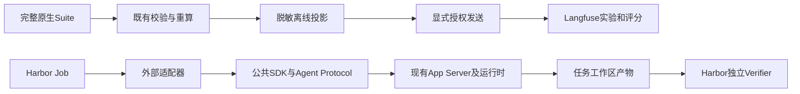

# Langfuse与Harbor首批接入验证

## 1. 交付范围

基于拉取时的origin/main `de1ab2722f91d6109e807617aa1e07c8a502c9e5`，
在`codex/langfuse-harbor-integration`独立工作区实现首批接入。
基线提交不包含本次未提交改动；精确实现身份由[源码摘要](source-sha256.json)记录。
原有工作区和其他开发分支不属于此次修改范围。

已实现完整原生Suite的脱敏导出及显式联网发送；Harbor适配器复用公共Agent Protocol，
没有另建模型循环。Harbor任务结果尚未转换为原生完整Suite，也没有据此声称端到端统一评测已完成。
设计和操作入口见[ADR](../../adr/0109-evaluation-integrations.md)与
[操作说明](../../operations/evaluation-integrations.md)。

## 2. 已验证证据

- 接入专项测试23项通过，覆盖离线不读凭据、保留失败分母、稳定身份与时间、原币种、
  字段白名单、私有文件、真实本机HTTP传输、部分接收、超时、人工交互中止和重复执行防护。
- 隔离的Harbor 0.25.0环境中适配器测试8项通过；验证指令通过文件传递、原生Action配置透传、
  试次身份和用量元数据，以及拒绝无效路径和会被忽略的模型或版本覆盖。
- 最终相关回归1690项通过，适配器8项另外在独立环境验证；不将重叠的专项测试重复计入总数。
  Python类型检查、Ruff静态检查、合同生成、任务包、文档、SBOM及wheel构建检查通过。
  精确命令和版本见[机器验证记录](verification.json)。
- 历史R3完整报告20个试次成功离线投影，源报告SHA-256为
  `72881f59688eb2a0b1fa6eb23bcc6138a4b90cb621a2a09ba1c92677ba240d0a`。
  原文件0644保持原样，只对私有副本执行既有0600 Reader；这是历史结果导出验证，未重新运行模型。
  [脱敏投影样本](langfuse-historical-suite-export.json)保留全部原始分母和未知费用状态。
- 真实Docker、固定镜像摘要、无网络、独立Verifier夹具：
  [Oracle结果](harbor-oracle-result.json)为1，
  [Nop结果](harbor-nop-result.json)为0；各1次、无异常、无重试。
  [Oracle锁](harbor-oracle-lock.json)和[Nop锁](harbor-nop-lock.json)保存Harbor版本及任务摘要。
  最终Verifier逐字节比较产物；早期配置失败和旧夹具运行留在本机临时目录，没有覆盖其Job锁。

Oracle/Nop只证明环境、产物转移和验收正负路径；协议测试使用ScriptedProvider。
二者均不是Harnessix真实模型编码成绩或公开榜单成绩。没有运行付费模型评测、上传Harbor Hub或发布部署。

## 3. 主干门禁现状

探索性全量测试为19993通过、704失败、90错误、152跳过。
从未修改main的git archive快照逐一重放全部794个失败/错误节点，794个均再次出现负结果，
其中703失败、91错误；一个迁移案例在失败和错误之间改变分类。
这不是对main进行完整全量测试，也不能据此宣称全量通过。
[节点、分类与重放方法](main-failure-replay.json)保留可审查记录。

大量失败由本机`/usr/bin/git` 2.24.3不支持`init --object-format`触发；
其余历史事件版本、迁移、Schema测试夹具、回调签名和可读性基线不匹配也在main重现。
全量测试启动后仍有少量接入收尾修改，最终源码的验证结论以1690项相关回归、23项专项和
独立环境8项适配器测试为准；没有把先前全量测试当作最终冻结源码的完整验收。

全局格式门禁的9个文件与未修改main逐字节一致；可读性门禁的28条错误在main快照重现，
当前错误列表与main完全相同。许可证门禁的12个Archive违规也在main快照重现。
没有更新格式、可读性或许可证策略来消除这些已有失败。

Schema生成时同时对齐了main已有的3处产物漂移：anthropic-config、openai-chat-config及
coding-eval-provider-suite-run-config-v2。对应Provider源代码没有改动；
这些文件之外新增了Langfuse导出Schema。产品pyproject.toml与uv.lock没有改动。
Harbor及其传递依赖仅安装在独立环境，根项目SBOM检查不代表这个外部环境也已完成发行审计。

## 4. 继续实施的验收顺序

1. 使用预装产品wheel、原生配置和固定Process Profile的镜像，完成Harnessix适配器的完整容器试次。
   记录成功、任务失败、审批中止、超时和清理证据；不能用Oracle或内存协议测试替代。
2. 在指定Langfuse实例完成真实写入、读回及同身份重发验收，核对实验、试次数、评分和原币种。
   本机HTTP测试只验证传输合同，当前尚无真实服务/UI验收。
3. 冻结Harbor到原生评测证据的映射；保留失败、异常和取消的分母。
   先解决全量Attempt、预算及费用完整性，再发布跨Agent成本比较或批量运行入口。
4. 逐调用实时Trace单独实现，不将Suite聚合Token拆成虚构generation。
   模型、任务、版本、预算与重复次数冻结后，才开展公开评测或真实付费对比。

当前Harbor标准Token及cost_usd保持未知，只展示公共Turn观测值。
turn_terminal_confirmed仅表示观察到协议终态，不能证明物理进程清理。
不自动批准、不自动恢复旧试次；这次接入不改变产品发布结论。

## 谱系说明

本证据对应提交de1ab272的实现。[ADR 0120](../../adr/0120-system-neutral-evaluation-platform.md)
把Langfuse导出与Harbor导入迁出产品包（evalkit与integrations/harnessix_eval），原测试随之迁移，
本文件因此改为historical，related_tests指向迁移后的测试。迁移后的五场景矩阵须在新代码上重跑并另立证据。
