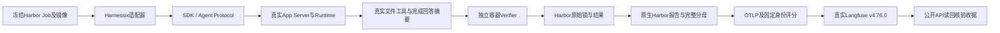

# Langfuse真实服务与Harbor完整容器闭环

## 1. 验收目标与实现边界

本轮完成真实Langfuse写入及公开API读回、Harnessix在Harbor中的完整容器试次，
以及Harbor原始结果到原生报告再到Langfuse的闭环。实现基于main
`de1ab2722f91d6109e807617aa1e07c8a502c9e5`，位于`codex/langfuse-harbor-integration`。
基线提交不包含未提交改动；实施身份以本目录冻结源码摘要和实际wheel/镜像摘要为准。
第一阶段记录仍保留在[v1报告](../langfuse-harbor-2026-11-05-v1/README.md)。

完整容器试次通过真实产品wheel、原生Provider配置、证书校验、App Server、公共SDK、
SQLite Session及read_file执行只读review，之后由新建独立Verifier容器评分。
Provider是容器内确定性HTTPS SSE夹具，不使用ScriptedProvider替代运行时，也不调用付费模型。
这验证集成和治理行为，不证明模型编码质量、真实Token分词、生产修改/测试权限或公开基准水平。

## 2. 受控矩阵与指标口径

| 场景 | 产品/Provider行为 | 独立奖励 | 原生报告归因 |
| --- | --- | --- | --- |
| 正常review | 实际read_file后完成回答 | 1 | passed |
| 错误答案 | Turn完成，回答摘要不符 | 0 | task |
| 审批中止 | 提出写入请求，客户端取消；没有自动批准 | 0 | runtime / intervention_required |
| 超时 | HTTPS请求持续阻塞，预算到期并取消 | 0 | budget / deadline_exceeded |
| Provider故障 | 本地端点返回503，按原生策略处理失败 | 0 | provider |

场景验收完成数与任务得分是不同分母。冻结矩阵5个场景均需满足各自预期；
任务报告完整保留1个通过、4个失败，任务通过率为1/5，不能写成100%编码成功率。
SSE每次回传固定100/20 Token，仅验流转；费用及完整性保持unknown，Harbor标准总用量不补零。
Harbor试次耗时包含环境、安装和验收，不作为纯模型延迟。

## 3. 真实服务验收

Langfuse为本机真实v4.76.0服务，六个镜像固定注册表摘要，Web仅绑定127.0.0.1:3300。
新生成的私有凭据位于工作区外，不写入本目录。重启复用同一组凭据及持久化数据卷。
历史R3报告20个试次、140个评分已真实写入并由公开API读回；
服务重启后只读核验仍得到20/140，没有以补写掩盖数据丢失。
原始历史任务没有重新执行，不将这些评分计为本轮模型实验。

读回逐项核对实验/数据集/根Observation身份、完整分母、评分ID、归属、数值、币种和证据时间。
使用v4实验API，支持空游标页与异步可见性，时间比较容纳不足1毫秒的数据库截断。
整数与布尔元数据可能以规范字符串返回；仅允许精确十进制或JSON true/false，拒绝宽松真值转换。
相同报告补发后再次读回，核对身份和数量不增长，原始Harbor JSON摘要不变化，不重跑Agent。

## 4. 隔离、故障修复与证据保留

镜像准备阶段按uv.lock安装依赖。运行夹具显式配置Docker network_mode:none，
监控实际工作容器镜像及内核网络模式，并核对清理。
本地测试CA只加入验收镜像的信任库；产品保持强制HTTPS和证书校验，宿主信任库没有改动。

本轮发现并修复的边界包括：

- Harbor默认no-network借助出口sidecar实现受控TCP策略，不等于内核none。
  首次监控据此失败并中止；保留该运行，改用官方支持的任务自定义Compose显式固定none，未放宽监控标准。
- Provider分类可能被外层NonZeroAgentExitCodeError覆盖，现保留原生类别，基础设施故障仍优先单列。
- Langfuse v4元数据整数及布尔字符串需要按规范核验；不因收到HTTP成功响应就发布verified。
- 未确认Turn终态时不能声称公共重放完整；公共重放完整也不能推导全量账单完整。
- Job无时区时间要求显式解释；重试运行、额外结果、重复身份和错配冻结配置拒绝发布。

开发探针、首次监控失败和布尔读回失败均留在各自本机运行目录。
最终冻结矩阵使用新目录及新Job，源锁没有被覆盖。原生报告将失败留在分母，
没有把缺失结果、异常或取消过滤成更高任务通过率。

## 5. 冻结版本的最终结果

2026-11-05（America/Los_Angeles）最终运行全部通过，原始UTC时间保留在收据中。
最终Job为`254f28b2-5b4b-4166-a68c-f8d4a29dee4d`，使用全新运行目录。

| 验收项 | 实际结果 | 证据 |
| --- | --- | --- |
| 五场景容器矩阵 | 5/5场景满足预期；任务评分1/5，4个失败完整保留 | [总收据](acceptance.json)、[原生报告](native-report.json) |
| 镜像和物理网络 | 实测10个工作/Verifier容器，全部为固定image ID及network_mode:none；工作容器与出口sidecar已清理 | [容器证据](container-evidence.json)、[镜像构建收据](native-image.json) |
| Harbor到原生报告 | 冻结槽位、任务与执行身份核对通过；源JSON补发前后摘要不变 | [原生报告](native-report.json)、[原始文件摘要](acceptance.json) |
| Langfuse写入与补发 | 两次各读回5个试次/25个评分，实验与数据集身份相同；额外GET-only核验仍为5/25 | [投影](langfuse-export.json)、[写入读回](langfuse-readback.json)、[最终只读核验](native-readonly-readback.json) |
| 历史证据持久化 | 真实历史20个试次/140个评分；重启后及最终GET-only核验均通过，没有重跑历史任务 | [重启后核验](historical-post-restart-readback.json)、[最终历史核验](historical-current-readback.json) |
| 相关回归 | 1,721 passed，零失败/错误/跳过；Harbor独立环境另有8 passed | [回归JUnit](regression-junit.xml)、[Harbor JUnit](harbor-adapter-junit.xml) |
| 静态与供应链检查 | lint、变更文件格式、543个源码文件类型检查、Schema、Task Pack、SBOM及Secret检查通过 | [核验汇总](verification.json) |

最终Langfuse实验ID为`271427d7187f0642151af22ef6c6e9cbdd74ac1e4fadd88d5d8e0324a6eaf06a`。
原生报告规范内容摘要为`ada9f574ad15b3ca3bfc674f69d6e466910b4f8be40ee31e891af95d84cc3a6f`；
这与JSON文件的原始字节摘要分开记录。

[冻结源码清单](frozen-source.json)覆盖963个文件，实施指纹为
`f82a82963c2816b7949eed7f95da5f1d46781902edea07791e8c3f3c7427fa85`。
实际运行wheel的SHA256为`a8fc3c16d84eb5c8d82bb932b561804bf975f8d8c1cea4900e938968e6fbd8d3`，
再次从冻结源码构建得到相同摘要；[Langfuse镜像锁](langfuse-images.json)固定六个服务镜像。
工作区仍为未提交改动，没有把main基线提交冒充实施提交，也没有合并到main。
[本目录制品摘要](artifact-sha256.json)用于验证归档完整性，不包含该摘要清单自身。

仓库全局门禁仍存在main原有9个格式问题、28个可读性错误和12个Archive许可证违规；
与原基线逐项比较没有新增，详见[基线比对](baseline-comparison.json)。
第一阶段的全量测试负例均在未修改main快照复现；本轮没有重新声称全量仓库测试通过。
聚焦测试包含在上述1,721项中，不重复累计。

## 6. 复验及后续边界

命令、私有状态位置、报告合同及操作顺序见[操作说明](../../operations/evaluation-integrations.md)。
真实服务的传输和数据核验与浏览器界面截图分开，本轮以公开API实际结果为准。
真实付费模型质量、公开基准、逐调用实时Trace、全量账单和生产无人值守权限策略另行验收。
此次接入不改变1.0发布结论；主干既有格式、可读性及许可证门禁问题仍按原记录保留。
